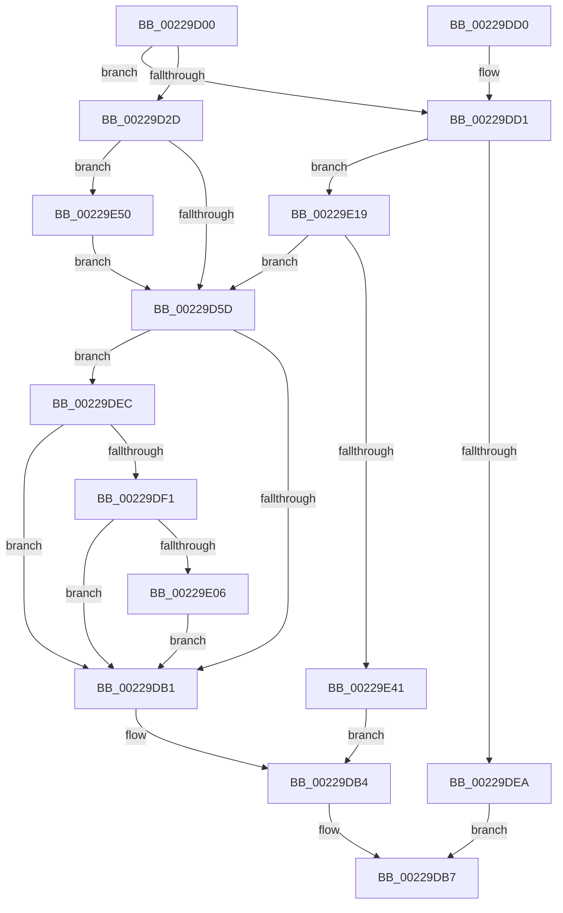

# MiMapSinglePage

- RVA: `0x00229D00`–`0x00229E6D` (길이 `365` bytes)
- VA: `0x0000000140229D00`
- 실행 섹션: `.text`
- PDB 이름 있음: `예`; PDB Function 태그: `아니요`
- unwind 정보 RVA: `0x0005FD1C`
- 디코드: `92`개 명령, `365/365` bytes 표시
- 미해석 바이트: `0` (있으면 어셈블리에 `.byte`로 보존)

> 이 문서는 커널 이미지의 기계어와 PDB 기호를 분석해 생성했습니다. 4번과 5번은 함수 원형과 자료형을 바이너리 사용 방식에서 추정한 C 해석이며 원본 소스 복구 결과는 아닙니다.

## 1. Dependencies

- 직접 호출 지점: **5**; 고유 호출 대상: **5**
- 직접 호출자로 확인된 함수: **7**
- RIP 상대 이미지 참조: **3**

### Outgoing calls
- `0x00229D8B` → [MiMakeProtectionPfnCompatible](MiMakeProtectionPfnCompatible_function_00229CD0.md) (function, `0x00229CD0`)
- `0x00229D9E` → [MiMakeValidPte](../2C/MiMakeValidPte_function_002C5590.md) (function, `0x002C5590`)
- `0x00229DDD` → [MiReservePtes](../31/MiReservePtes_function_00318D20.md) (function, `0x00318D20`)
- `0x00229E12` → [MiCheckLinearProtectedPteAccessedBit](../29/MiCheckLinearProtectedPteAccessedBit_function_00292D80.md) (function, `0x00292D80`)
- `0x00229E63` → [MiFlushSingleTbEntry](../28/MiFlushSingleTbEntry_function_0028E730.md) (function, `0x0028E730`)

### Direct callers
- [MiCombineWithStandbyExisting](MiCombineWithStandbyExisting_function_00229E74.md) at `0x0022A093`
- [MiCombineWithExisting](MiCombineWithExisting_function_0022B4B8.md) at `0x0022B5D4`
- [MiCombineWithExisting](MiCombineWithExisting_function_0022B4B8.md) at `0x0022B5EF`
- [MiCombineInitialInstance](MiCombineInitialInstance_function_0022BC0C.md) at `0x0022BDFF`
- [MiCombineInitialInstance](MiCombineInitialInstance_function_0022BC0C.md) at `0x0022BED8`
- [MiCopyDataPageToImagePage](../2A/MiCopyDataPageToImagePage_function_002AE818.md) at `0x002AEAB7`
- [MiCopyDataPageToImagePage](../2A/MiCopyDataPageToImagePage_function_002AE818.md) at `0x002AEB0E`
- [MiUpdateForkMaps](../../page/A7/MiUpdateForkMaps_function_00A7DAF8.md) at `0x00A7DCA6`
- [MiUpdateForkMaps](../../page/A7/MiUpdateForkMaps_function_00A7DAF8.md) at `0x00A7DD3B`
- [MiInitializeForkMaps](../../page/AD/MiInitializeForkMaps_function_00AD4A40.md) at `0x00AD4AD0`
- [MmInitializeImageViewExtensionCfg](../../init/C6/MmInitializeImageViewExtensionCfg_function_00C64FC4.md) at `0x00C65203`

### Static image references
- `0x00229DA3` → RVA `0x00FC6A88` (`ALMOSTRO`; read)
- `0x00229DD6` → RVA `0x00E37668` (`.data`; read)
- `0x00229E41` → RVA `0x00010880` (`.rdata`; read)

## 2. Other-region calls and transfers

- 다른 실행 섹션으로 향하는 call: **0**
- 별도 외부 분기/꼬리 이동을 확인하지 못했습니다.

## 3. Assembly (complete function range)

```asm
00229D00  48 89 5C 24 10                  mov qword ptr [rsp + 0x10], rbx
00229D05  48 89 6C 24 18                  mov qword ptr [rsp + 0x18], rbp
00229D0A  48 89 74 24 20                  mov qword ptr [rsp + 0x20], rsi
00229D0F  57                              push rdi
00229D10  41 56                           push r14
00229D12  41 57                           push r15
00229D14  48 83 EC 30                     sub rsp, 0x30
00229D18  41 8B D9                        mov ebx, r9d
00229D1B  45 8B F0                        mov r14d, r8d
00229D1E  4C 8B FA                        mov r15, rdx
00229D21  48 8B F1                        mov rsi, rcx
00229D24  48 85 C9                        test rcx, rcx
00229D27  0F 84 A4 00 00 00               je 0x140229dd1
00229D2D  48 8B F9                        mov rdi, rcx
00229D30  48 BD 00 00 00 00 80 F6 FF FF   movabs rbp, 0xfffff68000000000
00229D3A  48 C1 EF 09                     shr rdi, 9
00229D3E  48 B8 F8 FF FF FF 7F 00 00 00   movabs rax, 0x7ffffffff8
00229D48  48 23 F8                        and rdi, rax
00229D4B  48 8B C5                        mov rax, rbp
00229D4E  48 03 F8                        add rdi, rax
00229D51  48 8B 07                        mov rax, qword ptr [rdi]
00229D54  48 85 C0                        test rax, rax
00229D57  0F 85 F3 00 00 00               jne 0x140229e50
00229D5D  41 8B C6                        mov eax, r14d
00229D60  4B 8D 14 7F                     lea rdx, [r15 + r15*2]
00229D64  C1 F8 1F                        sar eax, 0x1f
00229D67  83 E0 FD                        and eax, 0xfffffffd
00229D6A  48 C1 E2 04                     shl rdx, 4
00229D6E  83 C0 04                        add eax, 4
00229D71  48 B9 00 00 00 00 00 DE FF FF   movabs rcx, 0xffffde0000000000
00229D7B  48 03 D1                        add rdx, rcx
00229D7E  8B C8                           mov ecx, eax
00229D80  83 C9 02                        or ecx, 2
00229D83  41 0F BA E6 1E                  bt r14d, 0x1e
00229D88  0F 42 C8                        cmovb ecx, eax
00229D8B  E8 40 FF FF FF                  call 0x140229cd0
00229D90  0D 00 00 00 A0                  or eax, 0xa0000000
00229D95  49 8B D7                        mov rdx, r15
00229D98  44 8B C0                        mov r8d, eax
00229D9B  48 8B CF                        mov rcx, rdi
00229D9E  E8 ED B7 09 00                  call 0x1402c5590
00229DA3  48 0F BA 25 DC CC D9 00 24      bt qword ptr [rip + 0xd9ccdc], 0x24
00229DAC  48 8B D8                        mov rbx, rax
00229DAF  72 3B                           jb 0x140229dec
00229DB1  48 89 1F                        mov qword ptr [rdi], rbx
00229DB4  48 8B C6                        mov rax, rsi
00229DB7  48 8B 5C 24 58                  mov rbx, qword ptr [rsp + 0x58]
00229DBC  48 8B 6C 24 60                  mov rbp, qword ptr [rsp + 0x60]
00229DC1  48 8B 74 24 68                  mov rsi, qword ptr [rsp + 0x68]
00229DC6  48 83 C4 30                     add rsp, 0x30
00229DCA  41 5F                           pop r15
00229DCC  41 5E                           pop r14
00229DCE  5F                              pop rdi
00229DCF  C3                              ret
00229DD0  CC                              int3
00229DD1  BA 01 00 00 00                  mov edx, 1
00229DD6  48 8D 0D 8B D8 C0 00            lea rcx, [rip + 0xc0d88b]
00229DDD  E8 3E EF 0E 00                  call 0x140318d20
00229DE2  48 8B F8                        mov rdi, rax
00229DE5  48 85 C0                        test rax, rax
00229DE8  75 2F                           jne 0x140229e19
00229DEA  EB CB                           jmp 0x140229db7
00229DEC  F6 C3 20                        test bl, 0x20
00229DEF  75 C0                           jne 0x140229db1
00229DF1  48 8B C5                        mov rax, rbp
00229DF4  48 B9 00 00 00 00 40 00 00 00   movabs rcx, 0x4000000000
00229DFE  48 03 C1                        add rax, rcx
00229E01  48 3B F8                        cmp rdi, rax
00229E04  72 AB                           jb 0x140229db1
00229E06  41 B8 80 00 00 00               mov r8d, 0x80
00229E0C  48 8B D3                        mov rdx, rbx
00229E0F  48 8B CF                        mov rcx, rdi
00229E12  E8 69 8F 06 00                  call 0x140292d80
00229E17  EB 98                           jmp 0x140229db1
00229E19  48 8B F7                        mov rsi, rdi
00229E1C  48 BD 00 00 00 00 80 F6 FF FF   movabs rbp, 0xfffff68000000000
00229E26  48 C1 E6 19                     shl rsi, 0x19
00229E2A  48 8B C5                        mov rax, rbp
00229E2D  48 C1 E0 19                     shl rax, 0x19
00229E31  48 2B F0                        sub rsi, rax
00229E34  48 C1 FE 10                     sar rsi, 0x10
00229E38  F6 C3 02                        test bl, 2
00229E3B  0F 84 1C FF FF FF               je 0x140229d5d
00229E41  48 8B 05 38 6A DE FF            mov rax, qword ptr [rip - 0x2195c8]
00229E48  48 89 07                        mov qword ptr [rdi], rax
00229E4B  E9 64 FF FF FF                  jmp 0x140229db4
00229E50  48 8B 05 29 6A DE FF            mov rax, qword ptr [rip - 0x2195d7]
00229E57  BA 02 00 00 00                  mov edx, 2
00229E5C  48 89 07                        mov qword ptr [rdi], rax
00229E5F  44 8D 42 FF                     lea r8d, [rdx - 1]
00229E63  E8 C8 48 06 00                  call 0x14028e730
00229E68  E9 F0 FE FF FF                  jmp 0x140229d5d
```

## 4. C-style interpretation (structured pseudocode)

```c
__int64 __fastcall MiMapSinglePage(__int64 a1, __int64 a2, int a3, int a4)
{
    __int64 result;
    __int64 v_rdi;
    __int64 v_rsi;
    __int64 v_rsp;
    unsigned __int64 v_stack_p10;
    unsigned __int64 v_stack_p18;
    unsigned __int64 v_stack_p20;

    v_stack_p10 = v_rbx;
    v_stack_p18 = v_rbp;
    v_stack_p20 = v_rsi;
    v_rsp = (v_rsp) - (48);
    if (a1 == 0) goto loc_00229DD1;
    v_rdi = (a1) >> (9);
    v_rdi = (v_rdi) & (result);
    v_rdi = (v_rdi) + (v_rbp);
    if (*(unsigned __int64 *)(v_rdi) != 0) goto loc_00229E50;
loc_00229D5D:
    result = (unsigned int)(((unsigned int)((unsigned int)((unsigned int)(a3)))) >> (31));
    result = (unsigned int)((result) & (0xFFFFFFFDULL));
    a2 = (a2 + a2 * 2) << (4);
    result = (unsigned int)((result) + (4));
    a2 = (a2) + (a1);
    a1 = (unsigned int)(((unsigned int)((unsigned int)(result))) | (2));
    if (condition_is_below) { a1 = (unsigned int)(result); }
    result = MiMakeProtectionPfnCompatible(a1, a2, a3, a4);
    result = (unsigned int)((result) | (0xA0000000ULL));
    result = MiMakeValidPte(v_rdi, a2, (unsigned int)((unsigned int)(result)), a4);
    if (condition_is_below) goto loc_00229DEC;
loc_00229DB1:
    *(unsigned __int64 *)(v_rdi) = result;
loc_00229DB4:
loc_00229DB7:
    v_rsp = (v_rsp) + (48);
    return a1;
loc_00229DD1:
    result = MiReservePtes(v_rip + 12638347, 1, (unsigned int)((unsigned int)(result)), a4);
    if (result != 0) goto loc_00229E19;
    goto loc_00229DB7;
loc_00229DEC:
    if ((((unsigned __int8)(v_stack_p10)) & (32)) != 0) goto loc_00229DB1;
    result = (v_stack_p18) + (v_rip + 12638347);
    if (result < result) goto loc_00229DB1;
    result = MiCheckLinearProtectedPteAccessedBit(result, v_stack_p10, 128, a4);
    goto loc_00229DB1;
loc_00229E19:
    v_rsi = (result) << (25);
    result = (v_stack_p18) << (25);
    v_rsi = (v_rsi) - (result);
    v_rsi = (v_rsi) >> (16);
    if ((((unsigned __int8)(v_stack_p10)) & (2)) == 0) goto loc_00229D5D;
    *(unsigned __int64 *)(result) = *(unsigned __int64 *)(v_rip - 2201032);
    goto loc_00229DB4;
loc_00229E50:
    *(unsigned __int64 *)(result) = *(unsigned __int64 *)(v_rip - 2201047);
    result = MiFlushSingleTbEntry(result, 2, 2 - 1, a4);
    goto loc_00229D5D;
}
```

## 5. (Beta) C Style

```c
int64_t MiMapSinglePage(int64_t Arg1, void *Arg2, int32_t Arg3, int32_t Arg4)
{
    uint8_t *arg2 = (uint8_t *)Arg2;

    int64_t result;
    int64_t local_rdi;
    int64_t local_rsi;
    int64_t local_rsp;
    uint64_t v_stack_p10;
    uint64_t v_stack_p18;
    uint64_t v_stack_p20;

    v_stack_p10 = local_rbx;
    v_stack_p18 = local_rbp;
    v_stack_p20 = local_rsi;
    local_rsp = (local_rsp) - (48);
    if (Arg1 == 0) goto loc_00229DD1;
    local_rdi = (Arg1) >> (9);
    local_rdi = (local_rdi) & (result);
    local_rdi = (local_rdi) + (local_rbp);
    if (*(uint64_t *)(local_rdi) != 0) goto loc_00229E50;
loc_00229D5D:
    result = (uint32_t)(((uint32_t)((uint32_t)((uint32_t)(Arg3)))) >> (31));
    result = (uint32_t)((result) & (0xFFFFFFFDULL));
    Arg2 = (Arg2 + Arg2 * 2) << (4);
    result = (uint32_t)((result) + (4));
    Arg2 = (Arg2) + (Arg1);
    Arg1 = (uint32_t)(((uint32_t)((uint32_t)(result))) | (2));
    if (condition_is_below) { Arg1 = (uint32_t)(result); }
    result = MiMakeProtectionPfnCompatible(Arg1, Arg2, Arg3, Arg4);
    result = (uint32_t)((result) | (0xA0000000ULL));
    result = MiMakeValidPte(local_rdi, Arg2, (uint32_t)((uint32_t)(result)), Arg4);
    if (condition_is_below) goto loc_00229DEC;
loc_00229DB1:
    *(uint64_t *)(local_rdi) = result;
loc_00229DB4:
loc_00229DB7:
    local_rsp = (local_rsp) + (48);
    return Arg1;
loc_00229DD1:
    result = MiReservePtes(v_rip + 12638347, 1, (uint32_t)((uint32_t)(result)), Arg4);
    if (result != 0) goto loc_00229E19;
    goto loc_00229DB7;
loc_00229DEC:
    if ((((uint8_t)(v_stack_p10)) & (32)) != 0) goto loc_00229DB1;
    result = (v_stack_p18) + (v_rip + 12638347);
    if (result < result) goto loc_00229DB1;
    result = MiCheckLinearProtectedPteAccessedBit(result, v_stack_p10, 128, Arg4);
    goto loc_00229DB1;
loc_00229E19:
    local_rsi = (result) << (25);
    result = (v_stack_p18) << (25);
    local_rsi = (local_rsi) - (result);
    local_rsi = (local_rsi) >> (16);
    if ((((uint8_t)(v_stack_p10)) & (2)) == 0) goto loc_00229D5D;
    *(uint64_t *)(result) = *(uint64_t *)(v_rip - 0x2195C8);
    goto loc_00229DB4;
loc_00229E50:
    *(uint64_t *)(result) = *(uint64_t *)(v_rip - 0x2195D7);
    result = MiFlushSingleTbEntry(result, 2, 2 - 1, Arg4);
    goto loc_00229D5D;
}
```

### 관측된 메모리 오프셋

구조체 형식이 확인되지 않은 접근은 인자 기준의 오프셋으로만 기록했습니다.

| 기준 인자 | 오프셋 표현 | 폭 (bit) | 접근 |
|---|---:|---:|---|
| `Arg2` | `+ 0x0 + r15*2` | `64` | `R` |

## 6. Execution-region graph

[열기: 2D/3D 그래프와 함수 탐색 컨트롤 패널](../../../control-panel.html?section=text&rva=0x00229D00&view=graph)

- 2D 그래프는 위에서 아래로 흐르고, 3D 그래프는 빈 공간을 드래그해 회전합니다. Shift+드래그는 이동, 휠은 확대·축소, 함수 노드 선택은 대상 보고서 이동입니다.

### Static fallback


