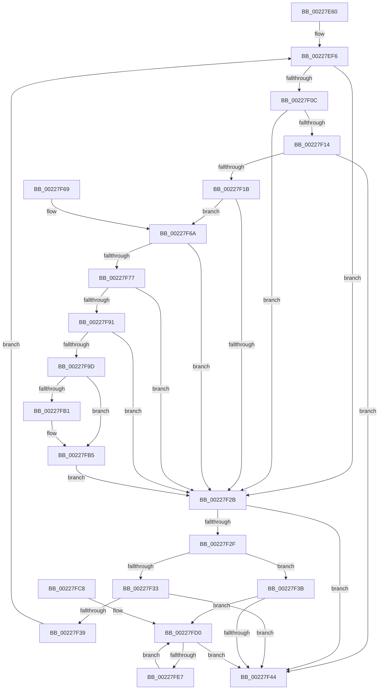

# MiMappingHasIoTracker

- RVA: `0x00227E60`–`0x00227FE9` (길이 `393` bytes)
- VA: `0x0000000140227E60`
- 실행 섹션: `.text`
- PDB 이름 있음: `예`; PDB Function 태그: `아니요`
- unwind 정보 RVA: `0x0005FBCC`
- 디코드: `100`개 명령, `393/393` bytes 표시
- 미해석 바이트: `0` (있으면 어셈블리에 `.byte`로 보존)

> 이 문서는 커널 이미지의 기계어와 PDB 기호를 분석해 생성했습니다. 4번과 5번은 함수 원형과 자료형을 바이너리 사용 방식에서 추정한 C 해석이며 원본 소스 복구 결과는 아닙니다.

## 1. Dependencies

- 직접 호출 지점: **0**; 고유 호출 대상: **0**
- 직접 호출자로 확인된 함수: **1**
- RIP 상대 이미지 참조: **1**

### Outgoing calls
- 직접 디코드된 call 명령이 없습니다.

### Direct callers
- [MmProtectMdlSystemAddress](MmProtectMdlSystemAddress_function_00227B50.md) at `0x00227CD0`

### Static image references
- `0x00227F6A` → RVA `0x00FC6A88` (`ALMOSTRO`; read)

## 2. Other-region calls and transfers

- 다른 실행 섹션으로 향하는 call: **0**
- 별도 외부 분기/꼬리 이동을 확인하지 못했습니다.

## 3. Assembly (complete function range)

```asm
00227E60  48 89 5C 24 08                  mov qword ptr [rsp + 8], rbx
00227E65  48 89 6C 24 10                  mov qword ptr [rsp + 0x10], rbp
00227E6A  48 89 74 24 18                  mov qword ptr [rsp + 0x18], rsi
00227E6F  48 89 7C 24 20                  mov qword ptr [rsp + 0x20], rdi
00227E74  41 56                           push r14
00227E76  48 83 EC 20                     sub rsp, 0x20
00227E7A  48 C1 E9 09                     shr rcx, 9
00227E7E  49 BE F8 FF FF FF 7F 00 00 00   movabs r14, 0x7ffffffff8
00227E88  49 23 CE                        and rcx, r14
00227E8B  48 BD 00 00 00 00 80 F6 FF FF   movabs rbp, 0xfffff68000000000
00227E95  48 8B C5                        mov rax, rbp
00227E98  4C 8D 04 01                     lea r8, [rcx + rax]
00227E9C  41 BB 04 00 00 00               mov r11d, 4
00227EA2  49 8B C8                        mov rcx, r8
00227EA5  4C 89 04 24                     mov qword ptr [rsp], r8
00227EA9  48 C1 E9 09                     shr rcx, 9
00227EAD  49 23 CE                        and rcx, r14
00227EB0  48 8B C5                        mov rax, rbp
00227EB3  48 03 C8                        add rcx, rax
00227EB6  48 89 4C 24 08                  mov qword ptr [rsp + 8], rcx
00227EBB  48 C1 E9 09                     shr rcx, 9
00227EBF  49 23 CE                        and rcx, r14
00227EC2  48 8B C5                        mov rax, rbp
00227EC5  48 03 C8                        add rcx, rax
00227EC8  48 89 4C 24 10                  mov qword ptr [rsp + 0x10], rcx
00227ECD  48 C1 E9 09                     shr rcx, 9
00227ED1  49 23 CE                        and rcx, r14
00227ED4  48 8B C5                        mov rax, rbp
00227ED7  48 03 C8                        add rcx, rax
00227EDA  48 BE 00 D0 BE 7D FB F6 FF FF   movabs rsi, 0xfffff6fb7dbed000
00227EE4  48 89 4C 24 18                  mov qword ptr [rsp + 0x18], rcx
00227EE9  41 8B DB                        mov ebx, r11d
00227EEC  48 BF F8 D7 BE 7D FB F6 FF FF   movabs rdi, 0xfffff6fb7dbed7f8
00227EF6  4C 8B 54 DC F8                  mov r10, qword ptr [rsp + rbx*8 - 8]
00227EFB  48 FF CB                        dec rbx
00227EFE  41 FF CB                        dec r11d
00227F01  49 8B 02                        mov rax, qword ptr [r10]
00227F04  48 8B CE                        mov rcx, rsi
00227F07  4C 3B D1                        cmp r10, rcx
00227F0A  72 1F                           jb 0x140227f2b
00227F0C  48 8B CF                        mov rcx, rdi
00227F0F  4C 3B D1                        cmp r10, rcx
00227F12  77 17                           ja 0x140227f2b
00227F14  48 8B C8                        mov rcx, rax
00227F17  A8 01                           test al, 1
00227F19  74 29                           je 0x140227f44
00227F1B  A8 42                           test al, 0x42
00227F1D  41 0F 95 C1                     setne r9b
00227F21  A8 20                           test al, 0x20
00227F23  0F 95 C2                        setne dl
00227F26  44 84 CA                        test dl, r9b
00227F29  74 3F                           je 0x140227f6a
00227F2B  A8 01                           test al, 1
00227F2D  74 15                           je 0x140227f44
00227F2F  84 C0                           test al, al
00227F31  78 08                           js 0x140227f3b
00227F33  48 83 FB 01                     cmp rbx, 1
00227F37  74 0B                           je 0x140227f44
00227F39  EB BB                           jmp 0x140227ef6
00227F3B  45 85 DB                        test r11d, r11d
00227F3E  0F 85 8C 00 00 00               jne 0x140227fd0
00227F44  49 8B 00                        mov rax, qword ptr [r8]
00227F47  48 8B 5C 24 30                  mov rbx, qword ptr [rsp + 0x30]
00227F4C  48 8B 6C 24 38                  mov rbp, qword ptr [rsp + 0x38]
00227F51  48 8B 74 24 40                  mov rsi, qword ptr [rsp + 0x40]
00227F56  48 8B 7C 24 48                  mov rdi, qword ptr [rsp + 0x48]
00227F5B  48 C1 E8 09                     shr rax, 9
00227F5F  83 E0 01                        and eax, 1
00227F62  48 83 C4 20                     add rsp, 0x20
00227F66  41 5E                           pop r14
00227F68  C3                              ret
00227F69  CC                              int3
00227F6A  48 F7 05 13 EB D9 00 00 00 60 00  test qword ptr [rip + 0xd9eb13], 0x600000
00227F75  74 B4                           je 0x140227f2b
00227F77  65 48 8B 14 25 88 01 00 00      mov rdx, qword ptr gs:[0x188]
00227F80  4C 8B 8A B8 00 00 00            mov r9, qword ptr [rdx + 0xb8]
00227F87  41 80 B9 60 01 00 00 01         cmp byte ptr [r9 + 0x160], 1
00227F8F  74 9A                           je 0x140227f2b
00227F91  49 8B 91 08 05 00 00            mov rdx, qword ptr [r9 + 0x508]
00227F98  48 85 D2                        test rdx, rdx
00227F9B  74 8E                           je 0x140227f2b
00227F9D  49 C1 EA 03                     shr r10, 3
00227FA1  41 81 E2 FF 01 00 00            and r10d, 0x1ff
00227FA8  4A 8B 14 D2                     mov rdx, qword ptr [rdx + r10*8]
00227FAC  F6 C2 20                        test dl, 0x20
00227FAF  74 04                           je 0x140227fb5
00227FB1  48 83 C9 20                     or rcx, 0x20
00227FB5  48 8B C1                        mov rax, rcx
00227FB8  48 83 C8 42                     or rax, 0x42
00227FBC  F6 C2 42                        test dl, 0x42
00227FBF  48 0F 44 C1                     cmove rax, rcx
00227FC3  E9 63 FF FF FF                  jmp 0x140227f2b
00227FC8  0F 1F 84 00 00 00 00 00         nop dword ptr [rax + rax]
00227FD0  49 C1 E8 09                     shr r8, 9
00227FD4  4D 23 C6                        and r8, r14
00227FD7  48 8B C5                        mov rax, rbp
00227FDA  4C 03 C0                        add r8, rax
00227FDD  41 83 C3 FF                     add r11d, -1
00227FE1  0F 84 5D FF FF FF               je 0x140227f44
00227FE7  EB E7                           jmp 0x140227fd0
```

## 4. C-style interpretation (structured pseudocode)

```c
__int64 __fastcall MiMappingHasIoTracker(__int64 a1)
{
    __int64 result;
    __int64 v_r10;
    __int64 v_r11;
    __int64 v_rbx;
    __int64 v_rsp;
    unsigned __int64 v_stack_m10;
    unsigned __int64 v_stack_m18;
    unsigned __int64 v_stack_m20;
    unsigned __int64 v_stack_m28;
    unsigned __int64 v_stack_p10;
    unsigned __int64 v_stack_p18;
    unsigned __int64 v_stack_p20;
    unsigned __int64 v_stack_p8;

    v_stack_p8 = v_rbx;
    v_stack_p10 = v_rbp;
    v_stack_p18 = v_rsi;
    v_stack_p20 = v_rdi;
    v_rsp = (v_rsp) - (32);
    a1 = (a1) >> (9);
    a1 = (a1) & (v_r14);
    v_stack_m28 = a1 + v_rbp * 1;
    a1 = (a1 + v_rbp * 1) >> (9);
    a1 = (a1) & (v_r14);
    a1 = (a1) + (v_rbp);
    v_stack_m20 = a1;
    a1 = (a1) >> (9);
    a1 = (a1) & (v_r14);
    a1 = (a1) + (v_rbp);
    v_stack_m18 = a1;
    a1 = (a1) >> (9);
    a1 = (a1) & (v_r14);
    a1 = (a1) + (v_rbp);
    v_stack_m10 = a1;
loc_00227EF6:
    v_rbx = (4) - 1;
    v_r11 = (unsigned int)((4) - 1);
    if ((*(unsigned __int64 *)(v_rsp + 4 * 8 - 8)) < v_rsi) goto loc_00227F2B;
    if ((*(unsigned __int64 *)(v_rsp + 4 * 8 - 8)) > v_rdi) goto loc_00227F2B;
    if ((((unsigned __int8)(*(unsigned __int64 *)(*(unsigned __int64 *)(v_rsp + 4 * 8 - 8)))) & (1)) == 0) goto loc_00227F44;
    a4 = ((((unsigned __int8)(*(unsigned __int64 *)(*(unsigned __int64 *)(v_rsp + 4 * 8 - 8)))) & (66)) != 0) ? 1 : 0;
    a2 = ((((unsigned __int8)(*(unsigned __int64 *)(*(unsigned __int64 *)(v_rsp + 4 * 8 - 8)))) & (32)) != 0) ? 1 : 0;
    if ((((unsigned __int8)(a2)) & ((unsigned __int8)(a4))) == 0) goto loc_00227F6A;
loc_00227F2B:
    if ((((unsigned __int8)(*(unsigned __int64 *)(*(unsigned __int64 *)(v_rsp + 4 * 8 - 8)))) & (1)) == 0) goto loc_00227F44;
    if (sign_flag) goto loc_00227F3B;
    if (v_rbx == 1) goto loc_00227F44;
    goto loc_00227EF6;
loc_00227F3B:
    if ((unsigned int)(v_r11) != 0) goto loc_00227FD0;
loc_00227F44:
    result = (*(unsigned __int64 *)(a1 + v_rbp * 1)) >> (9);
    result = (unsigned int)((result) & (1));
    v_rsp = (v_rsp) + (32);
    return result;
loc_00227F6A:
    if (((*(unsigned __int64 *)(v_rip + 14281491)) & (0x600000ULL)) == 0) goto loc_00227F2B;
    if ((*(unsigned __int8 *)(*(unsigned __int64 *)(*(unsigned __int64 *)(gs_base + (0 + 392)) + 184) + 352)) == 1) goto loc_00227F2B;
    if (*(unsigned __int64 *)(*(unsigned __int64 *)(*(unsigned __int64 *)(gs_base + (0 + 392)) + 184) + 1288) == 0) goto loc_00227F2B;
    v_r10 = (*(unsigned __int64 *)(v_rsp + 4 * 8 - 8)) >> (3);
    v_r10 = (unsigned int)((v_r10) & (511));
    if ((((unsigned __int8)(*(unsigned __int64 *)(*(unsigned __int64 *)(*(unsigned __int64 *)(*(unsigned __int64 *)(gs_base + (0 + 392)) + 184) + 1288) + v_r10 * 8))) & (32)) != 0) {
        a1 = (*(unsigned __int64 *)(*(unsigned __int64 *)(v_rsp + 4 * 8 - 8))) | (32);
    }
    result = (a1) | (66);
    if ((((unsigned __int8)(*(unsigned __int64 *)(*(unsigned __int64 *)(*(unsigned __int64 *)(*(unsigned __int64 *)(gs_base + (0 + 392)) + 184) + 1288) + v_r10 * 8))) & (66)) == 0) { result = a1; }
    goto loc_00227F2B;
loc_00227FD0:
    a3 = (a1 + v_rbp * 1) >> (9);
    a3 = (a3) & (v_r14);
    a3 = (a3) + (v_stack_p10);
    v_r11 = (unsigned int)((v_r11) + (-1));
    if (condition_is_equal) goto loc_00227F44;
    goto loc_00227FD0;
}
```

## 5. (Beta) C Style

```c
int64_t MiMappingHasIoTracker(int64_t Arg1)
{
    int64_t result;
    int64_t local_r10;
    int64_t local_r11;
    int64_t local_rbx;
    int64_t local_rsp;
    uint64_t v_stack_m10;
    uint64_t v_stack_m18;
    uint64_t v_stack_m20;
    uint64_t v_stack_m28;
    uint64_t v_stack_p10;
    uint64_t v_stack_p18;
    uint64_t v_stack_p20;
    uint64_t v_stack_p8;

    v_stack_p8 = local_rbx;
    v_stack_p10 = local_rbp;
    v_stack_p18 = local_rsi;
    v_stack_p20 = local_rdi;
    local_rsp = (local_rsp) - (32);
    Arg1 = (Arg1) >> (9);
    Arg1 = (Arg1) & (local_r14);
    v_stack_m28 = Arg1 + local_rbp * 1;
    Arg1 = (Arg1 + local_rbp * 1) >> (9);
    Arg1 = (Arg1) & (local_r14);
    Arg1 = (Arg1) + (local_rbp);
    v_stack_m20 = Arg1;
    Arg1 = (Arg1) >> (9);
    Arg1 = (Arg1) & (local_r14);
    Arg1 = (Arg1) + (local_rbp);
    v_stack_m18 = Arg1;
    Arg1 = (Arg1) >> (9);
    Arg1 = (Arg1) & (local_r14);
    Arg1 = (Arg1) + (local_rbp);
    v_stack_m10 = Arg1;
loc_00227EF6:
    local_rbx = (4) - 1;
    local_r11 = (uint32_t)((4) - 1);
    if ((*(uint64_t *)(local_rsp + 0x4 * 8 - 0x8)) < local_rsi) goto loc_00227F2B;
    if ((*(uint64_t *)(local_rsp + 0x4 * 8 - 0x8)) > local_rdi) goto loc_00227F2B;
    if ((((uint8_t)(*(uint64_t *)(*(uint64_t *)(local_rsp + 0x4 * 8 - 0x8)))) & (1)) == 0) goto loc_00227F44;
    a4 = ((((uint8_t)(*(uint64_t *)(*(uint64_t *)(local_rsp + 0x4 * 8 - 0x8)))) & (66)) != 0) ? 1 : 0;
    a2 = ((((uint8_t)(*(uint64_t *)(*(uint64_t *)(local_rsp + 0x4 * 8 - 0x8)))) & (32)) != 0) ? 1 : 0;
    if ((((uint8_t)(a2)) & ((uint8_t)(a4))) == 0) goto loc_00227F6A;
loc_00227F2B:
    if ((((uint8_t)(*(uint64_t *)(*(uint64_t *)(local_rsp + 0x4 * 8 - 0x8)))) & (1)) == 0) goto loc_00227F44;
    if (sign_flag) goto loc_00227F3B;
    if (local_rbx == 1) goto loc_00227F44;
    goto loc_00227EF6;
loc_00227F3B:
    if ((uint32_t)(local_r11) != 0) goto loc_00227FD0;
loc_00227F44:
    result = (*(uint64_t *)(Arg1 + local_rbp * 1)) >> (9);
    result = (uint32_t)((result) & (1));
    local_rsp = (local_rsp) + (32);
    return result;
loc_00227F6A:
    if (((*(uint64_t *)(v_rip + 0xD9EB13)) & (0x600000ULL)) == 0) goto loc_00227F2B;
    if ((*(uint8_t *)(*(uint64_t *)(*(uint64_t *)(gs_base + (0 + 0x188)) + 0xB8) + 0x160)) == 1) goto loc_00227F2B;
    if (*(uint64_t *)(*(uint64_t *)(*(uint64_t *)(gs_base + (0 + 0x188)) + 0xB8) + 0x508) == 0) goto loc_00227F2B;
    local_r10 = (*(uint64_t *)(local_rsp + 0x4 * 8 - 0x8)) >> (3);
    local_r10 = (uint32_t)((local_r10) & (511));
    if ((((uint8_t)(*(uint64_t *)(*(uint64_t *)(*(uint64_t *)(*(uint64_t *)(gs_base + (0 + 0x188)) + 0xB8) + 0x508) + local_r10 * 8))) & (32)) != 0) {
        Arg1 = (*(uint64_t *)(*(uint64_t *)(local_rsp + 0x4 * 8 - 0x8))) | (32);
    }
    result = (Arg1) | (66);
    if ((((uint8_t)(*(uint64_t *)(*(uint64_t *)(*(uint64_t *)(*(uint64_t *)(gs_base + (0 + 0x188)) + 0xB8) + 0x508) + local_r10 * 8))) & (66)) == 0) { result = Arg1; }
    goto loc_00227F2B;
loc_00227FD0:
    a3 = (Arg1 + local_rbp * 1) >> (9);
    a3 = (a3) & (local_r14);
    a3 = (a3) + (v_stack_p10);
    local_r11 = (uint32_t)((local_r11) + (-1));
    if (condition_is_equal) goto loc_00227F44;
    goto loc_00227FD0;
}
```

## 6. Execution-region graph

[열기: 2D/3D 그래프와 함수 탐색 컨트롤 패널](../../../control-panel.html?section=text&rva=0x00227E60&view=graph)

- 2D 그래프는 위에서 아래로 흐르고, 3D 그래프는 빈 공간을 드래그해 회전합니다. Shift+드래그는 이동, 휠은 확대·축소, 함수 노드 선택은 대상 보고서 이동입니다.

### Static fallback


