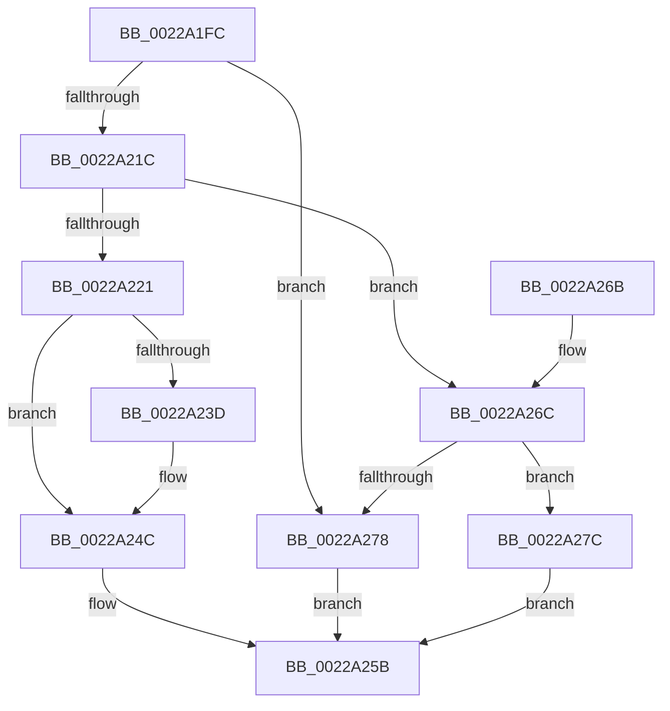

# MiRecheckCombineVm

- RVA: `0x0022A1FC`–`0x0022A283` (길이 `135` bytes)
- VA: `0x000000014022A1FC`
- 실행 섹션: `.text`
- PDB 이름 있음: `예`; PDB Function 태그: `아니요`
- unwind 정보 RVA: `0x0005FD80`
- 디코드: `39`개 명령, `135/135` bytes 표시
- 미해석 바이트: `0` (있으면 어셈블리에 `.byte`로 보존)

> 이 문서는 커널 이미지의 기계어와 PDB 기호를 분석해 생성했습니다. 4번과 5번은 함수 원형과 자료형을 바이너리 사용 방식에서 추정한 C 해석이며 원본 소스 복구 결과는 아닙니다.

## 1. Dependencies

- 직접 호출 지점: **3**; 고유 호출 대상: **3**
- 직접 호출자로 확인된 함수: **2**
- RIP 상대 이미지 참조: **1**

### Outgoing calls
- `0x0022A211` → [MiCombineCandidate](../31/MiCombineCandidate_function_00316290.md) (function, `0x00316290`)
- `0x0022A224` → [MiGetTopLevelPfn](../2B/MiGetTopLevelPfn_function_002B44E0.md) (function, `0x002B44E0`)
- `0x0022A22F` → [MiGetPageTablePfnBuddyRaw](../2B/MiGetPageTablePfnBuddyRaw_function_002B4470.md) (function, `0x002B4470`)

### Direct callers
- [MiCombineWithStandbyExisting](MiCombineWithStandbyExisting_function_00229E74.md) at `0x00229FFF`
- [MiCombineInitialInstance](MiCombineInitialInstance_function_0022BC0C.md) at `0x0022C7A0`

### Static image references
- `0x0022A26C` → RVA `0x00E380C0` (`.data`; read)

## 2. Other-region calls and transfers

- 다른 실행 섹션으로 향하는 call: **0**
- 별도 외부 분기/꼬리 이동을 확인하지 못했습니다.

## 3. Assembly (complete function range)

```asm
0022A1FC  48 89 5C 24 08                  mov qword ptr [rsp + 8], rbx
0022A201  48 89 74 24 10                  mov qword ptr [rsp + 0x10], rsi
0022A206  57                              push rdi
0022A207  48 83 EC 20                     sub rsp, 0x20
0022A20B  49 8B F9                        mov rdi, r9
0022A20E  49 8B F0                        mov rsi, r8
0022A211  E8 7A C0 0E 00                  call 0x140316290
0022A216  33 DB                           xor ebx, ebx
0022A218  85 C0                           test eax, eax
0022A21A  74 5C                           je 0x14022a278
0022A21C  83 F8 02                        cmp eax, 2
0022A21F  74 4B                           je 0x14022a26c
0022A221  48 8B CE                        mov rcx, rsi
0022A224  E8 B7 A2 08 00                  call 0x1402b44e0
0022A229  48 8B C8                        mov rcx, rax
0022A22C  4C 8B C0                        mov r8, rax
0022A22F  E8 3C A2 08 00                  call 0x1402b4470
0022A234  49 8B 48 18                     mov rcx, qword ptr [r8 + 0x18]
0022A238  4C 3B C6                        cmp r8, rsi
0022A23B  74 0F                           je 0x14022a24c
0022A23D  48 B9 FF FF FF FF FF FF FF 7F   movabs rcx, 0x7fffffffffffffff
0022A247  F0 49 21 48 18                  lock and qword ptr [r8 + 0x18], rcx
0022A24C  48 8D 88 00 04 00 00            lea rcx, [rax + 0x400]
0022A253  48 3B F9                        cmp rdi, rcx
0022A256  0F 94 C3                        sete bl
0022A259  8B C3                           mov eax, ebx
0022A25B  48 8B 5C 24 30                  mov rbx, qword ptr [rsp + 0x30]
0022A260  48 8B 74 24 38                  mov rsi, qword ptr [rsp + 0x38]
0022A265  48 83 C4 20                     add rsp, 0x20
0022A269  5F                              pop rdi
0022A26A  C3                              ret
0022A26B  CC                              int3
0022A26C  48 8D 05 4D DE C0 00            lea rax, [rip + 0xc0de4d]
0022A273  48 3B F8                        cmp rdi, rax
0022A276  74 04                           je 0x14022a27c
0022A278  33 C0                           xor eax, eax
0022A27A  EB DF                           jmp 0x14022a25b
0022A27C  B8 01 00 00 00                  mov eax, 1
0022A281  EB D8                           jmp 0x14022a25b
```

## 4. C-style interpretation (structured pseudocode)

```c
__int64 __fastcall MiRecheckCombineVm(__int64 a1, __int64 a2, __int64 a3, __int64 a4)
{
    __int64 result;
    __int64 v_rbx;
    __int64 v_rsp;
    unsigned __int64 v_stack_p10;
    unsigned __int64 v_stack_p8;

    v_stack_p8 = v_rbx;
    v_stack_p10 = v_rsi;
    v_rsp = (v_rsp) - (32);
    result = MiCombineCandidate(a1, a2, a3, a4);
    v_rbx = 0;
    if ((unsigned int)(result) == 0) goto loc_0022A278;
    if (((unsigned int)(result)) == 2) goto loc_0022A26C;
    result = MiGetTopLevelPfn(a3, a2, a3, a4);
    result = MiGetPageTablePfnBuddyRaw(result, a2, result, a4);
    if (result != a3) {
    }
    v_rbx = (a4 == (result + 1024)) ? 1 : 0;
loc_0022A25B:
    v_rsp = (v_rsp) + (32);
    return (unsigned int)((unsigned int)(v_rbx));
loc_0022A26C:
    if (a4 == (v_rip + 12639821)) goto loc_0022A27C;
loc_0022A278:
    result = 0;
    goto loc_0022A25B;
loc_0022A27C:
    goto loc_0022A25B;
}
```

## 5. (Beta) C Style

```c
int64_t MiRecheckCombineVm(int64_t Arg1, int64_t Arg2, int64_t Arg3, int64_t Arg4)
{
    int64_t result;
    int64_t local_rbx;
    int64_t local_rsp;
    uint64_t v_stack_p10;
    uint64_t v_stack_p8;

    v_stack_p8 = local_rbx;
    v_stack_p10 = local_rsi;
    local_rsp = (local_rsp) - (32);
    result = MiCombineCandidate(Arg1, Arg2, Arg3, Arg4);
    local_rbx = 0;
    if ((uint32_t)(result) == 0) goto loc_0022A278;
    if (((uint32_t)(result)) == 2) goto loc_0022A26C;
    result = MiGetTopLevelPfn(Arg3, Arg2, Arg3, Arg4);
    result = MiGetPageTablePfnBuddyRaw(result, Arg2, result, Arg4);
    if (result != Arg3) {
    }
    local_rbx = (Arg4 == (result + 1024)) ? 1 : 0;
loc_0022A25B:
    local_rsp = (local_rsp) + (32);
    return (uint32_t)((uint32_t)(local_rbx));
loc_0022A26C:
    if (Arg4 == (v_rip + 12639821)) goto loc_0022A27C;
loc_0022A278:
    result = 0;
    goto loc_0022A25B;
loc_0022A27C:
    goto loc_0022A25B;
}
```

## 6. Execution-region graph

[열기: 2D/3D 그래프와 함수 탐색 컨트롤 패널](../../../control-panel.html?section=text&rva=0x0022A1FC&view=graph)

- 2D 그래프는 위에서 아래로 흐르고, 3D 그래프는 빈 공간을 드래그해 회전합니다. Shift+드래그는 이동, 휠은 확대·축소, 함수 노드 선택은 대상 보고서 이동입니다.

### Static fallback


