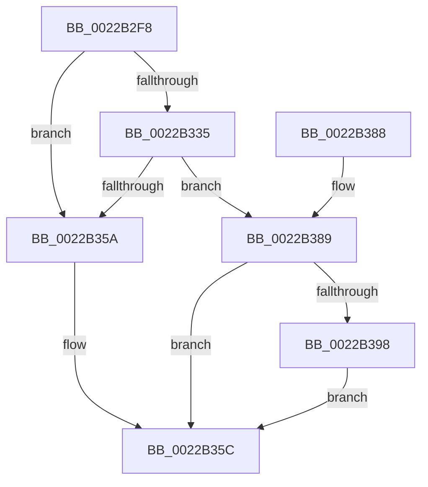

# MiReferenceCloneProto

- RVA: `0x0022B2F8`–`0x0022B3A2` (길이 `170` bytes)
- VA: `0x000000014022B2F8`
- 실행 섹션: `.text`
- PDB 이름 있음: `예`; PDB Function 태그: `아니요`
- unwind 정보 RVA: `0x0005FEDC`
- 디코드: `47`개 명령, `170/170` bytes 표시
- 미해석 바이트: `0` (있으면 어셈블리에 `.byte`로 보존)

> 이 문서는 커널 이미지의 기계어와 PDB 기호를 분석해 생성했습니다. 4번과 5번은 함수 원형과 자료형을 바이너리 사용 방식에서 추정한 C 해석이며 원본 소스 복구 결과는 아닙니다.

## 1. Dependencies

- 직접 호출 지점: **2**; 고유 호출 대상: **2**
- 직접 호출자로 확인된 함수: **3**
- RIP 상대 이미지 참조: **1**

### Outgoing calls
- `0x0022B327` → [MiLockCloneBlockAtDpc](../37/MiLockCloneBlockAtDpc_function_00370FD8.md) (function, `0x00370FD8`)
- `0x0022B351` → [MiChargeCrossPartitionSharedPage](MiChargeCrossPartitionSharedPage_function_0022CA9C.md) (function, `0x0022CA9C`)

### Direct callers
- [MiReferenceExistingCloneProto](MiReferenceExistingCloneProto_function_0022B040.md) at `0x0022B0C3`
- [MiCreateCombineAnchor](MiCreateCombineAnchor_function_0022B178.md) at `0x0022B1FD`
- [MiIncrementCombinedPte](MiIncrementCombinedPte_function_0022B248.md) at `0x0022B289`

### Static image references
- `0x0022B340` → RVA `0x00E30088` (`.data`; read)

## 2. Other-region calls and transfers

- 다른 실행 섹션으로 향하는 call: **0**
- 별도 외부 분기/꼬리 이동을 확인하지 못했습니다.

## 3. Assembly (complete function range)

```asm
0022B2F8  48 8B C4                        mov rax, rsp
0022B2FB  48 89 58 08                     mov qword ptr [rax + 8], rbx
0022B2FF  48 89 68 10                     mov qword ptr [rax + 0x10], rbp
0022B303  48 89 70 18                     mov qword ptr [rax + 0x18], rsi
0022B307  48 89 78 20                     mov qword ptr [rax + 0x20], rdi
0022B30B  41 56                           push r14
0022B30D  48 83 EC 20                     sub rsp, 0x20
0022B311  41 8B F1                        mov esi, r9d
0022B314  4C 8B F1                        mov r14, rcx
0022B317  BF 01 00 00 00                  mov edi, 1
0022B31C  49 8B C8                        mov rcx, r8
0022B31F  23 F7                           and esi, edi
0022B321  49 8B D8                        mov rbx, r8
0022B324  48 8B EA                        mov rbp, rdx
0022B327  E8 AC 5C 14 00                  call 0x140370fd8
0022B32C  48 8B 43 18                     mov rax, qword ptr [rbx + 0x18]
0022B330  48 85 C0                        test rax, rax
0022B333  74 25                           je 0x14022b35a
0022B335  41 0F B7 8E AE 00 00 00         movzx ecx, word ptr [r14 + 0xae]
0022B33D  44 8B CE                        mov r9d, esi
0022B340  48 8B 05 41 4D C0 00            mov rax, qword ptr [rip + 0xc04d41]
0022B347  4C 8B C3                        mov r8, rbx
0022B34A  48 8B 14 C8                     mov rdx, qword ptr [rax + rcx*8]
0022B34E  48 8B CD                        mov rcx, rbp
0022B351  E8 46 17 00 00                  call 0x14022ca9c
0022B356  85 C0                           test eax, eax
0022B358  75 2F                           jne 0x14022b389
0022B35A  33 FF                           xor edi, edi
0022B35C  48 B8 FF FF FF FF FF FF FF 7F   movabs rax, 0x7fffffffffffffff
0022B366  F0 48 21 43 10                  lock and qword ptr [rbx + 0x10], rax
0022B36B  48 8B 5C 24 30                  mov rbx, qword ptr [rsp + 0x30]
0022B370  8B C7                           mov eax, edi
0022B372  48 8B 7C 24 48                  mov rdi, qword ptr [rsp + 0x48]
0022B377  48 8B 6C 24 38                  mov rbp, qword ptr [rsp + 0x38]
0022B37C  48 8B 74 24 40                  mov rsi, qword ptr [rsp + 0x40]
0022B381  48 83 C4 20                     add rsp, 0x20
0022B385  41 5E                           pop r14
0022B387  C3                              ret
0022B388  CC                              int3
0022B389  48 8B 43 18                     mov rax, qword ptr [rbx + 0x18]
0022B38D  48 FF C0                        inc rax
0022B390  48 89 43 18                     mov qword ptr [rbx + 0x18], rax
0022B394  85 F6                           test esi, esi
0022B396  74 C4                           je 0x14022b35c
0022B398  48 8B 44 24 50                  mov rax, qword ptr [rsp + 0x50]
0022B39D  48 01 38                        add qword ptr [rax], rdi
0022B3A0  EB BA                           jmp 0x14022b35c
```

## 4. C-style interpretation (structured pseudocode)

```c
__int64 __fastcall MiReferenceCloneProto(__int64 a1, __int64 a2, __int64 a3, int a4, __int64 a5)
{
    __int64 result;
    __int64 v_rdi;
    __int64 v_rsi;
    __int64 v_rsp;
    unsigned __int64 v_stack_p10;
    unsigned __int64 v_stack_p18;
    unsigned __int64 v_stack_p20;
    unsigned __int64 v_stack_p8;

    *(unsigned __int64 *)(v_rsp + 8) = v_rbx;
    *(unsigned __int64 *)(v_rsp + 16) = v_rbp;
    *(unsigned __int64 *)(v_rsp + 24) = v_rsi;
    *(unsigned __int64 *)(v_rsp + 32) = v_rdi;
    v_rsp = (v_rsp) - (32);
    v_rsi = (unsigned int)(((unsigned int)(a4)) & (1));
    result = MiLockCloneBlockAtDpc(a3, a2, a3, a4);
    if (*(unsigned __int64 *)(a3 + 24) == 0) goto loc_0022B35A;
    result = MiChargeCrossPartitionSharedPage(a2, *(unsigned __int64 *)(*(unsigned __int64 *)(v_rip + 12602689) + *(unsigned __int16 *)(a1 + 174) * 8), a3, (unsigned int)((unsigned int)(v_rsi)));
    if ((unsigned int)(result) != 0) goto loc_0022B389;
loc_0022B35A:
    v_rdi = 0;
loc_0022B35C:
    v_rsp = (v_rsp) + (32);
    return 0;
loc_0022B389:
    result = (*(unsigned __int64 *)(v_stack_p8 + 24)) + 1;
    *(unsigned __int64 *)(v_stack_p8 + 24) = result;
    if ((unsigned int)(v_stack_p18) == 0) goto loc_0022B35C;
    goto loc_0022B35C;
}
```

## 5. (Beta) C Style

```c
int64_t MiReferenceCloneProto(void *Arg1, int64_t Arg2, void *Arg3, int32_t Arg4, void *Arg5)
{
    uint8_t *arg1 = (uint8_t *)Arg1;
    uint8_t *arg3 = (uint8_t *)Arg3;
    uint8_t *arg5 = (uint8_t *)Arg5;

    int64_t result;
    int64_t local_rdi;
    int64_t local_rsi;
    int64_t local_rsp;
    uint64_t v_stack_p10;
    uint64_t v_stack_p18;
    uint64_t v_stack_p20;
    uint64_t v_stack_p8;

    *(uint64_t *)(local_rsp + 0x8) = local_rbx;
    *(uint64_t *)(local_rsp + 0x10) = local_rbp;
    *(uint64_t *)(local_rsp + 0x18) = local_rsi;
    *(uint64_t *)(local_rsp + 0x20) = local_rdi;
    local_rsp = (local_rsp) - (32);
    local_rsi = (uint32_t)(((uint32_t)(Arg4)) & (1));
    result = MiLockCloneBlockAtDpc(Arg3, Arg2, Arg3, Arg4);
    if (*(uint64_t *)(arg3 + 0x18) == 0) goto loc_0022B35A;
    result = MiChargeCrossPartitionSharedPage(Arg2, *(uint64_t *)(*(uint64_t *)(v_rip + 0xC04D41) + *(uint16_t *)(arg1 + 0xAE) * 8), Arg3, (uint32_t)((uint32_t)(local_rsi)));
    if ((uint32_t)(result) != 0) goto loc_0022B389;
loc_0022B35A:
    local_rdi = 0;
loc_0022B35C:
    local_rsp = (local_rsp) + (32);
    return 0;
loc_0022B389:
    result = (*(uint64_t *)(v_stack_p8 + 0x18)) + 1;
    *(uint64_t *)(v_stack_p8 + 0x18) = result;
    if ((uint32_t)(v_stack_p18) == 0) goto loc_0022B35C;
    goto loc_0022B35C;
}
```

### 관측된 메모리 오프셋

구조체 형식이 확인되지 않은 접근은 인자 기준의 오프셋으로만 기록했습니다.

| 기준 인자 | 오프셋 표현 | 폭 (bit) | 접근 |
|---|---:|---:|---|
| `Arg1` | `+ 0xAE` | `16` | `R` |
| `Arg3` | `+ 0x10` | `64` | `R/W` |
| `Arg3` | `+ 0x18` | `64` | `R` |
| `Arg3` | `+ 0x18` | `64` | `W` |
| `Arg5` | `+ 0x0` | `64` | `R/W` |

## 6. Execution-region graph

[열기: 2D/3D 그래프와 함수 탐색 컨트롤 패널](../../../control-panel.html?section=text&rva=0x0022B2F8&view=graph)

- 2D 그래프는 위에서 아래로 흐르고, 3D 그래프는 빈 공간을 드래그해 회전합니다. Shift+드래그는 이동, 휠은 확대·축소, 함수 노드 선택은 대상 보고서 이동입니다.

### Static fallback


