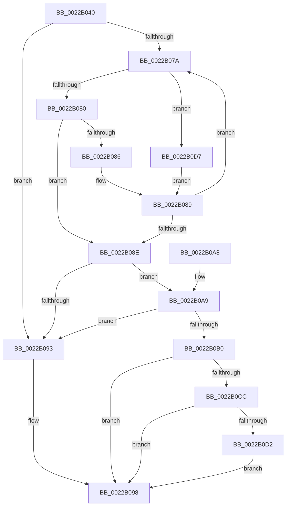

# MiReferenceExistingCloneProto

- RVA: `0x0022B040`–`0x0022B0DD` (길이 `157` bytes)
- VA: `0x000000014022B040`
- 실행 섹션: `.text`
- PDB 이름 있음: `예`; PDB Function 태그: `아니요`
- unwind 정보 RVA: `0x0005FE7C`
- 디코드: `45`개 명령, `157/157` bytes 표시
- 미해석 바이트: `0` (있으면 어셈블리에 `.byte`로 보존)

> 이 문서는 커널 이미지의 기계어와 PDB 기호를 분석해 생성했습니다. 4번과 5번은 함수 원형과 자료형을 바이너리 사용 방식에서 추정한 C 해석이며 원본 소스 복구 결과는 아닙니다.

## 1. Dependencies

- 직접 호출 지점: **1**; 고유 호출 대상: **1**
- 직접 호출자로 확인된 함수: **1**
- RIP 상대 이미지 참조: **0**

### Outgoing calls
- `0x0022B0C3` → [MiReferenceCloneProto](MiReferenceCloneProto_function_0022B2F8.md) (function, `0x0022B2F8`)

### Direct callers
- [MiBuildForkPte](MiBuildForkPte_function_0022E32C.md) at `0x0022E922`
- [MiBuildForkPte](MiBuildForkPte_function_0022E32C.md) at `0x0022EC6E`

### Static image references
- 디코드된 RIP-relative 메모리 참조가 없습니다.

## 2. Other-region calls and transfers

- 다른 실행 섹션으로 향하는 call: **0**
- 별도 외부 분기/꼬리 이동을 확인하지 못했습니다.

## 3. Assembly (complete function range)

```asm
0022B040  48 89 5C 24 08                  mov qword ptr [rsp + 8], rbx
0022B045  48 89 74 24 10                  mov qword ptr [rsp + 0x10], rsi
0022B04A  57                              push rdi
0022B04B  48 83 EC 30                     sub rsp, 0x30
0022B04F  65 48 8B 04 25 88 01 00 00      mov rax, qword ptr gs:[0x188]
0022B058  41 8B F0                        mov esi, r8d
0022B05B  48 8B 7C 24 60                  mov rdi, qword ptr [rsp + 0x60]
0022B060  48 8B DA                        mov rbx, rdx
0022B063  4C 8B 90 B8 00 00 00            mov r10, qword ptr [rax + 0xb8]
0022B06A  48 83 27 00                     and qword ptr [rdi], 0
0022B06E  49 8B 82 80 02 00 00            mov rax, qword ptr [r10 + 0x280]
0022B075  48 85 C0                        test rax, rax
0022B078  74 19                           je 0x14022b093
0022B07A  48 3B 58 20                     cmp rbx, qword ptr [rax + 0x20]
0022B07E  77 57                           ja 0x14022b0d7
0022B080  48 3B 58 18                     cmp rbx, qword ptr [rax + 0x18]
0022B084  73 08                           jae 0x14022b08e
0022B086  48 8B 00                        mov rax, qword ptr [rax]
0022B089  48 85 C0                        test rax, rax
0022B08C  75 EC                           jne 0x14022b07a
0022B08E  48 85 C0                        test rax, rax
0022B091  75 16                           jne 0x14022b0a9
0022B093  B8 01 00 00 00                  mov eax, 1
0022B098  48 8B 5C 24 40                  mov rbx, qword ptr [rsp + 0x40]
0022B09D  48 8B 74 24 48                  mov rsi, qword ptr [rsp + 0x48]
0022B0A2  48 83 C4 30                     add rsp, 0x30
0022B0A6  5F                              pop rdi
0022B0A7  C3                              ret
0022B0A8  CC                              int3
0022B0A9  48 83 78 30 00                  cmp qword ptr [rax + 0x30], 0
0022B0AE  74 E3                           je 0x14022b093
0022B0B0  48 8B 40 38                     mov rax, qword ptr [rax + 0x38]
0022B0B4  4C 8B C3                        mov r8, rbx
0022B0B7  4C 89 4C 24 20                  mov qword ptr [rsp + 0x20], r9
0022B0BC  44 8B CE                        mov r9d, esi
0022B0BF  48 8B 50 18                     mov rdx, qword ptr [rax + 0x18]
0022B0C3  E8 30 02 00 00                  call 0x14022b2f8
0022B0C8  85 C0                           test eax, eax
0022B0CA  74 CC                           je 0x14022b098
0022B0CC  40 F6 C6 01                     test sil, 1
0022B0D0  74 C6                           je 0x14022b098
0022B0D2  48 89 1F                        mov qword ptr [rdi], rbx
0022B0D5  EB C1                           jmp 0x14022b098
0022B0D7  48 8B 40 08                     mov rax, qword ptr [rax + 8]
0022B0DB  EB AC                           jmp 0x14022b089
```

## 4. C-style interpretation (structured pseudocode)

```c
__int64 __fastcall MiReferenceExistingCloneProto(__int64 a1, __int64 a2, int a3, __int64 a4, __int64 a5)
{
    __int64 result;
    __int64 v_rsp;
    unsigned __int64 v_stack_p10;
    unsigned __int64 v_stack_p20;
    unsigned __int64 v_stack_p8;

    v_stack_p8 = v_rbx;
    v_stack_p10 = v_rsi;
    v_rsp = (v_rsp) - (48);
    if (*(unsigned __int64 *)(*(unsigned __int64 *)(*(unsigned __int64 *)(gs_base + (0 + 392)) + 184) + 640) == 0) goto loc_0022B093;
loc_0022B07A:
    if (a2 > (*(unsigned __int64 *)(*(unsigned __int64 *)(*(unsigned __int64 *)(*(unsigned __int64 *)(gs_base + (0 + 392)) + 184) + 640) + 32))) goto loc_0022B0D7;
    if (a2 >= (*(unsigned __int64 *)(*(unsigned __int64 *)(*(unsigned __int64 *)(*(unsigned __int64 *)(gs_base + (0 + 392)) + 184) + 640) + 24))) goto loc_0022B08E;
loc_0022B089:
    if (*(unsigned __int64 *)(*(unsigned __int64 *)(*(unsigned __int64 *)(*(unsigned __int64 *)(gs_base + (0 + 392)) + 184) + 640)) != 0) goto loc_0022B07A;
loc_0022B08E:
    if (*(unsigned __int64 *)(*(unsigned __int64 *)(*(unsigned __int64 *)(*(unsigned __int64 *)(gs_base + (0 + 392)) + 184) + 640)) != 0) goto loc_0022B0A9;
loc_0022B093:
loc_0022B098:
    v_rsp = (v_rsp) + (48);
    return 1;
loc_0022B0A9:
    if ((*(unsigned __int64 *)(1 + 48)) == 0) goto loc_0022B093;
    v_stack_p20 = a4;
    result = MiReferenceCloneProto(a1, *(unsigned __int64 *)(*(unsigned __int64 *)(1 + 56) + 24), v_stack_p8, (unsigned int)((unsigned int)(v_stack_p10)));
    if ((unsigned int)(result) == 0) goto loc_0022B098;
    if ((((unsigned __int8)(v_stack_p10)) & (1)) == 0) goto loc_0022B098;
    *(unsigned __int64 *)(a5) = v_stack_p8;
    goto loc_0022B098;
loc_0022B0D7:
    goto loc_0022B089;
}
```

## 5. (Beta) C Style

```c
int64_t MiReferenceExistingCloneProto(int64_t Arg1, int64_t Arg2, int32_t Arg3, int64_t Arg4, void *Arg5)
{
    uint8_t *arg5 = (uint8_t *)Arg5;

    int64_t result;
    int64_t local_rsp;
    uint64_t v_stack_p10;
    uint64_t v_stack_p20;
    uint64_t v_stack_p8;

    v_stack_p8 = local_rbx;
    v_stack_p10 = local_rsi;
    local_rsp = (local_rsp) - (48);
    if (*(uint64_t *)(*(uint64_t *)(*(uint64_t *)(gs_base + (0 + 0x188)) + 0xB8) + 0x280) == 0) goto loc_0022B093;
loc_0022B07A:
    if (Arg2 > (*(uint64_t *)(*(uint64_t *)(*(uint64_t *)(*(uint64_t *)(gs_base + (0 + 0x188)) + 0xB8) + 0x280) + 0x20))) goto loc_0022B0D7;
    if (Arg2 >= (*(uint64_t *)(*(uint64_t *)(*(uint64_t *)(*(uint64_t *)(gs_base + (0 + 0x188)) + 0xB8) + 0x280) + 0x18))) goto loc_0022B08E;
loc_0022B089:
    if (*(uint64_t *)(*(uint64_t *)(*(uint64_t *)(*(uint64_t *)(gs_base + (0 + 0x188)) + 0xB8) + 0x280)) != 0) goto loc_0022B07A;
loc_0022B08E:
    if (*(uint64_t *)(*(uint64_t *)(*(uint64_t *)(*(uint64_t *)(gs_base + (0 + 0x188)) + 0xB8) + 0x280)) != 0) goto loc_0022B0A9;
loc_0022B093:
loc_0022B098:
    local_rsp = (local_rsp) + (48);
    return 1;
loc_0022B0A9:
    if ((*(uint64_t *)(1 + 0x30)) == 0) goto loc_0022B093;
    v_stack_p20 = Arg4;
    result = MiReferenceCloneProto(Arg1, *(uint64_t *)(*(uint64_t *)(1 + 0x38) + 0x18), v_stack_p8, (uint32_t)((uint32_t)(v_stack_p10)));
    if ((uint32_t)(result) == 0) goto loc_0022B098;
    if ((((uint8_t)(v_stack_p10)) & (1)) == 0) goto loc_0022B098;
    *(uint64_t *)(arg5) = v_stack_p8;
    goto loc_0022B098;
loc_0022B0D7:
    goto loc_0022B089;
}
```

### 관측된 메모리 오프셋

구조체 형식이 확인되지 않은 접근은 인자 기준의 오프셋으로만 기록했습니다.

| 기준 인자 | 오프셋 표현 | 폭 (bit) | 접근 |
|---|---:|---:|---|
| `Arg5` | `+ 0x0` | `64` | `R/W` |
| `Arg5` | `+ 0x0` | `64` | `W` |

## 6. Execution-region graph

[열기: 2D/3D 그래프와 함수 탐색 컨트롤 패널](../../../control-panel.html?section=text&rva=0x0022B040&view=graph)

- 2D 그래프는 위에서 아래로 흐르고, 3D 그래프는 빈 공간을 드래그해 회전합니다. Shift+드래그는 이동, 휠은 확대·축소, 함수 노드 선택은 대상 보고서 이동입니다.

### Static fallback


