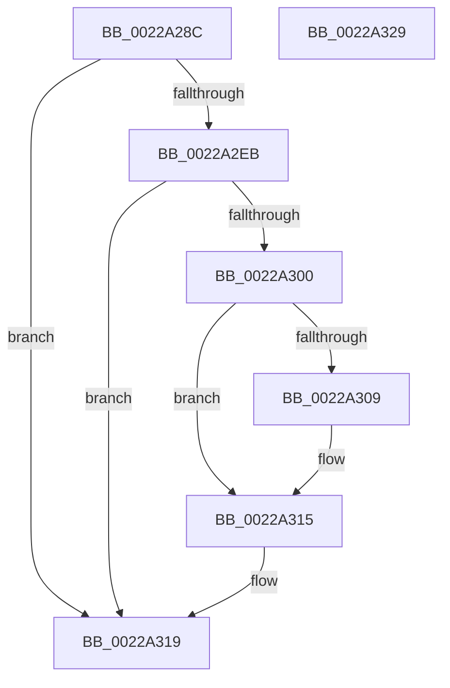

# MiReleaseArbitraryPage

- RVA: `0x0022A28C`–`0x0022A32A` (길이 `158` bytes)
- VA: `0x000000014022A28C`
- 실행 섹션: `.text`
- PDB 이름 있음: `예`; PDB Function 태그: `아니요`
- unwind 정보 RVA: `0x0005FD94`
- 디코드: `38`개 명령, `158/158` bytes 표시
- 미해석 바이트: `0` (있으면 어셈블리에 `.byte`로 보존)

> 이 문서는 커널 이미지의 기계어와 PDB 기호를 분석해 생성했습니다. 4번과 5번은 함수 원형과 자료형을 바이너리 사용 방식에서 추정한 C 해석이며 원본 소스 복구 결과는 아닙니다.

## 1. Dependencies

- 직접 호출 지점: **2**; 고유 호출 대상: **2**
- 직접 호출자로 확인된 함수: **2**
- RIP 상대 이미지 참조: **2**

### Outgoing calls
- `0x0022A2C4` → [MiSafeLockPage](../32/MiSafeLockPage_function_00321620.md) (function, `0x00321620`)
- `0x0022A310` → [KiLowerIrqlProcessIrqlFlags](../4F/KiLowerIrqlProcessIrqlFlags_function_004F5698.md) (function, `0x004F5698`)

### Direct callers
- [MiConvertStandbyToProto](MiConvertStandbyToProto_function_0022A330.md) at `0x0022A40C`
- [MiComputeCombineHash](../32/MiComputeCombineHash_function_003227C0.md) at `0x0032290B`

### Static image references
- `0x0022A2C9` → RVA `0x00010880` (`.rdata`; read)
- `0x0022A300` → RVA `0x00FC6D20` (`ALMOSTRO`; read)

## 2. Other-region calls and transfers

- 다른 실행 섹션으로 향하는 call: **0**
- 별도 외부 분기/꼬리 이동을 확인하지 못했습니다.

## 3. Assembly (complete function range)

```asm
0022A28C  48 89 5C 24 10                  mov qword ptr [rsp + 0x10], rbx
0022A291  48 89 74 24 18                  mov qword ptr [rsp + 0x18], rsi
0022A296  57                              push rdi
0022A297  48 83 EC 20                     sub rsp, 0x20
0022A29B  48 8B 71 30                     mov rsi, qword ptr [rcx + 0x30]
0022A29F  48 8B D9                        mov rbx, rcx
0022A2A2  48 B8 00 00 00 00 00 DE FF FF   movabs rax, 0xffffde0000000000
0022A2AC  48 8B CE                        mov rcx, rsi
0022A2AF  48 2B C8                        sub rcx, rax
0022A2B2  48 B8 AB AA AA AA AA AA AA AA   movabs rax, 0xaaaaaaaaaaaaaaab
0022A2BC  48 C1 F9 04                     sar rcx, 4
0022A2C0  48 0F AF C8                     imul rcx, rax
0022A2C4  E8 57 73 0F 00                  call 0x140321620
0022A2C9  48 8B 0D B0 65 DE FF            mov rcx, qword ptr [rip - 0x219a50]
0022A2D0  45 33 C0                        xor r8d, r8d
0022A2D3  4C 89 43 30                     mov qword ptr [rbx + 0x30], r8
0022A2D7  48 8B 53 38                     mov rdx, qword ptr [rbx + 0x38]
0022A2DB  0F B6 F8                        movzx edi, al
0022A2DE  48 89 0A                        mov qword ptr [rdx], rcx
0022A2E1  4C 89 43 38                     mov qword ptr [rbx + 0x38], r8
0022A2E5  40 80 FF 11                     cmp dil, 0x11
0022A2E9  74 2E                           je 0x14022a319
0022A2EB  48 B8 FF FF FF FF FF FF FF 7F   movabs rax, 0x7fffffffffffffff
0022A2F5  F0 48 21 46 18                  lock and qword ptr [rsi + 0x18], rax
0022A2FA  40 80 FF 02                     cmp dil, 2
0022A2FE  73 19                           jae 0x14022a319
0022A300  44 39 05 19 CA D9 00            cmp dword ptr [rip + 0xd9ca19], r8d
0022A307  74 0C                           je 0x14022a315
0022A309  44 0F 20 C1                     mov rcx, cr8
0022A30D  40 8A D7                        mov dl, dil
0022A310  E8 83 B3 2C 00                  call 0x1404f5698
0022A315  44 0F 22 C7                     mov cr8, rdi
0022A319  48 8B 5C 24 38                  mov rbx, qword ptr [rsp + 0x38]
0022A31E  48 8B 74 24 40                  mov rsi, qword ptr [rsp + 0x40]
0022A323  48 83 C4 20                     add rsp, 0x20
0022A327  5F                              pop rdi
0022A328  C3                              ret
0022A329  CC                              int3
```

## 4. C-style interpretation (structured pseudocode)

```c
__int64 __fastcall MiReleaseArbitraryPage(__int64 a1, __int64 a2, int a3)
{
    __int64 result;
    __int64 v_rsp;
    unsigned __int64 v_stack_p10;
    unsigned __int64 v_stack_p18;

    v_stack_p10 = v_rbx;
    v_stack_p18 = v_rsi;
    v_rsp = (v_rsp) - (32);
    a1 = (*(unsigned __int64 *)(a1 + 48)) - (result);
    a1 = (a1) >> (4);
    a1 = (a1) * (result);
    result = MiSafeLockPage(a1, a2, a3, a4);
    a3 = 0;
    *(unsigned __int64 *)(a1 + 48) = 0;
    *(unsigned __int64 *)(*(unsigned __int64 *)(a1 + 56)) = *(unsigned __int64 *)(v_rip - 2202192);
    *(unsigned __int64 *)(a1 + 56) = 0;
    if (((unsigned __int8)((unsigned __int8)(result))) == 17) goto loc_0022A319;
    if (((unsigned __int8)((unsigned __int8)(result))) >= 2) goto loc_0022A319;
    if ((*(unsigned int *)(v_rip + 14273049)) != 0) {
        a1 = v_cr8;
        a2 = (unsigned __int8)((unsigned __int8)(result));
        result = KiLowerIrqlProcessIrqlFlags(a1, a2, a3, a4);
    }
loc_0022A319:
    v_rsp = (v_rsp) + (32);
    return result;
}
```

## 5. (Beta) C Style

```c
int64_t MiReleaseArbitraryPage(void *Arg1, int64_t Arg2, int32_t Arg3)
{
    uint8_t *arg1 = (uint8_t *)Arg1;

    int64_t result;
    int64_t local_rsp;
    uint64_t v_stack_p10;
    uint64_t v_stack_p18;

    v_stack_p10 = local_rbx;
    v_stack_p18 = local_rsi;
    local_rsp = (local_rsp) - (32);
    Arg1 = (*(uint64_t *)(arg1 + 0x30)) - (result);
    Arg1 = (Arg1) >> (4);
    Arg1 = (Arg1) * (result);
    result = MiSafeLockPage(Arg1, Arg2, Arg3, a4);
    Arg3 = 0;
    *(uint64_t *)(arg1 + 0x30) = 0;
    *(uint64_t *)(*(uint64_t *)(arg1 + 0x38)) = *(uint64_t *)(v_rip - 0x219A50);
    *(uint64_t *)(arg1 + 0x38) = 0;
    if (((uint8_t)((uint8_t)(result))) == 17) goto loc_0022A319;
    if (((uint8_t)((uint8_t)(result))) >= 2) goto loc_0022A319;
    if ((*(uint32_t *)(v_rip + 0xD9CA19)) != 0) {
        Arg1 = v_cr8;
        Arg2 = (uint8_t)((uint8_t)(result));
        result = KiLowerIrqlProcessIrqlFlags(Arg1, Arg2, Arg3, a4);
    }
loc_0022A319:
    local_rsp = (local_rsp) + (32);
    return result;
}
```

### 관측된 메모리 오프셋

구조체 형식이 확인되지 않은 접근은 인자 기준의 오프셋으로만 기록했습니다.

| 기준 인자 | 오프셋 표현 | 폭 (bit) | 접근 |
|---|---:|---:|---|
| `Arg1` | `+ 0x30` | `64` | `R` |
| `Arg1` | `+ 0x30` | `64` | `W` |
| `Arg1` | `+ 0x38` | `64` | `R` |
| `Arg1` | `+ 0x38` | `64` | `W` |

## 6. Execution-region graph

[열기: 2D/3D 그래프와 함수 탐색 컨트롤 패널](../../../control-panel.html?section=text&rva=0x0022A28C&view=graph)

- 2D 그래프는 위에서 아래로 흐르고, 3D 그래프는 빈 공간을 드래그해 회전합니다. Shift+드래그는 이동, 휠은 확대·축소, 함수 노드 선택은 대상 보고서 이동입니다.

### Static fallback


