# MiRemoveWsle

- RVA: `0x0022D0C4`–`0x0022D345` (길이 `641` bytes)
- VA: `0x000000014022D0C4`
- 실행 섹션: `.text`
- PDB 이름 있음: `예`; PDB Function 태그: `예`
- unwind 정보 RVA: `0x0006001C`
- 디코드: `149`개 명령, `641/641` bytes 표시
- 미해석 바이트: `0` (있으면 어셈블리에 `.byte`로 보존)

> 이 문서는 커널 이미지의 기계어와 PDB 기호를 분석해 생성했습니다. 4번과 5번은 함수 원형과 자료형을 바이너리 사용 방식에서 추정한 C 해석이며 원본 소스 복구 결과는 아닙니다.

## 1. Dependencies

- 직접 호출 지점: **8**; 고유 호출 대상: **8**
- 직접 호출자로 확인된 함수: **2**
- RIP 상대 이미지 참조: **7**

### Outgoing calls
- `0x0022D0F2` → [MiLockWorkingSetCoreShared](../27/MiLockWorkingSetCoreShared_function_0027C3E0.md) (function, `0x0027C3E0`)
- `0x0022D1A0` → [MI_READ_PTE_LOCK_FREE](../28/MI_READ_PTE_LOCK_FREE_function_002828A0.md) (function, `0x002828A0`)
- `0x0022D1B4` → [MiWriteWsle](../29/MiWriteWsle_function_00292CA0.md) (function, `0x00292CA0`)
- `0x0022D1DA` → [MiUpdateWorkingSetAgeDistribution](../29/MiUpdateWorkingSetAgeDistribution_function_00291A00.md) (function, `0x00291A00`)
- `0x0022D202` → [MiUnlockWorkingSetCoreShared](../29/MiUnlockWorkingSetCoreShared_function_00292B00.md) (function, `0x00292B00`)
- `0x0022D25A` → [MiGetSystemRegionType](../28/MiGetSystemRegionType_function_0028EC80.md) (function, `0x0028EC80`)
- `0x0022D287` → [MiIsDriverPage](../2A/MiIsDriverPage_function_002A5514.md) (function, `0x002A5514`)
- `0x0022D33B` → [MiLogRemoveWsleEvent](../4D/MiLogRemoveWsleEvent_function_004D64BC.md) (function, `0x004D64BC`)

### Direct callers
- [MiCombineWithExisting](MiCombineWithExisting_function_0022B4B8.md) at `0x0022B7B5`
- [sub_0023F124](../23/Unknown_function_0023F124.md) at `0x0023F351`

### Static image references
- `0x0022D1E7` → RVA `0x00E388C0` (`.data`; read)
- `0x0022D207` → RVA `0x00FC6B04` (`ALMOSTRO`; read)
- `0x0022D235` → RVA `0x00FC6B28` (`ALMOSTRO`; read)
- `0x0022D24A` → RVA `0x00FC6B98` (`ALMOSTRO`; read)
- `0x0022D2A1` → RVA `0x00E2D96C` (`.data`; read/write)
- `0x0022D2DF` → RVA `0x00FC6CB0` (`ALMOSTRO`; read)
- `0x0022D2F1` → RVA `0x00FC6D90` (`ALMOSTRO`; read)

## 2. Other-region calls and transfers

- 다른 실행 섹션으로 향하는 call: **0**
- call이 아닌 외부 분기/꼬리 이동: **2**
  - `0x0022D2E6` → [sub_006D7150](../6D/Unknown_function_006D7150.md) (`tail-transfer`)
  - `0x0022D2FE` → [sub_006D7150](../6D/Unknown_function_006D7150.md) (`tail-transfer`)

## 3. Assembly (complete function range)

```asm
0022D0C4  48 89 5C 24 08                  mov qword ptr [rsp + 8], rbx
0022D0C9  48 89 6C 24 10                  mov qword ptr [rsp + 0x10], rbp
0022D0CE  48 89 74 24 18                  mov qword ptr [rsp + 0x18], rsi
0022D0D3  57                              push rdi
0022D0D4  41 54                           push r12
0022D0D6  41 55                           push r13
0022D0D8  41 56                           push r14
0022D0DA  41 57                           push r15
0022D0DC  48 83 EC 30                     sub rsp, 0x30
0022D0E0  8B 99 B8 00 00 00               mov ebx, dword ptr [rcx + 0xb8]
0022D0E6  45 8B E9                        mov r13d, r9d
0022D0E9  41 8A E8                        mov bpl, r8b
0022D0EC  48 8B FA                        mov rdi, rdx
0022D0EF  48 8B F1                        mov rsi, rcx
0022D0F2  E8 E9 F2 04 00                  call 0x14027c3e0
0022D0F7  33 D2                           xor edx, edx
0022D0F9  49 BE 00 00 00 00 80 F6 FF FF   movabs r14, 0xfffff68000000000
0022D103  49 BF FF FF FF FF FF F6 FF FF   movabs r15, 0xfffff6ffffffffff
0022D10D  39 94 24 80 00 00 00            cmp dword ptr [rsp + 0x80], edx
0022D114  74 1C                           je 0x14022d132
0022D116  F0 48 FF 8E 98 00 00 00         lock dec qword ptr [rsi + 0x98]
0022D11E  49 8B C6                        mov rax, r14
0022D121  48 3B F8                        cmp rdi, rax
0022D124  0F 83 83 01 00 00               jae 0x14022d2ad
0022D12A  F0 48 FF 8E 88 00 00 00         lock dec qword ptr [rsi + 0x88]
0022D132  80 E3 0F                        and bl, 0xf
0022D135  49 B8 F8 FF FF FF 7F 00 00 00   movabs r8, 0x7ffffffff8
0022D13F  80 FB 03                        cmp bl, 3
0022D142  0F 84 ED 00 00 00               je 0x14022d235
0022D148  F0 48 FF 8E 90 00 00 00         lock dec qword ptr [rsi + 0x90]
0022D150  49 8B C6                        mov rax, r14
0022D153  48 3B F8                        cmp rdi, rax
0022D156  0F 83 62 01 00 00               jae 0x14022d2be
0022D15C  F0 48 FF 8E 80 00 00 00         lock dec qword ptr [rsi + 0x80]
0022D164  40 80 E5 0F                     and bpl, 0xf
0022D168  40 80 FD 08                     cmp bpl, 8
0022D16C  8B DA                           mov ebx, edx
0022D16E  0F 94 C3                        sete bl
0022D171  41 83 FD 09                     cmp r13d, 9
0022D175  74 33                           je 0x14022d1aa
0022D177  41 BF 01 00 00 00               mov r15d, 1
0022D17D  44 8B F3                        mov r14d, ebx
0022D180  41 83 FD 0A                     cmp r13d, 0xa
0022D184  75 3E                           jne 0x14022d1c4
0022D186  48 8B CF                        mov rcx, rdi
0022D189  48 B8 00 00 00 00 80 F6 FF FF   movabs rax, 0xfffff68000000000
0022D193  48 C1 E9 09                     shr rcx, 9
0022D197  49 23 C8                        and rcx, r8
0022D19A  48 8B C0                        mov rax, rax
0022D19D  48 03 C8                        add rcx, rax
0022D1A0  E8 FB 56 05 00                  call 0x1402828a0
0022D1A5  41 84 C7                        test r15b, al
0022D1A8  74 18                           je 0x14022d1c2
0022D1AA  41 80 E5 0F                     and r13b, 0xf
0022D1AE  48 8B D7                        mov rdx, rdi
0022D1B1  45 8A C5                        mov r8b, r13b
0022D1B4  E8 E7 5A 06 00                  call 0x140292ca0
0022D1B9  41 BF 01 00 00 00               mov r15d, 1
0022D1BF  44 8B F3                        mov r14d, ebx
0022D1C2  33 D2                           xor edx, edx
0022D1C4  45 85 F6                        test r14d, r14d
0022D1C7  75 18                           jne 0x14022d1e1
0022D1C9  89 54 24 20                     mov dword ptr [rsp + 0x20], edx
0022D1CD  49 83 C9 FF                     or r9, 0xffffffffffffffff
0022D1D1  48 8B D7                        mov rdx, rdi
0022D1D4  44 8A C5                        mov r8b, bpl
0022D1D7  48 8B CE                        mov rcx, rsi
0022D1DA  E8 21 48 06 00                  call 0x140291a00
0022D1DF  33 D2                           xor edx, edx
0022D1E1  8B 86 B8 00 00 00               mov eax, dword ptr [rsi + 0xb8]
0022D1E7  48 8D 0D D2 B6 C0 00            lea rcx, [rip + 0xc0b6d2]
0022D1EE  24 0F                           and al, 0xf
0022D1F0  3C 01                           cmp al, 1
0022D1F2  48 0F 45 CA                     cmovne rcx, rdx
0022D1F6  48 85 C9                        test rcx, rcx
0022D1F9  0F 85 15 01 00 00               jne 0x14022d314
0022D1FF  48 8B CE                        mov rcx, rsi
0022D202  E8 F9 58 06 00                  call 0x140292b00
0022D207  F7 05 F3 98 D9 00 00 00 00 08   test dword ptr [rip + 0xd998f3], 0x8000000
0022D211  0F 85 15 01 00 00               jne 0x14022d32c
0022D217  48 8B 5C 24 60                  mov rbx, qword ptr [rsp + 0x60]
0022D21C  48 8B 6C 24 68                  mov rbp, qword ptr [rsp + 0x68]
0022D221  48 8B 74 24 70                  mov rsi, qword ptr [rsp + 0x70]
0022D226  48 83 C4 30                     add rsp, 0x30
0022D22A  41 5F                           pop r15
0022D22C  41 5E                           pop r14
0022D22E  41 5D                           pop r13
0022D230  41 5C                           pop r12
0022D232  5F                              pop rdi
0022D233  C3                              ret
0022D234  CC                              int3
0022D235  48 8B 05 EC 98 D9 00            mov rax, qword ptr [rip + 0xd998ec]
0022D23C  48 85 C0                        test rax, rax
0022D23F  74 16                           je 0x14022d257
0022D241  48 3B F8                        cmp rdi, rax
0022D244  0F 83 95 00 00 00               jae 0x14022d2df
0022D24A  48 3B 3D 47 99 D9 00            cmp rdi, qword ptr [rip + 0xd99947]
0022D251  0F 83 9A 00 00 00               jae 0x14022d2f1
0022D257  48 8B CF                        mov rcx, rdi
0022D25A  E8 21 1A 06 00                  call 0x14028ec80
0022D25F  83 F8 0B                        cmp eax, 0xb
0022D262  0F 85 9B 00 00 00               jne 0x14022d303
0022D268  48 8B CF                        mov rcx, rdi
0022D26B  48 B8 F8 FF FF FF 7F 00 00 00   movabs rax, 0x7ffffffff8
0022D275  48 C1 E9 09                     shr rcx, 9
0022D279  48 23 C8                        and rcx, rax
0022D27C  49 8B C6                        mov rax, r14
0022D27F  48 03 C8                        add rcx, rax
0022D282  BA 01 00 00 00                  mov edx, 1
0022D287  E8 88 82 07 00                  call 0x1402a5514
0022D28C  33 D2                           xor edx, edx
0022D28E  49 B8 F8 FF FF FF 7F 00 00 00   movabs r8, 0x7ffffffff8
0022D298  48 85 C0                        test rax, rax
0022D29B  0F 84 A7 FE FF FF               je 0x14022d148
0022D2A1  F0 FF 0D C4 06 C0 00            lock dec dword ptr [rip + 0xc006c4]
0022D2A8  E9 9B FE FF FF                  jmp 0x14022d148
0022D2AD  49 8B C7                        mov rax, r15
0022D2B0  48 3B F8                        cmp rdi, rax
0022D2B3  0F 86 79 FE FF FF               jbe 0x14022d132
0022D2B9  E9 6C FE FF FF                  jmp 0x14022d12a
0022D2BE  49 8B C7                        mov rax, r15
0022D2C1  48 3B F8                        cmp rdi, rax
0022D2C4  0F 87 92 FE FF FF               ja 0x14022d15c
0022D2CA  40 80 E5 0F                     and bpl, 0xf
0022D2CE  44 8B F2                        mov r14d, edx
0022D2D1  84 DB                           test bl, bl
0022D2D3  44 8B FA                        mov r15d, edx
0022D2D6  41 0F 95 C6                     setne r14b
0022D2DA  E9 E5 FE FF FF                  jmp 0x14022d1c4
0022D2DF  48 3B 3D CA 99 D9 00            cmp rdi, qword ptr [rip + 0xd999ca]
0022D2E6  0F 82 64 9E 4A 00               jb 0x1406d7150
0022D2EC  E9 59 FF FF FF                  jmp 0x14022d24a
0022D2F1  48 3B 3D 98 9A D9 00            cmp rdi, qword ptr [rip + 0xd99a98]
0022D2F8  0F 83 59 FF FF FF               jae 0x14022d257
0022D2FE  E9 4D 9E 4A 00                  jmp 0x1406d7150
0022D303  33 D2                           xor edx, edx
0022D305  49 B8 F8 FF FF FF 7F 00 00 00   movabs r8, 0x7ffffffff8
0022D30F  E9 34 FE FF FF                  jmp 0x14022d148
0022D314  F0 48 FF 49 08                  lock dec qword ptr [rcx + 8]
0022D319  45 85 FF                        test r15d, r15d
0022D31C  0F 84 DD FE FF FF               je 0x14022d1ff
0022D322  F0 48 FF 49 10                  lock dec qword ptr [rcx + 0x10]
0022D327  E9 D3 FE FF FF                  jmp 0x14022d1ff
0022D32C  8B 86 B8 00 00 00               mov eax, dword ptr [rsi + 0xb8]
0022D332  48 8B CF                        mov rcx, rdi
0022D335  0F B6 D0                        movzx edx, al
0022D338  83 E2 0F                        and edx, 0xf
0022D33B  E8 7C 91 2A 00                  call 0x1404d64bc
0022D340  E9 D2 FE FF FF                  jmp 0x14022d217
```

## 4. C-style interpretation (structured pseudocode)

```c
__int64 __fastcall MiRemoveWsle(__int64 a1, __int64 a2, unsigned __int8 a3, __int64 a4, unsigned int a5)
{
    __int64 result;
    __int64 v_r13;
    __int64 v_r14;
    __int64 v_r15;
    __int64 v_rbp;
    __int64 v_rbx;
    __int64 v_rsp;
    unsigned int v_stack_m38;
    unsigned __int64 v_stack_p10;
    unsigned __int64 v_stack_p18;
    unsigned __int64 v_stack_p8;

    v_stack_p8 = v_rbx;
    v_stack_p10 = v_rbp;
    v_stack_p18 = v_rsi;
    v_rsp = (v_rsp) - (48);
    result = MiLockWorkingSetCoreShared(a1, a2, a3, a4);
    a2 = 0;
    if (a5 == 0) goto loc_0022D132;
    if (0 >= v_r14) goto loc_0022D2AD;
loc_0022D12A:
loc_0022D132:
    v_rbx = (unsigned __int8)(((unsigned int)(*(unsigned int *)(a1 + 184))) & (15));
    if (((unsigned __int8)(v_rbx)) == 3) goto loc_0022D235;
loc_0022D148:
    if (0 >= v_r14) goto loc_0022D2BE;
loc_0022D15C:
    v_rbp = (unsigned __int8)((a3) & (15));
    v_rbx = (((unsigned __int8)(v_rbp)) == 8) ? 1 : 0;
    if (((unsigned int)((unsigned int)((unsigned int)(a4)))) == 9) goto loc_0022D1AA;
    if (((unsigned int)((unsigned int)((unsigned int)(a4)))) != 10) goto loc_0022D1C4;
    a1 = (0) >> (9);
    a1 = (a1) & (a3);
    a1 = (a1) + (v_r14);
    result = MI_READ_PTE_LOCK_FREE(a1, a2, a3, a4);
    v_r13 = (unsigned int)((unsigned int)(a4));
    v_r14 = (unsigned int)((unsigned int)(v_rbx));
    v_r15 = 1;
    if (((1) & ((unsigned __int8)(result))) != 0) {
        v_r13 = (unsigned __int8)(((unsigned int)((unsigned int)(a4))) & (15));
        a2 = 0;
        a3 = (unsigned __int8)(v_r13);
        result = MiWriteWsle(a1, a2, a3, a4);
        v_r15 = 1;
        v_r14 = (unsigned int)(v_rbx);
    }
    a2 = 0;
loc_0022D1C4:
    if ((unsigned int)(v_r14) == 0) {
        v_stack_m38 = 0;
        a4 = (a4) | (-1);
        a2 = 0;
        a3 = (unsigned __int8)(v_rbp);
        a1 = a1;
        result = MiUpdateWorkingSetAgeDistribution(a1, a2, a3, a4);
        a2 = 0;
    }
    result = (unsigned __int8)(((unsigned int)(*(unsigned int *)(a1 + 184))) & (15));
    a1 = v_rip + 12629714;
    if (((unsigned __int8)(result)) != 1) { a1 = 0; }
    if (a1 != 0) goto loc_0022D314;
loc_0022D1FF:
    result = MiUnlockWorkingSetCoreShared(a1, a2, a3, a4);
    if (((*(unsigned int *)(v_rip + 14260467)) & (0x8000000ULL)) != 0) goto loc_0022D32C;
loc_0022D217:
    v_rsp = (v_rsp) + (48);
    return result;
loc_0022D235:
    if (*(unsigned __int64 *)(v_rip + 14260460) == 0) goto loc_0022D257;
    if (0 >= (*(unsigned __int64 *)(v_rip + 14260460))) goto loc_0022D2DF;
loc_0022D24A:
    if (0 >= (*(unsigned __int64 *)(v_rip + 14260551))) goto loc_0022D2F1;
loc_0022D257:
    result = MiGetSystemRegionType(0, a2, a3, a4);
    if (((unsigned int)(result)) != 11) goto loc_0022D303;
    a1 = (0) >> (9);
    a1 = (a1) & (result);
    a1 = (a1) + (v_r14);
    result = MiIsDriverPage(a1, 1, a3, a4);
    a2 = 0;
    if (result == 0) goto loc_0022D148;
    goto loc_0022D148;
loc_0022D2AD:
    if (0 <= v_r15) goto loc_0022D132;
    goto loc_0022D12A;
loc_0022D2BE:
    if (0 > v_r15) goto loc_0022D15C;
    v_rbp = (unsigned __int8)((v_stack_p10) & (15));
    v_r14 = ((unsigned __int8)(v_stack_p8) != 0) ? 1 : 0;
    goto loc_0022D1C4;
loc_0022D2DF:
    goto loc_0022D24A;
loc_0022D2F1:
    if (0 >= (*(unsigned __int64 *)(v_rip + 14260888))) goto loc_0022D257;
loc_0022D303:
    a2 = 0;
    goto loc_0022D148;
loc_0022D314:
    if (0 == 0) goto loc_0022D1FF;
    goto loc_0022D1FF;
loc_0022D32C:
    a2 = (unsigned int)(((unsigned __int8)((unsigned int)(*(unsigned int *)(v_stack_p18 + 184)))) & (15));
    result = MiLogRemoveWsleEvent(0, a2, a3, a4);
    goto loc_0022D217;
}
```

## 5. (Beta) C Style

```c
int64_t MiRemoveWsle(void *Arg1, int64_t Arg2, uint8_t Arg3, int64_t Arg4, uint32_t Arg5)
{
    uint8_t *arg1 = (uint8_t *)Arg1;

    int64_t result;
    int64_t local_r13;
    int64_t local_r14;
    int64_t local_r15;
    int64_t local_rbp;
    int64_t local_rbx;
    int64_t local_rsp;
    uint32_t v_stack_m38;
    uint64_t v_stack_p10;
    uint64_t v_stack_p18;
    uint64_t v_stack_p8;

    v_stack_p8 = local_rbx;
    v_stack_p10 = local_rbp;
    v_stack_p18 = local_rsi;
    local_rsp = (local_rsp) - (48);
    result = MiLockWorkingSetCoreShared(Arg1, Arg2, Arg3, Arg4);
    Arg2 = 0;
    if (Arg5 == 0) goto loc_0022D132;
    if (0 >= local_r14) goto loc_0022D2AD;
loc_0022D12A:
loc_0022D132:
    local_rbx = (uint8_t)(((uint32_t)(*(uint32_t *)(arg1 + 0xB8))) & (15));
    if (((uint8_t)(local_rbx)) == 3) goto loc_0022D235;
loc_0022D148:
    if (0 >= local_r14) goto loc_0022D2BE;
loc_0022D15C:
    local_rbp = (uint8_t)((Arg3) & (15));
    local_rbx = (((uint8_t)(local_rbp)) == 8) ? 1 : 0;
    if (((uint32_t)((uint32_t)((uint32_t)(Arg4)))) == 9) goto loc_0022D1AA;
    if (((uint32_t)((uint32_t)((uint32_t)(Arg4)))) != 10) goto loc_0022D1C4;
    Arg1 = (0) >> (9);
    Arg1 = (Arg1) & (Arg3);
    Arg1 = (Arg1) + (local_r14);
    result = MI_READ_PTE_LOCK_FREE(Arg1, Arg2, Arg3, Arg4);
    local_r13 = (uint32_t)((uint32_t)(Arg4));
    local_r14 = (uint32_t)((uint32_t)(local_rbx));
    local_r15 = 1;
    if (((1) & ((uint8_t)(result))) != 0) {
        local_r13 = (uint8_t)(((uint32_t)((uint32_t)(Arg4))) & (15));
        Arg2 = 0;
        Arg3 = (uint8_t)(local_r13);
        result = MiWriteWsle(Arg1, Arg2, Arg3, Arg4);
        local_r15 = 1;
        local_r14 = (uint32_t)(local_rbx);
    }
    Arg2 = 0;
loc_0022D1C4:
    if ((uint32_t)(local_r14) == 0) {
        v_stack_m38 = 0;
        Arg4 = (Arg4) | (-1);
        Arg2 = 0;
        Arg3 = (uint8_t)(local_rbp);
        Arg1 = Arg1;
        result = MiUpdateWorkingSetAgeDistribution(Arg1, Arg2, Arg3, Arg4);
        Arg2 = 0;
    }
    result = (uint8_t)(((uint32_t)(*(uint32_t *)(arg1 + 0xB8))) & (15));
    Arg1 = v_rip + 12629714;
    if (((uint8_t)(result)) != 1) { Arg1 = 0; }
    if (Arg1 != NULL) goto loc_0022D314;
loc_0022D1FF:
    result = MiUnlockWorkingSetCoreShared(Arg1, Arg2, Arg3, Arg4);
    if (((*(uint32_t *)(v_rip + 0xD998F3)) & (0x8000000ULL)) != 0) goto loc_0022D32C;
loc_0022D217:
    local_rsp = (local_rsp) + (48);
    return result;
loc_0022D235:
    if (*(uint64_t *)(v_rip + 0xD998EC) == 0) goto loc_0022D257;
    if (0 >= (*(uint64_t *)(v_rip + 0xD998EC))) goto loc_0022D2DF;
loc_0022D24A:
    if (0 >= (*(uint64_t *)(v_rip + 0xD99947))) goto loc_0022D2F1;
loc_0022D257:
    result = MiGetSystemRegionType(0, Arg2, Arg3, Arg4);
    if (((uint32_t)(result)) != 11) goto loc_0022D303;
    Arg1 = (0) >> (9);
    Arg1 = (Arg1) & (result);
    Arg1 = (Arg1) + (local_r14);
    result = MiIsDriverPage(Arg1, 1, Arg3, Arg4);
    Arg2 = 0;
    if (result == 0) goto loc_0022D148;
    goto loc_0022D148;
loc_0022D2AD:
    if (0 <= local_r15) goto loc_0022D132;
    goto loc_0022D12A;
loc_0022D2BE:
    if (0 > local_r15) goto loc_0022D15C;
    local_rbp = (uint8_t)((v_stack_p10) & (15));
    local_r14 = ((uint8_t)(v_stack_p8) != 0) ? 1 : 0;
    goto loc_0022D1C4;
loc_0022D2DF:
    goto loc_0022D24A;
loc_0022D2F1:
    if (0 >= (*(uint64_t *)(v_rip + 0xD99A98))) goto loc_0022D257;
loc_0022D303:
    Arg2 = 0;
    goto loc_0022D148;
loc_0022D314:
    if (0 == 0) goto loc_0022D1FF;
    goto loc_0022D1FF;
loc_0022D32C:
    Arg2 = (uint32_t)(((uint8_t)((uint32_t)(*(uint32_t *)(v_stack_p18 + 0xB8)))) & (15));
    result = MiLogRemoveWsleEvent(0, Arg2, Arg3, Arg4);
    goto loc_0022D217;
}
```

### 관측된 메모리 오프셋

구조체 형식이 확인되지 않은 접근은 인자 기준의 오프셋으로만 기록했습니다.

| 기준 인자 | 오프셋 표현 | 폭 (bit) | 접근 |
|---|---:|---:|---|
| `Arg1` | `+ 0x80` | `64` | `R/W` |
| `Arg1` | `+ 0x88` | `64` | `R/W` |
| `Arg1` | `+ 0x90` | `64` | `R/W` |
| `Arg1` | `+ 0x98` | `64` | `R/W` |
| `Arg1` | `+ 0xB8` | `32` | `R` |

## 6. Execution-region graph

[열기: 2D/3D 그래프와 함수 탐색 컨트롤 패널](../../../control-panel.html?section=text&rva=0x0022D0C4&view=graph)

- 2D 그래프는 위에서 아래로 흐르고, 3D 그래프는 빈 공간을 드래그해 회전합니다. Shift+드래그는 이동, 휠은 확대·축소, 함수 노드 선택은 대상 보고서 이동입니다.

### Static fallback

```mermaid
flowchart TD
  bb_0022D0C4[BB_0022D0C4]
  bb_0022D116[BB_0022D116]
  bb_0022D12A[BB_0022D12A]
  bb_0022D132[BB_0022D132]
  bb_0022D148[BB_0022D148]
  bb_0022D15C[BB_0022D15C]
  bb_0022D177[BB_0022D177]
  bb_0022D186[BB_0022D186]
  bb_0022D1AA[BB_0022D1AA]
  bb_0022D1C2[BB_0022D1C2]
  bb_0022D1C4[BB_0022D1C4]
  bb_0022D1C9[BB_0022D1C9]
  bb_0022D1E1[BB_0022D1E1]
  bb_0022D1FF[BB_0022D1FF]
  bb_0022D217[BB_0022D217]
  bb_0022D234[BB_0022D234]
  bb_0022D235[BB_0022D235]
  bb_0022D241[BB_0022D241]
  bb_0022D24A[BB_0022D24A]
  bb_0022D257[BB_0022D257]
  bb_0022D268[BB_0022D268]
  bb_0022D2A1[BB_0022D2A1]
  bb_0022D2AD[BB_0022D2AD]
  bb_0022D2B9[BB_0022D2B9]
  bb_0022D2BE[BB_0022D2BE]
  bb_0022D2CA[BB_0022D2CA]
  bb_0022D2DF[BB_0022D2DF]
  bb_0022D2EC[BB_0022D2EC]
  bb_0022D2F1[BB_0022D2F1]
  bb_0022D2FE[BB_0022D2FE]
  bb_0022D303[BB_0022D303]
  bb_0022D314[BB_0022D314]
  bb_0022D322[BB_0022D322]
  bb_0022D32C[BB_0022D32C]
  bb_0022D0C4 -->|branch| bb_0022D132
  bb_0022D0C4 -->|fallthrough| bb_0022D116
  bb_0022D116 -->|branch| bb_0022D2AD
  bb_0022D116 -->|fallthrough| bb_0022D12A
  bb_0022D12A -->|flow| bb_0022D132
  bb_0022D132 -->|branch| bb_0022D235
  bb_0022D132 -->|fallthrough| bb_0022D148
  bb_0022D148 -->|branch| bb_0022D2BE
  bb_0022D148 -->|fallthrough| bb_0022D15C
  bb_0022D15C -->|branch| bb_0022D1AA
  bb_0022D15C -->|fallthrough| bb_0022D177
  bb_0022D177 -->|branch| bb_0022D1C4
  bb_0022D177 -->|fallthrough| bb_0022D186
  bb_0022D186 -->|branch| bb_0022D1C2
  bb_0022D186 -->|fallthrough| bb_0022D1AA
  bb_0022D1AA -->|flow| bb_0022D1C2
  bb_0022D1C2 -->|flow| bb_0022D1C4
  bb_0022D1C4 -->|branch| bb_0022D1E1
  bb_0022D1C4 -->|fallthrough| bb_0022D1C9
  bb_0022D1C9 -->|flow| bb_0022D1E1
  bb_0022D1E1 -->|branch| bb_0022D314
  bb_0022D1E1 -->|fallthrough| bb_0022D1FF
  bb_0022D1FF -->|branch| bb_0022D32C
  bb_0022D1FF -->|fallthrough| bb_0022D217
  bb_0022D234 -->|flow| bb_0022D235
  bb_0022D235 -->|branch| bb_0022D257
  bb_0022D235 -->|fallthrough| bb_0022D241
  bb_0022D241 -->|branch| bb_0022D2DF
  bb_0022D241 -->|fallthrough| bb_0022D24A
  bb_0022D24A -->|branch| bb_0022D2F1
  bb_0022D24A -->|fallthrough| bb_0022D257
  bb_0022D257 -->|branch| bb_0022D303
  bb_0022D257 -->|fallthrough| bb_0022D268
  bb_0022D268 -->|branch| bb_0022D148
  bb_0022D268 -->|fallthrough| bb_0022D2A1
  bb_0022D2A1 -->|branch| bb_0022D148
  bb_0022D2AD -->|branch| bb_0022D132
  bb_0022D2AD -->|fallthrough| bb_0022D2B9
  bb_0022D2B9 -->|branch| bb_0022D12A
  bb_0022D2BE -->|branch| bb_0022D15C
  bb_0022D2BE -->|fallthrough| bb_0022D2CA
  bb_0022D2CA -->|branch| bb_0022D1C4
  bb_0022D2DF -->|fallthrough| bb_0022D2EC
  bb_0022D2EC -->|branch| bb_0022D24A
  bb_0022D2F1 -->|branch| bb_0022D257
  bb_0022D2F1 -->|fallthrough| bb_0022D2FE
  bb_0022D303 -->|branch| bb_0022D148
  bb_0022D314 -->|branch| bb_0022D1FF
  bb_0022D314 -->|fallthrough| bb_0022D322
  bb_0022D322 -->|branch| bb_0022D1FF
  bb_0022D32C -->|branch| bb_0022D217
```


