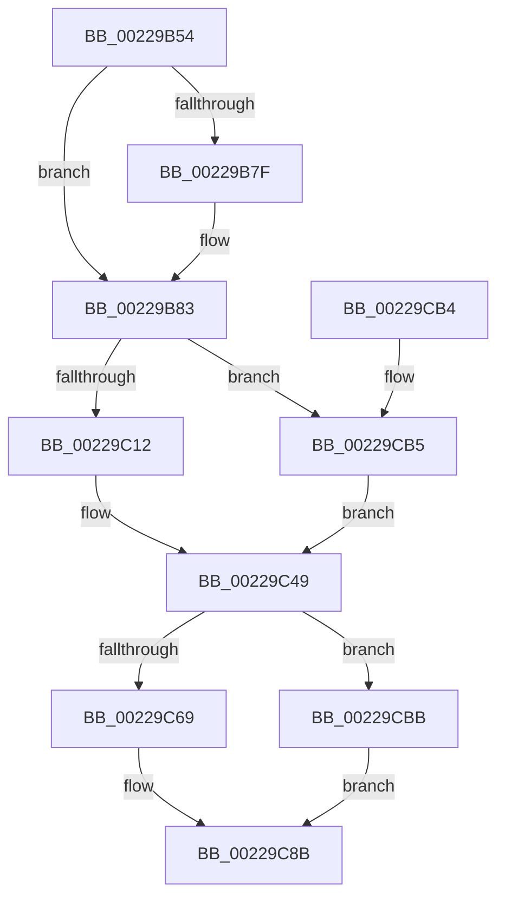

# MiReplaceActivePageTableLinks

- RVA: `0x00229B54`–`0x00229CC1` (길이 `365` bytes)
- VA: `0x0000000140229B54`
- 실행 섹션: `.text`
- PDB 이름 있음: `예`; PDB Function 태그: `아니요`
- unwind 정보 RVA: `0x0005FD00`
- 디코드: `97`개 명령, `365/365` bytes 표시
- 미해석 바이트: `0` (있으면 어셈블리에 `.byte`로 보존)

> 이 문서는 커널 이미지의 기계어와 PDB 기호를 분석해 생성했습니다. 4번과 5번은 함수 원형과 자료형을 바이너리 사용 방식에서 추정한 C 해석이며 원본 소스 복구 결과는 아닙니다.

## 1. Dependencies

- 직접 호출 지점: **2**; 고유 호출 대상: **2**
- 직접 호출자로 확인된 함수: **1**
- RIP 상대 이미지 참조: **0**

### Outgoing calls
- `0x00229BC2` → [ExAcquireSpinLockExclusiveAtDpcLevel](../24/ExAcquireSpinLockExclusiveAtDpcLevel_function_00248E80.md) (function, `0x00248E80`)
- `0x00229C8F` → [ExReleaseSpinLockExclusiveFromDpcLevel](../24/ExReleaseSpinLockExclusiveFromDpcLevel_function_002497E0.md) (function, `0x002497E0`)

### Direct callers
- [MiReplacePageTablePage](MiReplacePageTablePage_function_00229184.md) at `0x00229516`

### Static image references
- 디코드된 RIP-relative 메모리 참조가 없습니다.

## 2. Other-region calls and transfers

- 다른 실행 섹션으로 향하는 call: **0**
- 별도 외부 분기/꼬리 이동을 확인하지 못했습니다.

## 3. Assembly (complete function range)

```asm
00229B54  48 89 5C 24 08                  mov qword ptr [rsp + 8], rbx
00229B59  48 89 6C 24 10                  mov qword ptr [rsp + 0x10], rbp
00229B5E  48 89 74 24 18                  mov qword ptr [rsp + 0x18], rsi
00229B63  57                              push rdi
00229B64  41 56                           push r14
00229B66  41 57                           push r15
00229B68  48 83 EC 20                     sub rsp, 0x20
00229B6C  8B 81 B8 00 00 00               mov eax, dword ptr [rcx + 0xb8]
00229B72  48 8B F2                        mov rsi, rdx
00229B75  49 8B F8                        mov rdi, r8
00229B78  48 8B D1                        mov rdx, rcx
00229B7B  A8 0F                           test al, 0xf
00229B7D  74 04                           je 0x140229b83
00229B7F  49 8B 40 08                     mov rax, qword ptr [r8 + 8]
00229B83  48 8B 06                        mov rax, qword ptr [rsi]
00229B86  48 C1 E8 37                     shr rax, 0x37
00229B8A  83 E0 07                        and eax, 7
00229B8D  49 BF 00 00 00 00 00 DE FF FF   movabs r15, 0xffffde0000000000
00229B97  48 8D 0C 40                     lea rcx, [rax + rax*2]
00229B9B  48 8B 42 10                     mov rax, qword ptr [rdx + 0x10]
00229B9F  48 8D 2C C8                     lea rbp, [rax + rcx*8]
00229BA3  49 8B C7                        mov rax, r15
00229BA6  4C 8B F6                        mov r14, rsi
00229BA9  48 8D 4D 40                     lea rcx, [rbp + 0x40]
00229BAD  4C 2B F0                        sub r14, rax
00229BB0  48 B8 AB AA AA AA AA AA AA AA   movabs rax, 0xaaaaaaaaaaaaaaab
00229BBA  49 C1 FE 04                     sar r14, 4
00229BBE  4C 0F AF F0                     imul r14, rax
00229BC2  E8 B9 F2 01 00                  call 0x140248e80
00229BC7  8B 5F 24                        mov ebx, dword ptr [rdi + 0x24]
00229BCA  41 BA 00 00 FF FF               mov r10d, 0xffff0000
00229BD0  48 8B 47 10                     mov rax, qword ptr [rdi + 0x10]
00229BD4  48 BA FF FF FF FF FF 00 00 00   movabs rdx, 0xffffffffff
00229BDE  48 8B C8                        mov rcx, rax
00229BE1  48 89 46 10                     mov qword ptr [rsi + 0x10], rax
00229BE5  8B 46 24                        mov eax, dword ptr [rsi + 0x24]
00229BE8  48 23 CA                        and rcx, rdx
00229BEB  33 C3                           xor eax, ebx
00229BED  49 B8 FF FF FF FF 3F 00 00 00   movabs r8, 0x3fffffffff
00229BF7  41 23 C2                        and eax, r10d
00229BFA  49 B9 00 00 00 00 00 FF FF FF   movabs r9, 0xffffff0000000000
00229C04  33 C3                           xor eax, ebx
00229C06  89 46 24                        mov dword ptr [rsi + 0x24], eax
00229C09  49 3B C8                        cmp rcx, r8
00229C0C  0F 84 A3 00 00 00               je 0x140229cb5
00229C12  48 8D 14 49                     lea rdx, [rcx + rcx*2]
00229C16  48 C1 E2 04                     shl rdx, 4
00229C1A  49 8B C7                        mov rax, r15
00229C1D  48 03 D0                        add rdx, rax
00229C20  49 8B CE                        mov rcx, r14
00229C23  48 C1 E1 18                     shl rcx, 0x18
00229C27  48 8B 42 10                     mov rax, qword ptr [rdx + 0x10]
00229C2B  48 33 C8                        xor rcx, rax
00229C2E  49 23 C9                        and rcx, r9
00229C31  48 33 C8                        xor rcx, rax
00229C34  48 89 4A 10                     mov qword ptr [rdx + 0x10], rcx
00229C38  41 8B CE                        mov ecx, r14d
00229C3B  8B 42 24                        mov eax, dword ptr [rdx + 0x24]
00229C3E  33 C8                           xor ecx, eax
00229C40  41 23 CA                        and ecx, r10d
00229C43  41 33 CE                        xor ecx, r14d
00229C46  89 4A 24                        mov dword ptr [rdx + 0x24], ecx
00229C49  48 8B 47 10                     mov rax, qword ptr [rdi + 0x10]
00229C4D  48 B9 00 00 FF FF 3F 00 00 00   movabs rcx, 0x3fffff0000
00229C57  48 C1 E8 18                     shr rax, 0x18
00229C5B  48 23 C1                        and rax, rcx
00229C5E  0F B7 D3                        movzx edx, bx
00229C61  48 0B D0                        or rdx, rax
00229C64  49 3B D0                        cmp rdx, r8
00229C67  74 52                           je 0x140229cbb
00229C69  4C 8D 04 52                     lea r8, [rdx + rdx*2]
00229C6D  49 C1 E0 04                     shl r8, 4
00229C71  49 8B C7                        mov rax, r15
00229C74  4C 03 C0                        add r8, rax
00229C77  49 8B D6                        mov rdx, r14
00229C7A  49 8B 40 10                     mov rax, qword ptr [r8 + 0x10]
00229C7E  48 33 D0                        xor rdx, rax
00229C81  49 23 D1                        and rdx, r9
00229C84  49 33 D6                        xor rdx, r14
00229C87  49 89 50 10                     mov qword ptr [r8 + 0x10], rdx
00229C8B  48 8D 4D 40                     lea rcx, [rbp + 0x40]
00229C8F  E8 4C FB 01 00                  call 0x1402497e0
00229C94  48 8B 6C 24 48                  mov rbp, qword ptr [rsp + 0x48]
00229C99  0F BA F3 1A                     btr ebx, 0x1a
00229C9D  48 8B 74 24 50                  mov rsi, qword ptr [rsp + 0x50]
00229CA2  89 5F 24                        mov dword ptr [rdi + 0x24], ebx
00229CA5  48 8B 5C 24 40                  mov rbx, qword ptr [rsp + 0x40]
00229CAA  48 83 C4 20                     add rsp, 0x20
00229CAE  41 5F                           pop r15
00229CB0  41 5E                           pop r14
00229CB2  5F                              pop rdi
00229CB3  C3                              ret
00229CB4  CC                              int3
00229CB5  48 89 75 50                     mov qword ptr [rbp + 0x50], rsi
00229CB9  EB 8E                           jmp 0x140229c49
00229CBB  48 89 75 48                     mov qword ptr [rbp + 0x48], rsi
00229CBF  EB CA                           jmp 0x140229c8b
```

## 4. C-style interpretation (structured pseudocode)

```c
__int64 __fastcall MiReplaceActivePageTableLinks(__int64 a1, __int64 a2, __int64 a3)
{
    __int64 result;
    __int64 v_r14;
    __int64 v_rsp;
    unsigned __int64 v_stack_p10;
    unsigned __int64 v_stack_p18;
    unsigned __int64 v_stack_p8;

    v_stack_p8 = v_rbx;
    v_stack_p10 = v_rbp;
    v_stack_p18 = v_rsi;
    v_rsp = (v_rsp) - (32);
    result = (unsigned int)(*(unsigned int *)(a1 + 184));
    if ((((unsigned __int8)((unsigned int)(*(unsigned int *)(a1 + 184)))) & (15)) != 0) {
        result = *(unsigned __int64 *)(a3 + 8);
    }
    result = (*(unsigned __int64 *)(a2)) >> (55);
    result = (unsigned int)((result) & (7));
    v_r14 = (a2) - (v_r15);
    v_r14 = (v_r14) >> (4);
    v_r14 = (v_r14) * (v_r15);
    result = ExAcquireSpinLockExclusiveAtDpcLevel(*(unsigned __int64 *)(a1 + 16) + result + result * 2 * 8 + 64, a1, a3, a4);
    *(unsigned __int64 *)(a2 + 16) = *(unsigned __int64 *)(a3 + 16);
    a1 = (*(unsigned __int64 *)(a3 + 16)) & (a1);
    result = (unsigned int)(((unsigned int)(*(unsigned int *)(a2 + 36))) ^ ((unsigned int)((unsigned int)(*(unsigned int *)(a3 + 36)))));
    result = (unsigned int)((result) & ((unsigned int)((unsigned int)(0xFFFF0000ULL))));
    result = (unsigned int)((result) ^ ((unsigned int)((unsigned int)(*(unsigned int *)(a3 + 36)))));
    *(unsigned int *)(a2 + 36) = (unsigned int)(result);
    if (a1 == a3) goto loc_00229CB5;
    a2 = (a1 + a1 * 2) << (4);
    a2 = (a2) + (v_r15);
    a1 = (v_r14) << (24);
    a1 = (a1) ^ (*(unsigned __int64 *)(a2 + 16));
    a1 = (a1) & (a4);
    a1 = (a1) ^ (*(unsigned __int64 *)(a2 + 16));
    *(unsigned __int64 *)(a2 + 16) = a1;
    a1 = (unsigned int)(((unsigned int)((unsigned int)(v_r14))) ^ ((unsigned int)((unsigned int)(*(unsigned int *)(a2 + 36)))));
    a1 = (unsigned int)((a1) & ((unsigned int)((unsigned int)(0xFFFF0000ULL))));
    a1 = (unsigned int)((a1) ^ ((unsigned int)(v_r14)));
    *(unsigned int *)(a2 + 36) = (unsigned int)(a1);
loc_00229C49:
    result = (*(unsigned __int64 *)(a3 + 16)) >> (24);
    result = (result) & (a1);
    a2 = ((unsigned __int16)((unsigned int)(*(unsigned int *)(a3 + 36)))) | (result);
    if (a2 == a3) goto loc_00229CBB;
    a3 = (a2 + a2 * 2) << (4);
    a3 = (a3) + (v_r15);
    a2 = (v_r14) ^ (*(unsigned __int64 *)(a3 + 16));
    a2 = (a2) & (a4);
    a2 = (a2) ^ (v_r14);
    *(unsigned __int64 *)(a3 + 16) = a2;
loc_00229C8B:
    result = ExReleaseSpinLockExclusiveFromDpcLevel(*(unsigned __int64 *)(a1 + 16) + result + result * 2 * 8 + 64, a2, a3, a4);
    *(unsigned int *)(a3 + 36) = (unsigned int)((unsigned int)(*(unsigned int *)(a3 + 36)));
    v_rsp = (v_rsp) + (32);
    return result;
loc_00229CB5:
    *(unsigned __int64 *)(v_stack_p10 + 80) = v_stack_p18;
    goto loc_00229C49;
loc_00229CBB:
    *(unsigned __int64 *)(v_stack_p10 + 72) = v_stack_p18;
    goto loc_00229C8B;
}
```

## 5. (Beta) C Style

```c
int64_t MiReplaceActivePageTableLinks(void *Arg1, void *Arg2, void *Arg3)
{
    uint8_t *arg1 = (uint8_t *)Arg1;
    uint8_t *arg2 = (uint8_t *)Arg2;
    uint8_t *arg3 = (uint8_t *)Arg3;

    int64_t result;
    int64_t local_r14;
    int64_t local_rsp;
    uint64_t v_stack_p10;
    uint64_t v_stack_p18;
    uint64_t v_stack_p8;

    v_stack_p8 = local_rbx;
    v_stack_p10 = local_rbp;
    v_stack_p18 = local_rsi;
    local_rsp = (local_rsp) - (32);
    result = (uint32_t)(*(uint32_t *)(arg1 + 0xB8));
    if ((((uint8_t)((uint32_t)(*(uint32_t *)(arg1 + 0xB8)))) & (15)) != 0) {
        result = *(uint64_t *)(arg3 + 0x8);
    }
    result = (*(uint64_t *)(arg2)) >> (55);
    result = (uint32_t)((result) & (7));
    local_r14 = (Arg2) - (local_r15);
    local_r14 = (local_r14) >> (4);
    local_r14 = (local_r14) * (local_r15);
    result = ExAcquireSpinLockExclusiveAtDpcLevel(*(uint64_t *)(arg1 + 0x10) + result + result * 2 * 8 + 64, Arg1, Arg3, a4);
    *(uint64_t *)(arg2 + 0x10) = *(uint64_t *)(arg3 + 0x10);
    Arg1 = (*(uint64_t *)(arg3 + 0x10)) & (Arg1);
    result = (uint32_t)(((uint32_t)(*(uint32_t *)(arg2 + 0x24))) ^ ((uint32_t)((uint32_t)(*(uint32_t *)(arg3 + 0x24)))));
    result = (uint32_t)((result) & ((uint32_t)((uint32_t)(0xFFFF0000ULL))));
    result = (uint32_t)((result) ^ ((uint32_t)((uint32_t)(*(uint32_t *)(arg3 + 0x24)))));
    *(uint32_t *)(arg2 + 0x24) = (uint32_t)(result);
    if (Arg1 == Arg3) goto loc_00229CB5;
    Arg2 = (Arg1 + Arg1 * 2) << (4);
    Arg2 = (Arg2) + (local_r15);
    Arg1 = (local_r14) << (24);
    Arg1 = (Arg1) ^ (*(uint64_t *)(arg2 + 0x10));
    Arg1 = (Arg1) & (a4);
    Arg1 = (Arg1) ^ (*(uint64_t *)(arg2 + 0x10));
    *(void **)(arg2 + 0x10) = Arg1;
    Arg1 = (uint32_t)(((uint32_t)((uint32_t)(local_r14))) ^ ((uint32_t)((uint32_t)(*(uint32_t *)(arg2 + 0x24)))));
    Arg1 = (uint32_t)((Arg1) & ((uint32_t)((uint32_t)(0xFFFF0000ULL))));
    Arg1 = (uint32_t)((Arg1) ^ ((uint32_t)(local_r14)));
    *(uint32_t *)(arg2 + 0x24) = (uint32_t)(Arg1);
loc_00229C49:
    result = (*(uint64_t *)(arg3 + 0x10)) >> (24);
    result = (result) & (Arg1);
    Arg2 = ((uint16_t)((uint32_t)(*(uint32_t *)(arg3 + 0x24)))) | (result);
    if (Arg2 == Arg3) goto loc_00229CBB;
    Arg3 = (Arg2 + Arg2 * 2) << (4);
    Arg3 = (Arg3) + (local_r15);
    Arg2 = (local_r14) ^ (*(uint64_t *)(arg3 + 0x10));
    Arg2 = (Arg2) & (a4);
    Arg2 = (Arg2) ^ (local_r14);
    *(void **)(arg3 + 0x10) = Arg2;
loc_00229C8B:
    result = ExReleaseSpinLockExclusiveFromDpcLevel(*(uint64_t *)(arg1 + 0x10) + result + result * 2 * 8 + 64, Arg2, Arg3, a4);
    *(uint32_t *)(arg3 + 0x24) = (uint32_t)((uint32_t)(*(uint32_t *)(arg3 + 0x24)));
    local_rsp = (local_rsp) + (32);
    return result;
loc_00229CB5:
    *(uint64_t *)(v_stack_p10 + 0x50) = v_stack_p18;
    goto loc_00229C49;
loc_00229CBB:
    *(uint64_t *)(v_stack_p10 + 0x48) = v_stack_p18;
    goto loc_00229C8B;
}
```

### 관측된 메모리 오프셋

구조체 형식이 확인되지 않은 접근은 인자 기준의 오프셋으로만 기록했습니다.

| 기준 인자 | 오프셋 표현 | 폭 (bit) | 접근 |
|---|---:|---:|---|
| `Arg1` | `+ 0x10` | `64` | `R` |
| `Arg1` | `+ 0xB8` | `32` | `R` |
| `Arg2` | `+ 0x0` | `64` | `R` |
| `Arg2` | `+ 0x10` | `64` | `W` |
| `Arg2` | `+ 0x24` | `32` | `R` |
| `Arg2` | `+ 0x24` | `32` | `W` |
| `Arg3` | `+ 0x8` | `64` | `R` |
| `Arg3` | `+ 0x10` | `64` | `R` |
| `Arg3` | `+ 0x24` | `32` | `R` |
| `Arg3` | `+ 0x24` | `32` | `W` |

## 6. Execution-region graph

[열기: 2D/3D 그래프와 함수 탐색 컨트롤 패널](../../../control-panel.html?section=text&rva=0x00229B54&view=graph)

- 2D 그래프는 위에서 아래로 흐르고, 3D 그래프는 빈 공간을 드래그해 회전합니다. Shift+드래그는 이동, 휠은 확대·축소, 함수 노드 선택은 대상 보고서 이동입니다.

### Static fallback


