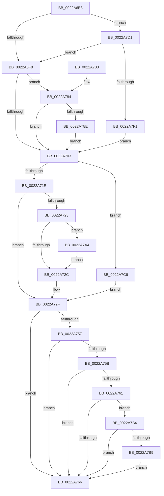

# MiResetAccessBitPteWorker

- RVA: `0x0022A6B8`–`0x0022A7F8` (길이 `320` bytes)
- VA: `0x000000014022A6B8`
- 실행 섹션: `.text`
- PDB 이름 있음: `예`; PDB Function 태그: `아니요`
- unwind 정보 RVA: `0x0005FDF0`
- 디코드: `91`개 명령, `320/320` bytes 표시
- 미해석 바이트: `0` (있으면 어셈블리에 `.byte`로 보존)

> 이 문서는 커널 이미지의 기계어와 PDB 기호를 분석해 생성했습니다. 4번과 5번은 함수 원형과 자료형을 바이너리 사용 방식에서 추정한 C 해석이며 원본 소스 복구 결과는 아닙니다.

## 1. Dependencies

- 직접 호출 지점: **7**; 고유 호출 대상: **7**
- 직접 호출자로 확인된 함수: **2**
- RIP 상대 이미지 참조: **0**

### Outgoing calls
- `0x0022A6E3` → [MiGetVaAge](../24/MiGetVaAge_function_00240AC0.md) (function, `0x00240AC0`)
- `0x0022A74E` → [MiClearPteAccessed](../29/MiClearPteAccessed_function_00290630.md) (function, `0x00290630`)
- `0x0022A79A` → [MiSetVaAgeList](../29/MiSetVaAgeList_function_00290A20.md) (function, `0x00290A20`)
- `0x0022A7AA` → [MiAcquirePrcbAgeTrimLists](../29/MiAcquirePrcbAgeTrimLists_function_002918B0.md) (function, `0x002918B0`)
- `0x0022A7BF` → [MiLogPageAccess](../24/MiLogPageAccess_function_00240870.md) (function, `0x00240870`)
- `0x0022A7D4` → [MiGetVmAccessLoggingPartition](../38/MiGetVmAccessLoggingPartition_function_003815A0.md) (function, `0x003815A0`)
- `0x0022A7DF` → [MiGetPfnPriority](../32/MiGetPfnPriority_function_003226F0.md) (function, `0x003226F0`)

### Direct callers
- [MiResetAccessBitPte](MiResetAccessBitPte_function_0022A800.md) at `0x0022A8C3`
- [MiResetAccessBitsVpabCallback](../4A/MiResetAccessBitsVpabCallback_function_004A7410.md) at `0x004A748F`

### Static image references
- 디코드된 RIP-relative 메모리 참조가 없습니다.

## 2. Other-region calls and transfers

- 다른 실행 섹션으로 향하는 call: **0**
- 별도 외부 분기/꼬리 이동을 확인하지 못했습니다.

## 3. Assembly (complete function range)

```asm
0022A6B8  48 89 5C 24 08                  mov qword ptr [rsp + 8], rbx
0022A6BD  48 89 6C 24 10                  mov qword ptr [rsp + 0x10], rbp
0022A6C2  48 89 74 24 18                  mov qword ptr [rsp + 0x18], rsi
0022A6C7  57                              push rdi
0022A6C8  41 54                           push r12
0022A6CA  41 55                           push r13
0022A6CC  41 56                           push r14
0022A6CE  41 57                           push r15
0022A6D0  48 83 EC 30                     sub rsp, 0x30
0022A6D4  4C 8B E2                        mov r12, rdx
0022A6D7  4D 8B E9                        mov r13, r9
0022A6DA  49 8B D0                        mov rdx, r8
0022A6DD  49 8B F0                        mov rsi, r8
0022A6E0  48 8B F9                        mov rdi, rcx
0022A6E3  E8 D8 63 01 00                  call 0x140240ac0
0022A6E8  44 8A D8                        mov r11b, al
0022A6EB  BD 01 00 00 00                  mov ebp, 1
0022A6F0  3C 07                           cmp al, 7
0022A6F2  0F 84 D9 00 00 00               je 0x14022a7d1
0022A6F8  8B DD                           mov ebx, ebp
0022A6FA  45 84 DB                        test r11b, r11b
0022A6FD  0F 85 81 00 00 00               jne 0x14022a784
0022A703  48 8B B4 24 80 00 00 00         mov rsi, qword ptr [rsp + 0x80]
0022A70B  33 ED                           xor ebp, ebp
0022A70D  45 33 FF                        xor r15d, r15d
0022A710  F6 84 24 88 00 00 00 04         test byte ptr [rsp + 0x88], 4
0022A718  0F 85 A8 00 00 00               jne 0x14022a7c6
0022A71E  39 6E 04                        cmp dword ptr [rsi + 4], ebp
0022A721  74 0C                           je 0x14022a72f
0022A723  4C 8D 76 08                     lea r14, [rsi + 8]
0022A727  49 39 2E                        cmp qword ptr [r14], rbp
0022A72A  74 78                           je 0x14022a7a4
0022A72C  49 8B 2E                        mov rbp, qword ptr [r14]
0022A72F  45 8B F7                        mov r14d, r15d
0022A732  4C 8B CD                        mov r9, rbp
0022A735  41 83 CE 01                     or r14d, 1
0022A739  4D 8B C4                        mov r8, r12
0022A73C  83 3E 00                        cmp dword ptr [rsi], 0
0022A73F  49 8B D5                        mov rdx, r13
0022A742  48 8B CF                        mov rcx, rdi
0022A745  45 0F 44 F7                     cmove r14d, r15d
0022A749  44 89 74 24 20                  mov dword ptr [rsp + 0x20], r14d
0022A74E  E8 DD 5E 06 00                  call 0x140290630
0022A753  85 C0                           test eax, eax
0022A755  74 0F                           je 0x14022a766
0022A757  85 DB                           test ebx, ebx
0022A759  74 0B                           je 0x14022a766
0022A75B  41 F6 C6 02                     test r14b, 2
0022A75F  75 05                           jne 0x14022a766
0022A761  83 3E 00                        cmp dword ptr [rsi], 0
0022A764  75 4E                           jne 0x14022a7b4
0022A766  48 8B 5C 24 60                  mov rbx, qword ptr [rsp + 0x60]
0022A76B  48 8B 6C 24 68                  mov rbp, qword ptr [rsp + 0x68]
0022A770  48 8B 74 24 70                  mov rsi, qword ptr [rsp + 0x70]
0022A775  48 83 C4 30                     add rsp, 0x30
0022A779  41 5F                           pop r15
0022A77B  41 5E                           pop r14
0022A77D  41 5D                           pop r13
0022A77F  41 5C                           pop r12
0022A781  5F                              pop rdi
0022A782  C3                              ret
0022A783  CC                              int3
0022A784  41 80 FB 07                     cmp r11b, 7
0022A788  0F 83 75 FF FF FF               jae 0x14022a703
0022A78E  45 33 C9                        xor r9d, r9d
0022A791  44 8B C5                        mov r8d, ebp
0022A794  48 8B D6                        mov rdx, rsi
0022A797  48 8B CF                        mov rcx, rdi
0022A79A  E8 81 62 06 00                  call 0x140290a20
0022A79F  E9 5F FF FF FF                  jmp 0x14022a703
0022A7A4  49 8B D6                        mov rdx, r14
0022A7A7  48 8B CF                        mov rcx, rdi
0022A7AA  E8 01 71 06 00                  call 0x1402918b0
0022A7AF  E9 78 FF FF FF                  jmp 0x14022a72c
0022A7B4  48 85 ED                        test rbp, rbp
0022A7B7  75 AD                           jne 0x14022a766
0022A7B9  49 8B D4                        mov rdx, r12
0022A7BC  48 8B CF                        mov rcx, rdi
0022A7BF  E8 AC 60 01 00                  call 0x140240870
0022A7C4  EB A0                           jmp 0x14022a766
0022A7C6  41 BF 02 00 00 00               mov r15d, 2
0022A7CC  E9 5E FF FF FF                  jmp 0x14022a72f
0022A7D1  48 8B CF                        mov rcx, rdi
0022A7D4  E8 C7 6D 15 00                  call 0x1403815a0
0022A7D9  49 8B CD                        mov rcx, r13
0022A7DC  4C 8B D0                        mov r10, rax
0022A7DF  E8 0C 7F 0F 00                  call 0x1403226f0
0022A7E4  41 3B 82 30 44 00 00            cmp eax, dword ptr [r10 + 0x4430]
0022A7EB  0F 83 07 FF FF FF               jae 0x14022a6f8
0022A7F1  33 DB                           xor ebx, ebx
0022A7F3  E9 0B FF FF FF                  jmp 0x14022a703
```

## 4. C-style interpretation (structured pseudocode)

```c
__int64 __fastcall MiResetAccessBitPteWorker(__int64 a1, __int64 a2, __int64 a3, __int64 a4, __int64 a5, unsigned __int8 a6)
{
    __int64 result;
    __int64 v_r14;
    __int64 v_r15;
    __int64 v_rbp;
    __int64 v_rbx;
    __int64 v_rsp;
    unsigned int v_stack_m38;
    unsigned __int64 v_stack_p10;
    unsigned __int64 v_stack_p18;
    unsigned __int64 v_stack_p8;

    v_stack_p8 = v_rbx;
    v_stack_p10 = v_rbp;
    v_stack_p18 = v_rsi;
    v_rsp = (v_rsp) - (48);
    result = MiGetVaAge(a1, a3, a3, a4);
    if (((unsigned __int8)(result)) == 7) goto loc_0022A7D1;
loc_0022A6F8:
    if ((unsigned __int8)((unsigned __int8)(result)) != 0) goto loc_0022A784;
loc_0022A703:
    v_rbp = 0;
    v_r15 = 0;
    if (((a6) & (4)) != 0) goto loc_0022A7C6;
    if ((*(unsigned int *)(a5 + 4)) == 0) goto loc_0022A72F;
    if ((*(unsigned __int64 *)(a5 + 8)) == 0) goto loc_0022A7A4;
loc_0022A72C:
loc_0022A72F:
    v_r14 = (unsigned int)((0) | (1));
    if ((*(unsigned int *)(a5)) == 0) { v_r14 = 0; }
    v_stack_m38 = (unsigned int)(v_r14);
    result = MiClearPteAccessed(a1, a4, a2, *(unsigned __int64 *)(a5 + 8));
    if ((unsigned int)(result) == 0) goto loc_0022A766;
    if (1 == 0) goto loc_0022A766;
    if ((((unsigned __int8)(v_r14)) & (2)) != 0) goto loc_0022A766;
    if ((*(unsigned int *)(a5)) != 0) goto loc_0022A7B4;
loc_0022A766:
    v_rsp = (v_rsp) + (48);
    return result;
loc_0022A784:
    if (((unsigned __int8)((unsigned __int8)(result))) >= 7) goto loc_0022A703;
    a4 = 0;
    result = MiSetVaAgeList(a1, v_stack_p18, (unsigned int)((unsigned int)(v_stack_p10)), a4);
    goto loc_0022A703;
loc_0022A7A4:
    result = MiAcquirePrcbAgeTrimLists(a1, v_r14, (unsigned int)((unsigned int)(v_stack_p10)), a4);
    goto loc_0022A72C;
loc_0022A7B4:
    if (v_stack_p10 != 0) goto loc_0022A766;
    result = MiLogPageAccess(a1, a2, (unsigned int)((unsigned int)(v_stack_p10)), a4);
    goto loc_0022A766;
loc_0022A7C6:
    goto loc_0022A72F;
loc_0022A7D1:
    result = MiGetVmAccessLoggingPartition(a1, a2, (unsigned int)((unsigned int)(v_stack_p10)), a4);
    result = MiGetPfnPriority(0, a2, (unsigned int)((unsigned int)(v_stack_p10)), a4);
    if (((unsigned int)(result)) >= (*(unsigned int *)(result + 17456))) goto loc_0022A6F8;
    v_rbx = 0;
    goto loc_0022A703;
}
```

## 5. (Beta) C Style

```c
int64_t MiResetAccessBitPteWorker(int64_t Arg1, int64_t Arg2, int64_t Arg3, int64_t Arg4, void *Arg5, uint8_t Arg6)
{
    uint8_t *arg5 = (uint8_t *)Arg5;

    int64_t result;
    int64_t local_r14;
    int64_t local_r15;
    int64_t local_rbp;
    int64_t local_rbx;
    int64_t local_rsp;
    uint32_t v_stack_m38;
    uint64_t v_stack_p10;
    uint64_t v_stack_p18;
    uint64_t v_stack_p8;

    v_stack_p8 = local_rbx;
    v_stack_p10 = local_rbp;
    v_stack_p18 = local_rsi;
    local_rsp = (local_rsp) - (48);
    result = MiGetVaAge(Arg1, Arg3, Arg3, Arg4);
    if (((uint8_t)(result)) == 7) goto loc_0022A7D1;
loc_0022A6F8:
    if ((uint8_t)((uint8_t)(result)) != 0) goto loc_0022A784;
loc_0022A703:
    local_rbp = 0;
    local_r15 = 0;
    if (((Arg6) & (4)) != 0) goto loc_0022A7C6;
    if ((*(uint32_t *)(arg5 + 0x4)) == 0) goto loc_0022A72F;
    if ((*(uint64_t *)(arg5 + 0x8)) == 0) goto loc_0022A7A4;
loc_0022A72C:
loc_0022A72F:
    local_r14 = (uint32_t)((0) | (1));
    if ((*(uint32_t *)(arg5)) == 0) { local_r14 = 0; }
    v_stack_m38 = (uint32_t)(local_r14);
    result = MiClearPteAccessed(Arg1, Arg4, Arg2, *(uint64_t *)(arg5 + 0x8));
    if ((uint32_t)(result) == 0) goto loc_0022A766;
    if (1 == 0) goto loc_0022A766;
    if ((((uint8_t)(local_r14)) & (2)) != 0) goto loc_0022A766;
    if ((*(uint32_t *)(arg5)) != 0) goto loc_0022A7B4;
loc_0022A766:
    local_rsp = (local_rsp) + (48);
    return result;
loc_0022A784:
    if (((uint8_t)((uint8_t)(result))) >= 7) goto loc_0022A703;
    Arg4 = 0;
    result = MiSetVaAgeList(Arg1, v_stack_p18, (uint32_t)((uint32_t)(v_stack_p10)), Arg4);
    goto loc_0022A703;
loc_0022A7A4:
    result = MiAcquirePrcbAgeTrimLists(Arg1, local_r14, (uint32_t)((uint32_t)(v_stack_p10)), Arg4);
    goto loc_0022A72C;
loc_0022A7B4:
    if (v_stack_p10 != 0) goto loc_0022A766;
    result = MiLogPageAccess(Arg1, Arg2, (uint32_t)((uint32_t)(v_stack_p10)), Arg4);
    goto loc_0022A766;
loc_0022A7C6:
    goto loc_0022A72F;
loc_0022A7D1:
    result = MiGetVmAccessLoggingPartition(Arg1, Arg2, (uint32_t)((uint32_t)(v_stack_p10)), Arg4);
    result = MiGetPfnPriority(0, Arg2, (uint32_t)((uint32_t)(v_stack_p10)), Arg4);
    if (((uint32_t)(result)) >= (*(uint32_t *)(result + 0x4430))) goto loc_0022A6F8;
    local_rbx = 0;
    goto loc_0022A703;
}
```

### 관측된 메모리 오프셋

구조체 형식이 확인되지 않은 접근은 인자 기준의 오프셋으로만 기록했습니다.

| 기준 인자 | 오프셋 표현 | 폭 (bit) | 접근 |
|---|---:|---:|---|
| `Arg5` | `+ 0x0` | `32` | `R` |
| `Arg5` | `+ 0x0` | `64` | `R` |
| `Arg5` | `+ 0x4` | `32` | `R` |
| `Arg5` | `+ 0x8` | `64` | `R` |

## 6. Execution-region graph

[열기: 2D/3D 그래프와 함수 탐색 컨트롤 패널](../../../control-panel.html?section=text&rva=0x0022A6B8&view=graph)

- 2D 그래프는 위에서 아래로 흐르고, 3D 그래프는 빈 공간을 드래그해 회전합니다. Shift+드래그는 이동, 휠은 확대·축소, 함수 노드 선택은 대상 보고서 이동입니다.

### Static fallback


