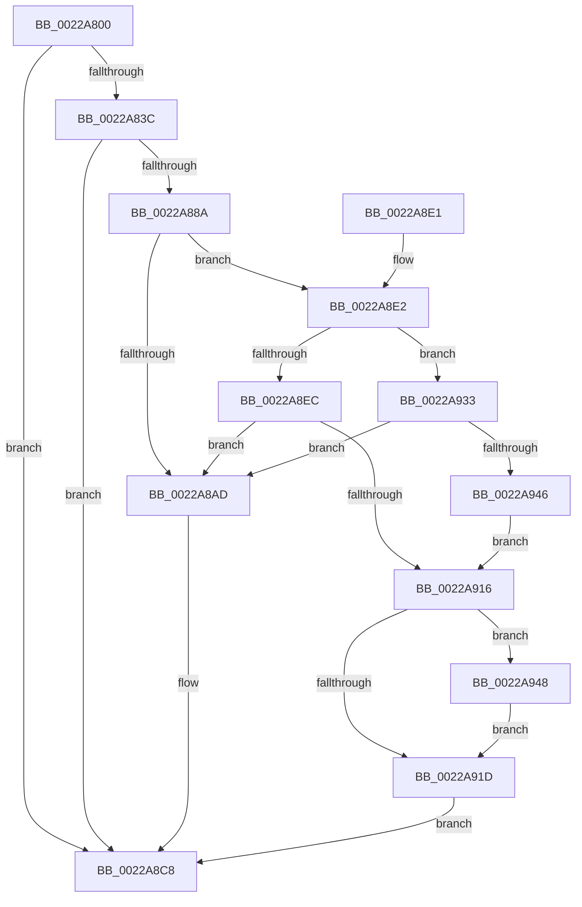

# MiResetAccessBitPte

- RVA: `0x0022A800`–`0x0022A956` (길이 `342` bytes)
- VA: `0x000000014022A800`
- 실행 섹션: `.text`
- PDB 이름 있음: `예`; PDB Function 태그: `아니요`
- unwind 정보 RVA: `0x0005FE10`
- 디코드: `93`개 명령, `342/342` bytes 표시
- 미해석 바이트: `0` (있으면 어셈블리에 `.byte`로 보존)

> 이 문서는 커널 이미지의 기계어와 PDB 기호를 분석해 생성했습니다. 4번과 5번은 함수 원형과 자료형을 바이너리 사용 방식에서 추정한 C 해석이며 원본 소스 복구 결과는 아닙니다.

## 1. Dependencies

- 직접 호출 지점: **5**; 고유 호출 대상: **5**
- 직접 호출자로 확인된 함수: **0**
- RIP 상대 이미지 참조: **0**

### Outgoing calls
- `0x0022A82A` → [MI_READ_PTE_LOCK_FREE](../28/MI_READ_PTE_LOCK_FREE_function_002828A0.md) (function, `0x002828A0`)
- `0x0022A881` → [MiWalkVaCheckCommon](MiWalkVaCheckCommon_function_0022A960.md) (function, `0x0022A960`)
- `0x0022A8C3` → [MiResetAccessBitPteWorker](MiResetAccessBitPteWorker_function_0022A6B8.md) (function, `0x0022A6B8`)
- `0x0022A90D` → [MiGetPagePrivilege](../28/MiGetPagePrivilege_function_00285420.md) (function, `0x00285420`)
- `0x0022A94F` → [MiAcquirePrcbAgeTrimLists](../29/MiAcquirePrcbAgeTrimLists_function_002918B0.md) (function, `0x002918B0`)

### Direct callers
- 이 함수 시작 RVA로 연결되는 직접 call은 확인되지 않았습니다. 간접 호출은 완전히 역산할 수 없습니다.

### Static image references
- 디코드된 RIP-relative 메모리 참조가 없습니다.

## 2. Other-region calls and transfers

- 다른 실행 섹션으로 향하는 call: **0**
- 별도 외부 분기/꼬리 이동을 확인하지 못했습니다.

## 3. Assembly (complete function range)

```asm
0022A800  48 89 5C 24 10                  mov qword ptr [rsp + 0x10], rbx
0022A805  48 89 6C 24 18                  mov qword ptr [rsp + 0x18], rbp
0022A80A  56                              push rsi
0022A80B  57                              push rdi
0022A80C  41 54                           push r12
0022A80E  41 56                           push r14
0022A810  41 57                           push r15
0022A812  48 83 EC 30                     sub rsp, 0x30
0022A816  48 8B B9 B8 00 00 00            mov rdi, qword ptr [rcx + 0xb8]
0022A81D  41 8B D8                        mov ebx, r8d
0022A820  48 8B 71 20                     mov rsi, qword ptr [rcx + 0x20]
0022A824  48 8B EA                        mov rbp, rdx
0022A827  48 8B CA                        mov rcx, rdx
0022A82A  E8 71 80 05 00                  call 0x1402828a0
0022A82F  48 89 44 24 60                  mov qword ptr [rsp + 0x60], rax
0022A834  A8 20                           test al, 0x20
0022A836  0F 84 8C 00 00 00               je 0x14022a8c8
0022A83C  48 C1 E8 0C                     shr rax, 0xc
0022A840  49 BC FF FF FF FF FF 00 00 00   movabs r12, 0xffffffffff
0022A84A  49 23 C4                        and rax, r12
0022A84D  49 BF 00 00 00 00 00 DE FF FF   movabs r15, 0xffffde0000000000
0022A857  4C 8D 34 40                     lea r14, [rax + rax*2]
0022A85B  49 C1 E6 04                     shl r14, 4
0022A85F  49 8B C7                        mov rax, r15
0022A862  4C 03 F0                        add r14, rax
0022A865  45 33 C9                        xor r9d, r9d
0022A868  48 8D 44 24 60                  lea rax, [rsp + 0x60]
0022A86D  85 DB                           test ebx, ebx
0022A86F  4D 8B C6                        mov r8, r14
0022A872  48 89 44 24 20                  mov qword ptr [rsp + 0x20], rax
0022A877  41 0F 94 C1                     sete r9b
0022A87B  48 8B D5                        mov rdx, rbp
0022A87E  48 8B CE                        mov rcx, rsi
0022A881  E8 DA 00 00 00                  call 0x14022a960
0022A886  85 C0                           test eax, eax
0022A888  74 3E                           je 0x14022a8c8
0022A88A  48 8B DD                        mov rbx, rbp
0022A88D  48 C1 E3 19                     shl rbx, 0x19
0022A891  48 B8 00 00 00 00 80 F6 FF FF   movabs rax, 0xfffff68000000000
0022A89B  48 C1 E0 19                     shl rax, 0x19
0022A89F  48 2B D8                        sub rbx, rax
0022A8A2  48 C1 FB 10                     sar rbx, 0x10
0022A8A6  48 83 7F 18 00                  cmp qword ptr [rdi + 0x18], 0
0022A8AB  75 35                           jne 0x14022a8e2
0022A8AD  83 64 24 28 00                  and dword ptr [rsp + 0x28], 0
0022A8B2  4D 8B CE                        mov r9, r14
0022A8B5  4C 8B C3                        mov r8, rbx
0022A8B8  48 89 7C 24 20                  mov qword ptr [rsp + 0x20], rdi
0022A8BD  48 8B D5                        mov rdx, rbp
0022A8C0  48 8B CE                        mov rcx, rsi
0022A8C3  E8 F0 FD FF FF                  call 0x14022a6b8
0022A8C8  48 8B 5C 24 68                  mov rbx, qword ptr [rsp + 0x68]
0022A8CD  33 C0                           xor eax, eax
0022A8CF  48 8B 6C 24 70                  mov rbp, qword ptr [rsp + 0x70]
0022A8D4  48 83 C4 30                     add rsp, 0x30
0022A8D8  41 5F                           pop r15
0022A8DA  41 5E                           pop r14
0022A8DC  41 5C                           pop r12
0022A8DE  5F                              pop rdi
0022A8DF  5E                              pop rsi
0022A8E0  C3                              ret
0022A8E1  CC                              int3
0022A8E2  8B 86 B8 00 00 00               mov eax, dword ptr [rsi + 0xb8]
0022A8E8  A8 0F                           test al, 0xf
0022A8EA  74 47                           je 0x14022a933
0022A8EC  48 8B 44 24 60                  mov rax, qword ptr [rsp + 0x60]
0022A8F1  48 C1 E8 0C                     shr rax, 0xc
0022A8F5  49 23 C4                        and rax, r12
0022A8F8  48 8D 0C 40                     lea rcx, [rax + rax*2]
0022A8FC  48 C1 E1 04                     shl rcx, 4
0022A900  49 8B C7                        mov rax, r15
0022A903  45 33 C0                        xor r8d, r8d
0022A906  48 03 C8                        add rcx, rax
0022A909  41 8D 50 02                     lea edx, [r8 + 2]
0022A90D  E8 0E AB 05 00                  call 0x140285420
0022A912  A8 41                           test al, 0x41
0022A914  74 97                           je 0x14022a8ad
0022A916  48 83 7F 18 01                  cmp qword ptr [rdi + 0x18], 1
0022A91B  74 2B                           je 0x14022a948
0022A91D  48 8B 4F 18                     mov rcx, qword ptr [rdi + 0x18]
0022A921  48 81 E3 00 F0 FF FF            and rbx, 0xfffffffffffff000
0022A928  8B 01                           mov eax, dword ptr [rcx]
0022A92A  48 89 5C C1 08                  mov qword ptr [rcx + rax*8 + 8], rbx
0022A92F  FF 01                           inc dword ptr [rcx]
0022A931  EB 95                           jmp 0x14022a8c8
0022A933  48 B8 FF FF FE FF FF 7F 00 00   movabs rax, 0x7ffffffeffff
0022A93D  48 3B D8                        cmp rbx, rax
0022A940  0F 87 67 FF FF FF               ja 0x14022a8ad
0022A946  EB CE                           jmp 0x14022a916
0022A948  48 8D 57 08                     lea rdx, [rdi + 8]
0022A94C  48 8B CE                        mov rcx, rsi
0022A94F  E8 5C 6F 06 00                  call 0x1402918b0
0022A954  EB C7                           jmp 0x14022a91d
```

## 4. C-style interpretation (structured pseudocode)

```c
__int64 __fastcall MiResetAccessBitPte(__int64 a1, __int64 a2, int a3, int a4)
{
    __int64 result;
    __int64 v_r14;
    __int64 v_rbx;
    __int64 v_rsp;
    unsigned int v_stack_m30;
    unsigned __int64 v_stack_m38;
    unsigned __int64 v_stack_p10;
    unsigned __int64 v_stack_p18;
    unsigned __int64 v_stack_p60;
    unsigned __int64 v_stack_p8;

    v_stack_p10 = v_rbx;
    v_stack_p18 = v_rbp;
    v_rsp = (v_rsp) - (48);
    result = MI_READ_PTE_LOCK_FREE(a2, a2, a3, a4);
    v_stack_p8 = result;
    if ((((unsigned __int8)(result)) & (32)) == 0) goto loc_0022A8C8;
    result = (result) >> (12);
    result = (result) & (v_r12);
    v_r14 = (result + result * 2) << (4);
    v_r14 = (v_r14) + (v_r15);
    a4 = 0;
    v_stack_m38 = v_stack_p8;
    a4 = ((unsigned int)((unsigned int)(a3)) == 0) ? 1 : 0;
    result = MiWalkVaCheckCommon(*(unsigned __int64 *)(a1 + 32), a2, v_r14, a4);
    if ((unsigned int)(result) == 0) goto loc_0022A8C8;
    v_rbx = (a2) << (25);
    result = (result) << (25);
    v_rbx = (v_rbx) - (result);
    v_rbx = (v_rbx) >> (16);
    if ((*(unsigned __int64 *)(*(unsigned __int64 *)(a1 + 184) + 24)) != 0) goto loc_0022A8E2;
loc_0022A8AD:
    v_stack_m38 = *(unsigned __int64 *)(a1 + 184);
    result = MiResetAccessBitPteWorker(*(unsigned __int64 *)(a1 + 32), a2, v_rbx, v_r14);
loc_0022A8C8:
    result = 0;
    v_rsp = (v_rsp) + (48);
    return result;
loc_0022A8E2:
    if ((((unsigned __int8)((unsigned int)(*(unsigned int *)(*(unsigned __int64 *)(a1 + 32) + 184)))) & (15)) == 0) goto loc_0022A933;
    result = (v_stack_p60) >> (12);
    result = (result) & (v_r12);
    a1 = (result + result * 2) << (4);
    a3 = 0;
    a1 = (a1) + (v_r15);
    result = MiGetPagePrivilege(a1, a3 + 2, a3, v_r14);
    if ((((unsigned __int8)(result)) & (65)) == 0) goto loc_0022A8AD;
loc_0022A916:
    if ((*(unsigned __int64 *)(*(unsigned __int64 *)(a1 + 184) + 24)) == 1) goto loc_0022A948;
loc_0022A91D:
    v_rbx = (v_stack_p10) & (0xFFFFFFFFFFFFF000ULL);
    *(unsigned __int64 *)(*(unsigned __int64 *)(*(unsigned __int64 *)(a1 + 184) + 24) + (unsigned int)(*(unsigned int *)(*(unsigned __int64 *)(*(unsigned __int64 *)(a1 + 184) + 24))) * 8 + 8) = v_rbx;
    goto loc_0022A8C8;
loc_0022A933:
    if (v_rbx > ((unsigned int)(*(unsigned int *)(*(unsigned __int64 *)(*(unsigned __int64 *)(a1 + 184) + 24))))) goto loc_0022A8AD;
    goto loc_0022A916;
loc_0022A948:
    result = MiAcquirePrcbAgeTrimLists(*(unsigned __int64 *)(a1 + 32), *(unsigned __int64 *)(a1 + 184) + 8, a3, v_r14);
    goto loc_0022A91D;
}
```

## 5. (Beta) C Style

```c
int64_t MiResetAccessBitPte(void *Arg1, int64_t Arg2, int32_t Arg3, int32_t Arg4)
{
    uint8_t *arg1 = (uint8_t *)Arg1;

    int64_t result;
    int64_t local_r14;
    int64_t local_rbx;
    int64_t local_rsp;
    uint32_t v_stack_m30;
    uint64_t v_stack_m38;
    uint64_t v_stack_p10;
    uint64_t v_stack_p18;
    uint64_t v_stack_p60;
    uint64_t v_stack_p8;

    v_stack_p10 = local_rbx;
    v_stack_p18 = local_rbp;
    local_rsp = (local_rsp) - (48);
    result = MI_READ_PTE_LOCK_FREE(Arg2, Arg2, Arg3, Arg4);
    v_stack_p8 = result;
    if ((((uint8_t)(result)) & (32)) == 0) goto loc_0022A8C8;
    result = (result) >> (12);
    result = (result) & (local_r12);
    local_r14 = (result + result * 2) << (4);
    local_r14 = (local_r14) + (local_r15);
    Arg4 = 0;
    v_stack_m38 = v_stack_p8;
    Arg4 = ((uint32_t)((uint32_t)(Arg3)) == 0) ? 1 : 0;
    result = MiWalkVaCheckCommon(*(uint64_t *)(arg1 + 0x20), Arg2, local_r14, Arg4);
    if ((uint32_t)(result) == 0) goto loc_0022A8C8;
    local_rbx = (Arg2) << (25);
    result = (result) << (25);
    local_rbx = (local_rbx) - (result);
    local_rbx = (local_rbx) >> (16);
    if ((*(uint64_t *)(*(uint64_t *)(arg1 + 0xB8) + 0x18)) != 0) goto loc_0022A8E2;
loc_0022A8AD:
    v_stack_m38 = *(uint64_t *)(arg1 + 0xB8);
    result = MiResetAccessBitPteWorker(*(uint64_t *)(arg1 + 0x20), Arg2, local_rbx, local_r14);
loc_0022A8C8:
    result = 0;
    local_rsp = (local_rsp) + (48);
    return result;
loc_0022A8E2:
    if ((((uint8_t)((uint32_t)(*(uint32_t *)(*(uint64_t *)(arg1 + 0x20) + 0xB8)))) & (15)) == 0) goto loc_0022A933;
    result = (v_stack_p60) >> (12);
    result = (result) & (local_r12);
    Arg1 = (result + result * 2) << (4);
    Arg3 = 0;
    Arg1 = (Arg1) + (local_r15);
    result = MiGetPagePrivilege(Arg1, Arg3 + 2, Arg3, local_r14);
    if ((((uint8_t)(result)) & (65)) == 0) goto loc_0022A8AD;
loc_0022A916:
    if ((*(uint64_t *)(*(uint64_t *)(arg1 + 0xB8) + 0x18)) == 1) goto loc_0022A948;
loc_0022A91D:
    local_rbx = (v_stack_p10) & (0xFFFFFFFFFFFFF000ULL);
    *(uint64_t *)(*(uint64_t *)(*(uint64_t *)(arg1 + 0xB8) + 0x18) + (uint32_t)(*(uint32_t *)(*(uint64_t *)(*(uint64_t *)(arg1 + 0xB8) + 0x18))) * 8 + 0x8) = local_rbx;
    goto loc_0022A8C8;
loc_0022A933:
    if (local_rbx > ((uint32_t)(*(uint32_t *)(*(uint64_t *)(*(uint64_t *)(arg1 + 0xB8) + 0x18))))) goto loc_0022A8AD;
    goto loc_0022A916;
loc_0022A948:
    result = MiAcquirePrcbAgeTrimLists(*(uint64_t *)(arg1 + 0x20), *(uint64_t *)(arg1 + 0xB8) + 8, Arg3, local_r14);
    goto loc_0022A91D;
}
```

### 관측된 메모리 오프셋

구조체 형식이 확인되지 않은 접근은 인자 기준의 오프셋으로만 기록했습니다.

| 기준 인자 | 오프셋 표현 | 폭 (bit) | 접근 |
|---|---:|---:|---|
| `Arg1` | `+ 0x20` | `64` | `R` |
| `Arg1` | `+ 0xB8` | `64` | `R` |

## 6. Execution-region graph

[열기: 2D/3D 그래프와 함수 탐색 컨트롤 패널](../../../control-panel.html?section=text&rva=0x0022A800&view=graph)

- 2D 그래프는 위에서 아래로 흐르고, 3D 그래프는 빈 공간을 드래그해 회전합니다. Shift+드래그는 이동, 휠은 확대·축소, 함수 노드 선택은 대상 보고서 이동입니다.

### Static fallback


