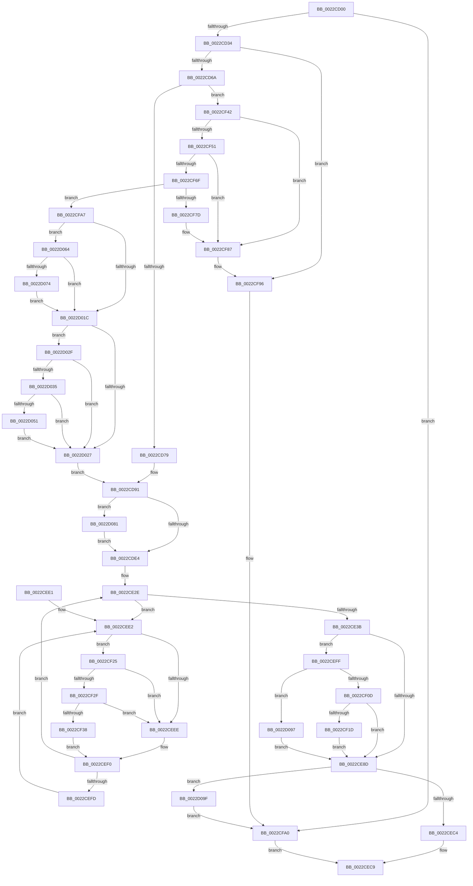

# MiResolveProtoCombine

- RVA: `0x0022CD00`–`0x0022D0BD` (길이 `957` bytes)
- VA: `0x000000014022CD00`
- 실행 섹션: `.text`
- PDB 이름 있음: `예`; PDB Function 태그: `아니요`
- unwind 정보 RVA: `0x00060000`
- 디코드: `241`개 명령, `957/957` bytes 표시
- 미해석 바이트: `0` (있으면 어셈블리에 `.byte`로 보존)

> 이 문서는 커널 이미지의 기계어와 PDB 기호를 분석해 생성했습니다. 4번과 5번은 함수 원형과 자료형을 바이너리 사용 방식에서 추정한 C 해석이며 원본 소스 복구 결과는 아닙니다.

## 1. Dependencies

- 직접 호출 지점: **19**; 고유 호출 대상: **16**
- 직접 호출자로 확인된 함수: **1**
- RIP 상대 이미지 참조: **4**

### Outgoing calls
- `0x0022CD26` → [MiLockProtoPoolPage](../2B/MiLockProtoPoolPage_function_002B8B80.md) (function, `0x002B8B80`)
- `0x0022CD37` → [MiGetContainingPageTable](../34/MiGetContainingPageTable_function_003467F0.md) (function, `0x003467F0`)
- `0x0022CD59` → [MiLockLeafPage](../36/MiLockLeafPage_function_003658C0.md) (function, `0x003658C0`)
- `0x0022CDD6` → [MiUnlockProtoPoolPage](../24/MiUnlockProtoPoolPage_function_00246090.md) (function, `0x00246090`)
- `0x0022CE14` → [MiGetContainingPageTable](../34/MiGetContainingPageTable_function_003467F0.md) (function, `0x003467F0`)
- `0x0022CE96` → [MiMakeValidPte](../2C/MiMakeValidPte_function_002C5590.md) (function, `0x002C5590`)
- `0x0022CEB7` → [MiAllocateWsle](../33/MiAllocateWsle_function_003332C0.md) (function, `0x003332C0`)
- `0x0022CF2F` → [KiCheckVpBackingLongSpinWaitHypercall](../30/KiCheckVpBackingLongSpinWaitHypercall_function_0030F490.md) (function, `0x0030F490`)
- `0x0022CF3B` → [HvlNotifyLongSpinWait](../30/HvlNotifyLongSpinWait_function_0030F460.md) (function, `0x0030F460`)
- `0x0022CF74` → [MiUnlinkPageFromListEx](../28/MiUnlinkPageFromListEx_function_00287590.md) (function, `0x00287590`)
- `0x0022CF82` → [MiDiscardTransitionPteEx](../37/MiDiscardTransitionPteEx_function_00375954.md) (function, `0x00375954`)
- `0x0022CF9B` → [MiUnlockProtoPoolPage](../24/MiUnlockProtoPoolPage_function_00246090.md) (function, `0x00246090`)
- `0x0022D00A` → [MiMakeTransitionPteValid](../28/MiMakeTransitionPteValid_function_00283D60.md) (function, `0x00283D60`)
- `0x0022D05D` → [MiCheckLinearProtectedPteAccessedBit](../29/MiCheckLinearProtectedPteAccessedBit_function_00292D80.md) (function, `0x00292D80`)
- `0x0022D06B` → [MiIsPteInStore](../36/MiIsPteInStore_function_00362460.md) (function, `0x00362460`)
- `0x0022D077` → [MiCaptureDirtyBitToPfn](../37/MiCaptureDirtyBitToPfn_function_00370DD0.md) (function, `0x00370DD0`)
- `0x0022D08D` → [MiReleasePageFileInfo](../28/MiReleasePageFileInfo_function_00283FD0.md) (function, `0x00283FD0`)
- `0x0022D0A9` → [MiLockAndDecrementShareCount](../2A/MiLockAndDecrementShareCount_function_002A2854.md) (function, `0x002A2854`)
- `0x0022D0B3` → [MiLockAndDecrementShareCount](../2A/MiLockAndDecrementShareCount_function_002A2854.md) (function, `0x002A2854`)

### Direct callers
- [MiCombineWithExisting](MiCombineWithExisting_function_0022B4B8.md) at `0x0022B7FF`

### Static image references
- `0x0022CD7D` → RVA `0x00E30088` (`.data`; read)
- `0x0022CEE5` → RVA `0x00FC52AC` (`ALMOSTRO`; reference)
- `0x0022CF25` → RVA `0x00FC6AB8` (`ALMOSTRO`; read)
- `0x0022D01C` → RVA `0x00FC6A88` (`ALMOSTRO`; read)

## 2. Other-region calls and transfers

- 다른 실행 섹션으로 향하는 call: **0**
- 별도 외부 분기/꼬리 이동을 확인하지 못했습니다.

## 3. Assembly (complete function range)

```asm
0022CD00  48 89 5C 24 08                  mov qword ptr [rsp + 8], rbx
0022CD05  48 89 54 24 10                  mov qword ptr [rsp + 0x10], rdx
0022CD0A  55                              push rbp
0022CD0B  56                              push rsi
0022CD0C  57                              push rdi
0022CD0D  41 54                           push r12
0022CD0F  41 55                           push r13
0022CD11  41 56                           push r14
0022CD13  41 57                           push r15
0022CD15  48 83 EC 40                     sub rsp, 0x40
0022CD19  4C 8B E1                        mov r12, rcx
0022CD1C  33 D2                           xor edx, edx
0022CD1E  49 8B C8                        mov rcx, r8
0022CD21  4D 8B F0                        mov r14, r8
0022CD24  33 DB                           xor ebx, ebx
0022CD26  E8 55 BE 08 00                  call 0x1402b8b80
0022CD2B  48 85 C0                        test rax, rax
0022CD2E  0F 84 6C 02 00 00               je 0x14022cfa0
0022CD34  49 8B CE                        mov rcx, r14
0022CD37  E8 B4 9A 11 00                  call 0x1403467f0
0022CD3C  48 8D 2C 40                     lea rbp, [rax + rax*2]
0022CD40  48 B8 00 00 00 00 00 DE FF FF   movabs rax, 0xffffde0000000000
0022CD4A  48 C1 E5 04                     shl rbp, 4
0022CD4E  48 8B C0                        mov rax, rax
0022CD51  33 D2                           xor edx, edx
0022CD53  49 8B CE                        mov rcx, r14
0022CD56  48 03 E8                        add rbp, rax
0022CD59  E8 62 8B 13 00                  call 0x1403658c0
0022CD5E  48 8B F8                        mov rdi, rax
0022CD61  48 85 C0                        test rax, rax
0022CD64  0F 84 2C 02 00 00               je 0x14022cf96
0022CD6A  49 8B 36                        mov rsi, qword ptr [r14]
0022CD6D  8D 43 01                        lea eax, [rbx + 1]
0022CD70  40 84 F0                        test al, sil
0022CD73  0F 84 C9 01 00 00               je 0x14022cf42
0022CD79  48 8B 47 28                     mov rax, qword ptr [rdi + 0x28]
0022CD7D  48 8B 0D 04 33 C0 00            mov rcx, qword ptr [rip + 0xc03304]
0022CD84  48 C1 E8 2B                     shr rax, 0x2b
0022CD88  25 FF 03 00 00                  and eax, 0x3ff
0022CD8D  4C 8B 3C C1                     mov r15, qword ptr [rcx + rax*8]
0022CD91  48 8B 47 18                     mov rax, qword ptr [rdi + 0x18]
0022CD95  48 BA FF FF FF FF FF FF FF 3F   movabs rdx, 0x3fffffffffffffff
0022CD9F  48 8B C8                        mov rcx, rax
0022CDA2  49 BE FF FF FF FF FF FF FF 7F   movabs r14, 0x7fffffffffffffff
0022CDAC  48 23 CA                        and rcx, rdx
0022CDAF  48 FF C1                        inc rcx
0022CDB2  48 8B D1                        mov rdx, rcx
0022CDB5  48 33 D0                        xor rdx, rax
0022CDB8  48 B8 00 00 00 00 00 00 00 C0   movabs rax, 0xc000000000000000
0022CDC2  48 23 D0                        and rdx, rax
0022CDC5  48 33 D1                        xor rdx, rcx
0022CDC8  48 89 57 18                     mov qword ptr [rdi + 0x18], rdx
0022CDCC  F0 4C 21 77 18                  lock and qword ptr [rdi + 0x18], r14
0022CDD1  B2 11                           mov dl, 0x11
0022CDD3  48 8B CD                        mov rcx, rbp
0022CDD6  E8 B5 92 01 00                  call 0x140246090
0022CDDB  48 85 DB                        test rbx, rbx
0022CDDE  0F 85 9D 02 00 00               jne 0x14022d081
0022CDE4  48 C1 EE 0C                     shr rsi, 0xc
0022CDE8  48 B8 FF FF FF FF FF 00 00 00   movabs rax, 0xffffffffff
0022CDF2  48 23 F0                        and rsi, rax
0022CDF5  49 BA 00 00 00 00 00 DE FF FF   movabs r10, 0xffffde0000000000
0022CDFF  48 8D 3C 76                     lea rdi, [rsi + rsi*2]
0022CE03  48 C1 E7 04                     shl rdi, 4
0022CE07  49 8B C2                        mov rax, r10
0022CE0A  48 03 F8                        add rdi, rax
0022CE0D  49 8B CC                        mov rcx, r12
0022CE10  48 8B 5F 10                     mov rbx, qword ptr [rdi + 0x10]
0022CE14  E8 D7 99 11 00                  call 0x1403467f0
0022CE19  48 8D 2C 40                     lea rbp, [rax + rax*2]
0022CE1D  48 C1 E5 04                     shl rbp, 4
0022CE21  49 8B C2                        mov rax, r10
0022CE24  48 03 E8                        add rbp, rax
0022CE27  45 33 FF                        xor r15d, r15d
0022CE2A  45 8D 6F 01                     lea r13d, [r15 + 1]
0022CE2E  F0 48 0F BA 6D 18 3F            lock bts qword ptr [rbp + 0x18], 0x3f
0022CE35  0F 82 A7 00 00 00               jb 0x14022cee2
0022CE3B  48 8B 45 18                     mov rax, qword ptr [rbp + 0x18]
0022CE3F  48 BA FF FF FF FF FF FF FF 3F   movabs rdx, 0x3fffffffffffffff
0022CE49  48 23 D0                        and rdx, rax
0022CE4C  48 FF C2                        inc rdx
0022CE4F  48 8B CA                        mov rcx, rdx
0022CE52  48 33 C8                        xor rcx, rax
0022CE55  48 B8 00 00 00 00 00 00 00 C0   movabs rax, 0xc000000000000000
0022CE5F  48 23 C8                        and rcx, rax
0022CE62  48 33 CA                        xor rcx, rdx
0022CE65  48 89 4D 18                     mov qword ptr [rbp + 0x18], rcx
0022CE69  F0 4C 21 75 18                  lock and qword ptr [rbp + 0x18], r14
0022CE6E  49 8B 04 24                     mov rax, qword ptr [r12]
0022CE72  8B 47 20                        mov eax, dword ptr [rdi + 0x20]
0022CE75  4C 8B AC 24 88 00 00 00         mov r13, qword ptr [rsp + 0x88]
0022CE7D  C1 E8 10                        shr eax, 0x10
0022CE80  48 C1 EB 05                     shr rbx, 5
0022CE84  24 C0                           and al, 0xc0
0022CE86  83 E3 07                        and ebx, 7
0022CE89  3C 40                           cmp al, 0x40
0022CE8B  75 72                           jne 0x14022ceff
0022CE8D  44 8B C3                        mov r8d, ebx
0022CE90  48 8B D6                        mov rdx, rsi
0022CE93  49 8B CC                        mov rcx, r12
0022CE96  E8 F5 86 09 00                  call 0x1402c5590
0022CE9B  48 83 64 24 30 00               and qword ptr [rsp + 0x30], 0
0022CEA1  45 33 C9                        xor r9d, r9d
0022CEA4  83 64 24 28 00                  and dword ptr [rsp + 0x28], 0
0022CEA9  4C 8B C7                        mov r8, rdi
0022CEAC  49 8B D4                        mov rdx, r12
0022CEAF  48 89 44 24 20                  mov qword ptr [rsp + 0x20], rax
0022CEB4  49 8B CD                        mov rcx, r13
0022CEB7  E8 04 64 10 00                  call 0x1403332c0
0022CEBC  85 C0                           test eax, eax
0022CEBE  0F 84 DB 01 00 00               je 0x14022d09f
0022CEC4  B8 01 00 00 00                  mov eax, 1
0022CEC9  48 8B 9C 24 80 00 00 00         mov rbx, qword ptr [rsp + 0x80]
0022CED1  48 83 C4 40                     add rsp, 0x40
0022CED5  41 5F                           pop r15
0022CED7  41 5E                           pop r14
0022CED9  41 5D                           pop r13
0022CEDB  41 5C                           pop r12
0022CEDD  5F                              pop rdi
0022CEDE  5E                              pop rsi
0022CEDF  5D                              pop rbp
0022CEE0  C3                              ret
0022CEE1  CC                              int3
0022CEE2  45 03 FD                        add r15d, r13d
0022CEE5  44 85 3D C0 83 D9 00            test dword ptr [rip + 0xd983c0], r15d
0022CEEC  74 37                           je 0x14022cf25
0022CEEE  F3 90                           pause
0022CEF0  48 8B 45 18                     mov rax, qword ptr [rbp + 0x18]
0022CEF4  48 85 C0                        test rax, rax
0022CEF7  0F 89 31 FF FF FF               jns 0x14022ce2e
0022CEFD  EB E3                           jmp 0x14022cee2
0022CEFF  8B 47 20                        mov eax, dword ptr [rdi + 0x20]
0022CF02  C1 E8 10                        shr eax, 0x10
0022CF05  3C 40                           cmp al, 0x40
0022CF07  0F 82 8A 01 00 00               jb 0x14022d097
0022CF0D  8B 47 20                        mov eax, dword ptr [rdi + 0x20]
0022CF10  C1 E8 10                        shr eax, 0x10
0022CF13  24 C0                           and al, 0xc0
0022CF15  3C 80                           cmp al, 0x80
0022CF17  0F 85 70 FF FF FF               jne 0x14022ce8d
0022CF1D  83 CB 18                        or ebx, 0x18
0022CF20  E9 68 FF FF FF                  jmp 0x14022ce8d
0022CF25  8B 05 8D 9B D9 00               mov eax, dword ptr [rip + 0xd99b8d]
0022CF2B  A8 40                           test al, 0x40
0022CF2D  74 BF                           je 0x14022ceee
0022CF2F  E8 5C 25 0E 00                  call 0x14030f490
0022CF34  84 C0                           test al, al
0022CF36  74 B6                           je 0x14022ceee
0022CF38  41 8B CF                        mov ecx, r15d
0022CF3B  E8 20 25 0E 00                  call 0x14030f460
0022CF40  EB AE                           jmp 0x14022cef0
0022CF42  81 E6 00 0C 00 00               and esi, 0xc00
0022CF48  48 81 FE 00 08 00 00            cmp rsi, 0x800
0022CF4F  75 36                           jne 0x14022cf87
0022CF51  48 8B 47 28                     mov rax, qword ptr [rdi + 0x28]
0022CF55  48 8B 0D 2C 31 C0 00            mov rcx, qword ptr [rip + 0xc0312c]
0022CF5C  48 C1 E8 2B                     shr rax, 0x2b
0022CF60  25 FF 03 00 00                  and eax, 0x3ff
0022CF65  F6 47 22 20                     test byte ptr [rdi + 0x22], 0x20
0022CF69  4C 8B 3C C1                     mov r15, qword ptr [rcx + rax*8]
0022CF6D  75 18                           jne 0x14022cf87
0022CF6F  33 D2                           xor edx, edx
0022CF71  48 8B CF                        mov rcx, rdi
0022CF74  E8 17 A6 05 00                  call 0x140287590
0022CF79  A8 03                           test al, 3
0022CF7B  74 2A                           je 0x14022cfa7
0022CF7D  33 D2                           xor edx, edx
0022CF7F  48 8B CF                        mov rcx, rdi
0022CF82  E8 CD 89 14 00                  call 0x140375954
0022CF87  49 BE FF FF FF FF FF FF FF 7F   movabs r14, 0x7fffffffffffffff
0022CF91  F0 4C 21 77 18                  lock and qword ptr [rdi + 0x18], r14
0022CF96  B2 11                           mov dl, 0x11
0022CF98  48 8B CD                        mov rcx, rbp
0022CF9B  E8 F0 90 01 00                  call 0x140246090
0022CFA0  33 C0                           xor eax, eax
0022CFA2  E9 22 FF FF FF                  jmp 0x14022cec9
0022CFA7  65 FF 04 25 98 2E 00 00         inc dword ptr gs:[0x2e98]
0022CFAF  48 B9 00 00 00 00 00 00 00 C0   movabs rcx, 0xc000000000000000
0022CFB9  48 8B 47 18                     mov rax, qword ptr [rdi + 0x18]
0022CFBD  48 23 C1                        and rax, rcx
0022CFC0  49 8B CE                        mov rcx, r14
0022CFC3  48 89 47 18                     mov qword ptr [rdi + 0x18], rax
0022CFC7  8B 47 20                        mov eax, dword ptr [rdi + 0x20]
0022CFCA  89 84 24 98 00 00 00            mov dword ptr [rsp + 0x98], eax
0022CFD1  B8 01 00 00 00                  mov eax, 1
0022CFD6  66 01 84 24 98 00 00 00         add word ptr [rsp + 0x98], ax
0022CFDE  8B 84 24 98 00 00 00            mov eax, dword ptr [rsp + 0x98]
0022CFE5  89 47 20                        mov dword ptr [rdi + 0x20], eax
0022CFE8  8B 47 20                        mov eax, dword ptr [rdi + 0x20]
0022CFEB  89 84 24 98 00 00 00            mov dword ptr [rsp + 0x98], eax
0022CFF2  C1 E8 10                        shr eax, 0x10
0022CFF5  24 FE                           and al, 0xfe
0022CFF7  0C 06                           or al, 6
0022CFF9  88 84 24 9A 00 00 00            mov byte ptr [rsp + 0x9a], al
0022D000  8B 84 24 98 00 00 00            mov eax, dword ptr [rsp + 0x98]
0022D007  89 47 20                        mov dword ptr [rdi + 0x20], eax
0022D00A  E8 51 6D 05 00                  call 0x140283d60
0022D00F  48 8B F0                        mov rsi, rax
0022D012  8B 47 10                        mov eax, dword ptr [rdi + 0x10]
0022D015  48 0F BA E0 0A                  bt rax, 0xa
0022D01A  73 48                           jae 0x14022d064
0022D01C  48 0F BA 25 63 9A D9 00 24      bt qword ptr [rip + 0xd99a63], 0x24
0022D025  72 08                           jb 0x14022d02f
0022D027  49 89 36                        mov qword ptr [r14], rsi
0022D02A  E9 62 FD FF FF                  jmp 0x14022cd91
0022D02F  40 F6 C6 20                     test sil, 0x20
0022D033  75 F2                           jne 0x14022d027
0022D035  48 B8 00 00 00 00 80 F6 FF FF   movabs rax, 0xfffff68000000000
0022D03F  48 B9 00 00 00 00 40 00 00 00   movabs rcx, 0x4000000000
0022D049  48 03 C1                        add rax, rcx
0022D04C  4C 3B F0                        cmp r14, rax
0022D04F  72 D6                           jb 0x14022d027
0022D051  41 B8 80 00 00 00               mov r8d, 0x80
0022D057  48 8B D6                        mov rdx, rsi
0022D05A  49 8B CE                        mov rcx, r14
0022D05D  E8 1E 5D 06 00                  call 0x140292d80
0022D062  EB C3                           jmp 0x14022d027
0022D064  48 8B 57 10                     mov rdx, qword ptr [rdi + 0x10]
0022D068  49 8B CF                        mov rcx, r15
0022D06B  E8 F0 53 13 00                  call 0x140362460
0022D070  85 C0                           test eax, eax
0022D072  74 A8                           je 0x14022d01c
0022D074  48 8B CF                        mov rcx, rdi
0022D077  E8 54 3D 14 00                  call 0x140370dd0
0022D07C  48 8B D8                        mov rbx, rax
0022D07F  EB 9B                           jmp 0x14022d01c
0022D081  41 B8 01 00 00 00               mov r8d, 1
0022D087  48 8B D3                        mov rdx, rbx
0022D08A  49 8B CF                        mov rcx, r15
0022D08D  E8 3E 6F 05 00                  call 0x140283fd0
0022D092  E9 4D FD FF FF                  jmp 0x14022cde4
0022D097  83 CB 08                        or ebx, 8
0022D09A  E9 EE FD FF FF                  jmp 0x14022ce8d
0022D09F  BB 02 00 00 00                  mov ebx, 2
0022D0A4  48 8B CF                        mov rcx, rdi
0022D0A7  8B D3                           mov edx, ebx
0022D0A9  E8 A6 57 07 00                  call 0x1402a2854
0022D0AE  8B D3                           mov edx, ebx
0022D0B0  48 8B CD                        mov rcx, rbp
0022D0B3  E8 9C 57 07 00                  call 0x1402a2854
0022D0B8  E9 E3 FE FF FF                  jmp 0x14022cfa0
```

## 4. C-style interpretation (structured pseudocode)

```c
__int64 __fastcall MiResolveProtoCombine(__int64 a1, __int64 a2, __int64 a3, int a4)
{
    __int64 result;
    __int64 v_r15;
    __int64 v_rbp;
    __int64 v_rbx;
    __int64 v_rdi;
    __int64 v_rsi;
    __int64 v_rsp;
    unsigned __int64 v_stack_m48;
    unsigned int v_stack_m50;
    unsigned __int64 v_stack_m58;
    unsigned __int64 v_stack_p10;
    unsigned __int64 v_stack_p8;
    unsigned int v_stack_p98;
    unsigned __int8 v_stack_p9A;

    v_stack_p8 = v_rbx;
    v_stack_p10 = a2;
    v_rsp = (v_rsp) - (64);
    a2 = 0;
    v_rbx = 0;
    result = MiLockProtoPoolPage(a3, a2, a3, a4);
    if (result == 0) goto loc_0022CFA0;
    result = MiGetContainingPageTable(a3, a2, a3, a4);
    v_rbp = (result + result * 2) << (4);
    a2 = 0;
    v_rbp = (v_rbp) + (result);
    result = MiLockLeafPage(a3, a2, a3, a4);
    if (result == 0) goto loc_0022CF96;
    if ((((unsigned __int8)(v_rbx + 1)) & ((unsigned __int8)(*(unsigned __int64 *)(a3)))) == 0) goto loc_0022CF42;
    result = (*(unsigned __int64 *)(result + 40)) >> (43);
    result = (unsigned int)((result) & (0x3FFULL));
loc_0022CD91:
    a1 = (*(unsigned __int64 *)(result + 24)) & (0);
    a1 = (a1) + 1;
    a2 = (a1) ^ (*(unsigned __int64 *)(result + 24));
    a2 = (a2) & (*(unsigned __int64 *)(result + 24));
    a2 = (a2) ^ (a1);
    *(unsigned __int64 *)(result + 24) = a2;
    result = MiUnlockProtoPoolPage(v_rbp, 17, a3, a4);
    if (0 != 0) goto loc_0022D081;
loc_0022CDE4:
    v_rsi = (*(unsigned __int64 *)(a3)) >> (12);
    v_rsi = (v_rsi) & (result);
    v_rdi = (v_rsi + v_rsi * 2) << (4);
    v_rdi = (v_rdi) + (v_r10);
    result = MiGetContainingPageTable(a1, 17, a3, a4);
    v_rbp = (result + result * 2) << (4);
    v_rbp = (v_rbp) + (v_r10);
    v_r15 = 0;
loc_0022CE2E:
    if (condition_is_below) goto loc_0022CEE2;
    a2 = (17) & (*(unsigned __int64 *)(v_rbp + 24));
    a2 = (a2) + 1;
    a1 = (a2) ^ (*(unsigned __int64 *)(v_rbp + 24));
    a1 = (a1) & (*(unsigned __int64 *)(v_rbp + 24));
    a1 = (a1) ^ (a2);
    *(unsigned __int64 *)(v_rbp + 24) = a1;
    result = (unsigned int)(((unsigned int)(*(unsigned int *)(v_rdi + 32))) >> (16));
    v_rbx = (*(unsigned __int64 *)(v_rdi + 16)) >> (5);
    result = (unsigned __int8)((result) & (192));
    v_rbx = (unsigned int)((v_rbx) & (7));
    if (((unsigned __int8)(result)) != 64) goto loc_0022CEFF;
loc_0022CE8D:
    result = MiMakeValidPte(a1, v_rsi, (unsigned int)((unsigned int)(v_rbx)), a4);
    a4 = 0;
    v_stack_m58 = result;
    result = MiAllocateWsle(v_stack_p10, a1, v_rdi, a4);
    if ((unsigned int)(result) == 0) goto loc_0022D09F;
loc_0022CEC9:
    v_rsp = (v_rsp) + (64);
    return 1;
loc_0022CEE2:
    v_r15 = (unsigned int)((v_r15) + ((unsigned int)(v_stack_p10)));
    if (((*(unsigned int *)(v_rip + 14255040)) & ((unsigned int)(v_r15))) == 0) goto loc_0022CF25;
loc_0022CEEE:
loc_0022CEF0:
    if (!sign_flag) goto loc_0022CE2E;
    goto loc_0022CEE2;
loc_0022CEFF:
    result = (unsigned int)(((unsigned int)(*(unsigned int *)(v_rdi + 32))) >> (16));
    if (((unsigned __int8)(result)) < 64) goto loc_0022D097;
    result = (unsigned int)(((unsigned int)(*(unsigned int *)(v_rdi + 32))) >> (16));
    result = (unsigned __int8)((result) & (192));
    if (((unsigned __int8)(result)) != 128) goto loc_0022CE8D;
    v_rbx = (unsigned int)((v_stack_p8) | (24));
    goto loc_0022CE8D;
loc_0022CF25:
    if ((((unsigned __int8)((unsigned int)(*(unsigned int *)(v_rip + 14261133)))) & (64)) == 0) goto loc_0022CEEE;
    result = KiCheckVpBackingLongSpinWaitHypercall(v_stack_p10, a1, v_rdi, a4);
    if ((unsigned __int8)(result) == 0) goto loc_0022CEEE;
    result = HvlNotifyLongSpinWait((unsigned int)((unsigned int)(v_r15)), a1, v_rdi, a4);
    goto loc_0022CEF0;
loc_0022CF42:
    v_rsi = (unsigned int)((v_rsi) & (0xC00ULL));
    if (v_rsi != 0x800ULL) goto loc_0022CF87;
    result = (*(unsigned __int64 *)(v_rdi + 40)) >> (43);
    result = (unsigned int)((result) & (0x3FFULL));
    if (((*(unsigned __int8 *)(v_rdi + 34)) & (32)) != 0) goto loc_0022CF87;
    a2 = 0;
    result = MiUnlinkPageFromListEx(v_rdi, a2, v_rdi, a4);
    if ((((unsigned __int8)(result)) & (3)) == 0) goto loc_0022CFA7;
    a2 = 0;
    result = MiDiscardTransitionPteEx(v_rdi, a2, v_rdi, a4);
loc_0022CF87:
loc_0022CF96:
    result = MiUnlockProtoPoolPage(v_rbp, 17, v_rdi, a4);
loc_0022CFA0:
    result = 0;
    goto loc_0022CEC9;
loc_0022CFA7:
    result = (*(unsigned __int64 *)(v_rdi + 24)) & (v_rbp);
    *(unsigned __int64 *)(v_rdi + 24) = result;
    v_stack_p98 = (unsigned int)((unsigned int)(*(unsigned int *)(v_rdi + 32)));
    *(unsigned int *)(v_rdi + 32) = (unsigned int)((unsigned int)(v_stack_p98));
    v_stack_p98 = (unsigned int)((unsigned int)(*(unsigned int *)(v_rdi + 32)));
    result = (unsigned int)(((unsigned int)(*(unsigned int *)(v_rdi + 32))) >> (16));
    result = (unsigned __int8)((result) & (254));
    result = (unsigned __int8)((result) | (6));
    v_stack_p9A = (unsigned __int8)(result);
    *(unsigned int *)(v_rdi + 32) = (unsigned int)((unsigned int)(v_stack_p98));
    result = MiMakeTransitionPteValid(a3, 17, v_rdi, a4);
    if (condition_is_above_or_equal) goto loc_0022D064;
loc_0022D01C:
    if (condition_is_below) goto loc_0022D02F;
loc_0022D027:
    *(unsigned __int64 *)(a3) = result;
    goto loc_0022CD91;
loc_0022D02F:
    if ((((unsigned __int8)(result)) & (32)) != 0) goto loc_0022D027;
    result = ((unsigned int)(*(unsigned int *)(v_rdi + 16))) + (a3);
    if (a3 < result) goto loc_0022D027;
    result = MiCheckLinearProtectedPteAccessedBit(a3, result, 128, a4);
    goto loc_0022D027;
loc_0022D064:
    result = MiIsPteInStore(*(unsigned __int64 *)(*(unsigned __int64 *)(v_rip + 12595500) + result * 8), *(unsigned __int64 *)(v_rdi + 16), 128, a4);
    if ((unsigned int)(result) == 0) goto loc_0022D01C;
    result = MiCaptureDirtyBitToPfn(v_rdi, *(unsigned __int64 *)(v_rdi + 16), 128, a4);
    goto loc_0022D01C;
loc_0022D081:
    result = MiReleasePageFileInfo(*(unsigned __int64 *)(*(unsigned __int64 *)(v_rip + 12595500) + result * 8), result, 1, a4);
    goto loc_0022CDE4;
loc_0022D097:
    v_rbx = (unsigned int)((result) | (8));
    goto loc_0022CE8D;
loc_0022D09F:
    result = MiLockAndDecrementShareCount(v_rdi, 2, 1, a4);
    result = MiLockAndDecrementShareCount(v_rbp, 2, 1, a4);
    goto loc_0022CFA0;
}
```

## 5. (Beta) C Style

```c
int64_t MiResolveProtoCombine(void *Arg1, int64_t Arg2, void *Arg3, int32_t Arg4)
{
    uint8_t *arg1 = (uint8_t *)Arg1;
    uint8_t *arg3 = (uint8_t *)Arg3;

    int64_t result;
    int64_t local_r15;
    int64_t local_rbp;
    int64_t local_rbx;
    int64_t local_rdi;
    int64_t local_rsi;
    int64_t local_rsp;
    uint64_t v_stack_m48;
    uint32_t v_stack_m50;
    uint64_t v_stack_m58;
    uint64_t v_stack_p10;
    uint64_t v_stack_p8;
    uint32_t v_stack_p98;
    uint8_t v_stack_p9A;

    v_stack_p8 = local_rbx;
    v_stack_p10 = Arg2;
    local_rsp = (local_rsp) - (64);
    Arg2 = 0;
    local_rbx = 0;
    result = MiLockProtoPoolPage(Arg3, Arg2, Arg3, Arg4);
    if (result == 0) goto loc_0022CFA0;
    result = MiGetContainingPageTable(Arg3, Arg2, Arg3, Arg4);
    local_rbp = (result + result * 2) << (4);
    Arg2 = 0;
    local_rbp = (local_rbp) + (result);
    result = MiLockLeafPage(Arg3, Arg2, Arg3, Arg4);
    if (result == 0) goto loc_0022CF96;
    if ((((uint8_t)(local_rbx + 1)) & ((uint8_t)(*(uint64_t *)(arg3)))) == 0) goto loc_0022CF42;
    result = (*(uint64_t *)(result + 0x28)) >> (43);
    result = (uint32_t)((result) & (0x3FFULL));
loc_0022CD91:
    Arg1 = (*(uint64_t *)(result + 0x18)) & (0);
    Arg1 = (Arg1) + 1;
    Arg2 = (Arg1) ^ (*(uint64_t *)(result + 0x18));
    Arg2 = (Arg2) & (*(uint64_t *)(result + 0x18));
    Arg2 = (Arg2) ^ (Arg1);
    *(uint64_t *)(result + 0x18) = Arg2;
    result = MiUnlockProtoPoolPage(local_rbp, 17, Arg3, Arg4);
    if (0 != 0) goto loc_0022D081;
loc_0022CDE4:
    local_rsi = (*(uint64_t *)(arg3)) >> (12);
    local_rsi = (local_rsi) & (result);
    local_rdi = (local_rsi + local_rsi * 2) << (4);
    local_rdi = (local_rdi) + (local_r10);
    result = MiGetContainingPageTable(Arg1, 17, Arg3, Arg4);
    local_rbp = (result + result * 2) << (4);
    local_rbp = (local_rbp) + (local_r10);
    local_r15 = 0;
loc_0022CE2E:
    if (condition_is_below) goto loc_0022CEE2;
    Arg2 = (17) & (*(uint64_t *)(local_rbp + 0x18));
    Arg2 = (Arg2) + 1;
    Arg1 = (Arg2) ^ (*(uint64_t *)(local_rbp + 0x18));
    Arg1 = (Arg1) & (*(uint64_t *)(local_rbp + 0x18));
    Arg1 = (Arg1) ^ (Arg2);
    *(void **)(local_rbp + 0x18) = Arg1;
    result = (uint32_t)(((uint32_t)(*(uint32_t *)(local_rdi + 0x20))) >> (16));
    local_rbx = (*(uint64_t *)(local_rdi + 0x10)) >> (5);
    result = (uint8_t)((result) & (192));
    local_rbx = (uint32_t)((local_rbx) & (7));
    if (((uint8_t)(result)) != 64) goto loc_0022CEFF;
loc_0022CE8D:
    result = MiMakeValidPte(Arg1, local_rsi, (uint32_t)((uint32_t)(local_rbx)), Arg4);
    Arg4 = 0;
    v_stack_m58 = result;
    result = MiAllocateWsle(v_stack_p10, Arg1, local_rdi, Arg4);
    if ((uint32_t)(result) == 0) goto loc_0022D09F;
loc_0022CEC9:
    local_rsp = (local_rsp) + (64);
    return 1;
loc_0022CEE2:
    local_r15 = (uint32_t)((local_r15) + ((uint32_t)(v_stack_p10)));
    if (((*(uint32_t *)(v_rip + 0xD983C0)) & ((uint32_t)(local_r15))) == 0) goto loc_0022CF25;
loc_0022CEEE:
loc_0022CEF0:
    if (!sign_flag) goto loc_0022CE2E;
    goto loc_0022CEE2;
loc_0022CEFF:
    result = (uint32_t)(((uint32_t)(*(uint32_t *)(local_rdi + 0x20))) >> (16));
    if (((uint8_t)(result)) < 64) goto loc_0022D097;
    result = (uint32_t)(((uint32_t)(*(uint32_t *)(local_rdi + 0x20))) >> (16));
    result = (uint8_t)((result) & (192));
    if (((uint8_t)(result)) != 128) goto loc_0022CE8D;
    local_rbx = (uint32_t)((v_stack_p8) | (24));
    goto loc_0022CE8D;
loc_0022CF25:
    if ((((uint8_t)((uint32_t)(*(uint32_t *)(v_rip + 0xD99B8D)))) & (64)) == 0) goto loc_0022CEEE;
    result = KiCheckVpBackingLongSpinWaitHypercall(v_stack_p10, Arg1, local_rdi, Arg4);
    if ((uint8_t)(result) == 0) goto loc_0022CEEE;
    result = HvlNotifyLongSpinWait((uint32_t)((uint32_t)(local_r15)), Arg1, local_rdi, Arg4);
    goto loc_0022CEF0;
loc_0022CF42:
    local_rsi = (uint32_t)((local_rsi) & (0xC00ULL));
    if (local_rsi != 0x800ULL) goto loc_0022CF87;
    result = (*(uint64_t *)(local_rdi + 0x28)) >> (43);
    result = (uint32_t)((result) & (0x3FFULL));
    if (((*(uint8_t *)(local_rdi + 0x22)) & (32)) != 0) goto loc_0022CF87;
    Arg2 = 0;
    result = MiUnlinkPageFromListEx(local_rdi, Arg2, local_rdi, Arg4);
    if ((((uint8_t)(result)) & (3)) == 0) goto loc_0022CFA7;
    Arg2 = 0;
    result = MiDiscardTransitionPteEx(local_rdi, Arg2, local_rdi, Arg4);
loc_0022CF87:
loc_0022CF96:
    result = MiUnlockProtoPoolPage(local_rbp, 17, local_rdi, Arg4);
loc_0022CFA0:
    result = 0;
    goto loc_0022CEC9;
loc_0022CFA7:
    result = (*(uint64_t *)(local_rdi + 0x18)) & (local_rbp);
    *(uint64_t *)(local_rdi + 0x18) = result;
    v_stack_p98 = (uint32_t)((uint32_t)(*(uint32_t *)(local_rdi + 0x20)));
    *(uint32_t *)(local_rdi + 0x20) = (uint32_t)((uint32_t)(v_stack_p98));
    v_stack_p98 = (uint32_t)((uint32_t)(*(uint32_t *)(local_rdi + 0x20)));
    result = (uint32_t)(((uint32_t)(*(uint32_t *)(local_rdi + 0x20))) >> (16));
    result = (uint8_t)((result) & (254));
    result = (uint8_t)((result) | (6));
    v_stack_p9A = (uint8_t)(result);
    *(uint32_t *)(local_rdi + 0x20) = (uint32_t)((uint32_t)(v_stack_p98));
    result = MiMakeTransitionPteValid(Arg3, 17, local_rdi, Arg4);
    if (condition_is_above_or_equal) goto loc_0022D064;
loc_0022D01C:
    if (condition_is_below) goto loc_0022D02F;
loc_0022D027:
    *(uint64_t *)(arg3) = result;
    goto loc_0022CD91;
loc_0022D02F:
    if ((((uint8_t)(result)) & (32)) != 0) goto loc_0022D027;
    result = ((uint32_t)(*(uint32_t *)(local_rdi + 0x10))) + (Arg3);
    if (Arg3 < result) goto loc_0022D027;
    result = MiCheckLinearProtectedPteAccessedBit(Arg3, result, 128, Arg4);
    goto loc_0022D027;
loc_0022D064:
    result = MiIsPteInStore(*(uint64_t *)(*(uint64_t *)(v_rip + 0xC0312C) + result * 8), *(uint64_t *)(local_rdi + 0x10), 128, Arg4);
    if ((uint32_t)(result) == 0) goto loc_0022D01C;
    result = MiCaptureDirtyBitToPfn(local_rdi, *(uint64_t *)(local_rdi + 0x10), 128, Arg4);
    goto loc_0022D01C;
loc_0022D081:
    result = MiReleasePageFileInfo(*(uint64_t *)(*(uint64_t *)(v_rip + 0xC0312C) + result * 8), result, 1, Arg4);
    goto loc_0022CDE4;
loc_0022D097:
    local_rbx = (uint32_t)((result) | (8));
    goto loc_0022CE8D;
loc_0022D09F:
    result = MiLockAndDecrementShareCount(local_rdi, 2, 1, Arg4);
    result = MiLockAndDecrementShareCount(local_rbp, 2, 1, Arg4);
    goto loc_0022CFA0;
}
```

### 관측된 메모리 오프셋

구조체 형식이 확인되지 않은 접근은 인자 기준의 오프셋으로만 기록했습니다.

| 기준 인자 | 오프셋 표현 | 폭 (bit) | 접근 |
|---|---:|---:|---|
| `Arg1` | `+ 0x0` | `64` | `R` |
| `Arg3` | `+ 0x0` | `64` | `R` |

## 6. Execution-region graph

[열기: 2D/3D 그래프와 함수 탐색 컨트롤 패널](../../../control-panel.html?section=text&rva=0x0022CD00&view=graph)

- 2D 그래프는 위에서 아래로 흐르고, 3D 그래프는 빈 공간을 드래그해 회전합니다. Shift+드래그는 이동, 휠은 확대·축소, 함수 노드 선택은 대상 보고서 이동입니다.

### Static fallback


