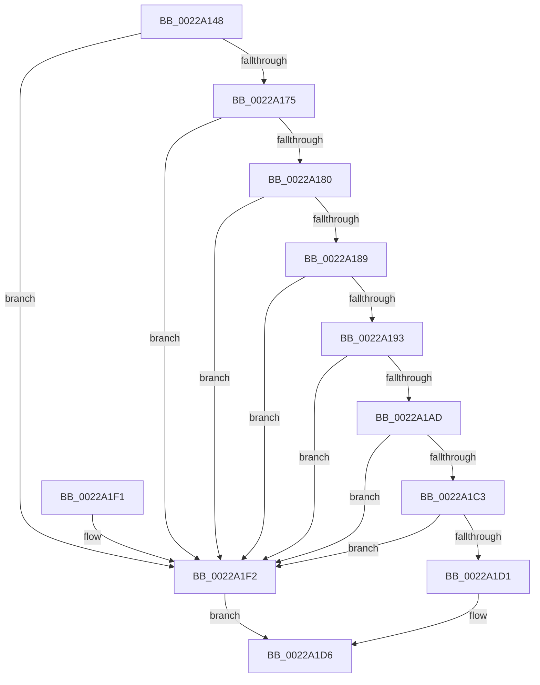

# MiStandbyPageStillCombineCandidate

- RVA: `0x0022A148`–`0x0022A1F6` (길이 `174` bytes)
- VA: `0x000000014022A148`
- 실행 섹션: `.text`
- PDB 이름 있음: `예`; PDB Function 태그: `아니요`
- unwind 정보 RVA: `0x0005FD64`
- 디코드: `53`개 명령, `174/174` bytes 표시
- 미해석 바이트: `0` (있으면 어셈블리에 `.byte`로 보존)

> 이 문서는 커널 이미지의 기계어와 PDB 기호를 분석해 생성했습니다. 4번과 5번은 함수 원형과 자료형을 바이너리 사용 방식에서 추정한 C 해석이며 원본 소스 복구 결과는 아닙니다.

## 1. Dependencies

- 직접 호출 지점: **1**; 고유 호출 대상: **1**
- 직접 호출자로 확인된 함수: **2**
- RIP 상대 이미지 참조: **1**

### Outgoing calls
- `0x0022A180` → [MiStandbyPageContentsIntact](../2A/MiStandbyPageContentsIntact_function_002AF0D4.md) (function, `0x002AF0D4`)

### Direct callers
- [MiCombineWithStandbyExisting](MiCombineWithStandbyExisting_function_00229E74.md) at `0x00229FDD`
- [MiCombineInitialInstance](MiCombineInitialInstance_function_0022BC0C.md) at `0x0022C77C`

### Static image references
- `0x0022A197` → RVA `0x00E30088` (`.data`; read)

## 2. Other-region calls and transfers

- 다른 실행 섹션으로 향하는 call: **0**
- 별도 외부 분기/꼬리 이동을 확인하지 못했습니다.

## 3. Assembly (complete function range)

```asm
0022A148  48 8B C4                        mov rax, rsp
0022A14B  48 89 58 08                     mov qword ptr [rax + 8], rbx
0022A14F  48 89 68 10                     mov qword ptr [rax + 0x10], rbp
0022A153  48 89 70 18                     mov qword ptr [rax + 0x18], rsi
0022A157  48 89 78 20                     mov qword ptr [rax + 0x20], rdi
0022A15B  41 56                           push r14
0022A15D  48 83 EC 20                     sub rsp, 0x20
0022A161  8B 41 20                        mov eax, dword ptr [rcx + 0x20]
0022A164  41 8B F9                        mov edi, r9d
0022A167  49 8B F0                        mov rsi, r8
0022A16A  48 8B EA                        mov rbp, rdx
0022A16D  48 8B D9                        mov rbx, rcx
0022A170  66 85 C0                        test ax, ax
0022A173  75 7D                           jne 0x14022a1f2
0022A175  8A 41 22                        mov al, byte ptr [rcx + 0x22]
0022A178  24 07                           and al, 7
0022A17A  2C 02                           sub al, 2
0022A17C  3C 01                           cmp al, 1
0022A17E  77 72                           ja 0x14022a1f2
0022A180  E8 4F 4F 08 00                  call 0x1402af0d4
0022A185  85 C0                           test eax, eax
0022A187  74 69                           je 0x14022a1f2
0022A189  8B 43 20                        mov eax, dword ptr [rbx + 0x20]
0022A18C  C1 E8 18                        shr eax, 0x18
0022A18F  A8 40                           test al, 0x40
0022A191  75 5F                           jne 0x14022a1f2
0022A193  48 8B 43 28                     mov rax, qword ptr [rbx + 0x28]
0022A197  48 8B 0D EA 5E C0 00            mov rcx, qword ptr [rip + 0xc05eea]
0022A19E  48 C1 E8 2B                     shr rax, 0x2b
0022A1A2  25 FF 03 00 00                  and eax, 0x3ff
0022A1A7  48 3B 2C C1                     cmp rbp, qword ptr [rcx + rax*8]
0022A1AB  75 45                           jne 0x14022a1f2
0022A1AD  48 8B 4B 08                     mov rcx, qword ptr [rbx + 8]
0022A1B1  48 BA 00 00 00 00 00 00 00 80   movabs rdx, 0x8000000000000000
0022A1BB  48 0B CA                        or rcx, rdx
0022A1BE  48 3B F1                        cmp rsi, rcx
0022A1C1  75 2F                           jne 0x14022a1f2
0022A1C3  8B 4B 10                        mov ecx, dword ptr [rbx + 0x10]
0022A1C6  48 C1 E9 05                     shr rcx, 5
0022A1CA  83 E1 1F                        and ecx, 0x1f
0022A1CD  3B CF                           cmp ecx, edi
0022A1CF  75 21                           jne 0x14022a1f2
0022A1D1  B8 01 00 00 00                  mov eax, 1
0022A1D6  48 8B 5C 24 30                  mov rbx, qword ptr [rsp + 0x30]
0022A1DB  48 8B 6C 24 38                  mov rbp, qword ptr [rsp + 0x38]
0022A1E0  48 8B 74 24 40                  mov rsi, qword ptr [rsp + 0x40]
0022A1E5  48 8B 7C 24 48                  mov rdi, qword ptr [rsp + 0x48]
0022A1EA  48 83 C4 20                     add rsp, 0x20
0022A1EE  41 5E                           pop r14
0022A1F0  C3                              ret
0022A1F1  CC                              int3
0022A1F2  33 C0                           xor eax, eax
0022A1F4  EB E0                           jmp 0x14022a1d6
```

## 4. C-style interpretation (structured pseudocode)

```c
__int64 __fastcall MiStandbyPageStillCombineCandidate(__int64 a1, __int64 a2, __int64 a3, int a4)
{
    __int64 result;
    __int64 v_rsp;
    unsigned __int64 v_stack_p10;
    unsigned __int64 v_stack_p18;
    unsigned __int64 v_stack_p20;
    unsigned __int64 v_stack_p8;

    *(unsigned __int64 *)(v_rsp + 8) = v_rbx;
    *(unsigned __int64 *)(v_rsp + 16) = v_rbp;
    *(unsigned __int64 *)(v_rsp + 24) = v_rsi;
    *(unsigned __int64 *)(v_rsp + 32) = v_rdi;
    v_rsp = (v_rsp) - (32);
    if ((unsigned __int16)((unsigned int)(*(unsigned int *)(a1 + 32))) != 0) goto loc_0022A1F2;
    result = (unsigned __int8)((*(unsigned __int8 *)(a1 + 34)) & (7));
    result = (unsigned __int8)((result) - (2));
    if (((unsigned __int8)(result)) > 1) goto loc_0022A1F2;
    result = MiStandbyPageContentsIntact(a1, a2, a3, a4);
    if ((unsigned int)(result) == 0) goto loc_0022A1F2;
    result = (unsigned int)(((unsigned int)(*(unsigned int *)(a1 + 32))) >> (24));
    if ((((unsigned __int8)(result)) & (64)) != 0) goto loc_0022A1F2;
    result = (*(unsigned __int64 *)(a1 + 40)) >> (43);
    result = (unsigned int)((result) & (0x3FFULL));
    if (a2 != (*(unsigned __int64 *)(*(unsigned __int64 *)(v_rip + 12607210) + result * 8))) goto loc_0022A1F2;
    a1 = (*(unsigned __int64 *)(a1 + 8)) | (a2);
    if (a3 != a1) goto loc_0022A1F2;
    a1 = ((unsigned int)(*(unsigned int *)(a1 + 16))) >> (5);
    a1 = (unsigned int)((a1) & (31));
    if (((unsigned int)(a1)) != ((unsigned int)((unsigned int)(a4)))) goto loc_0022A1F2;
loc_0022A1D6:
    v_rsp = (v_rsp) + (32);
    return 1;
loc_0022A1F2:
    result = 0;
    goto loc_0022A1D6;
}
```

## 5. (Beta) C Style

```c
int64_t MiStandbyPageStillCombineCandidate(void *Arg1, int64_t Arg2, int64_t Arg3, int32_t Arg4)
{
    uint8_t *arg1 = (uint8_t *)Arg1;

    int64_t result;
    int64_t local_rsp;
    uint64_t v_stack_p10;
    uint64_t v_stack_p18;
    uint64_t v_stack_p20;
    uint64_t v_stack_p8;

    *(uint64_t *)(local_rsp + 0x8) = local_rbx;
    *(uint64_t *)(local_rsp + 0x10) = local_rbp;
    *(uint64_t *)(local_rsp + 0x18) = local_rsi;
    *(uint64_t *)(local_rsp + 0x20) = local_rdi;
    local_rsp = (local_rsp) - (32);
    if ((uint16_t)((uint32_t)(*(uint32_t *)(arg1 + 0x20))) != 0) goto loc_0022A1F2;
    result = (uint8_t)((*(uint8_t *)(arg1 + 0x22)) & (7));
    result = (uint8_t)((result) - (2));
    if (((uint8_t)(result)) > 1) goto loc_0022A1F2;
    result = MiStandbyPageContentsIntact(Arg1, Arg2, Arg3, Arg4);
    if ((uint32_t)(result) == 0) goto loc_0022A1F2;
    result = (uint32_t)(((uint32_t)(*(uint32_t *)(arg1 + 0x20))) >> (24));
    if ((((uint8_t)(result)) & (64)) != 0) goto loc_0022A1F2;
    result = (*(uint64_t *)(arg1 + 0x28)) >> (43);
    result = (uint32_t)((result) & (0x3FFULL));
    if (Arg2 != (*(uint64_t *)(*(uint64_t *)(v_rip + 0xC05EEA) + result * 8))) goto loc_0022A1F2;
    Arg1 = (*(uint64_t *)(arg1 + 0x8)) | (Arg2);
    if (Arg3 != Arg1) goto loc_0022A1F2;
    Arg1 = ((uint32_t)(*(uint32_t *)(arg1 + 0x10))) >> (5);
    Arg1 = (uint32_t)((Arg1) & (31));
    if (((uint32_t)(Arg1)) != ((uint32_t)((uint32_t)(Arg4)))) goto loc_0022A1F2;
loc_0022A1D6:
    local_rsp = (local_rsp) + (32);
    return 1;
loc_0022A1F2:
    result = 0;
    goto loc_0022A1D6;
}
```

### 관측된 메모리 오프셋

구조체 형식이 확인되지 않은 접근은 인자 기준의 오프셋으로만 기록했습니다.

| 기준 인자 | 오프셋 표현 | 폭 (bit) | 접근 |
|---|---:|---:|---|
| `Arg1` | `+ 0x8` | `64` | `R` |
| `Arg1` | `+ 0x10` | `32` | `R` |
| `Arg1` | `+ 0x20` | `32` | `R` |
| `Arg1` | `+ 0x22` | `8` | `R` |
| `Arg1` | `+ 0x28` | `64` | `R` |

## 6. Execution-region graph

[열기: 2D/3D 그래프와 함수 탐색 컨트롤 패널](../../../control-panel.html?section=text&rva=0x0022A148&view=graph)

- 2D 그래프는 위에서 아래로 흐르고, 3D 그래프는 빈 공간을 드래그해 회전합니다. Shift+드래그는 이동, 휠은 확대·축소, 함수 노드 선택은 대상 보고서 이동입니다.

### Static fallback


