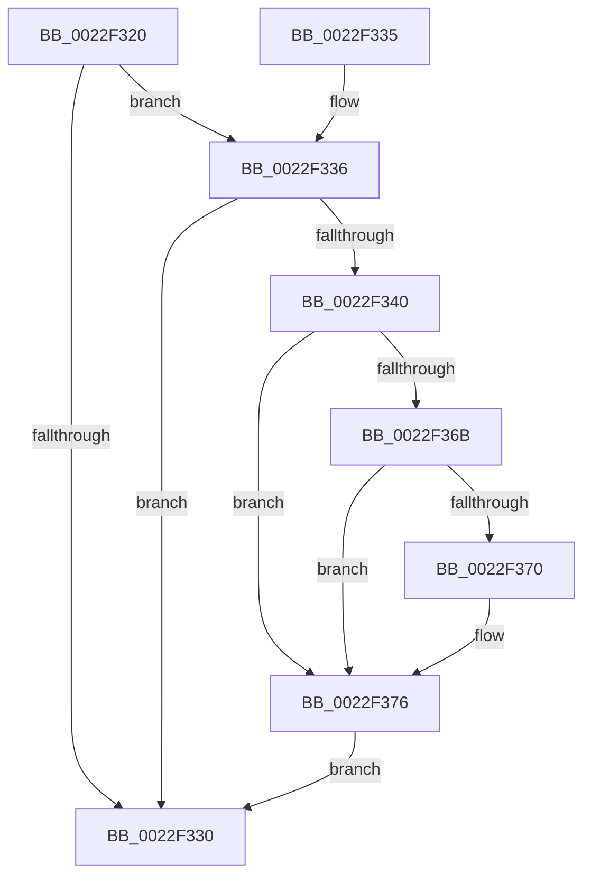

# MiTransferPageFileOwnership

- RVA: `0x0022F320`–`0x0022F3A9` (길이 `137` bytes)
- VA: `0x000000014022F320`
- 실행 섹션: `.text`
- PDB 이름 있음: `예`; PDB Function 태그: `아니요`
- unwind 정보 RVA: `0x000600D8`
- 디코드: `38`개 명령, `137/137` bytes 표시
- 미해석 바이트: `0` (있으면 어셈블리에 `.byte`로 보존)

> 이 문서는 커널 이미지의 기계어와 PDB 기호를 분석해 생성했습니다. 4번과 5번은 함수 원형과 자료형을 바이너리 사용 방식에서 추정한 C 해석이며 원본 소스 복구 결과는 아닙니다.

## 1. Dependencies

- 직접 호출 지점: **1**; 고유 호출 대상: **1**
- 직접 호출자로 확인된 함수: **3**
- RIP 상대 이미지 참조: **2**

### Outgoing calls
- `0x0022F3A2` → [MiUpdatePageFileBlockOwner](MiUpdatePageFileBlockOwner_function_0022F6BC.md) (function, `0x0022F6BC`)

### Direct callers
- [MiCombineInitialInstance](MiCombineInitialInstance_function_0022BC0C.md) at `0x0022C1E1`
- [MiCombineInitialInstance](MiCombineInitialInstance_function_0022BC0C.md) at `0x0022C679`
- [MiHandleForkTransitionPte](MiHandleForkTransitionPte_function_0022D34C.md) at `0x0022D691`
- [MiBuildForkPte](MiBuildForkPte_function_0022E32C.md) at `0x0022E652`

### Static image references
- `0x0022F344` → RVA `0x00E30088` (`.data`; read)
- `0x0022F358` → RVA `0x00E2DC80` (`.data`; read)

## 2. Other-region calls and transfers

- 다른 실행 섹션으로 향하는 call: **0**
- 별도 외부 분기/꼬리 이동을 확인하지 못했습니다.

## 3. Assembly (complete function range)

```asm
0022F320  48 83 EC 38                     sub rsp, 0x38
0022F324  F6 41 22 10                     test byte ptr [rcx + 0x22], 0x10
0022F328  4C 8B D2                        mov r10, rdx
0022F32B  4C 8B C1                        mov r8, rcx
0022F32E  74 06                           je 0x14022f336
0022F330  48 83 C4 38                     add rsp, 0x38
0022F334  C3                              ret
0022F335  CC                              int3
0022F336  8B 41 10                        mov eax, dword ptr [rcx + 0x10]
0022F339  C0 E8 02                        shr al, 2
0022F33C  A8 01                           test al, 1
0022F33E  74 F0                           je 0x14022f330
0022F340  48 8B 41 28                     mov rax, qword ptr [rcx + 0x28]
0022F344  48 8B 0D 3D 0D C0 00            mov rcx, qword ptr [rip + 0xc00d3d]
0022F34B  48 C1 E8 2B                     shr rax, 0x2b
0022F34F  25 FF 03 00 00                  and eax, 0x3ff
0022F354  4C 8B 0C C1                     mov r9, qword ptr [rcx + rax*8]
0022F358  48 8B 05 21 E9 BF 00            mov rax, qword ptr [rip + 0xbfe921]
0022F35F  49 8B 48 10                     mov rcx, qword ptr [r8 + 0x10]
0022F363  48 8B D1                        mov rdx, rcx
0022F366  48 85 C0                        test rax, rax
0022F369  74 0B                           je 0x14022f376
0022F36B  F6 C2 10                        test dl, 0x10
0022F36E  75 06                           jne 0x14022f376
0022F370  48 F7 D0                        not rax
0022F373  48 23 D0                        and rdx, rax
0022F376  48 C1 E9 0C                     shr rcx, 0xc
0022F37A  83 E1 0F                        and ecx, 0xf
0022F37D  48 C1 EA 20                     shr rdx, 0x20
0022F381  49 8B 8C C9 60 48 00 00         mov rcx, qword ptr [r9 + rcx*8 + 0x4860]
0022F389  45 0F B6 48 22                  movzx r9d, byte ptr [r8 + 0x22]
0022F38E  4D 8B 40 08                     mov r8, qword ptr [r8 + 8]
0022F392  41 C1 E9 03                     shr r9d, 3
0022F396  41 83 E1 01                     and r9d, 1
0022F39A  44 89 4C 24 20                  mov dword ptr [rsp + 0x20], r9d
0022F39F  4D 8B CA                        mov r9, r10
0022F3A2  E8 15 03 00 00                  call 0x14022f6bc
0022F3A7  EB 87                           jmp 0x14022f330
```

## 4. C-style interpretation (structured pseudocode)

```c
__int64 __fastcall MiTransferPageFileOwnership(__int64 a1, __int64 a2)
{
    __int64 result;
    __int64 v_rsp;
    unsigned int v_stack_p20;

    v_rsp = (v_rsp) - (56);
    if (((*(unsigned __int8 *)(a1 + 34)) & (16)) == 0) goto loc_0022F336;
loc_0022F330:
    v_rsp = (v_rsp) + (56);
    return result;
loc_0022F336:
    result = (unsigned __int8)(((unsigned int)(*(unsigned int *)(a1 + 16))) >> (2));
    if ((((unsigned __int8)(result)) & (1)) == 0) goto loc_0022F330;
    result = (*(unsigned __int64 *)(a1 + 40)) >> (43);
    result = (unsigned int)((result) & (0x3FFULL));
    if (*(unsigned __int64 *)(v_rip + 12577057) == 0) goto loc_0022F376;
    result = *(unsigned __int64 *)(v_rip + 12577057);
    if ((((unsigned __int8)(*(unsigned __int64 *)(a1 + 16))) & (16)) == 0) {
        result = ~(*(unsigned __int64 *)(v_rip + 12577057));
        a2 = (*(unsigned __int64 *)(a1 + 16)) & (result);
    }
    a1 = (*(unsigned __int64 *)(a1 + 16)) >> (12);
    a1 = (unsigned int)((a1) & (15));
    a2 = (a2) >> (32);
    a4 = (unsigned int)((*(unsigned __int8 *)(a1 + 34)) >> (3));
    a4 = (unsigned int)((a4) & (1));
    v_stack_p20 = (unsigned int)(a4);
    result = MiUpdatePageFileBlockOwner(*(unsigned __int64 *)(*(unsigned __int64 *)(*(unsigned __int64 *)(v_rip + 12586301) + result * 8) + a1 * 8 + 18528), a2, *(unsigned __int64 *)(a1 + 8), a2);
    goto loc_0022F330;
}
```

## 5. (Beta) C Style

```c
int64_t MiTransferPageFileOwnership(void *Arg1, int64_t Arg2)
{
    uint8_t *arg1 = (uint8_t *)Arg1;

    int64_t result;
    int64_t local_rsp;
    uint32_t v_stack_p20;

    local_rsp = (local_rsp) - (56);
    if (((*(uint8_t *)(arg1 + 0x22)) & (16)) == 0) goto loc_0022F336;
loc_0022F330:
    local_rsp = (local_rsp) + (56);
    return result;
loc_0022F336:
    result = (uint8_t)(((uint32_t)(*(uint32_t *)(arg1 + 0x10))) >> (2));
    if ((((uint8_t)(result)) & (1)) == 0) goto loc_0022F330;
    result = (*(uint64_t *)(arg1 + 0x28)) >> (43);
    result = (uint32_t)((result) & (0x3FFULL));
    if (*(uint64_t *)(v_rip + 0xBFE921) == 0) goto loc_0022F376;
    result = *(uint64_t *)(v_rip + 0xBFE921);
    if ((((uint8_t)(*(uint64_t *)(arg1 + 0x10))) & (16)) == 0) {
        result = ~(*(uint64_t *)(v_rip + 0xBFE921));
        Arg2 = (*(uint64_t *)(arg1 + 0x10)) & (result);
    }
    Arg1 = (*(uint64_t *)(arg1 + 0x10)) >> (12);
    Arg1 = (uint32_t)((Arg1) & (15));
    Arg2 = (Arg2) >> (32);
    a4 = (uint32_t)((*(uint8_t *)(arg1 + 0x22)) >> (3));
    a4 = (uint32_t)((a4) & (1));
    v_stack_p20 = (uint32_t)(a4);
    result = MiUpdatePageFileBlockOwner(*(uint64_t *)(*(uint64_t *)(*(uint64_t *)(v_rip + 0xC00D3D) + result * 8) + arg1 * 8 + 0x4860), Arg2, *(uint64_t *)(arg1 + 0x8), Arg2);
    goto loc_0022F330;
}
```

### 관측된 메모리 오프셋

구조체 형식이 확인되지 않은 접근은 인자 기준의 오프셋으로만 기록했습니다.

| 기준 인자 | 오프셋 표현 | 폭 (bit) | 접근 |
|---|---:|---:|---|
| `Arg1` | `+ 0x8` | `64` | `R` |
| `Arg1` | `+ 0x10` | `32` | `R` |
| `Arg1` | `+ 0x10` | `64` | `R` |
| `Arg1` | `+ 0x22` | `8` | `R` |
| `Arg1` | `+ 0x28` | `64` | `R` |

## 6. Execution-region graph

[열기: 2D/3D 그래프와 함수 탐색 컨트롤 패널](../../../control-panel.html?section=text&rva=0x0022F320&view=graph)

- 2D 그래프는 위에서 아래로 흐르고, 3D 그래프는 빈 공간을 드래그해 회전합니다. Shift+드래그는 이동, 휠은 확대·축소, 함수 노드 선택은 대상 보고서 이동입니다.

### Static fallback


