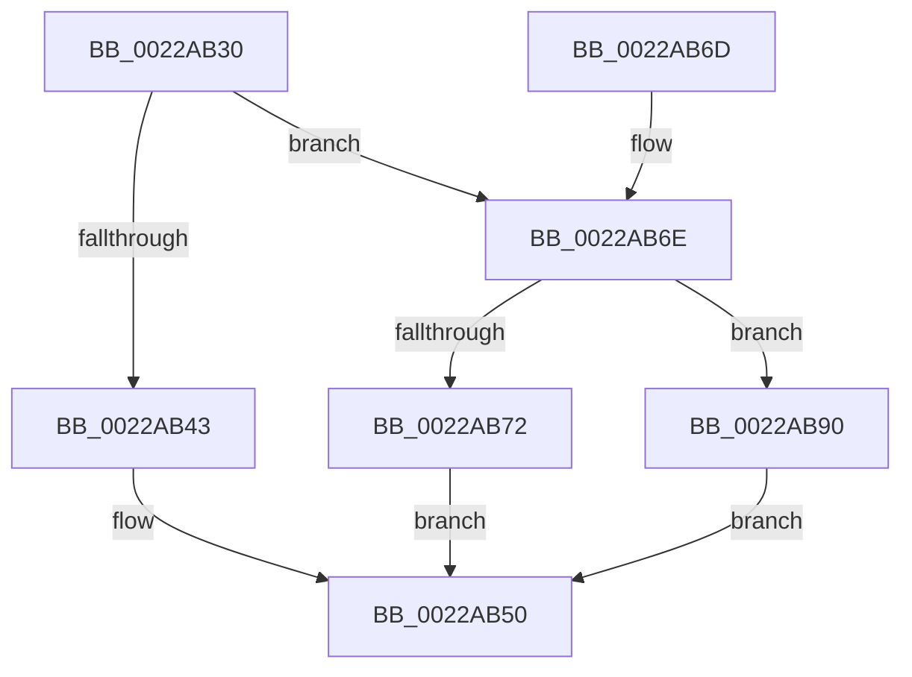

# MiTranslateVmToLock

- RVA: `0x0022AB30`–`0x0022ABA6` (길이 `118` bytes)
- VA: `0x000000014022AB30`
- 실행 섹션: `.text`
- PDB 이름 있음: `예`; PDB Function 태그: `아니요`
- unwind 정보 RVA: `0x000DB714`
- 디코드: `30`개 명령, `118/118` bytes 표시
- 미해석 바이트: `0` (있으면 어셈블리에 `.byte`로 보존)

> 이 문서는 커널 이미지의 기계어와 PDB 기호를 분석해 생성했습니다. 4번과 5번은 함수 원형과 자료형을 바이너리 사용 방식에서 추정한 C 해석이며 원본 소스 복구 결과는 아닙니다.

## 1. Dependencies

- 직접 호출 지점: **0**; 고유 호출 대상: **0**
- 직접 호출자로 확인된 함수: **2**
- RIP 상대 이미지 참조: **1**

### Outgoing calls
- 직접 디코드된 call 명령이 없습니다.

### Direct callers
- [MiIsPageTableLocked](MiIsPageTableLocked_function_0022A5B0.md) at `0x0022A629`
- [MiWalkVaCheckCommon](MiWalkVaCheckCommon_function_0022A960.md) at `0x0022AA86`

### Static image references
- `0x0022AB80` → RVA `0x00E2FDC0` (`.data`; read)

## 2. Other-region calls and transfers

- 다른 실행 섹션으로 향하는 call: **0**
- 별도 외부 분기/꼬리 이동을 확인하지 못했습니다.

## 3. Assembly (complete function range)

```asm
0022AB30  65 4C 8B 0C 25 20 00 00 00      mov r9, qword ptr gs:[0x20]
0022AB39  8B 81 B8 00 00 00               mov eax, dword ptr [rcx + 0xb8]
0022AB3F  24 0F                           and al, 0xf
0022AB41  75 2B                           jne 0x14022ab6e
0022AB43  41 B8 02 00 00 00               mov r8d, 2
0022AB49  48 81 C1 B0 00 00 00            add rcx, 0xb0
0022AB50  48 8B C2                        mov rax, rdx
0022AB53  48 89 0A                        mov qword ptr [rdx], rcx
0022AB56  41 8B C0                        mov eax, r8d
0022AB59  48 8D 04 40                     lea rax, [rax + rax*2]
0022AB5D  48 8D 80 88 13 00 00            lea rax, [rax + 0x1388]
0022AB64  49 8D 04 C1                     lea rax, [r9 + rax*8]
0022AB68  48 89 42 08                     mov qword ptr [rdx + 8], rax
0022AB6C  C3                              ret
0022AB6D  CC                              int3
0022AB6E  3C 07                           cmp al, 7
0022AB70  74 1E                           je 0x14022ab90
0022AB72  33 C9                           xor ecx, ecx
0022AB74  41 B8 03 00 00 00               mov r8d, 3
0022AB7A  3C 05                           cmp al, 5
0022AB7C  44 0F 44 C1                     cmove r8d, ecx
0022AB80  48 8D 0D 39 52 C0 00            lea rcx, [rip + 0xc05239]
0022AB87  41 8B C0                        mov eax, r8d
0022AB8A  48 8D 0C C1                     lea rcx, [rcx + rax*8]
0022AB8E  EB C0                           jmp 0x14022ab50
0022AB90  41 B8 01 00 00 00               mov r8d, 1
0022AB96  48 8D 0D 23 52 C0 00            lea rcx, [rip + 0xc05223]
0022AB9D  41 8B C0                        mov eax, r8d
0022ABA0  48 8D 0C C1                     lea rcx, [rcx + rax*8]
0022ABA4  EB AA                           jmp 0x14022ab50
```

## 4. C-style interpretation (structured pseudocode)

```c
__int64 __fastcall MiTranslateVmToLock(__int64 a1, __int64 a2)
{
    __int64 result;

    result = (unsigned __int8)(((unsigned int)(*(unsigned int *)(a1 + 184))) & (15));
    if (condition_is_not_equal) goto loc_0022AB6E;
    a1 = (a1) + (176);
loc_0022AB50:
    *(unsigned __int64 *)(a2) = a1;
    *(unsigned __int64 *)(a2 + 8) = *(unsigned __int64 *)(gs_base + (0 + 32)) + 2 + 2 * 2 + 5000 * 8;
    return *(unsigned __int64 *)(gs_base + (0 + 32)) + 2 + 2 * 2 + 5000 * 8;
loc_0022AB6E:
    if (((unsigned __int8)(*(unsigned __int64 *)(gs_base + (0 + 32)) + 2 + 2 * 2 + 5000 * 8)) == 7) goto loc_0022AB90;
    a1 = 0;
    a3 = 3;
    if (((unsigned __int8)(*(unsigned __int64 *)(gs_base + (0 + 32)) + 2 + 2 * 2 + 5000 * 8)) == 5) { a3 = 0; }
    goto loc_0022AB50;
loc_0022AB90:
    goto loc_0022AB50;
}
```

## 5. (Beta) C Style

```c
int64_t MiTranslateVmToLock(void *Arg1, void *Arg2)
{
    uint8_t *arg1 = (uint8_t *)Arg1;
    uint8_t *arg2 = (uint8_t *)Arg2;

    int64_t result;

    result = (uint8_t)(((uint32_t)(*(uint32_t *)(arg1 + 0xB8))) & (15));
    if (condition_is_not_equal) goto loc_0022AB6E;
    Arg1 = (Arg1) + (176);
loc_0022AB50:
    *(void **)(arg2) = Arg1;
    *(uint64_t *)(arg2 + 0x8) = *(uint64_t *)(gs_base + (0 + 0x20)) + 2 + 2 * 2 + 5000 * 8;
    return *(uint64_t *)(gs_base + (0 + 0x20)) + 2 + 2 * 2 + 5000 * 8;
loc_0022AB6E:
    if (((uint8_t)(*(uint64_t *)(gs_base + (0 + 0x20)) + 2 + 2 * 2 + 5000 * 8)) == 7) goto loc_0022AB90;
    Arg1 = 0;
    a3 = 3;
    if (((uint8_t)(*(uint64_t *)(gs_base + (0 + 0x20)) + 2 + 2 * 2 + 5000 * 8)) == 5) { a3 = 0; }
    goto loc_0022AB50;
loc_0022AB90:
    goto loc_0022AB50;
}
```

### 관측된 메모리 오프셋

구조체 형식이 확인되지 않은 접근은 인자 기준의 오프셋으로만 기록했습니다.

| 기준 인자 | 오프셋 표현 | 폭 (bit) | 접근 |
|---|---:|---:|---|
| `Arg1` | `+ 0xB8` | `32` | `R` |
| `Arg2` | `+ 0x0` | `64` | `W` |
| `Arg2` | `+ 0x8` | `64` | `W` |

## 6. Execution-region graph

[열기: 2D/3D 그래프와 함수 탐색 컨트롤 패널](../../../control-panel.html?section=text&rva=0x0022AB30&view=graph)

- 2D 그래프는 위에서 아래로 흐르고, 3D 그래프는 빈 공간을 드래그해 회전합니다. Shift+드래그는 이동, 휠은 확대·축소, 함수 노드 선택은 대상 보고서 이동입니다.

### Static fallback


