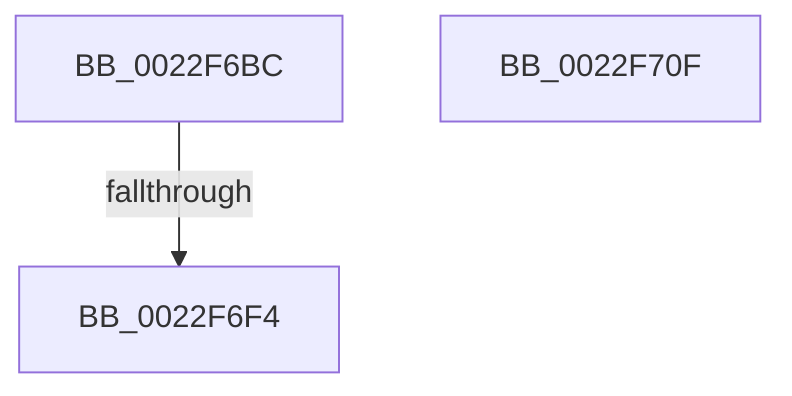

# MiUpdatePageFileBlockOwner

- RVA: `0x0022F6BC`–`0x0022F710` (길이 `84` bytes)
- VA: `0x000000014022F6BC`
- 실행 섹션: `.text`
- PDB 이름 있음: `예`; PDB Function 태그: `예`
- unwind 정보 RVA: `0x00060130`
- 디코드: `23`개 명령, `84/84` bytes 표시
- 미해석 바이트: `0` (있으면 어셈블리에 `.byte`로 보존)

> 이 문서는 커널 이미지의 기계어와 PDB 기호를 분석해 생성했습니다. 4번과 5번은 함수 원형과 자료형을 바이너리 사용 방식에서 추정한 C 해석이며 원본 소스 복구 결과는 아닙니다.

## 1. Dependencies

- 직접 호출 지점: **0**; 고유 호출 대상: **0**
- 직접 호출자로 확인된 함수: **3**
- RIP 상대 이미지 참조: **1**

### Outgoing calls
- 직접 디코드된 call 명령이 없습니다.

### Direct callers
- [MiDemoteCombinedPte](MiDemoteCombinedPte_function_0022ABAC.md) at `0x0022AFB8`
- [MiBuildForkPte](MiBuildForkPte_function_0022E32C.md) at `0x0022EE00`
- [MiTransferPageFileOwnership](MiTransferPageFileOwnership_function_0022F320.md) at `0x0022F3A2`

### Static image references
- `0x0022F6D5` → RVA `0x00E37390` (`.data`; read)

## 2. Other-region calls and transfers

- 다른 실행 섹션으로 향하는 call: **0**
- call이 아닌 외부 분기/꼬리 이동: **1**
  - `0x0022F6EE` → [sub_006D7254](../6D/Unknown_function_006D7254.md) (`tail-transfer`)

## 3. Assembly (complete function range)

```asm
0022F6BC  48 8B C4                        mov rax, rsp
0022F6BF  48 89 58 08                     mov qword ptr [rax + 8], rbx
0022F6C3  48 89 68 10                     mov qword ptr [rax + 0x10], rbp
0022F6C7  48 89 70 18                     mov qword ptr [rax + 0x18], rsi
0022F6CB  48 89 78 20                     mov qword ptr [rax + 0x20], rdi
0022F6CF  41 56                           push r14
0022F6D1  48 83 EC 40                     sub rsp, 0x40
0022F6D5  83 3D B4 7C C0 00 00            cmp dword ptr [rip + 0xc07cb4], 0
0022F6DC  0F 57 C0                        xorps xmm0, xmm0
0022F6DF  0F 11 40 E8                     movups xmmword ptr [rax - 0x18], xmm0
0022F6E3  49 8B F9                        mov rdi, r9
0022F6E6  4D 8B F0                        mov r14, r8
0022F6E9  8B F2                           mov esi, edx
0022F6EB  48 8B E9                        mov rbp, rcx
0022F6EE  0F 85 60 7B 4A 00               jne 0x1406d7254
0022F6F4  48 8B 5C 24 50                  mov rbx, qword ptr [rsp + 0x50]
0022F6F9  48 8B 6C 24 58                  mov rbp, qword ptr [rsp + 0x58]
0022F6FE  48 8B 74 24 60                  mov rsi, qword ptr [rsp + 0x60]
0022F703  48 8B 7C 24 68                  mov rdi, qword ptr [rsp + 0x68]
0022F708  48 83 C4 40                     add rsp, 0x40
0022F70C  41 5E                           pop r14
0022F70E  C3                              ret
0022F70F  CC                              int3
```

## 4. C-style interpretation (structured pseudocode)

```c
__int64 __fastcall MiUpdatePageFileBlockOwner(__int64 a1, int a2, __int64 a3, __int64 a4)
{
    __int64 v_rsp;
    unsigned __int64 v_stack_p10;
    unsigned __int64 v_stack_p18;
    unsigned __int64 v_stack_p20;
    unsigned __int64 v_stack_p8;

    *(unsigned __int64 *)(v_rsp + 8) = v_rbx;
    *(unsigned __int64 *)(v_rsp + 16) = v_rbp;
    *(unsigned __int64 *)(v_rsp + 24) = v_rsi;
    *(unsigned __int64 *)(v_rsp + 32) = v_rdi;
    v_rsp = (v_rsp) - (64);
    *(unsigned __int64 *)(v_rsp - 24) = v_xmm0;
    v_rsp = (v_rsp) + (64);
    return v_rsp;
}
```

## 5. (Beta) C Style

```c
int64_t MiUpdatePageFileBlockOwner(int64_t Arg1, int32_t Arg2, int64_t Arg3, int64_t Arg4)
{
    int64_t local_rsp;
    uint64_t v_stack_p10;
    uint64_t v_stack_p18;
    uint64_t v_stack_p20;
    uint64_t v_stack_p8;

    *(uint64_t *)(local_rsp + 0x8) = local_rbx;
    *(uint64_t *)(local_rsp + 0x10) = local_rbp;
    *(uint64_t *)(local_rsp + 0x18) = local_rsi;
    *(uint64_t *)(local_rsp + 0x20) = local_rdi;
    local_rsp = (local_rsp) - (64);
    *(uint64_t *)(local_rsp - 0x18) = v_xmm0;
    local_rsp = (local_rsp) + (64);
    return local_rsp;
}
```

## 6. Execution-region graph

[열기: 2D/3D 그래프와 함수 탐색 컨트롤 패널](../../../control-panel.html?section=text&rva=0x0022F6BC&view=graph)

- 2D 그래프는 위에서 아래로 흐르고, 3D 그래프는 빈 공간을 드래그해 회전합니다. Shift+드래그는 이동, 휠은 확대·축소, 함수 노드 선택은 대상 보고서 이동입니다.

### Static fallback


