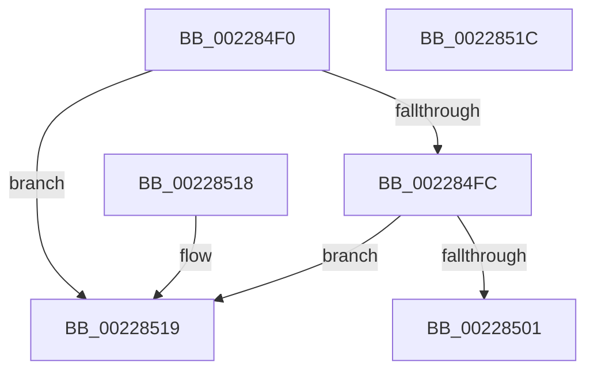

# MiVaIsUltra

- RVA: `0x002284F0`–`0x0022851D` (길이 `45` bytes)
- VA: `0x00000001402284F0`
- 실행 섹션: `.text`
- PDB 이름 있음: `예`; PDB Function 태그: `아니요`
- unwind 정보 RVA: `0x000DB714`
- 디코드: `16`개 명령, `45/45` bytes 표시
- 미해석 바이트: `0` (있으면 어셈블리에 `.byte`로 보존)

> 이 문서는 커널 이미지의 기계어와 PDB 기호를 분석해 생성했습니다. 4번과 5번은 함수 원형과 자료형을 바이너리 사용 방식에서 추정한 C 해석이며 원본 소스 복구 결과는 아닙니다.

## 1. Dependencies

- 직접 호출 지점: **0**; 고유 호출 대상: **0**
- 직접 호출자로 확인된 함수: **3**
- RIP 상대 이미지 참조: **2**

### Outgoing calls
- 직접 디코드된 call 명령이 없습니다.

### Direct callers
- [MiTranslatePageForCopy](MiTranslatePageForCopy_function_00228960.md) at `0x00228A6E`
- [MiClearMappingAndDereferenceIoSpace](../24/MiClearMappingAndDereferenceIoSpace_function_00247DF0.md) at `0x00247E73`
- [sub_0036CD3D](../36/Unknown_function_0036CD3D.md) at `0x0036CE24`

### Static image references
- `0x002284F0` → RVA `0x00E35FE8` (`.data`; read)
- `0x00228501` → RVA `0x00E35FF8` (`.data`; read)

## 2. Other-region calls and transfers

- 다른 실행 섹션으로 향하는 call: **0**
- 별도 외부 분기/꼬리 이동을 확인하지 못했습니다.

## 3. Assembly (complete function range)

```asm
002284F0  48 8B 05 F1 DA C0 00            mov rax, qword ptr [rip + 0xc0daf1]
002284F7  48 85 C0                        test rax, rax
002284FA  74 1D                           je 0x140228519
002284FC  48 3B C8                        cmp rcx, rax
002284FF  72 18                           jb 0x140228519
00228501  48 8B 15 F0 DA C0 00            mov rdx, qword ptr [rip + 0xc0daf0]
00228508  48 C1 E2 1E                     shl rdx, 0x1e
0022850C  48 03 D0                        add rdx, rax
0022850F  33 C0                           xor eax, eax
00228511  48 3B CA                        cmp rcx, rdx
00228514  0F 92 C0                        setb al
00228517  C3                              ret
00228518  CC                              int3
00228519  33 C0                           xor eax, eax
0022851B  C3                              ret
0022851C  CC                              int3
```

## 4. C-style interpretation (structured pseudocode)

```c
__int64 __fastcall MiVaIsUltra(__int64 a1)
{
    __int64 result;

    if (*(unsigned __int64 *)(v_rip + 12638961) == 0) goto loc_00228519;
    if (a1 < (*(unsigned __int64 *)(v_rip + 12638961))) goto loc_00228519;
    a2 = (*(unsigned __int64 *)(v_rip + 12638960)) << (30);
    a2 = (a2) + (*(unsigned __int64 *)(v_rip + 12638961));
    result = 0;
    result = (a1 < a2) ? 1 : 0;
    return result;
loc_00228519:
    result = 0;
    return result;
}
```

## 5. (Beta) C Style

```c
int64_t MiVaIsUltra(int64_t Arg1)
{
    int64_t result;

    if (*(uint64_t *)(v_rip + 0xC0DAF1) == 0) goto loc_00228519;
    if (Arg1 < (*(uint64_t *)(v_rip + 0xC0DAF1))) goto loc_00228519;
    a2 = (*(uint64_t *)(v_rip + 0xC0DAF0)) << (30);
    a2 = (a2) + (*(uint64_t *)(v_rip + 0xC0DAF1));
    result = 0;
    result = (Arg1 < a2) ? 1 : 0;
    return result;
loc_00228519:
    result = 0;
    return result;
}
```

## 6. Execution-region graph

[열기: 2D/3D 그래프와 함수 탐색 컨트롤 패널](../../../control-panel.html?section=text&rva=0x002284F0&view=graph)

- 2D 그래프는 위에서 아래로 흐르고, 3D 그래프는 빈 공간을 드래그해 회전합니다. Shift+드래그는 이동, 휠은 확대·축소, 함수 노드 선택은 대상 보고서 이동입니다.

### Static fallback


