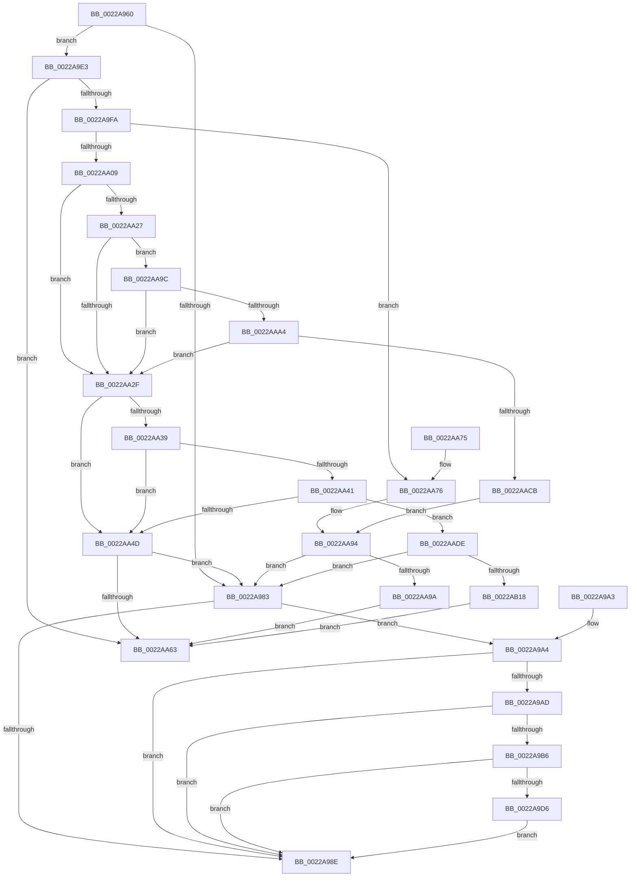

# MiWalkVaCheckCommon

- RVA: `0x0022A960`–`0x0022AB1D` (길이 `445` bytes)
- VA: `0x000000014022A960`
- 실행 섹션: `.text`
- PDB 이름 있음: `예`; PDB Function 태그: `아니요`
- unwind 정보 RVA: `0x0005FE2C`
- 디코드: `116`개 명령, `445/445` bytes 표시
- 미해석 바이트: `0` (있으면 어셈블리에 `.byte`로 보존)

> 이 문서는 커널 이미지의 기계어와 PDB 기호를 분석해 생성했습니다. 4번과 5번은 함수 원형과 자료형을 바이너리 사용 방식에서 추정한 C 해석이며 원본 소스 복구 결과는 아닙니다.

## 1. Dependencies

- 직접 호출 지점: **3**; 고유 호출 대상: **3**
- 직접 호출자로 확인된 함수: **3**
- RIP 상대 이미지 참조: **1**

### Outgoing calls
- `0x0022A9CD` → [MiDemoteCombinedPte](MiDemoteCombinedPte_function_0022ABAC.md) (function, `0x0022ABAC`)
- `0x0022AA50` → [MI_READ_PTE_LOCK_FREE](../28/MI_READ_PTE_LOCK_FREE_function_002828A0.md) (function, `0x002828A0`)
- `0x0022AA86` → [MiTranslateVmToLock](MiTranslateVmToLock_function_0022AB30.md) (function, `0x0022AB30`)

### Direct callers
- [MiResetAccessBitPte](MiResetAccessBitPte_function_0022A800.md) at `0x0022A881`
- [MiSimpleAgePte](../4A/MiSimpleAgePte_function_004ACD40.md) at `0x004ACDBB`
- [MiUpdateOldPte](../4E/MiUpdateOldPte_function_004EDD20.md) at `0x004EDDA1`

### Static image references
- `0x0022AAE4` → RVA `0x00E2F1AC` (`.data`; read)

## 2. Other-region calls and transfers

- 다른 실행 섹션으로 향하는 call: **0**
- 별도 외부 분기/꼬리 이동을 확인하지 못했습니다.

## 3. Assembly (complete function range)

```asm
0022A960  48 89 5C 24 08                  mov qword ptr [rsp + 8], rbx
0022A965  48 89 74 24 10                  mov qword ptr [rsp + 0x10], rsi
0022A96A  57                              push rdi
0022A96B  48 83 EC 30                     sub rsp, 0x30
0022A96F  8B 81 B8 00 00 00               mov eax, dword ptr [rcx + 0xb8]
0022A975  49 8B D8                        mov rbx, r8
0022A978  48 8B F2                        mov rsi, rdx
0022A97B  48 8B F9                        mov rdi, rcx
0022A97E  45 85 C9                        test r9d, r9d
0022A981  74 60                           je 0x14022a9e3
0022A983  48 8B 43 28                     mov rax, qword ptr [rbx + 0x28]
0022A987  48 0F BA E0 28                  bt rax, 0x28
0022A98C  73 16                           jae 0x14022a9a4
0022A98E  B8 01 00 00 00                  mov eax, 1
0022A993  48 8B 5C 24 40                  mov rbx, qword ptr [rsp + 0x40]
0022A998  48 8B 74 24 48                  mov rsi, qword ptr [rsp + 0x48]
0022A99D  48 83 C4 30                     add rsp, 0x30
0022A9A1  5F                              pop rdi
0022A9A2  C3                              ret
0022A9A3  CC                              int3
0022A9A4  48 8B 43 08                     mov rax, qword ptr [rbx + 8]
0022A9A8  48 85 C0                        test rax, rax
0022A9AB  78 E1                           js 0x14022a98e
0022A9AD  48 8B 43 08                     mov rax, qword ptr [rbx + 8]
0022A9B1  48 85 C0                        test rax, rax
0022A9B4  74 D8                           je 0x14022a98e
0022A9B6  4C 8B 43 08                     mov r8, qword ptr [rbx + 8]
0022A9BA  48 B8 00 00 00 00 00 00 00 80   movabs rax, 0x8000000000000000
0022A9C4  4C 0B C0                        or r8, rax
0022A9C7  48 8B D6                        mov rdx, rsi
0022A9CA  48 8B CF                        mov rcx, rdi
0022A9CD  E8 DA 01 00 00                  call 0x14022abac
0022A9D2  85 C0                           test eax, eax
0022A9D4  74 B8                           je 0x14022a98e
0022A9D6  48 8B 44 24 60                  mov rax, qword ptr [rsp + 0x60]
0022A9DB  48 8B 0E                        mov rcx, qword ptr [rsi]
0022A9DE  48 89 08                        mov qword ptr [rax], rcx
0022A9E1  EB AB                           jmp 0x14022a98e
0022A9E3  49 8B 40 18                     mov rax, qword ptr [r8 + 0x18]
0022A9E7  48 B9 FF FF FF FF FF FF FF 3F   movabs rcx, 0x3fffffffffffffff
0022A9F1  48 23 C1                        and rax, rcx
0022A9F4  48 83 F8 01                     cmp rax, 1
0022A9F8  75 69                           jne 0x14022aa63
0022A9FA  48 B8 68 DF BE 7D FB F6 FF FF   movabs rax, 0xfffff6fb7dbedf68
0022AA04  48 3B F0                        cmp rsi, rax
0022AA07  74 6D                           je 0x14022aa76
0022AA09  8B 87 B8 00 00 00               mov eax, dword ptr [rdi + 0xb8]
0022AA0F  48 BA 00 D0 BE 7D FB F6 FF FF   movabs rdx, 0xfffff6fb7dbed000
0022AA19  49 B8 FF DF BE 7D FB F6 FF FF   movabs r8, 0xfffff6fb7dbedfff
0022AA23  A8 0F                           test al, 0xf
0022AA25  75 08                           jne 0x14022aa2f
0022AA27  48 8B C2                        mov rax, rdx
0022AA2A  48 3B F0                        cmp rsi, rax
0022AA2D  73 6D                           jae 0x14022aa9c
0022AA2F  8B 87 B8 00 00 00               mov eax, dword ptr [rdi + 0xb8]
0022AA35  A8 0F                           test al, 0xf
0022AA37  74 14                           je 0x14022aa4d
0022AA39  48 8B C2                        mov rax, rdx
0022AA3C  48 3B F0                        cmp rsi, rax
0022AA3F  72 0C                           jb 0x14022aa4d
0022AA41  49 8B C0                        mov rax, r8
0022AA44  48 3B F0                        cmp rsi, rax
0022AA47  0F 86 91 00 00 00               jbe 0x14022aade
0022AA4D  48 8B CE                        mov rcx, rsi
0022AA50  E8 4B 7E 05 00                  call 0x1402828a0
0022AA55  48 C1 E8 3C                     shr rax, 0x3c
0022AA59  0F BA E0 00                     bt eax, 0
0022AA5D  0F 83 20 FF FF FF               jae 0x14022a983
0022AA63  48 8B 5C 24 40                  mov rbx, qword ptr [rsp + 0x40]
0022AA68  33 C0                           xor eax, eax
0022AA6A  48 8B 74 24 48                  mov rsi, qword ptr [rsp + 0x48]
0022AA6F  48 83 C4 30                     add rsp, 0x30
0022AA73  5F                              pop rdi
0022AA74  C3                              ret
0022AA75  CC                              int3
0022AA76  0F 57 C0                        xorps xmm0, xmm0
0022AA79  48 8D 54 24 20                  lea rdx, [rsp + 0x20]
0022AA7E  48 8B CF                        mov rcx, rdi
0022AA81  0F 11 44 24 20                  movups xmmword ptr [rsp + 0x20], xmm0
0022AA86  E8 A5 00 00 00                  call 0x14022ab30
0022AA8B  48 8B 54 24 20                  mov rdx, qword ptr [rsp + 0x20]
0022AA90  48 83 3A 00                     cmp qword ptr [rdx], 0
0022AA94  0F 84 E9 FE FF FF               je 0x14022a983
0022AA9A  EB C7                           jmp 0x14022aa63
0022AA9C  49 8B C0                        mov rax, r8
0022AA9F  48 3B F0                        cmp rsi, rax
0022AAA2  77 8B                           ja 0x14022aa2f
0022AAA4  65 48 8B 04 25 88 01 00 00      mov rax, qword ptr gs:[0x188]
0022AAAD  48 8B 88 B8 00 00 00            mov rcx, qword ptr [rax + 0xb8]
0022AAB4  48 8B 81 10 04 00 00            mov rax, qword ptr [rcx + 0x410]
0022AABB  48 8B 88 68 05 00 00            mov rcx, qword ptr [rax + 0x568]
0022AAC2  48 85 C9                        test rcx, rcx
0022AAC5  0F 84 64 FF FF FF               je 0x14022aa2f
0022AACB  48 8B C6                        mov rax, rsi
0022AACE  48 C1 E8 03                     shr rax, 3
0022AAD2  25 FF 01 00 00                  and eax, 0x1ff
0022AAD7  8B 04 81                        mov eax, dword ptr [rcx + rax*4]
0022AADA  85 C0                           test eax, eax
0022AADC  EB B6                           jmp 0x14022aa94
0022AADE  48 8B C2                        mov rax, rdx
0022AAE1  48 8B CE                        mov rcx, rsi
0022AAE4  48 8D 15 C1 46 C0 00            lea rdx, [rip + 0xc046c1]
0022AAEB  48 2B C8                        sub rcx, rax
0022AAEE  8B 87 B8 00 00 00               mov eax, dword ptr [rdi + 0xb8]
0022AAF4  48 C1 F9 03                     sar rcx, 3
0022AAF8  03 C9                           add ecx, ecx
0022AAFA  8B C1                           mov eax, ecx
0022AAFC  44 8B C1                        mov r8d, ecx
0022AAFF  48 C1 E8 05                     shr rax, 5
0022AB03  41 83 E0 1F                     and r8d, 0x1f
0022AB07  41 8B C8                        mov ecx, r8d
0022AB0A  8B 14 82                        mov edx, dword ptr [rdx + rax*4]
0022AB0D  D3 EA                           shr edx, cl
0022AB0F  F6 C2 01                        test dl, 1
0022AB12  0F 84 6B FE FF FF               je 0x14022a983
0022AB18  E9 46 FF FF FF                  jmp 0x14022aa63
```

## 4. C-style interpretation (structured pseudocode)

```c
__int64 __fastcall MiWalkVaCheckCommon(__int64 a1, __int64 a2, __int64 a3, int a4, __int64 a5)
{
    __int64 result;
    __int64 v_rsp;
    unsigned __int64 v_stack_p10;
    unsigned __int64 v_stack_p40;
    unsigned __int64 v_stack_p48;
    unsigned __int64 v_stack_p58;
    unsigned __int64 v_stack_p8;

    v_stack_p8 = v_rbx;
    v_stack_p10 = v_rsi;
    v_rsp = (v_rsp) - (48);
    if (a4 == 0) goto loc_0022A9E3;
loc_0022A983:
    if (condition_is_above_or_equal) goto loc_0022A9A4;
loc_0022A98E:
    v_rsp = (v_rsp) + (48);
    return 1;
loc_0022A9A4:
    if (sign_flag) goto loc_0022A98E;
    if (*(unsigned __int64 *)(v_stack_p8 + 8) == 0) goto loc_0022A98E;
    a3 = (*(unsigned __int64 *)(v_stack_p8 + 8)) | (*(unsigned __int64 *)(v_stack_p8 + 8));
    result = MiDemoteCombinedPte(a1, v_stack_p10, a3, a4);
    if ((unsigned int)(result) == 0) goto loc_0022A98E;
    *(unsigned __int64 *)(a5) = *(unsigned __int64 *)(v_stack_p10);
    goto loc_0022A98E;
loc_0022A9E3:
    result = (*(unsigned __int64 *)(a3 + 24)) & (*(unsigned __int64 *)(v_stack_p10));
    if (result != 1) goto loc_0022AA63;
    if (v_stack_p10 == result) goto loc_0022AA76;
    if ((((unsigned __int8)((unsigned int)(*(unsigned int *)(a1 + 184)))) & (15)) != 0) goto loc_0022AA2F;
    if (v_stack_p10 >= v_stack_p10) goto loc_0022AA9C;
loc_0022AA2F:
    if ((((unsigned __int8)((unsigned int)(*(unsigned int *)(a1 + 184)))) & (15)) == 0) goto loc_0022AA4D;
    if (v_stack_p10 < v_stack_p10) goto loc_0022AA4D;
    if (v_stack_p10 <= a3) goto loc_0022AADE;
loc_0022AA4D:
    result = MI_READ_PTE_LOCK_FREE(v_stack_p10, v_stack_p10, a3, a4);
    result = (result) >> (60);
    if (condition_is_above_or_equal) goto loc_0022A983;
loc_0022AA63:
    result = 0;
    v_rsp = (v_rsp) + (48);
    return result;
loc_0022AA76:
    v_stack_p58 = v_xmm0;
    result = MiTranslateVmToLock(a1, v_stack_p58, a3, a4);
loc_0022AA94:
    if ((*(unsigned __int64 *)(v_stack_p58)) == 0) goto loc_0022A983;
    goto loc_0022AA63;
loc_0022AA9C:
    if (v_stack_p48 > a3) goto loc_0022AA2F;
    if (*(unsigned __int64 *)(*(unsigned __int64 *)(*(unsigned __int64 *)(*(unsigned __int64 *)(gs_base + (0 + 392)) + 184) + 1040) + 1384) == 0) goto loc_0022AA2F;
    result = (v_stack_p48) >> (3);
    result = (unsigned int)((result) & (511));
    goto loc_0022AA94;
loc_0022AADE:
    a1 = (v_stack_p48) - (v_stack_p58);
    a1 = (a1) >> (3);
    a1 = (unsigned int)((a1) + ((unsigned int)(a1)));
    result = ((unsigned int)((unsigned int)(a1))) >> (5);
    a3 = (unsigned int)(((unsigned int)((unsigned int)(a1))) & (31));
    a2 = (unsigned int)(((unsigned int)(*(unsigned int *)(v_rip + 12601025 + result * 4))) >> ((unsigned __int8)((unsigned int)((unsigned int)(a3)))));
    if ((((unsigned __int8)(a2)) & (1)) == 0) goto loc_0022A983;
    goto loc_0022AA63;
}
```

## 5. (Beta) C Style

```c
int64_t MiWalkVaCheckCommon(void *Arg1, int64_t Arg2, void *Arg3, int32_t Arg4, void *Arg5)
{
    uint8_t *arg1 = (uint8_t *)Arg1;
    uint8_t *arg3 = (uint8_t *)Arg3;
    uint8_t *arg5 = (uint8_t *)Arg5;

    int64_t result;
    int64_t local_rsp;
    uint64_t v_stack_p10;
    uint64_t v_stack_p40;
    uint64_t v_stack_p48;
    uint64_t v_stack_p58;
    uint64_t v_stack_p8;

    v_stack_p8 = local_rbx;
    v_stack_p10 = local_rsi;
    local_rsp = (local_rsp) - (48);
    if (Arg4 == 0) goto loc_0022A9E3;
loc_0022A983:
    if (condition_is_above_or_equal) goto loc_0022A9A4;
loc_0022A98E:
    local_rsp = (local_rsp) + (48);
    return 1;
loc_0022A9A4:
    if (sign_flag) goto loc_0022A98E;
    if (*(uint64_t *)(v_stack_p8 + 0x8) == 0) goto loc_0022A98E;
    Arg3 = (*(uint64_t *)(v_stack_p8 + 0x8)) | (*(uint64_t *)(v_stack_p8 + 0x8));
    result = MiDemoteCombinedPte(Arg1, v_stack_p10, Arg3, Arg4);
    if ((uint32_t)(result) == 0) goto loc_0022A98E;
    *(uint64_t *)(arg5) = *(uint64_t *)(v_stack_p10);
    goto loc_0022A98E;
loc_0022A9E3:
    result = (*(uint64_t *)(arg3 + 0x18)) & (*(uint64_t *)(v_stack_p10));
    if (result != 1) goto loc_0022AA63;
    if (v_stack_p10 == result) goto loc_0022AA76;
    if ((((uint8_t)((uint32_t)(*(uint32_t *)(arg1 + 0xB8)))) & (15)) != 0) goto loc_0022AA2F;
    if (v_stack_p10 >= v_stack_p10) goto loc_0022AA9C;
loc_0022AA2F:
    if ((((uint8_t)((uint32_t)(*(uint32_t *)(arg1 + 0xB8)))) & (15)) == 0) goto loc_0022AA4D;
    if (v_stack_p10 < v_stack_p10) goto loc_0022AA4D;
    if (v_stack_p10 <= Arg3) goto loc_0022AADE;
loc_0022AA4D:
    result = MI_READ_PTE_LOCK_FREE(v_stack_p10, v_stack_p10, Arg3, Arg4);
    result = (result) >> (60);
    if (condition_is_above_or_equal) goto loc_0022A983;
loc_0022AA63:
    result = 0;
    local_rsp = (local_rsp) + (48);
    return result;
loc_0022AA76:
    v_stack_p58 = v_xmm0;
    result = MiTranslateVmToLock(Arg1, v_stack_p58, Arg3, Arg4);
loc_0022AA94:
    if ((*(uint64_t *)(v_stack_p58)) == 0) goto loc_0022A983;
    goto loc_0022AA63;
loc_0022AA9C:
    if (v_stack_p48 > Arg3) goto loc_0022AA2F;
    if (*(uint64_t *)(*(uint64_t *)(*(uint64_t *)(*(uint64_t *)(gs_base + (0 + 0x188)) + 0xB8) + 0x410) + 0x568) == 0) goto loc_0022AA2F;
    result = (v_stack_p48) >> (3);
    result = (uint32_t)((result) & (511));
    goto loc_0022AA94;
loc_0022AADE:
    Arg1 = (v_stack_p48) - (v_stack_p58);
    Arg1 = (Arg1) >> (3);
    Arg1 = (uint32_t)((Arg1) + ((uint32_t)(Arg1)));
    result = ((uint32_t)((uint32_t)(Arg1))) >> (5);
    Arg3 = (uint32_t)(((uint32_t)((uint32_t)(Arg1))) & (31));
    Arg2 = (uint32_t)(((uint32_t)(*(uint32_t *)(v_rip + 0xC046C1 + result * 4))) >> ((uint8_t)((uint32_t)((uint32_t)(Arg3)))));
    if ((((uint8_t)(Arg2)) & (1)) == 0) goto loc_0022A983;
    goto loc_0022AA63;
}
```

### 관측된 메모리 오프셋

구조체 형식이 확인되지 않은 접근은 인자 기준의 오프셋으로만 기록했습니다.

| 기준 인자 | 오프셋 표현 | 폭 (bit) | 접근 |
|---|---:|---:|---|
| `Arg1` | `+ 0xB8` | `32` | `R` |
| `Arg3` | `+ 0x8` | `64` | `R` |
| `Arg3` | `+ 0x18` | `64` | `R` |
| `Arg3` | `+ 0x28` | `64` | `R` |
| `Arg5` | `+ 0x0` | `64` | `W` |

## 6. Execution-region graph

[열기: 2D/3D 그래프와 함수 탐색 컨트롤 패널](../../../control-panel.html?section=text&rva=0x0022A960&view=graph)

- 2D 그래프는 위에서 아래로 흐르고, 3D 그래프는 빈 공간을 드래그해 회전합니다. Shift+드래그는 이동, 휠은 확대·축소, 함수 노드 선택은 대상 보고서 이동입니다.

### Static fallback


