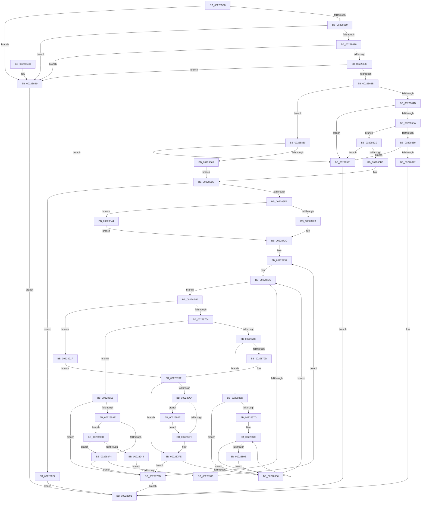

# MmCopyMemory

- RVA: `0x002285B0`–`0x0022895A` (길이 `938` bytes)
- VA: `0x00000001402285B0`
- 실행 섹션: `.text`
- PDB 이름 있음: `예`; PDB Function 태그: `아니요`
- unwind 정보 RVA: `0x0005FC38`
- 디코드: `230`개 명령, `938/938` bytes 표시
- 미해석 바이트: `0` (있으면 어셈블리에 `.byte`로 보존)

> 이 문서는 커널 이미지의 기계어와 PDB 기호를 분석해 생성했습니다. 4번과 5번은 함수 원형과 자료형을 바이너리 사용 방식에서 추정한 C 해석이며 원본 소스 복구 결과는 아닙니다.

## 1. Dependencies

- 직접 호출 지점: **11**; 고유 호출 대상: **10**
- 직접 호출자로 확인된 함수: **0**
- RIP 상대 이미지 참조: **3**

### Outgoing calls
- `0x00228600` → [memset](../6C/memset_function_006C6C40.md) (function, `0x006C6C40`)
- `0x0022868C` → [ZwReadVirtualMemoryEx](../6A/ZwReadVirtualMemoryEx_function_006AFFD0.md) (function, `0x006AFFD0`)
- `0x00228698` → [_security_check_cookie](../6A/_security_check_cookie_function_006AC640.md) (function, `0x006AC640`)
- `0x0022877F` → [MiTranslatePageForCopy](MiTranslatePageForCopy_function_00228960.md) (function, `0x00228960`)
- `0x002287B8` → [MiCopySinglePage](MiCopySinglePage_function_00228FA4.md) (function, `0x00228FA4`)
- `0x002287F9` → [MiUnlockSystemVa](../34/MiUnlockSystemVa_function_0034B800.md) (function, `0x0034B800`)
- `0x00228856` → [MiCheckPhysicalAddressRange](MiCheckPhysicalAddressRange_function_00228474.md) (function, `0x00228474`)
- `0x00228871` → [MiUnlockSystemVa](../34/MiUnlockSystemVa_function_0034B800.md) (function, `0x0034B800`)
- `0x002288B9` → [MiGetEffectivePagePriorityThread](../36/MiGetEffectivePagePriorityThread_function_003626E0.md) (function, `0x003626E0`)
- `0x00228906` → [MiPrefetchVirtualMemory](../36/MiPrefetchVirtualMemory_function_0036C560.md) (function, `0x0036C560`)
- `0x00228950` → [MiUnlockProtoPoolPage](../24/MiUnlockProtoPoolPage_function_00246090.md) (function, `0x00246090`)

### Direct callers
- 이 함수 시작 RVA로 연결되는 직접 call은 확인되지 않았습니다. 간접 호출은 완전히 역산할 수 없습니다.

### Static image references
- `0x002285CC` → RVA `0x00E0A740` (`.data`; read)
- `0x002288E6` → RVA `0x00E2F380` (`.data`; read)
- `0x0022893B` → RVA `0x00E2F390` (`.data`; read)

## 2. Other-region calls and transfers

- 다른 실행 섹션으로 향하는 call: **0**
- 별도 외부 분기/꼬리 이동을 확인하지 못했습니다.

## 3. Assembly (complete function range)

```asm
002285B0  48 89 5C 24 20                  mov qword ptr [rsp + 0x20], rbx
002285B5  55                              push rbp
002285B6  56                              push rsi
002285B7  57                              push rdi
002285B8  41 54                           push r12
002285BA  41 55                           push r13
002285BC  41 56                           push r14
002285BE  41 57                           push r15
002285C0  48 8D 6C 24 F0                  lea rbp, [rsp - 0x10]
002285C5  48 81 EC 10 01 00 00            sub rsp, 0x110
002285CC  48 8B 05 6D 21 BE 00            mov rax, qword ptr [rip + 0xbe216d]
002285D3  48 33 C4                        xor rax, rsp
002285D6  48 89 45 00                     mov qword ptr [rbp], rax
002285DA  4C 8B 65 70                     mov r12, qword ptr [rbp + 0x70]
002285DE  49 8B F0                        mov rsi, r8
002285E1  48 8B DA                        mov rbx, rdx
002285E4  48 89 4C 24 38                  mov qword ptr [rsp + 0x38], rcx
002285E9  48 8B F9                        mov rdi, rcx
002285EC  4C 89 64 24 68                  mov qword ptr [rsp + 0x68], r12
002285F1  33 D2                           xor edx, edx
002285F3  48 8D 4D 80                     lea rcx, [rbp - 0x80]
002285F7  41 B8 80 00 00 00               mov r8d, 0x80
002285FD  45 8B E9                        mov r13d, r9d
00228600  E8 3B E6 49 00                  call 0x1406c6c40
00228605  33 C9                           xor ecx, ecx
00228607  49 21 0C 24                     and qword ptr [r12], rcx
0022860B  48 89 4C 24 48                  mov qword ptr [rsp + 0x48], rcx
00228610  45 85 ED                        test r13d, r13d
00228613  0F 84 A0 00 00 00               je 0x1402286b9
00228619  41 F7 C5 FC FF FF FF            test r13d, 0xfffffffc
00228620  0F 85 93 00 00 00               jne 0x1402286b9
00228626  41 8D 45 FF                     lea eax, [r13 - 1]
0022862A  41 85 C5                        test r13d, eax
0022862D  0F 85 86 00 00 00               jne 0x1402286b9
00228633  44 0F 20 C0                     mov rax, cr8
00228637  3C 01                           cmp al, 1
00228639  77 7E                           ja 0x1402286b9
0022863B  45 8B C5                        mov r8d, r13d
0022863E  41 83 E0 01                     and r8d, 1
00228642  44 89 44 24 30                  mov dword ptr [rsp + 0x30], r8d
00228647  0F 85 03 02 00 00               jne 0x140228850
0022864D  48 8D 04 1E                     lea rax, [rsi + rbx]
00228651  48 3B C3                        cmp rax, rbx
00228654  0F 86 D7 02 00 00               jbe 0x140228931
0022865A  48 B9 FF FF FE FF FF 7F 00 00   movabs rcx, 0x7ffffffeffff
00228664  48 3B D9                        cmp rbx, rcx
00228667  77 57                           ja 0x1402286c0
00228669  48 3B C1                        cmp rax, rcx
0022866C  0F 87 BF 02 00 00               ja 0x140228931
00228672  C7 44 24 28 01 00 00 00         mov dword ptr [rsp + 0x28], 1
0022867A  4C 8B CE                        mov r9, rsi
0022867D  4C 8B C7                        mov r8, rdi
00228680  4C 89 64 24 20                  mov qword ptr [rsp + 0x20], r12
00228685  48 8B D3                        mov rdx, rbx
00228688  48 83 C9 FF                     or rcx, 0xffffffffffffffff
0022868C  E8 3F 79 48 00                  call 0x1406affd0
00228691  48 8B 4D 00                     mov rcx, qword ptr [rbp]
00228695  48 33 CC                        xor rcx, rsp
00228698  E8 A3 3F 48 00                  call 0x1406ac640
0022869D  48 8B 9C 24 68 01 00 00         mov rbx, qword ptr [rsp + 0x168]
002286A5  48 81 C4 10 01 00 00            add rsp, 0x110
002286AC  41 5F                           pop r15
002286AE  41 5E                           pop r14
002286B0  41 5D                           pop r13
002286B2  41 5C                           pop r12
002286B4  5F                              pop rdi
002286B5  5E                              pop rsi
002286B6  5D                              pop rbp
002286B7  C3                              ret
002286B8  CC                              int3
002286B9  B8 F2 00 00 C0                  mov eax, 0xc00000f2
002286BE  EB D1                           jmp 0x140228691
002286C0  48 B8 00 00 00 00 00 80 FF FF   movabs rax, 0xffff800000000000
002286CA  48 3B D8                        cmp rbx, rax
002286CD  0F 82 5E 02 00 00               jb 0x140228931
002286D3  48 8B CB                        mov rcx, rbx
002286D6  BA FF 0F 00 00                  mov edx, 0xfff
002286DB  48 B8 00 00 00 00 01 00 00 00   movabs rax, 0x100000000
002286E5  48 23 CA                        and rcx, rdx
002286E8  48 03 CA                        add rcx, rdx
002286EB  48 03 CE                        add rcx, rsi
002286EE  48 C1 E9 0C                     shr rcx, 0xc
002286F2  48 3B C8                        cmp rcx, rax
002286F5  0F 83 2C 02 00 00               jae 0x140228927
002286FB  65 4C 8B 24 25 88 01 00 00      mov r12, qword ptr gs:[0x188]
00228704  44 8D 72 01                     lea r14d, [rdx + 1]
00228708  33 FF                           xor edi, edi
0022870A  4C 89 64 24 60                  mov qword ptr [rsp + 0x60], r12
0022870F  4C 8B FB                        mov r15, rbx
00228712  4C 23 FA                        and r15, rdx
00228715  4D 2B F7                        sub r14, r15
00228718  4C 3B F6                        cmp r14, rsi
0022871B  4C 0F 47 F6                     cmova r14, rsi
0022871F  45 85 C0                        test r8d, r8d
00228722  0F 85 1C 01 00 00               jne 0x140228844
00228728  48 83 C8 FF                     or rax, 0xffffffffffffffff
0022872C  48 89 44 24 40                  mov qword ptr [rsp + 0x40], rax
00228731  48 8B 44 24 38                  mov rax, qword ptr [rsp + 0x38]
00228736  48 85 F6                        test rsi, rsi
00228739  75 14                           jne 0x14022874f
0022873B  48 8B 44 24 68                  mov rax, qword ptr [rsp + 0x68]
00228740  48 8B 4C 24 48                  mov rcx, qword ptr [rsp + 0x48]
00228745  48 01 08                        add qword ptr [rax], rcx
00228748  8B C7                           mov eax, edi
0022874A  E9 42 FF FF FF                  jmp 0x140228691
0022874F  48 83 64 24 58 00               and qword ptr [rsp + 0x58], 0
00228755  48 83 64 24 50 00               and qword ptr [rsp + 0x50], 0
0022875B  45 85 C0                        test r8d, r8d
0022875E  0F 85 BB 01 00 00               jne 0x14022891f
00228764  48 8D 44 24 50                  lea rax, [rsp + 0x50]
00228769  48 8B CB                        mov rcx, rbx
0022876C  4C 8D 4C 24 58                  lea r9, [rsp + 0x58]
00228771  48 89 44 24 20                  mov qword ptr [rsp + 0x20], rax
00228776  4C 8D 44 24 40                  lea r8, [rsp + 0x40]
0022877B  48 8D 55 80                     lea rdx, [rbp - 0x80]
0022877F  E8 DC 01 00 00                  call 0x140228960
00228784  8B F8                           mov edi, eax
00228786  85 C0                           test eax, eax
00228788  0F 88 15 01 00 00               js 0x1402288a3
0022878E  4C 8B 65 98                     mov r12, qword ptr [rbp - 0x68]
00228792  3D 11 01 00 00                  cmp eax, 0x111
00228797  0F 84 D0 00 00 00               je 0x14022886d
0022879D  48 8B 44 24 38                  mov rax, qword ptr [rsp + 0x38]
002287A2  4D 8B C7                        mov r8, r15
002287A5  44 89 6C 24 20                  mov dword ptr [rsp + 0x20], r13d
002287AA  4C 8B 7C 24 40                  mov r15, qword ptr [rsp + 0x40]
002287AF  4D 8B CE                        mov r9, r14
002287B2  49 8B D7                        mov rdx, r15
002287B5  48 8B C8                        mov rcx, rax
002287B8  E8 E7 07 00 00                  call 0x140228fa4
002287BD  8B F8                           mov edi, eax
002287BF  4D 85 E4                        test r12, r12
002287C2  74 3A                           je 0x1402287fe
002287C4  4B 8D 04 7F                     lea rax, [r15 + r15*2]
002287C8  48 C1 E0 04                     shl rax, 4
002287CC  48 B9 18 00 00 00 00 DE FF FF   movabs rcx, 0xffffde0000000018
002287D6  48 03 C1                        add rax, rcx
002287D9  48 B9 FF FF FF FF FF FF FF 7F   movabs rcx, 0x7fffffffffffffff
002287E3  F0 48 21 08                     lock and qword ptr [rax], rcx
002287E7  48 8B 4C 24 58                  mov rcx, qword ptr [rsp + 0x58]
002287EC  48 85 C9                        test rcx, rcx
002287EF  0F 85 59 01 00 00               jne 0x14022894e
002287F5  48 8D 4D 80                     lea rcx, [rbp - 0x80]
002287F9  E8 02 30 12 00                  call 0x14034b800
002287FE  85 FF                           test edi, edi
00228800  0F 88 35 FF FF FF               js 0x14022873b
00228806  4C 01 74 24 48                  add qword ptr [rsp + 0x48], r14
0022880B  49 2B F6                        sub rsi, r14
0022880E  48 8B 44 24 38                  mov rax, qword ptr [rsp + 0x38]
00228813  49 03 DE                        add rbx, r14
00228816  48 FF 44 24 40                  inc qword ptr [rsp + 0x40]
0022881B  49 03 C6                        add rax, r14
0022881E  44 8B 44 24 30                  mov r8d, dword ptr [rsp + 0x30]
00228823  B9 00 10 00 00                  mov ecx, 0x1000
00228828  4C 8B 64 24 60                  mov r12, qword ptr [rsp + 0x60]
0022882D  48 3B F1                        cmp rsi, rcx
00228830  4C 8B F6                        mov r14, rsi
00228833  48 89 44 24 38                  mov qword ptr [rsp + 0x38], rax
00228838  4C 0F 47 F1                     cmova r14, rcx
0022883C  45 33 FF                        xor r15d, r15d
0022883F  E9 F2 FE FF FF                  jmp 0x140228736
00228844  48 8B C3                        mov rax, rbx
00228847  48 C1 E8 0C                     shr rax, 0xc
0022884B  E9 DC FE FF FF                  jmp 0x14022872c
00228850  48 8B D6                        mov rdx, rsi
00228853  48 8B CB                        mov rcx, rbx
00228856  E8 19 FC FF FF                  call 0x140228474
0022885B  85 C0                           test eax, eax
0022885D  0F 84 CE 00 00 00               je 0x140228931
00228863  44 8B 44 24 30                  mov r8d, dword ptr [rsp + 0x30]
00228868  E9 69 FE FF FF                  jmp 0x1402286d6
0022886D  48 8D 4D 80                     lea rcx, [rbp - 0x80]
00228871  E8 8A 2F 12 00                  call 0x14034b800
00228876  33 FF                           xor edi, edi
00228878  4D 85 F6                        test r14, r14
0022887B  74 89                           je 0x140228806
0022887D  48 8B 4C 24 38                  mov rcx, qword ptr [rsp + 0x38]
00228882  49 8B D6                        mov rdx, r14
00228885  4C 2B F9                        sub r15, rcx
00228888  49 8D 04 0F                     lea rax, [r15 + rcx]
0022888C  83 E0 07                        and eax, 7
0022888F  8A 44 04 50                     mov al, byte ptr [rsp + rax + 0x50]
00228893  88 01                           mov byte ptr [rcx], al
00228895  48 FF C1                        inc rcx
00228898  48 83 EA 01                     sub rdx, 1
0022889C  75 EA                           jne 0x140228888
0022889E  E9 63 FF FF FF                  jmp 0x140228806
002288A3  3D D8 00 00 C0                  cmp eax, 0xc00000d8
002288A8  0F 85 8D FE FF FF               jne 0x14022873b
002288AE  0F 57 C0                        xorps xmm0, xmm0
002288B1  49 8B CC                        mov rcx, r12
002288B4  0F 11 44 24 70                  movups xmmword ptr [rsp + 0x70], xmm0
002288B9  E8 22 9E 13 00                  call 0x1403626e0
002288BE  48 8B CB                        mov rcx, rbx
002288C1  48 89 5C 24 70                  mov qword ptr [rsp + 0x70], rbx
002288C6  81 E1 FF FF 1F 00               and ecx, 0x1fffff
002288CC  83 E0 07                        and eax, 7
002288CF  0D B8 80 00 00                  or eax, 0x80b8
002288D4  BA 00 00 20 00                  mov edx, 0x200000
002288D9  48 2B D1                        sub rdx, rcx
002288DC  48 8B CE                        mov rcx, rsi
002288DF  48 3B F2                        cmp rsi, rdx
002288E2  48 0F 47 CA                     cmova rcx, rdx
002288E6  48 3B 1D 93 6A C0 00            cmp rbx, qword ptr [rip + 0xc06a93]
002288ED  48 89 4C 24 78                  mov qword ptr [rsp + 0x78], rcx
002288F2  73 47                           jae 0x14022893b
002288F4  44 8B C8                        mov r9d, eax
002288F7  48 8D 54 24 70                  lea rdx, [rsp + 0x70]
002288FC  B8 01 00 00 00                  mov eax, 1
00228901  44 8B C0                        mov r8d, eax
00228904  8B C8                           mov ecx, eax
00228906  E8 55 3C 14 00                  call 0x14036c560
0022890B  8B F8                           mov edi, eax
0022890D  85 C0                           test eax, eax
0022890F  0F 88 26 FE FF FF               js 0x14022873b
00228915  44 8B 44 24 30                  mov r8d, dword ptr [rsp + 0x30]
0022891A  E9 12 FE FF FF                  jmp 0x140228731
0022891F  45 33 E4                        xor r12d, r12d
00228922  E9 7B FE FF FF                  jmp 0x1402287a2
00228927  B8 F1 00 00 C0                  mov eax, 0xc00000f1
0022892C  E9 60 FD FF FF                  jmp 0x140228691
00228931  B8 18 00 00 C0                  mov eax, 0xc0000018
00228936  E9 56 FD FF FF                  jmp 0x140228691
0022893B  48 3B 1D 4E 6A C0 00            cmp rbx, qword ptr [rip + 0xc06a4e]
00228942  77 B0                           ja 0x1402288f4
00228944  BF EF 00 00 C0                  mov edi, 0xc00000ef
00228949  E9 ED FD FF FF                  jmp 0x14022873b
0022894E  B2 11                           mov dl, 0x11
00228950  E8 3B D7 01 00                  call 0x140246090
00228955  E9 9B FE FF FF                  jmp 0x1402287f5
```

## 4. C-style interpretation (structured pseudocode)

```c
__int64 __fastcall MmCopyMemory(__int64 a1, __int64 a2, __int64 a3, int a4, __int64 a5)
{
    __int64 result;
    __int64 v_r12;
    __int64 v_r14;
    __int64 v_r15;
    __int64 v_rbx;
    __int64 v_rdi;
    __int64 v_rsi;
    __int64 v_rsp;
    unsigned __int64 v_stack_m100;
    unsigned __int64 v_stack_m110;
    unsigned int v_stack_m118;
    unsigned int v_stack_m120;
    unsigned __int64 v_stack_m128;
    unsigned __int64 v_stack_m48;
    unsigned __int64 v_stack_mB0;
    unsigned __int64 v_stack_mC8;
    unsigned __int64 v_stack_mE0;
    unsigned __int64 v_stack_p20;
    unsigned int v_stack_p30;
    unsigned __int64 v_stack_p38;
    unsigned __int64 v_stack_p40;
    unsigned __int64 v_stack_p48;
    unsigned __int64 v_stack_p50;
    unsigned __int64 v_stack_p58;
    unsigned __int64 v_stack_p60;
    unsigned __int64 v_stack_p68;
    unsigned __int64 v_stack_p70;
    unsigned __int64 v_stack_p78;

    v_stack_p20 = v_rbx;
    v_rsp = (v_rsp) - (272);
    result = (*(unsigned __int64 *)(v_rip + 12460397)) ^ (v_rsp);
    v_stack_m48 = result;
    v_stack_m110 = a1;
    v_stack_mE0 = a5;
    a2 = 0;
    result = memset(v_stack_mC8, a2, 128, a4);
    a1 = 0;
    v_stack_m100 = 0;
    if ((unsigned int)((unsigned int)(a4)) == 0) goto loc_002286B9;
    if ((((unsigned int)((unsigned int)(a4))) & (0xFFFFFFFCULL)) != 0) goto loc_002286B9;
    if ((((unsigned int)((unsigned int)(a4))) & ((unsigned int)((unsigned int)(a4) - 1))) != 0) goto loc_002286B9;
    if (((unsigned __int8)(v_cr8)) > 1) goto loc_002286B9;
    a3 = (unsigned int)(((unsigned int)((unsigned int)((unsigned int)(a4)))) & (1));
    v_stack_m118 = (unsigned int)(a3);
    if (condition_is_not_equal) goto loc_00228850;
    if ((a3 + a2 * 1) <= 0) goto loc_00228931;
    if (0 > 0) goto loc_002286C0;
    if ((a3 + a2 * 1) > 0) goto loc_00228931;
    v_stack_m120 = 1;
    v_stack_m128 = a5;
    a1 = (a1) | (-1);
    result = ZwReadVirtualMemoryEx(a1, 0, 0, a3);
loc_00228691:
    a1 = (v_stack_m48) ^ (v_rsp);
    result = _security_check_cookie(a1, 0, 0, a3);
    v_rsp = (v_rsp) + (272);
    return result;
loc_002286B9:
    goto loc_00228691;
loc_002286C0:
    if (v_stack_p20 < ((unsigned int)(0xC00000F2ULL))) goto loc_00228931;
loc_002286D6:
    a1 = (v_stack_p20) & ((unsigned int)(0xFFFULL));
    a1 = (a1) + ((unsigned int)(0xFFFULL));
    a1 = (a1) + (a3);
    a1 = (a1) >> (12);
    if (a1 >= ((unsigned int)(0xC00000F2ULL))) goto loc_00228927;
    v_rdi = 0;
    v_stack_p60 = *(unsigned __int64 *)(gs_base + (0 + 392));
    v_r15 = (v_stack_p20) & ((unsigned int)(0xFFFULL));
    v_r14 = ((unsigned int)(0xFFFULL) + 1) - (v_r15);
    if (v_r14 > a3) { v_r14 = a3; }
    if (0 != 0) goto loc_00228844;
    result = ((unsigned int)(0xC00000F2ULL)) | (-1);
loc_0022872C:
    v_stack_p40 = result;
loc_00228731:
loc_00228736:
    if (a3 != 0) goto loc_0022874F;
loc_0022873B:
    goto loc_00228691;
loc_0022874F:
    if (0 != 0) goto loc_0022891F;
    v_stack_p20 = v_stack_p50;
    result = MiTranslatePageForCopy(v_stack_p20, v_stack_mC8, v_stack_p40, v_stack_p58);
    if (sign_flag) goto loc_002288A3;
    if (((unsigned int)(result)) == 273) goto loc_0022886D;
loc_002287A2:
    v_stack_p20 = (unsigned int)((unsigned int)(a4));
    result = MiCopySinglePage(v_stack_p38, v_stack_p40, v_r15, v_r14);
    if (v_stack_mB0 == 0) goto loc_002287FE;
    result = (v_stack_p40 + v_stack_p40 * 2) << (4);
    result = (result) + (v_stack_p38);
    if (v_stack_p58 != 0) goto loc_0022894E;
loc_002287F5:
    result = MiUnlockSystemVa(v_stack_mC8, v_stack_p40, v_r15, v_r14);
loc_002287FE:
    if (sign_flag) goto loc_0022873B;
loc_00228806:
    v_rsi = (a3) - (v_r14);
    v_rbx = (v_stack_p20) + (v_r14);
    result = (v_stack_p38) + (v_r14);
    v_stack_p38 = result;
    v_r14 = v_rsi;
    if (v_rsi > ((unsigned int)(0x1000ULL))) { v_r14 = (unsigned int)(0x1000ULL); }
    v_r15 = 0;
    goto loc_00228736;
loc_00228844:
    result = (v_rbx) >> (12);
    goto loc_0022872C;
loc_00228850:
    result = MiCheckPhysicalAddressRange(v_rbx, v_rsi, (unsigned int)(v_stack_p30), v_r14);
    if ((unsigned int)(result) == 0) goto loc_00228931;
    goto loc_002286D6;
loc_0022886D:
    result = MiUnlockSystemVa(v_stack_mC8, v_rsi, (unsigned int)(v_stack_p30), v_r14);
    v_rdi = 0;
    if (v_r14 == 0) goto loc_00228806;
    v_r15 = (v_r15) - (v_stack_p38);
loc_00228888:
    result = (unsigned int)((v_r15 + v_stack_p38 * 1) & (7));
    *(unsigned __int8 *)(v_stack_p38) = (unsigned __int8)(*(unsigned __int8 *)(v_rsp + result * 1 + 80));
    a1 = (v_stack_p38) + 1;
    a2 = (v_r14) - (1);
    if (condition_is_not_equal) goto loc_00228888;
    goto loc_00228806;
loc_002288A3:
    if (((unsigned int)(*(unsigned __int8 *)(v_rsp + result * 1 + 80))) != 0xC00000D8ULL) goto loc_0022873B;
    v_stack_p70 = v_xmm0;
    result = MiGetEffectivePagePriorityThread(v_stack_p60, a2, (unsigned int)(v_stack_p30), v_r14);
    v_stack_p70 = v_rbx;
    a1 = (unsigned int)((v_rbx) & (0x1FFFFFULL));
    result = (unsigned int)((result) & (7));
    result = (unsigned int)((result) | (0x80B8ULL));
    a2 = ((unsigned int)(0x200000ULL)) - (a1);
    a1 = v_rsi;
    if (v_rsi > a2) { a1 = a2; }
    v_stack_p78 = a1;
    if (v_rbx >= (*(unsigned __int64 *)(v_rip + 12610195))) goto loc_0022893B;
loc_002288F4:
    result = MiPrefetchVirtualMemory(1, v_stack_p70, 1, (unsigned int)((unsigned int)(result)));
    if (sign_flag) goto loc_0022873B;
    goto loc_00228731;
loc_0022891F:
    v_r12 = 0;
    goto loc_002287A2;
loc_00228927:
    goto loc_00228691;
loc_00228931:
    goto loc_00228691;
loc_0022893B:
    if (v_rbx > (*(unsigned __int64 *)(v_rip + 12610126))) goto loc_002288F4;
    goto loc_0022873B;
loc_0022894E:
    result = MiUnlockProtoPoolPage(1, 17, (unsigned int)(v_stack_p30), (unsigned int)((unsigned int)(result)));
    goto loc_002287F5;
}
```

## 5. (Beta) C Style

```c
int64_t MmCopyMemory(int64_t Arg1, int64_t Arg2, void *Arg3, int32_t Arg4, void *Arg5)
{
    uint8_t *arg3 = (uint8_t *)Arg3;
    uint8_t *arg5 = (uint8_t *)Arg5;

    int64_t result;
    int64_t local_r12;
    int64_t local_r14;
    int64_t local_r15;
    int64_t local_rbx;
    int64_t local_rdi;
    int64_t local_rsi;
    int64_t local_rsp;
    uint64_t v_stack_m100;
    uint64_t v_stack_m110;
    uint32_t v_stack_m118;
    uint32_t v_stack_m120;
    uint64_t v_stack_m128;
    uint64_t v_stack_m48;
    uint64_t v_stack_mB0;
    uint64_t v_stack_mC8;
    uint64_t v_stack_mE0;
    uint64_t v_stack_p20;
    uint32_t v_stack_p30;
    uint64_t v_stack_p38;
    uint64_t v_stack_p40;
    uint64_t v_stack_p48;
    uint64_t v_stack_p50;
    uint64_t v_stack_p58;
    uint64_t v_stack_p60;
    uint64_t v_stack_p68;
    uint64_t v_stack_p70;
    uint64_t v_stack_p78;

    v_stack_p20 = local_rbx;
    local_rsp = (local_rsp) - (272);
    result = (*(uint64_t *)(v_rip + 0xBE216D)) ^ (local_rsp);
    v_stack_m48 = result;
    v_stack_m110 = Arg1;
    v_stack_mE0 = Arg5;
    Arg2 = 0;
    result = memset(v_stack_mC8, Arg2, 128, Arg4);
    Arg1 = 0;
    v_stack_m100 = 0;
    if ((uint32_t)((uint32_t)(Arg4)) == 0) goto loc_002286B9;
    if ((((uint32_t)((uint32_t)(Arg4))) & (0xFFFFFFFCULL)) != 0) goto loc_002286B9;
    if ((((uint32_t)((uint32_t)(Arg4))) & ((uint32_t)((uint32_t)(Arg4) - 1))) != 0) goto loc_002286B9;
    if (((uint8_t)(v_cr8)) > 1) goto loc_002286B9;
    Arg3 = (uint32_t)(((uint32_t)((uint32_t)((uint32_t)(Arg4)))) & (1));
    v_stack_m118 = (uint32_t)(Arg3);
    if (condition_is_not_equal) goto loc_00228850;
    if ((Arg3 + Arg2 * 1) <= 0) goto loc_00228931;
    if (0 > 0) goto loc_002286C0;
    if ((Arg3 + Arg2 * 1) > 0) goto loc_00228931;
    v_stack_m120 = 1;
    v_stack_m128 = Arg5;
    Arg1 = (Arg1) | (-1);
    result = ZwReadVirtualMemoryEx(Arg1, 0, 0, Arg3);
loc_00228691:
    Arg1 = (v_stack_m48) ^ (local_rsp);
    result = _security_check_cookie(Arg1, 0, 0, Arg3);
    local_rsp = (local_rsp) + (272);
    return result;
loc_002286B9:
    goto loc_00228691;
loc_002286C0:
    if (v_stack_p20 < ((uint32_t)(0xC00000F2ULL))) goto loc_00228931;
loc_002286D6:
    Arg1 = (v_stack_p20) & ((uint32_t)(0xFFFULL));
    Arg1 = (Arg1) + ((uint32_t)(0xFFFULL));
    Arg1 = (Arg1) + (Arg3);
    Arg1 = (Arg1) >> (12);
    if (Arg1 >= ((uint32_t)(0xC00000F2ULL))) goto loc_00228927;
    local_rdi = 0;
    v_stack_p60 = *(uint64_t *)(gs_base + (0 + 0x188));
    local_r15 = (v_stack_p20) & ((uint32_t)(0xFFFULL));
    local_r14 = ((uint32_t)(0xFFFULL) + 1) - (local_r15);
    if (local_r14 > Arg3) { local_r14 = Arg3; }
    if (0 != 0) goto loc_00228844;
    result = ((uint32_t)(0xC00000F2ULL)) | (-1);
loc_0022872C:
    v_stack_p40 = result;
loc_00228731:
loc_00228736:
    if (Arg3 != NULL) goto loc_0022874F;
loc_0022873B:
    goto loc_00228691;
loc_0022874F:
    if (0 != 0) goto loc_0022891F;
    v_stack_p20 = v_stack_p50;
    result = MiTranslatePageForCopy(v_stack_p20, v_stack_mC8, v_stack_p40, v_stack_p58);
    if (sign_flag) goto loc_002288A3;
    if (((uint32_t)(result)) == 273) goto loc_0022886D;
loc_002287A2:
    v_stack_p20 = (uint32_t)((uint32_t)(Arg4));
    result = MiCopySinglePage(v_stack_p38, v_stack_p40, local_r15, local_r14);
    if (v_stack_mB0 == 0) goto loc_002287FE;
    result = (v_stack_p40 + v_stack_p40 * 2) << (4);
    result = (result) + (v_stack_p38);
    if (v_stack_p58 != 0) goto loc_0022894E;
loc_002287F5:
    result = MiUnlockSystemVa(v_stack_mC8, v_stack_p40, local_r15, local_r14);
loc_002287FE:
    if (sign_flag) goto loc_0022873B;
loc_00228806:
    local_rsi = (Arg3) - (local_r14);
    local_rbx = (v_stack_p20) + (local_r14);
    result = (v_stack_p38) + (local_r14);
    v_stack_p38 = result;
    local_r14 = local_rsi;
    if (local_rsi > ((uint32_t)(0x1000ULL))) { local_r14 = (uint32_t)(0x1000ULL); }
    local_r15 = 0;
    goto loc_00228736;
loc_00228844:
    result = (local_rbx) >> (12);
    goto loc_0022872C;
loc_00228850:
    result = MiCheckPhysicalAddressRange(local_rbx, local_rsi, (uint32_t)(v_stack_p30), local_r14);
    if ((uint32_t)(result) == 0) goto loc_00228931;
    goto loc_002286D6;
loc_0022886D:
    result = MiUnlockSystemVa(v_stack_mC8, local_rsi, (uint32_t)(v_stack_p30), local_r14);
    local_rdi = 0;
    if (local_r14 == 0) goto loc_00228806;
    local_r15 = (local_r15) - (v_stack_p38);
loc_00228888:
    result = (uint32_t)((local_r15 + v_stack_p38 * 1) & (7));
    *(uint8_t *)(v_stack_p38) = (uint8_t)(*(uint8_t *)(local_rsp + result * 1 + 0x50));
    Arg1 = (v_stack_p38) + 1;
    Arg2 = (local_r14) - (1);
    if (condition_is_not_equal) goto loc_00228888;
    goto loc_00228806;
loc_002288A3:
    if (((uint32_t)(*(uint8_t *)(local_rsp + result * 1 + 0x50))) != 0xC00000D8ULL) goto loc_0022873B;
    v_stack_p70 = v_xmm0;
    result = MiGetEffectivePagePriorityThread(v_stack_p60, Arg2, (uint32_t)(v_stack_p30), local_r14);
    v_stack_p70 = local_rbx;
    Arg1 = (uint32_t)((local_rbx) & (0x1FFFFFULL));
    result = (uint32_t)((result) & (7));
    result = (uint32_t)((result) | (0x80B8ULL));
    Arg2 = ((uint32_t)(0x200000ULL)) - (Arg1);
    Arg1 = local_rsi;
    if (local_rsi > Arg2) { Arg1 = Arg2; }
    v_stack_p78 = Arg1;
    if (local_rbx >= (*(uint64_t *)(v_rip + 0xC06A93))) goto loc_0022893B;
loc_002288F4:
    result = MiPrefetchVirtualMemory(1, v_stack_p70, 1, (uint32_t)((uint32_t)(result)));
    if (sign_flag) goto loc_0022873B;
    goto loc_00228731;
loc_0022891F:
    local_r12 = 0;
    goto loc_002287A2;
loc_00228927:
    goto loc_00228691;
loc_00228931:
    goto loc_00228691;
loc_0022893B:
    if (local_rbx > (*(uint64_t *)(v_rip + 0xC06A4E))) goto loc_002288F4;
    goto loc_0022873B;
loc_0022894E:
    result = MiUnlockProtoPoolPage(1, 17, (uint32_t)(v_stack_p30), (uint32_t)((uint32_t)(result)));
    goto loc_002287F5;
}
```

### 관측된 메모리 오프셋

구조체 형식이 확인되지 않은 접근은 인자 기준의 오프셋으로만 기록했습니다.

| 기준 인자 | 오프셋 표현 | 폭 (bit) | 접근 |
|---|---:|---:|---|
| `Arg3` | `+ 0x0 + rbx*1` | `64` | `R` |
| `Arg5` | `+ 0x0` | `64` | `R/W` |

## 6. Execution-region graph

[열기: 2D/3D 그래프와 함수 탐색 컨트롤 패널](../../../control-panel.html?section=text&rva=0x002285B0&view=graph)

- 2D 그래프는 위에서 아래로 흐르고, 3D 그래프는 빈 공간을 드래그해 회전합니다. Shift+드래그는 이동, 휠은 확대·축소, 함수 노드 선택은 대상 보고서 이동입니다.

### Static fallback


