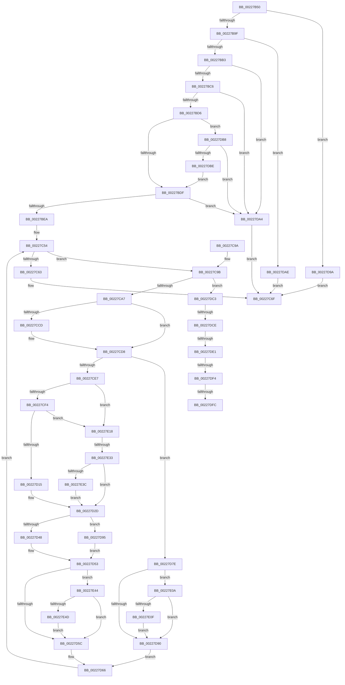

# MmProtectMdlSystemAddress

- RVA: `0x00227B50`–`0x00227E5A` (길이 `778` bytes)
- VA: `0x0000000140227B50`
- 실행 섹션: `.text`
- PDB 이름 있음: `예`; PDB Function 태그: `예`
- unwind 정보 RVA: `0x0005FB94`
- 디코드: `191`개 명령, `778/778` bytes 표시
- 미해석 바이트: `0` (있으면 어셈블리에 `.byte`로 보존)

> 이 문서는 커널 이미지의 기계어와 PDB 기호를 분석해 생성했습니다. 4번과 5번은 함수 원형과 자료형을 바이너리 사용 방식에서 추정한 C 해석이며 원본 소스 복구 결과는 아닙니다.

## 1. Dependencies

- 직접 호출 지점: **14**; 고유 호출 대상: **14**
- 직접 호출자로 확인된 함수: **2**
- RIP 상대 이미지 참조: **4**

### Outgoing calls
- `0x00227B8B` → [memset](../6C/memset_function_006C6C40.md) (function, `0x006C6C40`)
- `0x00227BA6` → [MI_IS_PHYSICAL_ADDRESS](../23/MI_IS_PHYSICAL_ADDRESS_function_0023B3A0.md) (function, `0x0023B3A0`)
- `0x00227BB5` → [MiMakeProtectionMask](../32/MiMakeProtectionMask_function_00329480.md) (function, `0x00329480`)
- `0x00227C49` → [MiInitializeTbFlushList](../29/MiInitializeTbFlushList_function_00294F00.md) (function, `0x00294F00`)
- `0x00227C68` → [MiFlushTbList](../31/MiFlushTbList_function_00311FC0.md) (function, `0x00311FC0`)
- `0x00227C7A` → [_security_check_cookie](../6A/_security_check_cookie_function_006AC640.md) (function, `0x006AC640`)
- `0x00227CC3` → [MiInsertTbFlushEntry](../29/MiInsertTbFlushEntry_function_00293670.md) (function, `0x00293670`)
- `0x00227CD0` → [MiMappingHasIoTracker](MiMappingHasIoTracker_function_00227E60.md) (function, `0x00227E60`)
- `0x00227D26` → [MiMakeProtectionPfnCompatible](MiMakeProtectionPfnCompatible_function_00229CD0.md) (function, `0x00229CD0`)
- `0x00227D3C` → [MiMakeValidPte](../2C/MiMakeValidPte_function_002C5590.md) (function, `0x002C5590`)
- `0x00227D4E` → [MiWriteValidPteNewProtection](../28/MiWriteValidPteNewProtection_function_00281810.md) (function, `0x00281810`)
- `0x00227D86` → [MiMakeTransitionPte](../36/MiMakeTransitionPte_function_00363F70.md) (function, `0x00363F70`)
- `0x00227E26` → [MiLookupIoPageNode](../2A/MiLookupIoPageNode_function_002AC5C8.md) (function, `0x002AC5C8`)
- `0x00227E50` → [MiMappingHasIoReferences](../46/MiMappingHasIoReferences_function_00460934.md) (function, `0x00460934`)

### Direct callers
- [IopLiveDumpBufferDumpData](../59/IopLiveDumpBufferDumpData_function_0059A938.md) at `0x0059ABB0`
- [DifMmProtectMdlSystemAddressWrapper](../63/DifMmProtectMdlSystemAddressWrapper_function_00636710.md) at `0x006367E4`

### Static image references
- `0x00227B67` → RVA `0x00E0A740` (`.data`; read)
- `0x00227C0C` → RVA `0x00E38200` (`.data`; read)
- `0x00227CE7` → RVA `0x00E2DCE0` (`.data`; read)
- `0x00227DE1` → RVA `0x00E2DC80` (`.data`; read)

## 2. Other-region calls and transfers

- 다른 실행 섹션으로 향하는 call: **0**
- call이 아닌 외부 분기/꼬리 이동: **6**
  - `0x00227DC8` → [sub_006D6DBE + 0x2C](../6D/Unknown_function_006D6DBE.md) (`tail-transfer`)
  - `0x00227DDB` → [sub_006D6DBE + 0x2C](../6D/Unknown_function_006D6DBE.md) (`tail-transfer`)
  - `0x00227DEE` → [sub_006D6DBE + 0x4](../6D/Unknown_function_006D6DBE.md) (`tail-transfer`)
  - `0x00227DF6` → [sub_006D6DBE](../6D/Unknown_function_006D6DBE.md) (`tail-transfer`)
  - `0x00227E05` → [sub_006D6DBE + 0x4](../6D/Unknown_function_006D6DBE.md) (`tail-transfer`)
  - `0x00227E2D` → [sub_006D6DBE + 0x24](../6D/Unknown_function_006D6DBE.md) (`tail-transfer`)

## 3. Assembly (complete function range)

```asm
00227B50  48 89 5C 24 18                  mov qword ptr [rsp + 0x18], rbx
00227B55  55                              push rbp
00227B56  56                              push rsi
00227B57  57                              push rdi
00227B58  41 54                           push r12
00227B5A  41 55                           push r13
00227B5C  41 56                           push r14
00227B5E  41 57                           push r15
00227B60  48 81 EC 20 01 00 00            sub rsp, 0x120
00227B67  48 8B 05 D2 2B BE 00            mov rax, qword ptr [rip + 0xbe2bd2]
00227B6E  48 33 C4                        xor rax, rsp
00227B71  48 89 84 24 10 01 00 00         mov qword ptr [rsp + 0x110], rax
00227B79  8B DA                           mov ebx, edx
00227B7B  4C 8B E9                        mov r13, rcx
00227B7E  33 D2                           xor edx, edx
00227B80  48 8D 4C 24 40                  lea rcx, [rsp + 0x40]
00227B85  41 B8 C8 00 00 00               mov r8d, 0xc8
00227B8B  E8 B0 F0 49 00                  call 0x1406c6c40
00227B90  BF 01 00 00 00                  mov edi, 1
00227B95  41 84 7D 0A                     test byte ptr [r13 + 0xa], dil
00227B99  0F 84 FB 01 00 00               je 0x140227d9a
00227B9F  49 8B 6D 18                     mov rbp, qword ptr [r13 + 0x18]
00227BA3  48 8B CD                        mov rcx, rbp
00227BA6  E8 F5 37 01 00                  call 0x14023b3a0
00227BAB  85 C0                           test eax, eax
00227BAD  0F 85 FB 01 00 00               jne 0x140227dae
00227BB3  8B CB                           mov ecx, ebx
00227BB5  E8 C6 18 10 00                  call 0x140329480
00227BBA  44 8B F0                        mov r14d, eax
00227BBD  83 F8 FF                        cmp eax, -1
00227BC0  0F 84 DE 01 00 00               je 0x140227da4
00227BC6  8B D0                           mov edx, eax
00227BC8  C1 EA 03                        shr edx, 3
00227BCB  8D 4A FF                        lea ecx, [rdx - 1]
00227BCE  3B CF                           cmp ecx, edi
00227BD0  0F 86 CE 01 00 00               jbe 0x140227da4
00227BD6  83 FA 03                        cmp edx, 3
00227BD9  0F 84 D9 01 00 00               je 0x140227db8
00227BDF  83 E0 05                        and eax, 5
00227BE2  3C 05                           cmp al, 5
00227BE4  0F 84 BA 01 00 00               je 0x140227da4
00227BEA  48 8B F5                        mov rsi, rbp
00227BED  48 B8 F8 FF FF FF 7F 00 00 00   movabs rax, 0x7ffffffff8
00227BF7  48 C1 EE 09                     shr rsi, 9
00227BFB  48 23 F0                        and rsi, rax
00227BFE  48 B8 00 00 00 00 80 F6 FF FF   movabs rax, 0xfffff68000000000
00227C08  45 8B 5D 28                     mov r11d, dword ptr [r13 + 0x28]
00227C0C  48 8D 15 ED 05 C1 00            lea rdx, [rip + 0xc105ed]
00227C13  48 8B CD                        mov rcx, rbp
00227C16  89 7C 24 20                     mov dword ptr [rsp + 0x20], edi
00227C1A  81 E1 FF 0F 00 00               and ecx, 0xfff
00227C20  49 81 C3 FF 0F 00 00            add r11, 0xfff
00227C27  45 33 C9                        xor r9d, r9d
00227C2A  4C 03 D9                        add r11, rcx
00227C2D  49 C1 EB 0C                     shr r11, 0xc
00227C31  48 8D 4C 24 40                  lea rcx, [rsp + 0x40]
00227C36  4C 89 5C 24 30                  mov qword ptr [rsp + 0x30], r11
00227C3B  48 03 F0                        add rsi, rax
00227C3E  48 81 E5 00 F0 FF FF            and rbp, 0xfffffffffffff000
00227C45  45 8D 41 14                     lea r8d, [r9 + 0x14]
00227C49  E8 B2 D2 06 00                  call 0x140294f00
00227C4E  45 33 E4                        xor r12d, r12d
00227C51  4C 8B FD                        mov r15, rbp
00227C54  48 BA FF FF FF FF FF 00 00 00   movabs rdx, 0xffffffffff
00227C5E  4D 85 DB                        test r11, r11
00227C61  75 38                           jne 0x140227c9b
00227C63  48 8D 4C 24 40                  lea rcx, [rsp + 0x40]
00227C68  E8 53 A3 0E 00                  call 0x140311fc0
00227C6D  33 C0                           xor eax, eax
00227C6F  48 8B 8C 24 10 01 00 00         mov rcx, qword ptr [rsp + 0x110]
00227C77  48 33 CC                        xor rcx, rsp
00227C7A  E8 C1 49 48 00                  call 0x1406ac640
00227C7F  48 8B 9C 24 70 01 00 00         mov rbx, qword ptr [rsp + 0x170]
00227C87  48 81 C4 20 01 00 00            add rsp, 0x120
00227C8E  41 5F                           pop r15
00227C90  41 5E                           pop r14
00227C92  41 5D                           pop r13
00227C94  41 5C                           pop r12
00227C96  5F                              pop rdi
00227C97  5E                              pop rsi
00227C98  5D                              pop rbp
00227C99  C3                              ret
00227C9A  CC                              int3
00227C9B  48 8B 06                        mov rax, qword ptr [rsi]
00227C9E  40 84 C7                        test dil, al
00227CA1  0F 84 1C 01 00 00               je 0x140227dc3
00227CA7  48 C1 E8 0C                     shr rax, 0xc
00227CAB  48 8D 4C 24 40                  lea rcx, [rsp + 0x40]
00227CB0  48 23 C2                        and rax, rdx
00227CB3  89 7C 24 38                     mov dword ptr [rsp + 0x38], edi
00227CB7  49 8B D7                        mov rdx, r15
00227CBA  45 33 C9                        xor r9d, r9d
00227CBD  4C 8B C7                        mov r8, rdi
00227CC0  48 8B D8                        mov rbx, rax
00227CC3  E8 A8 B9 06 00                  call 0x140293670
00227CC8  4C 3B FD                        cmp r15, rbp
00227CCB  75 0B                           jne 0x140227cd8
00227CCD  48 8B CD                        mov rcx, rbp
00227CD0  E8 8B 01 00 00                  call 0x140227e60
00227CD5  44 8B E0                        mov r12d, eax
00227CD8  4C 8B 5C 24 30                  mov r11, qword ptr [rsp + 0x30]
00227CDD  41 83 FE 18                     cmp r14d, 0x18
00227CE1  0F 84 97 00 00 00               je 0x140227d7e
00227CE7  48 3B 1D F2 5F C0 00            cmp rbx, qword ptr [rip + 0xc05ff2]
00227CEE  0F 87 24 01 00 00               ja 0x140227e18
00227CF4  48 8D 0C 5B                     lea rcx, [rbx + rbx*2]
00227CF8  48 03 C9                        add rcx, rcx
00227CFB  48 B8 28 00 00 00 00 DE FF FF   movabs rax, 0xffffde0000000028
00227D05  48 8B 04 C8                     mov rax, qword ptr [rax + rcx*8]
00227D09  48 C1 E8 36                     shr rax, 0x36
00227D0D  85 C7                           test edi, eax
00227D0F  0F 84 03 01 00 00               je 0x140227e18
00227D15  48 B8 00 00 00 00 00 DE FF FF   movabs rax, 0xffffde0000000000
00227D1F  48 8D 14 C8                     lea rdx, [rax + rcx*8]
00227D23  41 8B CE                        mov ecx, r14d
00227D26  E8 A5 1F 00 00                  call 0x140229cd0
00227D2B  8B F8                           mov edi, eax
00227D2D  81 CF 00 00 00 A0               or edi, 0xa0000000
00227D33  48 8B D3                        mov rdx, rbx
00227D36  44 8B C7                        mov r8d, edi
00227D39  48 8B CE                        mov rcx, rsi
00227D3C  E8 4F D8 09 00                  call 0x1402c5590
00227D41  83 7C 24 38 00                  cmp dword ptr [rsp + 0x38], 0
00227D46  74 4D                           je 0x140227d95
00227D48  48 8B D0                        mov rdx, rax
00227D4B  48 8B CE                        mov rcx, rsi
00227D4E  E8 BD 9A 05 00                  call 0x140281810
00227D53  45 85 E4                        test r12d, r12d
00227D56  0F 85 E8 00 00 00               jne 0x140227e44
00227D5C  4C 8B 5C 24 30                  mov r11, qword ptr [rsp + 0x30]
00227D61  BF 01 00 00 00                  mov edi, 1
00227D66  49 81 C7 00 10 00 00            add r15, 0x1000
00227D6D  48 83 C6 08                     add rsi, 8
00227D71  4C 2B DF                        sub r11, rdi
00227D74  4C 89 5C 24 30                  mov qword ptr [rsp + 0x30], r11
00227D79  E9 D6 FE FF FF                  jmp 0x140227c54
00227D7E  BA 18 00 00 00                  mov edx, 0x18
00227D83  48 8B CB                        mov rcx, rbx
00227D86  E8 E5 C1 13 00                  call 0x140363f70
00227D8B  45 85 E4                        test r12d, r12d
00227D8E  75 7A                           jne 0x140227e0a
00227D90  48 89 06                        mov qword ptr [rsi], rax
00227D93  EB D1                           jmp 0x140227d66
00227D95  48 89 06                        mov qword ptr [rsi], rax
00227D98  EB B9                           jmp 0x140227d53
00227D9A  B8 19 00 00 C0                  mov eax, 0xc0000019
00227D9F  E9 CB FE FF FF                  jmp 0x140227c6f
00227DA4  B8 45 00 00 C0                  mov eax, 0xc0000045
00227DA9  E9 C1 FE FF FF                  jmp 0x140227c6f
00227DAE  B8 BB 00 00 C0                  mov eax, 0xc00000bb
00227DB3  E9 B7 FE FF FF                  jmp 0x140227c6f
00227DB8  41 F6 C6 07                     test r14b, 7
00227DBC  75 E6                           jne 0x140227da4
00227DBE  E9 1C FE FF FF                  jmp 0x140227bdf
00227DC3  48 0F BA E0 0B                  bt rax, 0xb
00227DC8  0F 83 1C F0 4A 00               jae 0x1406d6dea
00227DCE  48 8B C8                        mov rcx, rax
00227DD1  48 C1 E9 05                     shr rcx, 5
00227DD5  83 E1 1F                        and ecx, 0x1f
00227DD8  80 F9 18                        cmp cl, 0x18
00227DDB  0F 85 09 F0 4A 00               jne 0x1406d6dea
00227DE1  48 8B 0D 98 5E C0 00            mov rcx, qword ptr [rip + 0xc05e98]
00227DE8  48 8B D8                        mov rbx, rax
00227DEB  48 85 C9                        test rcx, rcx
00227DEE  0F 84 CE EF 4A 00               je 0x1406d6dc2
00227DF4  A8 10                           test al, 0x10
00227DF6  0F 85 C2 EF 4A 00               jne 0x1406d6dbe
00227DFC  48 8B D9                        mov rbx, rcx
00227DFF  48 F7 D3                        not rbx
00227E02  48 23 D8                        and rbx, rax
00227E05  E9 B8 EF 4A 00                  jmp 0x1406d6dc2
00227E0A  4C 3B FD                        cmp r15, rbp
00227E0D  75 81                           jne 0x140227d90
00227E0F  48 83 C8 08                     or rax, 8
00227E13  E9 78 FF FF FF                  jmp 0x140227d90
00227E18  41 8B FE                        mov edi, r14d
00227E1B  BA 01 00 00 00                  mov edx, 1
00227E20  48 8B CB                        mov rcx, rbx
00227E23  83 E7 07                        and edi, 7
00227E26  E8 9D 47 08 00                  call 0x1402ac5c8
00227E2B  85 C0                           test eax, eax
00227E2D  0F 84 AF EF 4A 00               je 0x1406d6de2
00227E33  83 F8 02                        cmp eax, 2
00227E36  0F 85 F1 FE FF FF               jne 0x140227d2d
00227E3C  83 CF 18                        or edi, 0x18
00227E3F  E9 E9 FE FF FF                  jmp 0x140227d2d
00227E44  4C 3B FD                        cmp r15, rbp
00227E47  0F 85 0F FF FF FF               jne 0x140227d5c
00227E4D  48 8B CD                        mov rcx, rbp
00227E50  E8 DF 8A 23 00                  call 0x140460934
00227E55  E9 02 FF FF FF                  jmp 0x140227d5c
```

## 4. C-style interpretation (structured pseudocode)

```c
__int64 __fastcall MmProtectMdlSystemAddress(__int64 a1, int a2, __int64 a3, int a4)
{
    __int64 result;
    __int64 v_r11;
    __int64 v_r12;
    __int64 v_r15;
    __int64 v_rbp;
    __int64 v_rbx;
    __int64 v_rdi;
    __int64 v_rsi;
    __int64 v_rsp;
    unsigned __int64 v_stack_m118;
    unsigned __int64 v_stack_m128;
    unsigned int v_stack_m138;
    unsigned __int64 v_stack_m48;
    unsigned __int64 v_stack_p18;
    unsigned __int64 v_stack_p30;
    unsigned int v_stack_p38;
    unsigned __int64 v_stack_p40;

    v_stack_p18 = v_rbx;
    v_rsp = (v_rsp) - (288);
    result = (*(unsigned __int64 *)(v_rip + 12463058)) ^ (v_rsp);
    v_stack_m48 = result;
    a2 = 0;
    result = memset(v_stack_m118, a2, 200, a4);
    if (((*(unsigned __int8 *)(a1 + 10)) & (1)) == 0) goto loc_00227D9A;
    result = MI_IS_PHYSICAL_ADDRESS(*(unsigned __int64 *)(a1 + 24), a2, 200, a4);
    if ((unsigned int)(result) != 0) goto loc_00227DAE;
    result = MiMakeProtectionMask((unsigned int)((unsigned int)((unsigned int)(a2))), a2, 200, a4);
    if (((unsigned int)(result)) == -1) goto loc_00227DA4;
    a2 = (unsigned int)(((unsigned int)((unsigned int)(result))) >> (3));
    if (((unsigned int)(a2 - 1)) <= 1) goto loc_00227DA4;
    if (a2 == 3) goto loc_00227DB8;
loc_00227BDF:
    result = (unsigned int)((result) & (5));
    if (((unsigned __int8)(result)) == 5) goto loc_00227DA4;
    v_rsi = (*(unsigned __int64 *)(a1 + 24)) >> (9);
    v_rsi = (v_rsi) & (result);
    v_stack_m138 = 1;
    a1 = (unsigned int)((*(unsigned __int64 *)(a1 + 24)) & (0xFFFULL));
    v_r11 = ((unsigned int)(*(unsigned int *)(a1 + 40))) + (0xFFFULL);
    a4 = 0;
    v_r11 = (v_r11) + (a1);
    v_r11 = (v_r11) >> (12);
    v_stack_m128 = v_r11;
    v_rsi = (v_rsi) + (result);
    v_rbp = (*(unsigned __int64 *)(a1 + 24)) & (0xFFFFFFFFFFFFF000ULL);
    result = MiInitializeTbFlushList(v_stack_m118, v_rip + 12649965, a4 + 20, a4);
    v_r12 = 0;
loc_00227C54:
    if (v_r11 != 0) goto loc_00227C9B;
    result = MiFlushTbList(v_stack_m118, v_rip + 12649965, a4 + 20, a4);
    result = 0;
loc_00227C6F:
    a1 = (v_stack_m48) ^ (v_rsp);
    result = _security_check_cookie(a1, v_rip + 12649965, a4 + 20, a4);
    v_rsp = (v_rsp) + (288);
    return result;
loc_00227C9B:
    if (((1) & ((unsigned __int8)(*(unsigned __int64 *)(v_rsi)))) == 0) goto loc_00227DC3;
    result = (*(unsigned __int64 *)(v_rsi)) >> (12);
    result = (result) & (v_rip + 12649965);
    v_stack_p38 = 1;
    a4 = 0;
    result = MiInsertTbFlushEntry(v_stack_p40, v_rbp, 1, a4);
    if (v_rbp == v_rbp) {
        a1 = v_rbp;
        result = MiMappingHasIoTracker(a1, v_rbp, 1, a4);
        v_r12 = (unsigned int)(result);
    }
    if (((unsigned int)((unsigned int)((unsigned int)(result)))) == 24) goto loc_00227D7E;
    if (result > (*(unsigned __int64 *)(v_rip + 12607474))) goto loc_00227E18;
    a1 = (result + result * 2) + (result + result * 2);
    result = (*(unsigned __int64 *)(result + a1 * 8)) >> (54);
    if (((1) & ((unsigned int)(result))) == 0) goto loc_00227E18;
    result = MiMakeProtectionPfnCompatible((unsigned int)((unsigned int)((unsigned int)((unsigned int)(result)))), result + a1 * 8, 1, a4);
loc_00227D2D:
    v_rdi = (unsigned int)(((unsigned int)((unsigned int)(result))) | (0xA0000000ULL));
    result = MiMakeValidPte(v_rsi, result, (unsigned int)((unsigned int)(v_rdi)), a4);
    if (v_stack_p38 == 0) goto loc_00227D95;
    result = MiWriteValidPteNewProtection(v_rsi, result, (unsigned int)((unsigned int)(v_rdi)), a4);
loc_00227D53:
    if ((unsigned int)(v_r12) != 0) goto loc_00227E44;
loc_00227D5C:
loc_00227D66:
    v_r15 = (v_rbp) + (0x1000ULL);
    v_rsi = (v_rsi) + (8);
    v_r11 = (v_stack_p30) - (1);
    v_stack_p30 = v_r11;
    goto loc_00227C54;
loc_00227D7E:
    result = MiMakeTransitionPte(result, 24, (unsigned int)((unsigned int)(v_rdi)), a4);
    if ((unsigned int)(v_r12) != 0) goto loc_00227E0A;
loc_00227D90:
    *(unsigned __int64 *)(v_rsi) = result;
    goto loc_00227D66;
loc_00227D95:
    *(unsigned __int64 *)(v_rsi) = result;
    goto loc_00227D53;
loc_00227D9A:
    goto loc_00227C6F;
loc_00227DA4:
    goto loc_00227C6F;
loc_00227DAE:
    goto loc_00227C6F;
loc_00227DB8:
    if ((((unsigned __int8)((unsigned int)((unsigned int)(result)))) & (7)) != 0) goto loc_00227DA4;
    goto loc_00227BDF;
loc_00227DC3:
    a1 = ((unsigned int)(0xC00000BBULL)) >> (5);
    a1 = (unsigned int)((a1) & (31));
    v_rbx = ~(*(unsigned __int64 *)(v_rip + 12607128));
    v_rbx = (v_rbx) & ((unsigned int)(0xC00000BBULL));
loc_00227E0A:
    if (v_r15 != v_rbp) goto loc_00227D90;
    result = ((unsigned int)(0xC00000BBULL)) | (8);
    goto loc_00227D90;
loc_00227E18:
    v_rdi = (unsigned int)(((unsigned int)((unsigned int)((unsigned int)((unsigned int)(result))))) & (7));
    result = MiLookupIoPageNode(v_rbx, 1, (unsigned int)((unsigned int)(v_rdi)), a4);
    if (((unsigned int)(result)) != 2) goto loc_00227D2D;
    v_rdi = (unsigned int)((v_rdi) | (24));
    goto loc_00227D2D;
loc_00227E44:
    if (v_r15 != v_rbp) goto loc_00227D5C;
    result = MiMappingHasIoReferences(v_rbp, 1, (unsigned int)((unsigned int)(v_rdi)), a4);
    goto loc_00227D5C;
}
```

## 5. (Beta) C Style

```c
int64_t MmProtectMdlSystemAddress(void *Arg1, int32_t Arg2, int64_t Arg3, int32_t Arg4)
{
    uint8_t *arg1 = (uint8_t *)Arg1;

    int64_t result;
    int64_t local_r11;
    int64_t local_r12;
    int64_t local_r15;
    int64_t local_rbp;
    int64_t local_rbx;
    int64_t local_rdi;
    int64_t local_rsi;
    int64_t local_rsp;
    uint64_t v_stack_m118;
    uint64_t v_stack_m128;
    uint32_t v_stack_m138;
    uint64_t v_stack_m48;
    uint64_t v_stack_p18;
    uint64_t v_stack_p30;
    uint32_t v_stack_p38;
    uint64_t v_stack_p40;

    v_stack_p18 = local_rbx;
    local_rsp = (local_rsp) - (288);
    result = (*(uint64_t *)(v_rip + 0xBE2BD2)) ^ (local_rsp);
    v_stack_m48 = result;
    Arg2 = 0;
    result = memset(v_stack_m118, Arg2, 200, Arg4);
    if (((*(uint8_t *)(arg1 + 0xA)) & (1)) == 0) goto loc_00227D9A;
    result = MI_IS_PHYSICAL_ADDRESS(*(uint64_t *)(arg1 + 0x18), Arg2, 200, Arg4);
    if ((uint32_t)(result) != 0) goto loc_00227DAE;
    result = MiMakeProtectionMask((uint32_t)((uint32_t)((uint32_t)(Arg2))), Arg2, 200, Arg4);
    if (((uint32_t)(result)) == -1) goto loc_00227DA4;
    Arg2 = (uint32_t)(((uint32_t)((uint32_t)(result))) >> (3));
    if (((uint32_t)(Arg2 - 1)) <= 1) goto loc_00227DA4;
    if (Arg2 == 3) goto loc_00227DB8;
loc_00227BDF:
    result = (uint32_t)((result) & (5));
    if (((uint8_t)(result)) == 5) goto loc_00227DA4;
    local_rsi = (*(uint64_t *)(arg1 + 0x18)) >> (9);
    local_rsi = (local_rsi) & (result);
    v_stack_m138 = 1;
    Arg1 = (uint32_t)((*(uint64_t *)(arg1 + 0x18)) & (0xFFFULL));
    local_r11 = ((uint32_t)(*(uint32_t *)(arg1 + 0x28))) + (0xFFFULL);
    Arg4 = 0;
    local_r11 = (local_r11) + (Arg1);
    local_r11 = (local_r11) >> (12);
    v_stack_m128 = local_r11;
    local_rsi = (local_rsi) + (result);
    local_rbp = (*(uint64_t *)(arg1 + 0x18)) & (0xFFFFFFFFFFFFF000ULL);
    result = MiInitializeTbFlushList(v_stack_m118, v_rip + 12649965, Arg4 + 20, Arg4);
    local_r12 = 0;
loc_00227C54:
    if (local_r11 != 0) goto loc_00227C9B;
    result = MiFlushTbList(v_stack_m118, v_rip + 12649965, Arg4 + 20, Arg4);
    result = 0;
loc_00227C6F:
    Arg1 = (v_stack_m48) ^ (local_rsp);
    result = _security_check_cookie(Arg1, v_rip + 12649965, Arg4 + 20, Arg4);
    local_rsp = (local_rsp) + (288);
    return result;
loc_00227C9B:
    if (((1) & ((uint8_t)(*(uint64_t *)(local_rsi)))) == 0) goto loc_00227DC3;
    result = (*(uint64_t *)(local_rsi)) >> (12);
    result = (result) & (v_rip + 12649965);
    v_stack_p38 = 1;
    Arg4 = 0;
    result = MiInsertTbFlushEntry(v_stack_p40, local_rbp, 1, Arg4);
    if (local_rbp == local_rbp) {
        Arg1 = local_rbp;
        result = MiMappingHasIoTracker(Arg1, local_rbp, 1, Arg4);
        local_r12 = (uint32_t)(result);
    }
    if (((uint32_t)((uint32_t)((uint32_t)(result)))) == 24) goto loc_00227D7E;
    if (result > (*(uint64_t *)(v_rip + 0xC05FF2))) goto loc_00227E18;
    Arg1 = (result + result * 2) + (result + result * 2);
    result = (*(uint64_t *)(result + arg1 * 8)) >> (54);
    if (((1) & ((uint32_t)(result))) == 0) goto loc_00227E18;
    result = MiMakeProtectionPfnCompatible((uint32_t)((uint32_t)((uint32_t)((uint32_t)(result)))), result + Arg1 * 8, 1, Arg4);
loc_00227D2D:
    local_rdi = (uint32_t)(((uint32_t)((uint32_t)(result))) | (0xA0000000ULL));
    result = MiMakeValidPte(local_rsi, result, (uint32_t)((uint32_t)(local_rdi)), Arg4);
    if (v_stack_p38 == 0) goto loc_00227D95;
    result = MiWriteValidPteNewProtection(local_rsi, result, (uint32_t)((uint32_t)(local_rdi)), Arg4);
loc_00227D53:
    if ((uint32_t)(local_r12) != 0) goto loc_00227E44;
loc_00227D5C:
loc_00227D66:
    local_r15 = (local_rbp) + (0x1000ULL);
    local_rsi = (local_rsi) + (8);
    local_r11 = (v_stack_p30) - (1);
    v_stack_p30 = local_r11;
    goto loc_00227C54;
loc_00227D7E:
    result = MiMakeTransitionPte(result, 24, (uint32_t)((uint32_t)(local_rdi)), Arg4);
    if ((uint32_t)(local_r12) != 0) goto loc_00227E0A;
loc_00227D90:
    *(uint64_t *)(local_rsi) = result;
    goto loc_00227D66;
loc_00227D95:
    *(uint64_t *)(local_rsi) = result;
    goto loc_00227D53;
loc_00227D9A:
    goto loc_00227C6F;
loc_00227DA4:
    goto loc_00227C6F;
loc_00227DAE:
    goto loc_00227C6F;
loc_00227DB8:
    if ((((uint8_t)((uint32_t)((uint32_t)(result)))) & (7)) != 0) goto loc_00227DA4;
    goto loc_00227BDF;
loc_00227DC3:
    Arg1 = ((uint32_t)(0xC00000BBULL)) >> (5);
    Arg1 = (uint32_t)((Arg1) & (31));
    local_rbx = ~(*(uint64_t *)(v_rip + 0xC05E98));
    local_rbx = (local_rbx) & ((uint32_t)(0xC00000BBULL));
loc_00227E0A:
    if (local_r15 != local_rbp) goto loc_00227D90;
    result = ((uint32_t)(0xC00000BBULL)) | (8);
    goto loc_00227D90;
loc_00227E18:
    local_rdi = (uint32_t)(((uint32_t)((uint32_t)((uint32_t)((uint32_t)(result))))) & (7));
    result = MiLookupIoPageNode(local_rbx, 1, (uint32_t)((uint32_t)(local_rdi)), Arg4);
    if (((uint32_t)(result)) != 2) goto loc_00227D2D;
    local_rdi = (uint32_t)((local_rdi) | (24));
    goto loc_00227D2D;
loc_00227E44:
    if (local_r15 != local_rbp) goto loc_00227D5C;
    result = MiMappingHasIoReferences(local_rbp, 1, (uint32_t)((uint32_t)(local_rdi)), Arg4);
    goto loc_00227D5C;
}
```

### 관측된 메모리 오프셋

구조체 형식이 확인되지 않은 접근은 인자 기준의 오프셋으로만 기록했습니다.

| 기준 인자 | 오프셋 표현 | 폭 (bit) | 접근 |
|---|---:|---:|---|
| `Arg1` | `+ 0xA` | `8` | `R` |
| `Arg1` | `+ 0x18` | `64` | `R` |
| `Arg1` | `+ 0x28` | `32` | `R` |

## 6. Execution-region graph

[열기: 2D/3D 그래프와 함수 탐색 컨트롤 패널](../../../control-panel.html?section=text&rva=0x00227B50&view=graph)

- 2D 그래프는 위에서 아래로 흐르고, 3D 그래프는 빈 공간을 드래그해 회전합니다. Shift+드래그는 이동, 휠은 확대·축소, 함수 노드 선택은 대상 보고서 이동입니다.

### Static fallback


