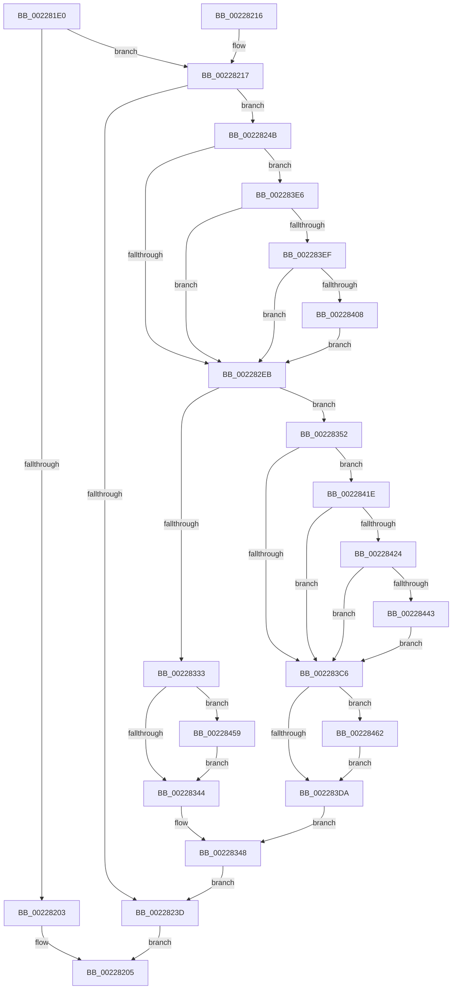

# MmStealTopLevelPage

- RVA: `0x002281E0`–`0x0022846B` (길이 `651` bytes)
- VA: `0x00000001402281E0`
- 실행 섹션: `.text`
- PDB 이름 있음: `예`; PDB Function 태그: `아니요`
- unwind 정보 RVA: `0x0005FC10`
- 디코드: `154`개 명령, `651/651` bytes 표시
- 미해석 바이트: `0` (있으면 어셈블리에 `.byte`로 보존)

> 이 문서는 커널 이미지의 기계어와 PDB 기호를 분석해 생성했습니다. 4번과 5번은 함수 원형과 자료형을 바이너리 사용 방식에서 추정한 C 해석이며 원본 소스 복구 결과는 아닙니다.

## 1. Dependencies

- 직접 호출 지점: **9**; 고유 호출 대상: **7**
- 직접 호출자로 확인된 함수: **1**
- RIP 상대 이미지 참조: **4**

### Outgoing calls
- `0x00228228` → [MiLockWorkingSetExclusiveAtDpc](../23/MiLockWorkingSetExclusiveAtDpc_function_002395EC.md) (function, `0x002395EC`)
- `0x00228230` → [MiReplacePageTablePage](MiReplacePageTablePage_function_00229184.md) (function, `0x00229184`)
- `0x00228242` → [MiUnlockWorkingSetExclusive](../27/MiUnlockWorkingSetExclusive_function_0027EC70.md) (function, `0x0027EC70`)
- `0x00228261` → [MiMapPageInHyperSpaceWorker](../33/MiMapPageInHyperSpaceWorker_function_00332B10.md) (function, `0x00332B10`)
- `0x002282A8` → [MI_READ_PTE_LOCK_FREE](../28/MI_READ_PTE_LOCK_FREE_function_002828A0.md) (function, `0x002828A0`)
- `0x00228369` → [MI_READ_PTE_LOCK_FREE](../28/MI_READ_PTE_LOCK_FREE_function_002828A0.md) (function, `0x002828A0`)
- `0x00228399` → [MiFlushSingleTbEntry](../28/MiFlushSingleTbEntry_function_0028E730.md) (function, `0x0028E730`)
- `0x00228414` → [MiCheckLinearProtectedPteAccessedBit](../29/MiCheckLinearProtectedPteAccessedBit_function_00292D80.md) (function, `0x00292D80`)
- `0x0022844F` → [MiCheckLinearProtectedPteAccessedBit](../29/MiCheckLinearProtectedPteAccessedBit_function_00292D80.md) (function, `0x00292D80`)

### Direct callers
- [KiSwapDirectoryTableBaseTarget](KiSwapDirectoryTableBaseTarget_function_00227FF0.md) at `0x00228051`

### Static image references
- `0x00228251` → RVA `0x00EF5168` (`.data`; read/write)
- `0x002282CA` → RVA `0x00010880` (`.rdata`; read)
- `0x002282DC` → RVA `0x00FC6A88` (`ALMOSTRO`; read)
- `0x00228337` → RVA `0x00FC6A87` (`ALMOSTRO`; read)

## 2. Other-region calls and transfers

- 다른 실행 섹션으로 향하는 call: **0**
- 별도 외부 분기/꼬리 이동을 확인하지 못했습니다.

## 3. Assembly (complete function range)

```asm
002281E0  40 53                           push rbx
002281E2  55                              push rbp
002281E3  56                              push rsi
002281E4  57                              push rdi
002281E5  41 54                           push r12
002281E7  41 55                           push r13
002281E9  41 56                           push r14
002281EB  41 57                           push r15
002281ED  48 83 EC 28                     sub rsp, 0x28
002281F1  65 4C 8B 3C 25 88 01 00 00      mov r15, qword ptr gs:[0x188]
002281FA  4C 8B F1                        mov r14, rcx
002281FD  4C 39 79 28                     cmp qword ptr [rcx + 0x28], r15
00228201  74 14                           je 0x140228217
00228203  33 C0                           xor eax, eax
00228205  48 83 C4 28                     add rsp, 0x28
00228209  41 5F                           pop r15
0022820B  41 5E                           pop r14
0022820D  41 5D                           pop r13
0022820F  41 5C                           pop r12
00228211  5F                              pop rdi
00228212  5E                              pop rsi
00228213  5D                              pop rbp
00228214  5B                              pop rbx
00228215  C3                              ret
00228216  CC                              int3
00228217  4D 8B BF B8 00 00 00            mov r15, qword ptr [r15 + 0xb8]
0022821E  4D 8D AF 00 04 00 00            lea r13, [r15 + 0x400]
00228225  49 8B CD                        mov rcx, r13
00228228  E8 BF 13 01 00                  call 0x1402395ec
0022822D  49 8B CE                        mov rcx, r14
00228230  E8 4F 0F 00 00                  call 0x140229184
00228235  33 ED                           xor ebp, ebp
00228237  41 39 6E 38                     cmp dword ptr [r14 + 0x38], ebp
0022823B  7D 0E                           jge 0x14022824b
0022823D  B2 11                           mov dl, 0x11
0022823F  49 8B CD                        mov rcx, r13
00228242  E8 29 6A 05 00                  call 0x14027ec70
00228247  8B C5                           mov eax, ebp
00228249  EB BA                           jmp 0x140228205
0022824B  49 8B 76 20                     mov rsi, qword ptr [r14 + 0x20]
0022824F  33 D2                           xor edx, edx
00228251  FF 05 11 CF CC 00               inc dword ptr [rip + 0xcccf11]
00228257  41 B8 00 00 00 80               mov r8d, 0x80000000
0022825D  49 8B 4E 20                     mov rcx, qword ptr [r14 + 0x20]
00228261  E8 AA A8 10 00                  call 0x140332b10
00228266  49 8B 56 08                     mov rdx, qword ptr [r14 + 8]
0022826A  4C 8B E0                        mov r12, rax
0022826D  48 B8 F8 FF FF FF 7F 00 00 00   movabs rax, 0x7ffffffff8
00228277  48 C1 EA 09                     shr rdx, 9
0022827B  48 23 D0                        and rdx, rax
0022827E  48 B8 00 00 00 00 80 F6 FF FF   movabs rax, 0xfffff68000000000
00228288  48 8B C8                        mov rcx, rax
0022828B  48 03 D1                        add rdx, rcx
0022828E  48 8B FE                        mov rdi, rsi
00228291  48 C1 EA 03                     shr rdx, 3
00228295  81 E2 FF 01 00 00               and edx, 0x1ff
0022829B  48 C1 E7 0C                     shl rdi, 0xc
0022829F  49 8D 0C D4                     lea rcx, [r12 + rdx*8]
002282A3  48 89 4C 24 70                  mov qword ptr [rsp + 0x70], rcx
002282A8  E8 F3 A5 05 00                  call 0x1402828a0
002282AD  48 8B D8                        mov rbx, rax
002282B0  48 B9 00 00 00 00 40 00 00 00   movabs rcx, 0x4000000000
002282BA  48 33 DF                        xor rbx, rdi
002282BD  48 B8 FF 0F 00 00 00 00 F0 FF   movabs rax, 0xfff0000000000fff
002282C7  48 23 D8                        and rbx, rax
002282CA  48 8B 05 AF 85 DE FF            mov rax, qword ptr [rip - 0x217a51]
002282D1  48 33 DF                        xor rbx, rdi
002282D4  48 8B 7C 24 70                  mov rdi, qword ptr [rsp + 0x70]
002282D9  48 89 07                        mov qword ptr [rdi], rax
002282DC  48 0F BA 25 A3 E7 D9 00 24      bt qword ptr [rip + 0xd9e7a3], 0x24
002282E5  0F 82 FB 00 00 00               jb 0x1402283e6
002282EB  49 C1 EC 09                     shr r12, 9
002282EF  48 BA F8 FF FF FF 7F 00 00 00   movabs rdx, 0x7ffffffff8
002282F9  48 89 1F                        mov qword ptr [rdi], rbx
002282FC  4C 23 E2                        and r12, rdx
002282FF  48 BF 00 00 00 00 80 F6 FF FF   movabs rdi, 0xfffff68000000000
00228309  48 8B C7                        mov rax, rdi
0022830C  4C 03 E0                        add r12, rax
0022830F  65 48 8B 04 25 20 00 00 00      mov rax, qword ptr gs:[0x20]
00228318  48 8B 88 38 88 00 00            mov rcx, qword ptr [rax + 0x8838]
0022831F  48 8B 05 5A 85 DE FF            mov rax, qword ptr [rip - 0x217aa6]
00228326  48 89 29                        mov qword ptr [rcx], rbp
00228329  49 89 04 24                     mov qword ptr [r12], rax
0022832D  41 39 6E 40                     cmp dword ptr [r14 + 0x40], ebp
00228331  75 1F                           jne 0x140228352
00228333  48 C1 E6 0C                     shl rsi, 0xc
00228337  40 38 2D 49 E7 D9 00            cmp byte ptr [rip + 0xd9e749], bpl
0022833E  0F 85 15 01 00 00               jne 0x140228459
00228344  49 89 77 28                     mov qword ptr [r15 + 0x28], rsi
00228348  BD 01 00 00 00                  mov ebp, 1
0022834D  E9 EB FE FF FF                  jmp 0x14022823d
00228352  4D 8B B7 08 05 00 00            mov r14, qword ptr [r15 + 0x508]
00228359  49 C1 EE 09                     shr r14, 9
0022835D  4C 23 F2                        and r14, rdx
00228360  48 8B C7                        mov rax, rdi
00228363  4C 03 F0                        add r14, rax
00228366  49 8B CE                        mov rcx, r14
00228369  E8 32 A5 05 00                  call 0x1402828a0
0022836E  48 8B D8                        mov rbx, rax
00228371  49 8B CE                        mov rcx, r14
00228374  48 8B 05 05 85 DE FF            mov rax, qword ptr [rip - 0x217afb]
0022837B  49 89 06                        mov qword ptr [r14], rax
0022837E  48 C1 E1 19                     shl rcx, 0x19
00228382  48 8B C7                        mov rax, rdi
00228385  BA 02 00 00 00                  mov edx, 2
0022838A  48 C1 E0 19                     shl rax, 0x19
0022838E  48 2B C8                        sub rcx, rax
00228391  48 C1 F9 10                     sar rcx, 0x10
00228395  44 8D 42 FF                     lea r8d, [rdx - 1]
00228399  E8 92 63 06 00                  call 0x14028e730
0022839E  48 8B C6                        mov rax, rsi
002283A1  48 B9 FF 0F 00 00 00 00 F0 FF   movabs rcx, 0xfff0000000000fff
002283AB  48 C1 E0 0C                     shl rax, 0xc
002283AF  48 8B F8                        mov rdi, rax
002283B2  48 33 FB                        xor rdi, rbx
002283B5  48 23 F9                        and rdi, rcx
002283B8  48 33 F8                        xor rdi, rax
002283BB  48 0F BA 25 C4 E6 D9 00 24      bt qword ptr [rip + 0xd9e6c4], 0x24
002283C4  72 58                           jb 0x14022841e
002283C6  48 C1 E6 0C                     shl rsi, 0xc
002283CA  40 38 2D B6 E6 D9 00            cmp byte ptr [rip + 0xd9e6b6], bpl
002283D1  49 89 3E                        mov qword ptr [r14], rdi
002283D4  0F 85 88 00 00 00               jne 0x140228462
002283DA  49 89 B7 58 01 00 00            mov qword ptr [r15 + 0x158], rsi
002283E1  E9 62 FF FF FF                  jmp 0x140228348
002283E6  F6 C3 20                        test bl, 0x20
002283E9  0F 85 FC FE FF FF               jne 0x1402282eb
002283EF  48 B8 00 00 00 00 80 F6 FF FF   movabs rax, 0xfffff68000000000
002283F9  48 8B C0                        mov rax, rax
002283FC  48 03 C1                        add rax, rcx
002283FF  48 3B F8                        cmp rdi, rax
00228402  0F 82 E3 FE FF FF               jb 0x1402282eb
00228408  41 B8 80 00 00 00               mov r8d, 0x80
0022840E  48 8B D3                        mov rdx, rbx
00228411  48 8B CF                        mov rcx, rdi
00228414  E8 67 A9 06 00                  call 0x140292d80
00228419  E9 CD FE FF FF                  jmp 0x1402282eb
0022841E  40 F6 C7 20                     test dil, 0x20
00228422  75 A2                           jne 0x1402283c6
00228424  48 B8 00 00 00 00 80 F6 FF FF   movabs rax, 0xfffff68000000000
0022842E  48 8B C0                        mov rax, rax
00228431  48 B9 00 00 00 00 40 00 00 00   movabs rcx, 0x4000000000
0022843B  48 03 C1                        add rax, rcx
0022843E  4C 3B F0                        cmp r14, rax
00228441  72 83                           jb 0x1402283c6
00228443  41 B8 80 00 00 00               mov r8d, 0x80
00228449  48 8B D7                        mov rdx, rdi
0022844C  49 8B CE                        mov rcx, r14
0022844F  E8 2C A9 06 00                  call 0x140292d80
00228454  E9 6D FF FF FF                  jmp 0x1402283c6
00228459  48 83 CE 02                     or rsi, 2
0022845D  E9 E2 FE FF FF                  jmp 0x140228344
00228462  48 83 CE 01                     or rsi, 1
00228466  E9 6F FF FF FF                  jmp 0x1402283da
```

## 4. C-style interpretation (structured pseudocode)

```c
__int64 __fastcall MmStealTopLevelPage(__int64 a1)
{
    __int64 result;
    __int64 v_r12;
    __int64 v_r14;
    __int64 v_rbp;
    __int64 v_rbx;
    __int64 v_rdi;
    __int64 v_rsi;
    __int64 v_rsp;
    unsigned __int64 v_stack_p70;

    v_rsp = (v_rsp) - (40);
    if ((*(unsigned __int64 *)(a1 + 40)) == (*(unsigned __int64 *)(gs_base + (0 + 392)))) goto loc_00228217;
    result = 0;
loc_00228205:
    v_rsp = (v_rsp) + (40);
    return result;
loc_00228217:
    result = MiLockWorkingSetExclusiveAtDpc(*(unsigned __int64 *)(*(unsigned __int64 *)(gs_base + (0 + 392)) + 184) + 1024, a2, a3, a4);
    result = MiReplacePageTablePage(a1, a2, a3, a4);
    v_rbp = 0;
    if ((*(unsigned int *)(a1 + 56)) >= 0) goto loc_0022824B;
loc_0022823D:
    result = MiUnlockWorkingSetExclusive(*(unsigned __int64 *)(*(unsigned __int64 *)(gs_base + (0 + 392)) + 184) + 1024, 17, a3, a4);
    goto loc_00228205;
loc_0022824B:
    a2 = 0;
    result = MiMapPageInHyperSpaceWorker(*(unsigned __int64 *)(a1 + 32), a2, (unsigned int)(0x80000000ULL), a4);
    a2 = (*(unsigned __int64 *)(a1 + 8)) >> (9);
    a2 = (a2) & (result);
    a2 = (a2) + (result);
    a2 = (a2) >> (3);
    a2 = (unsigned int)((a2) & (511));
    v_rdi = (*(unsigned __int64 *)(a1 + 32)) << (12);
    v_stack_p70 = result + a2 * 8;
    result = MI_READ_PTE_LOCK_FREE(result + a2 * 8, a2, (unsigned int)(0x80000000ULL), a4);
    v_rbx = (result) ^ (v_rdi);
    v_rbx = (v_rbx) & (result);
    v_rbx = (v_rbx) ^ (v_rdi);
    *(unsigned __int64 *)(v_stack_p70) = *(unsigned __int64 *)(v_rip - 2194001);
    if (condition_is_below) goto loc_002283E6;
loc_002282EB:
    v_r12 = (result) >> (9);
    *(unsigned __int64 *)(v_stack_p70) = v_rbx;
    v_r12 = (v_r12) & (a2);
    v_r12 = (v_r12) + (v_stack_p70);
    *(unsigned __int64 *)(*(unsigned __int64 *)(*(unsigned __int64 *)(gs_base + (0 + 32)) + 34872)) = 0;
    *(unsigned __int64 *)(v_r12) = *(unsigned __int64 *)(v_rip - 2194086);
    if ((*(unsigned int *)(a1 + 64)) != 0) goto loc_00228352;
    v_rsi = (*(unsigned __int64 *)(a1 + 32)) << (12);
    if ((*(unsigned __int8 *)(v_rip + 14280521)) != 0) goto loc_00228459;
loc_00228344:
    *(unsigned __int64 *)(*(unsigned __int64 *)(*(unsigned __int64 *)(gs_base + (0 + 392)) + 184) + 40) = v_rsi;
loc_00228348:
    goto loc_0022823D;
loc_00228352:
    v_r14 = (*(unsigned __int64 *)(*(unsigned __int64 *)(*(unsigned __int64 *)(gs_base + (0 + 392)) + 184) + 1288)) >> (9);
    v_r14 = (v_r14) & (a2);
    v_r14 = (v_r14) + (v_stack_p70);
    result = MI_READ_PTE_LOCK_FREE(v_r14, a2, (unsigned int)(0x80000000ULL), a4);
    *(unsigned __int64 *)(v_r14) = *(unsigned __int64 *)(v_rip - 2194171);
    a1 = (v_r14) << (25);
    result = (v_stack_p70) << (25);
    a1 = (a1) - (result);
    a1 = (a1) >> (16);
    result = MiFlushSingleTbEntry(a1, 2, 2 - 1, a4);
    result = (v_rsi) << (12);
    v_rdi = (result) ^ (result);
    v_rdi = (v_rdi) & (a1);
    v_rdi = (v_rdi) ^ (result);
    if (condition_is_below) goto loc_0022841E;
loc_002283C6:
    v_rsi = (v_rsi) << (12);
    *(unsigned __int64 *)(v_r14) = v_rdi;
    if ((*(unsigned __int8 *)(v_rip + 14280374)) != 1) goto loc_00228462;
loc_002283DA:
    *(unsigned __int64 *)(*(unsigned __int64 *)(*(unsigned __int64 *)(gs_base + (0 + 392)) + 184) + 344) = v_rsi;
    goto loc_00228348;
loc_002283E6:
    if ((((unsigned __int8)(result)) & (32)) != 0) goto loc_002282EB;
    result = (result) + (a1);
    if (v_rdi < result) goto loc_002282EB;
    result = MiCheckLinearProtectedPteAccessedBit(v_rdi, result, 128, a4);
    goto loc_002282EB;
loc_0022841E:
    if ((((unsigned __int8)(v_rdi)) & (32)) != 0) goto loc_002283C6;
    result = (result) + (v_rdi);
    if (v_r14 < result) goto loc_002283C6;
    result = MiCheckLinearProtectedPteAccessedBit(v_r14, v_rdi, 128, a4);
    goto loc_002283C6;
loc_00228459:
    v_rsi = (v_rsi) | (2);
    goto loc_00228344;
loc_00228462:
    v_rsi = (v_rsi) | (1);
    goto loc_002283DA;
}
```

## 5. (Beta) C Style

```c
int64_t MmStealTopLevelPage(void *Arg1)
{
    uint8_t *arg1 = (uint8_t *)Arg1;

    int64_t result;
    int64_t local_r12;
    int64_t local_r14;
    int64_t local_rbp;
    int64_t local_rbx;
    int64_t local_rdi;
    int64_t local_rsi;
    int64_t local_rsp;
    uint64_t v_stack_p70;

    local_rsp = (local_rsp) - (40);
    if ((*(uint64_t *)(arg1 + 0x28)) == (*(uint64_t *)(gs_base + (0 + 0x188)))) goto loc_00228217;
    result = 0;
loc_00228205:
    local_rsp = (local_rsp) + (40);
    return result;
loc_00228217:
    result = MiLockWorkingSetExclusiveAtDpc(*(uint64_t *)(*(uint64_t *)(gs_base + (0 + 0x188)) + 0xB8) + 1024, a2, a3, a4);
    result = MiReplacePageTablePage(Arg1, a2, a3, a4);
    local_rbp = 0;
    if ((*(uint32_t *)(arg1 + 0x38)) >= 0) goto loc_0022824B;
loc_0022823D:
    result = MiUnlockWorkingSetExclusive(*(uint64_t *)(*(uint64_t *)(gs_base + (0 + 0x188)) + 0xB8) + 1024, 17, a3, a4);
    goto loc_00228205;
loc_0022824B:
    a2 = 0;
    result = MiMapPageInHyperSpaceWorker(*(uint64_t *)(arg1 + 0x20), a2, (uint32_t)(0x80000000ULL), a4);
    a2 = (*(uint64_t *)(arg1 + 0x8)) >> (9);
    a2 = (a2) & (result);
    a2 = (a2) + (result);
    a2 = (a2) >> (3);
    a2 = (uint32_t)((a2) & (511));
    local_rdi = (*(uint64_t *)(arg1 + 0x20)) << (12);
    v_stack_p70 = result + a2 * 8;
    result = MI_READ_PTE_LOCK_FREE(result + a2 * 8, a2, (uint32_t)(0x80000000ULL), a4);
    local_rbx = (result) ^ (local_rdi);
    local_rbx = (local_rbx) & (result);
    local_rbx = (local_rbx) ^ (local_rdi);
    *(uint64_t *)(v_stack_p70) = *(uint64_t *)(v_rip - 0x217A51);
    if (condition_is_below) goto loc_002283E6;
loc_002282EB:
    local_r12 = (result) >> (9);
    *(uint64_t *)(v_stack_p70) = local_rbx;
    local_r12 = (local_r12) & (a2);
    local_r12 = (local_r12) + (v_stack_p70);
    *(uint64_t *)(*(uint64_t *)(*(uint64_t *)(gs_base + (0 + 0x20)) + 0x8838)) = 0;
    *(uint64_t *)(local_r12) = *(uint64_t *)(v_rip - 0x217AA6);
    if ((*(uint32_t *)(arg1 + 0x40)) != 0) goto loc_00228352;
    local_rsi = (*(uint64_t *)(arg1 + 0x20)) << (12);
    if ((*(uint8_t *)(v_rip + 0xD9E749)) != 0) goto loc_00228459;
loc_00228344:
    *(uint64_t *)(*(uint64_t *)(*(uint64_t *)(gs_base + (0 + 0x188)) + 0xB8) + 0x28) = local_rsi;
loc_00228348:
    goto loc_0022823D;
loc_00228352:
    local_r14 = (*(uint64_t *)(*(uint64_t *)(*(uint64_t *)(gs_base + (0 + 0x188)) + 0xB8) + 0x508)) >> (9);
    local_r14 = (local_r14) & (a2);
    local_r14 = (local_r14) + (v_stack_p70);
    result = MI_READ_PTE_LOCK_FREE(local_r14, a2, (uint32_t)(0x80000000ULL), a4);
    *(uint64_t *)(local_r14) = *(uint64_t *)(v_rip - 0x217AFB);
    Arg1 = (local_r14) << (25);
    result = (v_stack_p70) << (25);
    Arg1 = (Arg1) - (result);
    Arg1 = (Arg1) >> (16);
    result = MiFlushSingleTbEntry(Arg1, 2, 2 - 1, a4);
    result = (local_rsi) << (12);
    local_rdi = (result) ^ (result);
    local_rdi = (local_rdi) & (Arg1);
    local_rdi = (local_rdi) ^ (result);
    if (condition_is_below) goto loc_0022841E;
loc_002283C6:
    local_rsi = (local_rsi) << (12);
    *(uint64_t *)(local_r14) = local_rdi;
    if ((*(uint8_t *)(v_rip + 0xD9E6B6)) != 1) goto loc_00228462;
loc_002283DA:
    *(uint64_t *)(*(uint64_t *)(*(uint64_t *)(gs_base + (0 + 0x188)) + 0xB8) + 0x158) = local_rsi;
    goto loc_00228348;
loc_002283E6:
    if ((((uint8_t)(result)) & (32)) != 0) goto loc_002282EB;
    result = (result) + (Arg1);
    if (local_rdi < result) goto loc_002282EB;
    result = MiCheckLinearProtectedPteAccessedBit(local_rdi, result, 128, a4);
    goto loc_002282EB;
loc_0022841E:
    if ((((uint8_t)(local_rdi)) & (32)) != 0) goto loc_002283C6;
    result = (result) + (local_rdi);
    if (local_r14 < result) goto loc_002283C6;
    result = MiCheckLinearProtectedPteAccessedBit(local_r14, local_rdi, 128, a4);
    goto loc_002283C6;
loc_00228459:
    local_rsi = (local_rsi) | (2);
    goto loc_00228344;
loc_00228462:
    local_rsi = (local_rsi) | (1);
    goto loc_002283DA;
}
```

### 관측된 메모리 오프셋

구조체 형식이 확인되지 않은 접근은 인자 기준의 오프셋으로만 기록했습니다.

| 기준 인자 | 오프셋 표현 | 폭 (bit) | 접근 |
|---|---:|---:|---|
| `Arg1` | `+ 0x8` | `64` | `R` |
| `Arg1` | `+ 0x20` | `64` | `R` |
| `Arg1` | `+ 0x28` | `64` | `R` |
| `Arg1` | `+ 0x38` | `32` | `R` |
| `Arg1` | `+ 0x40` | `32` | `R` |

## 6. Execution-region graph

[열기: 2D/3D 그래프와 함수 탐색 컨트롤 패널](../../../control-panel.html?section=text&rva=0x002281E0&view=graph)

- 2D 그래프는 위에서 아래로 흐르고, 3D 그래프는 빈 공간을 드래그해 회전합니다. Shift+드래그는 이동, 휠은 확대·축소, 함수 노드 선택은 대상 보고서 이동입니다.

### Static fallback


