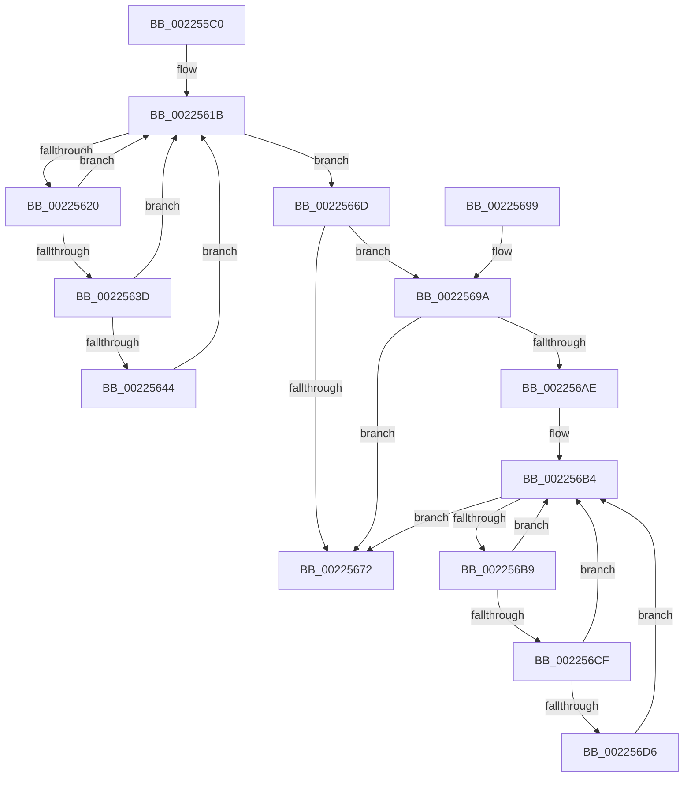

# PerfInfoLogSysCallEntry

- RVA: `0x002255C0`–`0x00225702` (길이 `322` bytes)
- VA: `0x00000001402255C0`
- 실행 섹션: `.text`
- PDB 이름 있음: `예`; PDB Function 태그: `아니요`
- unwind 정보 RVA: `0x0005FA60`
- 디코드: `80`개 명령, `322/322` bytes 표시
- 미해석 바이트: `0` (있으면 어셈블리에 `.byte`로 보존)

> 이 문서는 커널 이미지의 기계어와 PDB 기호를 분석해 생성했습니다. 4번과 5번은 함수 원형과 자료형을 바이너리 사용 방식에서 추정한 C 해석이며 원본 소스 복구 결과는 아닙니다.

## 1. Dependencies

- 직접 호출 지점: **5**; 고유 호출 대상: **4**
- 직접 호출자로 확인된 함수: **2**
- RIP 상대 이미지 참조: **2**

### Outgoing calls
- `0x00225600` → [PsGetCurrentServerSilo](PsGetCurrentServerSilo_function_00225710.md) (function, `0x00225710`)
- `0x00225666` → [EtwpLogKernelEvent](../25/EtwpLogKernelEvent_function_0025CC00.md) (function, `0x0025CC00`)
- `0x0022567D` → [_security_check_cookie](../6A/_security_check_cookie_function_006AC640.md) (function, `0x006AC640`)
- `0x0022569D` → [PsGetServerSiloGlobals](PsGetServerSiloGlobals_function_002250A0.md) (function, `0x002250A0`)
- `0x002256FB` → [EtwpLogKernelEvent](../25/EtwpLogKernelEvent_function_0025CC00.md) (function, `0x0025CC00`)

### Direct callers
- [KiSystemCall64](../6C/KiSystemCall64_function_006C4A40.md) at `0x006C581A`
- [KiTrackSystemCallEntry](../../page/74/KiTrackSystemCallEntry_function_00747D40.md) at `0x00747E34`

### Static image references
- `0x002255D5` → RVA `0x00E0A740` (`.data`; read)
- `0x0022560E` → RVA `0x00FC6AA8` (`ALMOSTRO`; read)

## 2. Other-region calls and transfers

- 다른 실행 섹션으로 향하는 call: **0**
- 별도 외부 분기/꼬리 이동을 확인하지 못했습니다.

## 3. Assembly (complete function range)

```asm
002255C0  4C 8B DC                        mov r11, rsp
002255C3  49 89 5B 08                     mov qword ptr [r11 + 8], rbx
002255C7  49 89 73 10                     mov qword ptr [r11 + 0x10], rsi
002255CB  49 89 7B 18                     mov qword ptr [r11 + 0x18], rdi
002255CF  41 57                           push r15
002255D1  48 83 EC 60                     sub rsp, 0x60
002255D5  48 8B 05 64 51 BE 00            mov rax, qword ptr [rip + 0xbe5164]
002255DC  48 33 C4                        xor rax, rsp
002255DF  48 89 44 24 50                  mov qword ptr [rsp + 0x50], rax
002255E4  49 8D 43 D0                     lea rax, [r11 - 0x30]
002255E8  49 89 4B D0                     mov qword ptr [r11 - 0x30], rcx
002255EC  49 89 43 D8                     mov qword ptr [r11 - 0x28], rax
002255F0  48 8B F1                        mov rsi, rcx
002255F3  83 64 24 4C 00                  and dword ptr [rsp + 0x4c], 0
002255F8  C7 44 24 48 08 00 00 00         mov dword ptr [rsp + 0x48], 8
00225600  E8 0B 01 00 00                  call 0x140225710
00225605  48 8B F8                        mov rdi, rax
00225608  41 BF 33 0F 00 00               mov r15d, 0xf33
0022560E  48 8B 05 93 14 DA 00            mov rax, qword ptr [rip + 0xda1493]
00225615  8B 98 A8 11 00 00               mov ebx, dword ptr [rax + 0x11a8]
0022561B  0F BC CB                        bsf ecx, ebx
0022561E  74 4D                           je 0x14022566d
00225620  48 8B 15 81 14 DA 00            mov rdx, qword ptr [rip + 0xda1481]
00225627  8D 43 FF                        lea eax, [rbx - 1]
0022562A  23 D8                           and ebx, eax
0022562C  8B C1                           mov eax, ecx
0022562E  48 C1 E0 05                     shl rax, 5
00225632  48 05 CC 11 00 00               add rax, 0x11cc
00225638  48 03 C2                        add rax, rdx
0022563B  74 DE                           je 0x14022561b
0022563D  8B 40 08                        mov eax, dword ptr [rax + 8]
00225640  A8 40                           test al, 0x40
00225642  74 D7                           je 0x14022561b
00225644  44 0F B6 84 4A 98 11 00 00      movzx r8d, byte ptr [rdx + rcx*2 + 0x1198]
0022564D  41 B9 01 00 00 00               mov r9d, 1
00225653  48 8D 4C 24 40                  lea rcx, [rsp + 0x40]
00225658  C7 44 24 28 02 18 60 00         mov dword ptr [rsp + 0x28], 0x601802
00225660  66 44 89 7C 24 20               mov word ptr [rsp + 0x20], r15w
00225666  E8 95 75 03 00                  call 0x14025cc00
0022566B  EB AE                           jmp 0x14022561b
0022566D  48 85 FF                        test rdi, rdi
00225670  75 28                           jne 0x14022569a
00225672  48 8B C6                        mov rax, rsi
00225675  48 8B 4C 24 50                  mov rcx, qword ptr [rsp + 0x50]
0022567A  48 33 CC                        xor rcx, rsp
0022567D  E8 BE 6F 48 00                  call 0x1406ac640
00225682  4C 8D 5C 24 60                  lea r11, [rsp + 0x60]
00225687  49 8B 5B 10                     mov rbx, qword ptr [r11 + 0x10]
0022568B  49 8B 73 18                     mov rsi, qword ptr [r11 + 0x18]
0022568F  49 8B 7B 20                     mov rdi, qword ptr [r11 + 0x20]
00225693  49 8B E3                        mov rsp, r11
00225696  41 5F                           pop r15
00225698  C3                              ret
00225699  CC                              int3
0022569A  48 8B CF                        mov rcx, rdi
0022569D  E8 FE F9 FF FF                  call 0x1402250a0
002256A2  48 8B B8 40 03 00 00            mov rdi, qword ptr [rax + 0x340]
002256A9  48 85 FF                        test rdi, rdi
002256AC  74 C4                           je 0x140225672
002256AE  8B 9F A8 11 00 00               mov ebx, dword ptr [rdi + 0x11a8]
002256B4  0F BC CB                        bsf ecx, ebx
002256B7  74 B9                           je 0x140225672
002256B9  8D 43 FF                        lea eax, [rbx - 1]
002256BC  23 D8                           and ebx, eax
002256BE  8B C1                           mov eax, ecx
002256C0  48 C1 E0 05                     shl rax, 5
002256C4  48 05 CC 11 00 00               add rax, 0x11cc
002256CA  48 03 C7                        add rax, rdi
002256CD  74 E5                           je 0x1402256b4
002256CF  8B 40 08                        mov eax, dword ptr [rax + 8]
002256D2  A8 40                           test al, 0x40
002256D4  74 DE                           je 0x1402256b4
002256D6  44 0F B6 84 4F 98 11 00 00      movzx r8d, byte ptr [rdi + rcx*2 + 0x1198]
002256DF  41 B9 01 00 00 00               mov r9d, 1
002256E5  48 8D 4C 24 40                  lea rcx, [rsp + 0x40]
002256EA  C7 44 24 28 02 18 60 00         mov dword ptr [rsp + 0x28], 0x601802
002256F2  48 8B D7                        mov rdx, rdi
002256F5  66 44 89 7C 24 20               mov word ptr [rsp + 0x20], r15w
002256FB  E8 00 75 03 00                  call 0x14025cc00
00225700  EB B2                           jmp 0x1402256b4
```

## 4. C-style interpretation (structured pseudocode)

```c
__int64 __fastcall PerfInfoLogSysCallEntry(__int64 a1)
{
    __int64 result;
    __int64 v_rbx;
    __int64 v_rsp;
    unsigned __int64 v_stack_m18;
    unsigned int v_stack_m1C;
    unsigned int v_stack_m20;
    unsigned __int64 v_stack_m28;
    unsigned int v_stack_m38;
    unsigned int v_stack_m40;
    unsigned __int16 v_stack_m48;
    unsigned __int64 v_stack_m8;

    *(unsigned __int64 *)(v_rsp + 8) = v_rbx;
    *(unsigned __int64 *)(v_rsp + 16) = v_rsi;
    *(unsigned __int64 *)(v_rsp + 24) = v_rdi;
    v_rsp = (v_rsp) - (96);
    result = (*(unsigned __int64 *)(v_rip + 12472676)) ^ (v_rsp);
    v_stack_m18 = result;
    *(unsigned __int64 *)(v_rsp - 48) = a1;
    *(unsigned __int64 *)(v_rsp - 40) = v_rsp - 48;
    v_stack_m20 = 8;
    result = PsGetCurrentServerSilo(a1, a2, a3, a4);
loc_0022561B:
    if (condition_is_equal) goto loc_0022566D;
    v_rbx = (unsigned int)(((unsigned int)(*(unsigned int *)(*(unsigned __int64 *)(v_rip + 14292115) + 4520))) & ((unsigned int)((unsigned int)(*(unsigned int *)(*(unsigned __int64 *)(v_rip + 14292115) + 4520)) - 1)));
    result = ((unsigned int)((unsigned int)(a1))) << (5);
    result = (result) + (0x11CCULL);
    result = (result) + (*(unsigned __int64 *)(v_rip + 14292097));
    if (condition_is_equal) goto loc_0022561B;
    if ((((unsigned __int8)((unsigned int)(*(unsigned int *)(result + 8)))) & (64)) == 0) goto loc_0022561B;
    v_stack_m40 = 0x601802ULL;
    v_stack_m48 = (unsigned __int16)((unsigned int)(0xF33ULL));
    result = EtwpLogKernelEvent(v_stack_m28, *(unsigned __int64 *)(v_rip + 14292097), *(unsigned __int8 *)(*(unsigned __int64 *)(v_rip + 14292097) + a1 * 2 + 4504), 1);
    goto loc_0022561B;
loc_0022566D:
    if (result != 0) goto loc_0022569A;
loc_00225672:
    a1 = (v_stack_m18) ^ (v_rsp);
    result = _security_check_cookie(a1, *(unsigned __int64 *)(v_rip + 14292097), *(unsigned __int8 *)(*(unsigned __int64 *)(v_rip + 14292097) + a1 * 2 + 4504), 1);
    return result;
loc_0022569A:
    result = PsGetServerSiloGlobals(*(unsigned __int64 *)(v_stack_m8 + 32), *(unsigned __int64 *)(v_rip + 14292097), *(unsigned __int8 *)(*(unsigned __int64 *)(v_rip + 14292097) + a1 * 2 + 4504), 1);
    if (*(unsigned __int64 *)(result + 832) == 0) goto loc_00225672;
loc_002256B4:
    if (*(unsigned __int64 *)(result + 832) == 0) goto loc_00225672;
    v_rbx = (unsigned int)(((unsigned int)(*(unsigned int *)(*(unsigned __int64 *)(result + 832) + 4520))) & ((unsigned int)((unsigned int)(*(unsigned int *)(*(unsigned __int64 *)(result + 832) + 4520)) - 1)));
    result = ((unsigned int)((unsigned int)(*(unsigned __int64 *)(v_stack_m8 + 32)))) << (5);
    result = (result) + (0x11CCULL);
    result = (result) + (*(unsigned __int64 *)(result + 832));
    if (condition_is_equal) goto loc_002256B4;
    if ((((unsigned __int8)((unsigned int)(*(unsigned int *)(result + 8)))) & (64)) == 0) goto loc_002256B4;
    v_stack_m38 = 0x601802ULL;
    v_stack_m40 = (unsigned __int16)((unsigned int)(0xF33ULL));
    result = EtwpLogKernelEvent(v_stack_m20, *(unsigned __int64 *)(result + 832), *(unsigned __int8 *)(*(unsigned __int64 *)(result + 832) + *(unsigned __int64 *)(v_stack_m8 + 32) * 2 + 4504), 1);
    goto loc_002256B4;
}
```

## 5. (Beta) C Style

```c
int64_t PerfInfoLogSysCallEntry(int64_t Arg1)
{
    int64_t result;
    int64_t local_rbx;
    int64_t local_rsp;
    uint64_t v_stack_m18;
    uint32_t v_stack_m1C;
    uint32_t v_stack_m20;
    uint64_t v_stack_m28;
    uint32_t v_stack_m38;
    uint32_t v_stack_m40;
    uint16_t v_stack_m48;
    uint64_t v_stack_m8;

    *(uint64_t *)(local_rsp + 0x8) = local_rbx;
    *(uint64_t *)(local_rsp + 0x10) = local_rsi;
    *(uint64_t *)(local_rsp + 0x18) = local_rdi;
    local_rsp = (local_rsp) - (96);
    result = (*(uint64_t *)(v_rip + 0xBE5164)) ^ (local_rsp);
    v_stack_m18 = result;
    *(uint64_t *)(local_rsp - 0x30) = Arg1;
    *(uint64_t *)(local_rsp - 0x28) = local_rsp - 48;
    v_stack_m20 = 8;
    result = PsGetCurrentServerSilo(Arg1, a2, a3, a4);
loc_0022561B:
    if (condition_is_equal) goto loc_0022566D;
    local_rbx = (uint32_t)(((uint32_t)(*(uint32_t *)(*(uint64_t *)(v_rip + 0xDA1493) + 0x11A8))) & ((uint32_t)((uint32_t)(*(uint32_t *)(*(uint64_t *)(v_rip + 0xDA1493) + 0x11A8)) - 1)));
    result = ((uint32_t)((uint32_t)(Arg1))) << (5);
    result = (result) + (0x11CCULL);
    result = (result) + (*(uint64_t *)(v_rip + 0xDA1481));
    if (condition_is_equal) goto loc_0022561B;
    if ((((uint8_t)((uint32_t)(*(uint32_t *)(result + 0x8)))) & (64)) == 0) goto loc_0022561B;
    v_stack_m40 = 0x601802ULL;
    v_stack_m48 = (uint16_t)((uint32_t)(0xF33ULL));
    result = EtwpLogKernelEvent(v_stack_m28, *(uint64_t *)(v_rip + 0xDA1481), *(uint8_t *)(*(uint64_t *)(v_rip + 0xDA1481) + Arg1 * 2 + 0x1198), 1);
    goto loc_0022561B;
loc_0022566D:
    if (result != 0) goto loc_0022569A;
loc_00225672:
    Arg1 = (v_stack_m18) ^ (local_rsp);
    result = _security_check_cookie(Arg1, *(uint64_t *)(v_rip + 0xDA1481), *(uint8_t *)(*(uint64_t *)(v_rip + 0xDA1481) + Arg1 * 2 + 0x1198), 1);
    return result;
loc_0022569A:
    result = PsGetServerSiloGlobals(*(uint64_t *)(v_stack_m8 + 0x20), *(uint64_t *)(v_rip + 0xDA1481), *(uint8_t *)(*(uint64_t *)(v_rip + 0xDA1481) + Arg1 * 2 + 0x1198), 1);
    if (*(uint64_t *)(result + 0x340) == 0) goto loc_00225672;
loc_002256B4:
    if (*(uint64_t *)(result + 0x340) == 0) goto loc_00225672;
    local_rbx = (uint32_t)(((uint32_t)(*(uint32_t *)(*(uint64_t *)(result + 0x340) + 0x11A8))) & ((uint32_t)((uint32_t)(*(uint32_t *)(*(uint64_t *)(result + 0x340) + 0x11A8)) - 1)));
    result = ((uint32_t)((uint32_t)(*(uint64_t *)(v_stack_m8 + 0x20)))) << (5);
    result = (result) + (0x11CCULL);
    result = (result) + (*(uint64_t *)(result + 0x340));
    if (condition_is_equal) goto loc_002256B4;
    if ((((uint8_t)((uint32_t)(*(uint32_t *)(result + 0x8)))) & (64)) == 0) goto loc_002256B4;
    v_stack_m38 = 0x601802ULL;
    v_stack_m40 = (uint16_t)((uint32_t)(0xF33ULL));
    result = EtwpLogKernelEvent(v_stack_m20, *(uint64_t *)(result + 0x340), *(uint8_t *)(*(uint64_t *)(result + 0x340) + *(uint64_t *)(v_stack_m8 + 0x20) * 2 + 0x1198), 1);
    goto loc_002256B4;
}
```

## 6. Execution-region graph

[열기: 2D/3D 그래프와 함수 탐색 컨트롤 패널](../../../control-panel.html?section=text&rva=0x002255C0&view=graph)

- 2D 그래프는 위에서 아래로 흐르고, 3D 그래프는 빈 공간을 드래그해 회전합니다. Shift+드래그는 이동, 휠은 확대·축소, 함수 노드 선택은 대상 보고서 이동입니다.

### Static fallback


