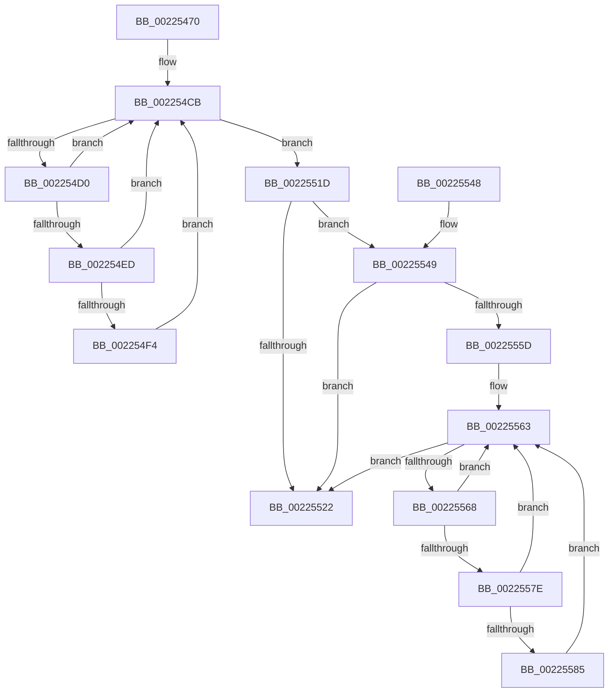

# PerfInfoLogSysCallExit

- RVA: `0x00225470`–`0x002255B1` (길이 `321` bytes)
- VA: `0x0000000140225470`
- 실행 섹션: `.text`
- PDB 이름 있음: `예`; PDB Function 태그: `아니요`
- unwind 정보 RVA: `0x0005FA40`
- 디코드: `79`개 명령, `321/321` bytes 표시
- 미해석 바이트: `0` (있으면 어셈블리에 `.byte`로 보존)

> 이 문서는 커널 이미지의 기계어와 PDB 기호를 분석해 생성했습니다. 4번과 5번은 함수 원형과 자료형을 바이너리 사용 방식에서 추정한 C 해석이며 원본 소스 복구 결과는 아닙니다.

## 1. Dependencies

- 직접 호출 지점: **5**; 고유 호출 대상: **4**
- 직접 호출자로 확인된 함수: **2**
- RIP 상대 이미지 참조: **2**

### Outgoing calls
- `0x002254B0` → [PsGetCurrentServerSilo](PsGetCurrentServerSilo_function_00225710.md) (function, `0x00225710`)
- `0x00225516` → [EtwpLogKernelEvent](../25/EtwpLogKernelEvent_function_0025CC00.md) (function, `0x0025CC00`)
- `0x0022552D` → [_security_check_cookie](../6A/_security_check_cookie_function_006AC640.md) (function, `0x006AC640`)
- `0x0022554C` → [PsGetServerSiloGlobals](PsGetServerSiloGlobals_function_002250A0.md) (function, `0x002250A0`)
- `0x002255AA` → [EtwpLogKernelEvent](../25/EtwpLogKernelEvent_function_0025CC00.md) (function, `0x0025CC00`)

### Direct callers
- [KiSystemCall64](../6C/KiSystemCall64_function_006C4A40.md) at `0x006C5847`
- [KiTrackSystemCallExit](../../page/74/KiTrackSystemCallExit_function_00747E60.md) at `0x00747EC3`

### Static image references
- `0x00225485` → RVA `0x00E0A740` (`.data`; read)
- `0x002254BE` → RVA `0x00FC6AA8` (`ALMOSTRO`; read)

## 2. Other-region calls and transfers

- 다른 실행 섹션으로 향하는 call: **0**
- 별도 외부 분기/꼬리 이동을 확인하지 못했습니다.

## 3. Assembly (complete function range)

```asm
00225470  4C 8B DC                        mov r11, rsp
00225473  49 89 5B 08                     mov qword ptr [r11 + 8], rbx
00225477  49 89 73 10                     mov qword ptr [r11 + 0x10], rsi
0022547B  49 89 7B 18                     mov qword ptr [r11 + 0x18], rdi
0022547F  41 57                           push r15
00225481  48 83 EC 50                     sub rsp, 0x50
00225485  48 8B 05 B4 52 BE 00            mov rax, qword ptr [rip + 0xbe52b4]
0022548C  48 33 C4                        xor rax, rsp
0022548F  48 89 44 24 48                  mov qword ptr [rsp + 0x48], rax
00225494  49 8D 43 D8                     lea rax, [r11 - 0x28]
00225498  48 8B F1                        mov rsi, rcx
0022549B  49 89 43 E0                     mov qword ptr [r11 - 0x20], rax
0022549F  83 64 24 44 00                  and dword ptr [rsp + 0x44], 0
002254A4  89 74 24 30                     mov dword ptr [rsp + 0x30], esi
002254A8  C7 44 24 40 04 00 00 00         mov dword ptr [rsp + 0x40], 4
002254B0  E8 5B 02 00 00                  call 0x140225710
002254B5  48 8B F8                        mov rdi, rax
002254B8  41 BF 34 0F 00 00               mov r15d, 0xf34
002254BE  48 8B 05 E3 15 DA 00            mov rax, qword ptr [rip + 0xda15e3]
002254C5  8B 98 A8 11 00 00               mov ebx, dword ptr [rax + 0x11a8]
002254CB  0F BC CB                        bsf ecx, ebx
002254CE  74 4D                           je 0x14022551d
002254D0  48 8B 15 D1 15 DA 00            mov rdx, qword ptr [rip + 0xda15d1]
002254D7  8D 43 FF                        lea eax, [rbx - 1]
002254DA  23 D8                           and ebx, eax
002254DC  8B C1                           mov eax, ecx
002254DE  48 C1 E0 05                     shl rax, 5
002254E2  48 05 CC 11 00 00               add rax, 0x11cc
002254E8  48 03 C2                        add rax, rdx
002254EB  74 DE                           je 0x1402254cb
002254ED  8B 40 08                        mov eax, dword ptr [rax + 8]
002254F0  A8 40                           test al, 0x40
002254F2  74 D7                           je 0x1402254cb
002254F4  44 0F B6 84 4A 98 11 00 00      movzx r8d, byte ptr [rdx + rcx*2 + 0x1198]
002254FD  41 B9 01 00 00 00               mov r9d, 1
00225503  48 8D 4C 24 38                  lea rcx, [rsp + 0x38]
00225508  C7 44 24 28 02 18 60 00         mov dword ptr [rsp + 0x28], 0x601802
00225510  66 44 89 7C 24 20               mov word ptr [rsp + 0x20], r15w
00225516  E8 E5 76 03 00                  call 0x14025cc00
0022551B  EB AE                           jmp 0x1402254cb
0022551D  48 85 FF                        test rdi, rdi
00225520  75 27                           jne 0x140225549
00225522  48 8B C6                        mov rax, rsi
00225525  48 8B 4C 24 48                  mov rcx, qword ptr [rsp + 0x48]
0022552A  48 33 CC                        xor rcx, rsp
0022552D  E8 0E 71 48 00                  call 0x1406ac640
00225532  48 8B 5C 24 60                  mov rbx, qword ptr [rsp + 0x60]
00225537  48 8B 74 24 68                  mov rsi, qword ptr [rsp + 0x68]
0022553C  48 8B 7C 24 70                  mov rdi, qword ptr [rsp + 0x70]
00225541  48 83 C4 50                     add rsp, 0x50
00225545  41 5F                           pop r15
00225547  C3                              ret
00225548  CC                              int3
00225549  48 8B CF                        mov rcx, rdi
0022554C  E8 4F FB FF FF                  call 0x1402250a0
00225551  48 8B B8 40 03 00 00            mov rdi, qword ptr [rax + 0x340]
00225558  48 85 FF                        test rdi, rdi
0022555B  74 C5                           je 0x140225522
0022555D  8B 9F A8 11 00 00               mov ebx, dword ptr [rdi + 0x11a8]
00225563  0F BC CB                        bsf ecx, ebx
00225566  74 BA                           je 0x140225522
00225568  8D 43 FF                        lea eax, [rbx - 1]
0022556B  23 D8                           and ebx, eax
0022556D  8B C1                           mov eax, ecx
0022556F  48 C1 E0 05                     shl rax, 5
00225573  48 05 CC 11 00 00               add rax, 0x11cc
00225579  48 03 C7                        add rax, rdi
0022557C  74 E5                           je 0x140225563
0022557E  8B 40 08                        mov eax, dword ptr [rax + 8]
00225581  A8 40                           test al, 0x40
00225583  74 DE                           je 0x140225563
00225585  44 0F B6 84 4F 98 11 00 00      movzx r8d, byte ptr [rdi + rcx*2 + 0x1198]
0022558E  41 B9 01 00 00 00               mov r9d, 1
00225594  48 8D 4C 24 38                  lea rcx, [rsp + 0x38]
00225599  C7 44 24 28 02 18 60 00         mov dword ptr [rsp + 0x28], 0x601802
002255A1  48 8B D7                        mov rdx, rdi
002255A4  66 44 89 7C 24 20               mov word ptr [rsp + 0x20], r15w
002255AA  E8 51 76 03 00                  call 0x14025cc00
002255AF  EB B2                           jmp 0x140225563
```

## 4. C-style interpretation (structured pseudocode)

```c
__int64 __fastcall PerfInfoLogSysCallExit(__int64 a1)
{
    __int64 result;
    __int64 v_rbx;
    __int64 v_rsp;
    unsigned __int64 v_stack_m10;
    unsigned int v_stack_m14;
    unsigned int v_stack_m18;
    unsigned __int64 v_stack_m20;
    unsigned int v_stack_m28;
    unsigned int v_stack_m30;
    unsigned __int16 v_stack_m38;
    unsigned __int64 v_stack_p10;
    unsigned __int64 v_stack_p18;
    unsigned __int16 v_stack_p20;
    unsigned int v_stack_p28;
    unsigned __int64 v_stack_p38;
    unsigned __int64 v_stack_p8;

    *(unsigned __int64 *)(v_rsp + 8) = v_rbx;
    *(unsigned __int64 *)(v_rsp + 16) = v_rsi;
    *(unsigned __int64 *)(v_rsp + 24) = v_rdi;
    v_rsp = (v_rsp) - (80);
    result = (*(unsigned __int64 *)(v_rip + 12473012)) ^ (v_rsp);
    v_stack_m10 = result;
    *(unsigned __int64 *)(v_rsp - 32) = v_rsp - 40;
    v_stack_m28 = (unsigned int)(a1);
    v_stack_m18 = 4;
    result = PsGetCurrentServerSilo(a1, a2, a3, a4);
loc_002254CB:
    if (condition_is_equal) goto loc_0022551D;
    v_rbx = (unsigned int)(((unsigned int)(*(unsigned int *)(*(unsigned __int64 *)(v_rip + 14292451) + 4520))) & ((unsigned int)((unsigned int)(*(unsigned int *)(*(unsigned __int64 *)(v_rip + 14292451) + 4520)) - 1)));
    result = ((unsigned int)((unsigned int)(a1))) << (5);
    result = (result) + (0x11CCULL);
    result = (result) + (*(unsigned __int64 *)(v_rip + 14292433));
    if (condition_is_equal) goto loc_002254CB;
    if ((((unsigned __int8)((unsigned int)(*(unsigned int *)(result + 8)))) & (64)) == 0) goto loc_002254CB;
    v_stack_m30 = 0x601802ULL;
    v_stack_m38 = (unsigned __int16)((unsigned int)(0xF34ULL));
    result = EtwpLogKernelEvent(v_stack_m20, *(unsigned __int64 *)(v_rip + 14292433), *(unsigned __int8 *)(*(unsigned __int64 *)(v_rip + 14292433) + a1 * 2 + 4504), 1);
    goto loc_002254CB;
loc_0022551D:
    if (result != 0) goto loc_00225549;
loc_00225522:
    a1 = (v_stack_m10) ^ (v_rsp);
    result = _security_check_cookie(a1, *(unsigned __int64 *)(v_rip + 14292433), *(unsigned __int8 *)(*(unsigned __int64 *)(v_rip + 14292433) + a1 * 2 + 4504), 1);
    v_rsp = (v_rsp) + (80);
    return result;
loc_00225549:
    result = PsGetServerSiloGlobals(v_stack_p18, *(unsigned __int64 *)(v_rip + 14292433), *(unsigned __int8 *)(*(unsigned __int64 *)(v_rip + 14292433) + a1 * 2 + 4504), 1);
    if (*(unsigned __int64 *)(result + 832) == 0) goto loc_00225522;
loc_00225563:
    if (*(unsigned __int64 *)(result + 832) == 0) goto loc_00225522;
    v_rbx = (unsigned int)(((unsigned int)(*(unsigned int *)(*(unsigned __int64 *)(result + 832) + 4520))) & ((unsigned int)((unsigned int)(*(unsigned int *)(*(unsigned __int64 *)(result + 832) + 4520)) - 1)));
    result = ((unsigned int)((unsigned int)(v_stack_p18))) << (5);
    result = (result) + (0x11CCULL);
    result = (result) + (*(unsigned __int64 *)(result + 832));
    if (condition_is_equal) goto loc_00225563;
    if ((((unsigned __int8)((unsigned int)(*(unsigned int *)(result + 8)))) & (64)) == 0) goto loc_00225563;
    v_stack_p28 = 0x601802ULL;
    v_stack_p20 = (unsigned __int16)((unsigned int)(0xF34ULL));
    result = EtwpLogKernelEvent(v_stack_p38, *(unsigned __int64 *)(result + 832), *(unsigned __int8 *)(*(unsigned __int64 *)(result + 832) + v_stack_p18 * 2 + 4504), 1);
    goto loc_00225563;
}
```

## 5. (Beta) C Style

```c
int64_t PerfInfoLogSysCallExit(int64_t Arg1)
{
    int64_t result;
    int64_t local_rbx;
    int64_t local_rsp;
    uint64_t v_stack_m10;
    uint32_t v_stack_m14;
    uint32_t v_stack_m18;
    uint64_t v_stack_m20;
    uint32_t v_stack_m28;
    uint32_t v_stack_m30;
    uint16_t v_stack_m38;
    uint64_t v_stack_p10;
    uint64_t v_stack_p18;
    uint16_t v_stack_p20;
    uint32_t v_stack_p28;
    uint64_t v_stack_p38;
    uint64_t v_stack_p8;

    *(uint64_t *)(local_rsp + 0x8) = local_rbx;
    *(uint64_t *)(local_rsp + 0x10) = local_rsi;
    *(uint64_t *)(local_rsp + 0x18) = local_rdi;
    local_rsp = (local_rsp) - (80);
    result = (*(uint64_t *)(v_rip + 0xBE52B4)) ^ (local_rsp);
    v_stack_m10 = result;
    *(uint64_t *)(local_rsp - 0x20) = local_rsp - 40;
    v_stack_m28 = (uint32_t)(Arg1);
    v_stack_m18 = 4;
    result = PsGetCurrentServerSilo(Arg1, a2, a3, a4);
loc_002254CB:
    if (condition_is_equal) goto loc_0022551D;
    local_rbx = (uint32_t)(((uint32_t)(*(uint32_t *)(*(uint64_t *)(v_rip + 0xDA15E3) + 0x11A8))) & ((uint32_t)((uint32_t)(*(uint32_t *)(*(uint64_t *)(v_rip + 0xDA15E3) + 0x11A8)) - 1)));
    result = ((uint32_t)((uint32_t)(Arg1))) << (5);
    result = (result) + (0x11CCULL);
    result = (result) + (*(uint64_t *)(v_rip + 0xDA15D1));
    if (condition_is_equal) goto loc_002254CB;
    if ((((uint8_t)((uint32_t)(*(uint32_t *)(result + 0x8)))) & (64)) == 0) goto loc_002254CB;
    v_stack_m30 = 0x601802ULL;
    v_stack_m38 = (uint16_t)((uint32_t)(0xF34ULL));
    result = EtwpLogKernelEvent(v_stack_m20, *(uint64_t *)(v_rip + 0xDA15D1), *(uint8_t *)(*(uint64_t *)(v_rip + 0xDA15D1) + Arg1 * 2 + 0x1198), 1);
    goto loc_002254CB;
loc_0022551D:
    if (result != 0) goto loc_00225549;
loc_00225522:
    Arg1 = (v_stack_m10) ^ (local_rsp);
    result = _security_check_cookie(Arg1, *(uint64_t *)(v_rip + 0xDA15D1), *(uint8_t *)(*(uint64_t *)(v_rip + 0xDA15D1) + Arg1 * 2 + 0x1198), 1);
    local_rsp = (local_rsp) + (80);
    return result;
loc_00225549:
    result = PsGetServerSiloGlobals(v_stack_p18, *(uint64_t *)(v_rip + 0xDA15D1), *(uint8_t *)(*(uint64_t *)(v_rip + 0xDA15D1) + Arg1 * 2 + 0x1198), 1);
    if (*(uint64_t *)(result + 0x340) == 0) goto loc_00225522;
loc_00225563:
    if (*(uint64_t *)(result + 0x340) == 0) goto loc_00225522;
    local_rbx = (uint32_t)(((uint32_t)(*(uint32_t *)(*(uint64_t *)(result + 0x340) + 0x11A8))) & ((uint32_t)((uint32_t)(*(uint32_t *)(*(uint64_t *)(result + 0x340) + 0x11A8)) - 1)));
    result = ((uint32_t)((uint32_t)(v_stack_p18))) << (5);
    result = (result) + (0x11CCULL);
    result = (result) + (*(uint64_t *)(result + 0x340));
    if (condition_is_equal) goto loc_00225563;
    if ((((uint8_t)((uint32_t)(*(uint32_t *)(result + 0x8)))) & (64)) == 0) goto loc_00225563;
    v_stack_p28 = 0x601802ULL;
    v_stack_p20 = (uint16_t)((uint32_t)(0xF34ULL));
    result = EtwpLogKernelEvent(v_stack_p38, *(uint64_t *)(result + 0x340), *(uint8_t *)(*(uint64_t *)(result + 0x340) + v_stack_p18 * 2 + 0x1198), 1);
    goto loc_00225563;
}
```

## 6. Execution-region graph

[열기: 2D/3D 그래프와 함수 탐색 컨트롤 패널](../../../control-panel.html?section=text&rva=0x00225470&view=graph)

- 2D 그래프는 위에서 아래로 흐르고, 3D 그래프는 빈 공간을 드래그해 회전합니다. Shift+드래그는 이동, 휠은 확대·축소, 함수 노드 선택은 대상 보고서 이동입니다.

### Static fallback


