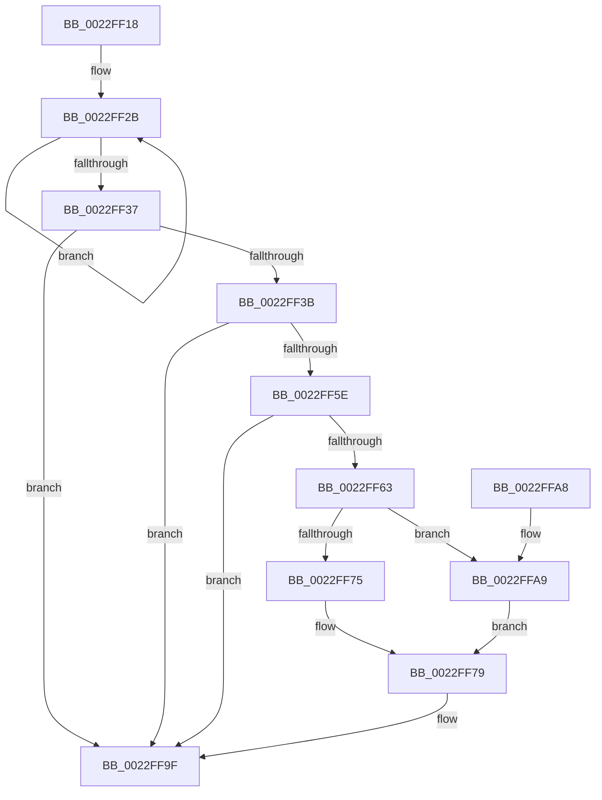

# PopFxScheduleDeviceIdleTimer

- RVA: `0x0022FF18`–`0x0022FFC8` (길이 `176` bytes)
- VA: `0x000000014022FF18`
- 실행 섹션: `.text`
- PDB 이름 있음: `예`; PDB Function 태그: `아니요`
- unwind 정보 RVA: `0x00060220`
- 디코드: `47`개 명령, `176/176` bytes 표시
- 미해석 바이트: `0` (있으면 어셈블리에 `.byte`로 보존)

> 이 문서는 커널 이미지의 기계어와 PDB 기호를 분석해 생성했습니다. 4번과 5번은 함수 원형과 자료형을 바이너리 사용 방식에서 추정한 C 해석이며 원본 소스 복구 결과는 아닙니다.

## 1. Dependencies

- 직접 호출 지점: **1**; 고유 호출 대상: **1**
- 직접 호출자로 확인된 함수: **2**
- RIP 상대 이미지 참조: **0**

### Outgoing calls
- `0x0022FF92` → [KeSetCoalescableTimer](KeSetCoalescableTimer_function_0022FFD0.md) (function, `0x0022FFD0`)

### Direct callers
- [sub_002BD95A](../2B/Unknown_function_002BD95A.md) at `0x002BDC46`
- [sub_006F985C](../6F/Unknown_function_006F985C.md) at `0x006F9864`

### Static image references
- 디코드된 RIP-relative 메모리 참조가 없습니다.

## 2. Other-region calls and transfers

- 다른 실행 섹션으로 향하는 call: **0**
- 별도 외부 분기/꼬리 이동을 확인하지 못했습니다.

## 3. Assembly (complete function range)

```asm
0022FF18  40 53                           push rbx
0022FF1A  48 83 EC 30                     sub rsp, 0x30
0022FF1E  48 8B D9                        mov rbx, rcx
0022FF21  45 33 C0                        xor r8d, r8d
0022FF24  0F 0D 49 20                     prefetchw byte ptr [rcx + 0x20]
0022FF28  8B 41 20                        mov eax, dword ptr [rcx + 0x20]
0022FF2B  8B D0                           mov edx, eax
0022FF2D  41 0B D0                        or edx, r8d
0022FF30  F0 0F B1 51 20                  lock cmpxchg dword ptr [rcx + 0x20], edx
0022FF35  75 F4                           jne 0x14022ff2b
0022FF37  A8 08                           test al, 8
0022FF39  75 64                           jne 0x14022ff9f
0022FF3B  4C 8B 91 18 02 00 00            mov r10, qword ptr [rcx + 0x218]
0022FF42  48 BA 08 00 00 00 80 F7 FF FF   movabs rdx, 0xfffff78000000008
0022FF4C  48 8B 12                        mov rdx, qword ptr [rdx]
0022FF4F  48 8B 81 20 02 00 00            mov rax, qword ptr [rcx + 0x220]
0022FF56  4C 03 D0                        add r10, rax
0022FF59  4C 3B D0                        cmp r10, rax
0022FF5C  72 41                           jb 0x14022ff9f
0022FF5E  49 3B D2                        cmp rdx, r10
0022FF61  73 3C                           jae 0x14022ff9f
0022FF63  4C 2B D2                        sub r10, rdx
0022FF66  48 B8 00 00 00 00 A0 86 01 00   movabs rax, 0x186a000000000
0022FF70  4C 3B D0                        cmp r10, rax
0022FF73  72 34                           jb 0x14022ffa9
0022FF75  41 83 C9 FF                     or r9d, 0xffffffff
0022FF79  48 8D 81 D8 01 00 00            lea rax, [rcx + 0x1d8]
0022FF80  49 F7 DA                        neg r10
0022FF83  49 8B D2                        mov rdx, r10
0022FF86  48 89 44 24 20                  mov qword ptr [rsp + 0x20], rax
0022FF8B  48 81 C1 98 01 00 00            add rcx, 0x198
0022FF92  E8 39 00 00 00                  call 0x14022ffd0
0022FF97  F0 83 4B 20 04                  lock or dword ptr [rbx + 0x20], 4
0022FF9C  41 B0 01                        mov r8b, 1
0022FF9F  41 8A C0                        mov al, r8b
0022FFA2  48 83 C4 30                     add rsp, 0x30
0022FFA6  5B                              pop rbx
0022FFA7  C3                              ret
0022FFA8  CC                              int3
0022FFA9  48 B8 47 08 8F 36 8E 58 8B 4F   movabs rax, 0x4f8b588e368f0847
0022FFB3  4D 8B CA                        mov r9, r10
0022FFB6  49 F7 E2                        mul r10
0022FFB9  4C 2B CA                        sub r9, rdx
0022FFBC  49 D1 E9                        shr r9, 1
0022FFBF  4C 03 CA                        add r9, rdx
0022FFC2  49 C1 E9 10                     shr r9, 0x10
0022FFC6  EB B1                           jmp 0x14022ff79
```

## 4. C-style interpretation (structured pseudocode)

```c
__int64 __fastcall PopFxScheduleDeviceIdleTimer(__int64 a1, __int64 a2, int a3, int a4)
{
    __int64 result;
    __int64 v_r10;
    __int64 v_rsp;
    unsigned __int64 v_stack_m18;

    v_rsp = (v_rsp) - (48);
    a3 = 0;
loc_0022FF2B:
    a2 = (unsigned int)(((unsigned int)((unsigned int)((unsigned int)(*(unsigned int *)(a1 + 32))))) | (0));
    if (condition_is_not_equal) goto loc_0022FF2B;
    if ((((unsigned __int8)((unsigned int)(*(unsigned int *)(a1 + 32)))) & (8)) != 0) goto loc_0022FF9F;
    v_r10 = (*(unsigned __int64 *)(a1 + 536)) + (*(unsigned __int64 *)(a1 + 544));
    if (v_r10 < (*(unsigned __int64 *)(a1 + 544))) goto loc_0022FF9F;
    if ((*(unsigned __int64 *)(a2)) >= v_r10) goto loc_0022FF9F;
    v_r10 = (v_r10) - (*(unsigned __int64 *)(a2));
    if (v_r10 < (*(unsigned __int64 *)(a1 + 544))) goto loc_0022FFA9;
    a4 = (unsigned int)((a4) | (0xFFFFFFFFULL));
loc_0022FF79:
    v_r10 = -(v_r10);
    v_stack_m18 = a1 + 472;
    a1 = (a1) + (408);
    result = KeSetCoalescableTimer(a1, v_r10, a3, a4);
loc_0022FF9F:
    v_rsp = (v_rsp) + (48);
    return 1;
loc_0022FFA9:
    a4 = (v_r10) - (v_r10);
    a4 = (a4) >> (1);
    a4 = (a4) + (v_r10);
    a4 = (a4) >> (16);
    goto loc_0022FF79;
}
```

## 5. (Beta) C Style

```c
int64_t PopFxScheduleDeviceIdleTimer(void *Arg1, int64_t Arg2, int32_t Arg3, int32_t Arg4)
{
    uint8_t *arg1 = (uint8_t *)Arg1;

    int64_t result;
    int64_t local_r10;
    int64_t local_rsp;
    uint64_t v_stack_m18;

    local_rsp = (local_rsp) - (48);
    Arg3 = 0;
loc_0022FF2B:
    Arg2 = (uint32_t)(((uint32_t)((uint32_t)((uint32_t)(*(uint32_t *)(arg1 + 0x20))))) | (0));
    if (condition_is_not_equal) goto loc_0022FF2B;
    if ((((uint8_t)((uint32_t)(*(uint32_t *)(arg1 + 0x20)))) & (8)) != 0) goto loc_0022FF9F;
    local_r10 = (*(uint64_t *)(arg1 + 0x218)) + (*(uint64_t *)(arg1 + 0x220));
    if (local_r10 < (*(uint64_t *)(arg1 + 0x220))) goto loc_0022FF9F;
    if ((*(uint64_t *)(Arg2)) >= local_r10) goto loc_0022FF9F;
    local_r10 = (local_r10) - (*(uint64_t *)(Arg2));
    if (local_r10 < (*(uint64_t *)(arg1 + 0x220))) goto loc_0022FFA9;
    Arg4 = (uint32_t)((Arg4) | (0xFFFFFFFFULL));
loc_0022FF79:
    local_r10 = -(local_r10);
    v_stack_m18 = Arg1 + 472;
    Arg1 = (Arg1) + (408);
    result = KeSetCoalescableTimer(Arg1, local_r10, Arg3, Arg4);
loc_0022FF9F:
    local_rsp = (local_rsp) + (48);
    return 1;
loc_0022FFA9:
    Arg4 = (local_r10) - (local_r10);
    Arg4 = (Arg4) >> (1);
    Arg4 = (Arg4) + (local_r10);
    Arg4 = (Arg4) >> (16);
    goto loc_0022FF79;
}
```

### 관측된 메모리 오프셋

구조체 형식이 확인되지 않은 접근은 인자 기준의 오프셋으로만 기록했습니다.

| 기준 인자 | 오프셋 표현 | 폭 (bit) | 접근 |
|---|---:|---:|---|
| `Arg1` | `+ 0x20` | `8` | `R` |
| `Arg1` | `+ 0x20` | `32` | `R` |
| `Arg1` | `+ 0x20` | `32` | `R/W` |
| `Arg1` | `+ 0x1D8` | `64` | `R` |
| `Arg1` | `+ 0x218` | `64` | `R` |
| `Arg1` | `+ 0x220` | `64` | `R` |

## 6. Execution-region graph

[열기: 2D/3D 그래프와 함수 탐색 컨트롤 패널](../../../control-panel.html?section=text&rva=0x0022FF18&view=graph)

- 2D 그래프는 위에서 아래로 흐르고, 3D 그래프는 빈 공간을 드래그해 회전합니다. Shift+드래그는 이동, 휠은 확대·축소, 함수 노드 선택은 대상 보고서 이동입니다.

### Static fallback


