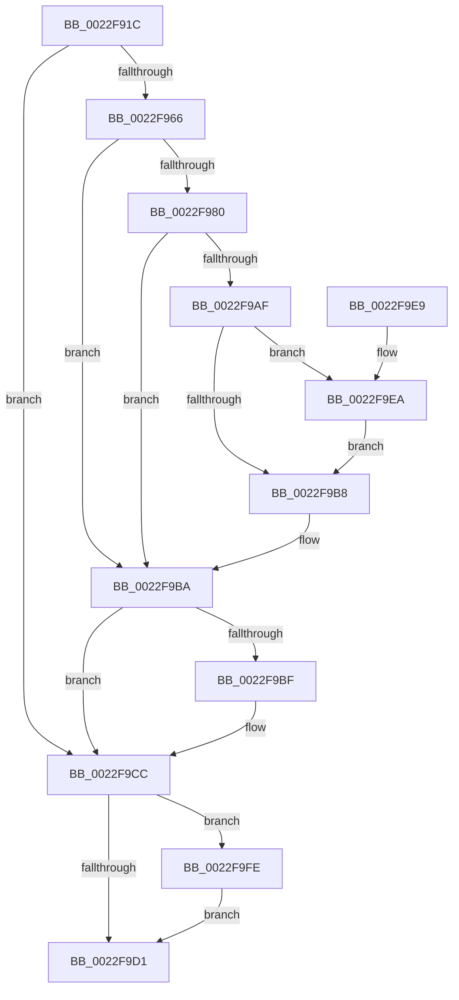

# PopPowerRequestCreateUserModeRequest

- RVA: `0x0022F91C`–`0x0022FA08` (길이 `236` bytes)
- VA: `0x000000014022F91C`
- 실행 섹션: `.text`
- PDB 이름 있음: `예`; PDB Function 태그: `아니요`
- unwind 정보 RVA: `0x00060188`
- 디코드: `71`개 명령, `236/236` bytes 표시
- 미해석 바이트: `0` (있으면 어셈블리에 `.byte`로 보존)

> 이 문서는 커널 이미지의 기계어와 PDB 기호를 분석해 생성했습니다. 4번과 5번은 함수 원형과 자료형을 바이너리 사용 방식에서 추정한 C 해석이며 원본 소스 복구 결과는 아닙니다.

## 1. Dependencies

- 직접 호출 지점: **8**; 고유 호출 대상: **8**
- 직접 호출자로 확인된 함수: **1**
- RIP 상대 이미지 참조: **0**

### Outgoing calls
- `0x0022F956` → [PoCaptureReasonContext](../23/PoCaptureReasonContext_function_00230A38.md) (function, `0x00230A38`)
- `0x0022F970` → [PopPowerRequestCreateCommon](../23/PopPowerRequestCreateCommon_function_00230150.md) (function, `0x00230150`)
- `0x0022F98A` → [ObfReferenceObjectWithTag](../21/ObfReferenceObjectWithTag_function_00210710.md) (function, `0x00210710`)
- `0x0022F9A4` → [ObInsertObject](../../page/8B/ObInsertObject_function_008B9100.md) (function, `0x008B9100`)
- `0x0022F9AF` → [TtmIsEnabled](../../page/91/TtmIsEnabled_function_009143D8.md) (function, `0x009143D8`)
- `0x0022F9C7` → [ObfDereferenceObjectWithTag](../2F/ObfDereferenceObjectWithTag_function_002F78E0.md) (function, `0x002F78E0`)
- `0x0022F9F7` → [TtmNotifySessionPowerRequestCreated](../../page/77/TtmNotifySessionPowerRequestCreated_function_00776DD8.md) (function, `0x00776DD8`)
- `0x0022FA01` → [PoDestroyReasonContext](../23/PoDestroyReasonContext_function_00230944.md) (function, `0x00230944`)

### Direct callers
- [NtPowerInformation](../../page/95/NtPowerInformation_function_00955D80.md) at `0x009577B5`

### Static image references
- 디코드된 RIP-relative 메모리 참조가 없습니다.

## 2. Other-region calls and transfers

- 다른 실행 섹션으로 향하는 call: **3**
  - `0x0022F9A4` → [ObInsertObject](../../page/8B/ObInsertObject_function_008B9100.md) (`.text` → `PAGE`)
  - `0x0022F9AF` → [TtmIsEnabled](../../page/91/TtmIsEnabled_function_009143D8.md) (`.text` → `PAGE`)
  - `0x0022F9F7` → [TtmNotifySessionPowerRequestCreated](../../page/77/TtmNotifySessionPowerRequestCreated_function_00776DD8.md) (`.text` → `PAGE`)
- 별도 외부 분기/꼬리 이동을 확인하지 못했습니다.

## 3. Assembly (complete function range)

```asm
0022F91C  4C 8B DC                        mov r11, rsp
0022F91F  49 89 5B 08                     mov qword ptr [r11 + 8], rbx
0022F923  49 89 73 10                     mov qword ptr [r11 + 0x10], rsi
0022F927  49 89 7B 18                     mov qword ptr [r11 + 0x18], rdi
0022F92B  41 56                           push r14
0022F92D  48 83 EC 40                     sub rsp, 0x40
0022F931  49 83 63 20 00                  and qword ptr [r11 + 0x20], 0
0022F936  49 8D 43 20                     lea rax, [r11 + 0x20]
0022F93A  49 83 63 E8 00                  and qword ptr [r11 - 0x18], 0
0022F93F  41 B1 01                        mov r9b, 1
0022F942  4D 8B F0                        mov r14, r8
0022F945  49 89 43 E0                     mov qword ptr [r11 - 0x20], rax
0022F949  49 83 63 D8 00                  and qword ptr [r11 - 0x28], 0
0022F94E  8A DA                           mov bl, dl
0022F950  41 8A D1                        mov dl, r9b
0022F953  45 33 C0                        xor r8d, r8d
0022F956  E8 DD 10 00 00                  call 0x140230a38
0022F95B  48 8B 7C 24 68                  mov rdi, qword ptr [rsp + 0x68]
0022F960  8B F0                           mov esi, eax
0022F962  85 C0                           test eax, eax
0022F964  78 66                           js 0x14022f9cc
0022F966  4C 8D 44 24 30                  lea r8, [rsp + 0x30]
0022F96B  8A D3                           mov dl, bl
0022F96D  48 8B CF                        mov rcx, rdi
0022F970  E8 DB 07 00 00                  call 0x140230150
0022F975  48 8B 5C 24 30                  mov rbx, qword ptr [rsp + 0x30]
0022F97A  8B F0                           mov esi, eax
0022F97C  85 C0                           test eax, eax
0022F97E  78 3A                           js 0x14022f9ba
0022F980  BA 50 6F 50 72                  mov edx, 0x72506f50
0022F985  48 8B CB                        mov rcx, rbx
0022F988  33 FF                           xor edi, edi
0022F98A  E8 81 0D FE FF                  call 0x140210710
0022F98F  45 33 C9                        xor r9d, r9d
0022F992  4C 89 74 24 28                  mov qword ptr [rsp + 0x28], r14
0022F997  48 21 7C 24 20                  and qword ptr [rsp + 0x20], rdi
0022F99C  45 33 C0                        xor r8d, r8d
0022F99F  33 D2                           xor edx, edx
0022F9A1  48 8B CB                        mov rcx, rbx
0022F9A4  E8 57 97 68 00                  call 0x1408b9100
0022F9A9  8B F0                           mov esi, eax
0022F9AB  85 C0                           test eax, eax
0022F9AD  78 0B                           js 0x14022f9ba
0022F9AF  E8 24 4A 6E 00                  call 0x1409143d8
0022F9B4  84 C0                           test al, al
0022F9B6  75 32                           jne 0x14022f9ea
0022F9B8  33 F6                           xor esi, esi
0022F9BA  48 85 DB                        test rbx, rbx
0022F9BD  74 0D                           je 0x14022f9cc
0022F9BF  BA 50 6F 50 72                  mov edx, 0x72506f50
0022F9C4  48 8B CB                        mov rcx, rbx
0022F9C7  E8 14 7F 0C 00                  call 0x1402f78e0
0022F9CC  48 85 FF                        test rdi, rdi
0022F9CF  75 2D                           jne 0x14022f9fe
0022F9D1  48 8B 5C 24 50                  mov rbx, qword ptr [rsp + 0x50]
0022F9D6  8B C6                           mov eax, esi
0022F9D8  48 8B 74 24 58                  mov rsi, qword ptr [rsp + 0x58]
0022F9DD  48 8B 7C 24 60                  mov rdi, qword ptr [rsp + 0x60]
0022F9E2  48 83 C4 40                     add rsp, 0x40
0022F9E6  41 5E                           pop r14
0022F9E8  C3                              ret
0022F9E9  CC                              int3
0022F9EA  4D 8B 0E                        mov r9, qword ptr [r14]
0022F9ED  44 8B 43 68                     mov r8d, dword ptr [rbx + 0x68]
0022F9F1  8B 53 24                        mov edx, dword ptr [rbx + 0x24]
0022F9F4  8B 4B 10                        mov ecx, dword ptr [rbx + 0x10]
0022F9F7  E8 DC 73 54 00                  call 0x140776dd8
0022F9FC  EB BA                           jmp 0x14022f9b8
0022F9FE  48 8B CF                        mov rcx, rdi
0022FA01  E8 3E 0F 00 00                  call 0x140230944
0022FA06  EB C9                           jmp 0x14022f9d1
```

## 4. C-style interpretation (structured pseudocode)

```c
__int64 __fastcall PopPowerRequestCreateUserModeRequest(__int64 a1, unsigned __int8 a2, __int64 a3)
{
    __int64 result;
    __int64 v_rdi;
    __int64 v_rsi;
    __int64 v_rsp;
    unsigned __int64 v_stack_m18;
    unsigned __int64 v_stack_m20;
    unsigned __int64 v_stack_m28;
    unsigned __int64 v_stack_p10;
    unsigned __int64 v_stack_p18;
    unsigned __int64 v_stack_p20;
    unsigned __int64 v_stack_p8;

    *(unsigned __int64 *)(v_rsp + 8) = v_rbx;
    *(unsigned __int64 *)(v_rsp + 16) = v_rsi;
    *(unsigned __int64 *)(v_rsp + 24) = v_rdi;
    v_rsp = (v_rsp) - (64);
    *(unsigned __int64 *)(v_rsp - 32) = v_rsp + 32;
    a3 = 0;
    result = PoCaptureReasonContext(a1, 1, a3, 1);
    if (sign_flag) goto loc_0022F9CC;
    result = PopPowerRequestCreateCommon(v_stack_p20, a2, v_stack_m18, 1);
    if (sign_flag) goto loc_0022F9BA;
    v_rdi = 0;
    result = ObfReferenceObjectWithTag(v_stack_m18, (unsigned int)(0x72506F50ULL), v_stack_m18, 1);
    a4 = 0;
    v_stack_m20 = 0;
    a3 = 0;
    a2 = 0;
    result = ObInsertObject(v_stack_m18, a2, a3, a4);
    if (sign_flag) goto loc_0022F9BA;
    result = TtmIsEnabled(v_stack_m18, a2, a3, a4);
    if ((unsigned __int8)(result) != 0) goto loc_0022F9EA;
loc_0022F9B8:
    v_rsi = 0;
loc_0022F9BA:
    if (v_stack_m18 != 0) {
        a2 = 0x72506F50ULL;
        a1 = v_stack_m18;
        result = ObfDereferenceObjectWithTag(a1, a2, a3, a4);
    }
    if (0 != 0) goto loc_0022F9FE;
loc_0022F9D1:
    v_rsp = (v_rsp) + (64);
    return 0;
loc_0022F9EA:
    result = TtmNotifySessionPowerRequestCreated((unsigned int)(*(unsigned int *)(v_stack_p8 + 16)), (unsigned int)(*(unsigned int *)(v_stack_p8 + 36)), (unsigned int)(*(unsigned int *)(v_stack_p8 + 104)), *(unsigned __int64 *)(a3));
    goto loc_0022F9B8;
loc_0022F9FE:
    result = PoDestroyReasonContext(v_stack_p18, (unsigned int)(*(unsigned int *)(v_stack_p8 + 36)), (unsigned int)(*(unsigned int *)(v_stack_p8 + 104)), *(unsigned __int64 *)(a3));
    goto loc_0022F9D1;
}
```

## 5. (Beta) C Style

```c
int64_t PopPowerRequestCreateUserModeRequest(int64_t Arg1, uint8_t Arg2, void *Arg3)
{
    uint8_t *arg3 = (uint8_t *)Arg3;

    int64_t result;
    int64_t local_rdi;
    int64_t local_rsi;
    int64_t local_rsp;
    uint64_t v_stack_m18;
    uint64_t v_stack_m20;
    uint64_t v_stack_m28;
    uint64_t v_stack_p10;
    uint64_t v_stack_p18;
    uint64_t v_stack_p20;
    uint64_t v_stack_p8;

    *(uint64_t *)(local_rsp + 0x8) = local_rbx;
    *(uint64_t *)(local_rsp + 0x10) = local_rsi;
    *(uint64_t *)(local_rsp + 0x18) = local_rdi;
    local_rsp = (local_rsp) - (64);
    *(uint64_t *)(local_rsp - 0x20) = local_rsp + 32;
    Arg3 = 0;
    result = PoCaptureReasonContext(Arg1, 1, Arg3, 1);
    if (sign_flag) goto loc_0022F9CC;
    result = PopPowerRequestCreateCommon(v_stack_p20, Arg2, v_stack_m18, 1);
    if (sign_flag) goto loc_0022F9BA;
    local_rdi = 0;
    result = ObfReferenceObjectWithTag(v_stack_m18, (uint32_t)(0x72506F50ULL), v_stack_m18, 1);
    a4 = 0;
    v_stack_m20 = 0;
    Arg3 = 0;
    Arg2 = 0;
    result = ObInsertObject(v_stack_m18, Arg2, Arg3, a4);
    if (sign_flag) goto loc_0022F9BA;
    result = TtmIsEnabled(v_stack_m18, Arg2, Arg3, a4);
    if ((uint8_t)(result) != 0) goto loc_0022F9EA;
loc_0022F9B8:
    local_rsi = 0;
loc_0022F9BA:
    if (v_stack_m18 != 0) {
        Arg2 = 0x72506F50ULL;
        Arg1 = v_stack_m18;
        result = ObfDereferenceObjectWithTag(Arg1, Arg2, Arg3, a4);
    }
    if (0 != 0) goto loc_0022F9FE;
loc_0022F9D1:
    local_rsp = (local_rsp) + (64);
    return 0;
loc_0022F9EA:
    result = TtmNotifySessionPowerRequestCreated((uint32_t)(*(uint32_t *)(v_stack_p8 + 0x10)), (uint32_t)(*(uint32_t *)(v_stack_p8 + 0x24)), (uint32_t)(*(uint32_t *)(v_stack_p8 + 0x68)), *(uint64_t *)(arg3));
    goto loc_0022F9B8;
loc_0022F9FE:
    result = PoDestroyReasonContext(v_stack_p18, (uint32_t)(*(uint32_t *)(v_stack_p8 + 0x24)), (uint32_t)(*(uint32_t *)(v_stack_p8 + 0x68)), *(uint64_t *)(arg3));
    goto loc_0022F9D1;
}
```

### 관측된 메모리 오프셋

구조체 형식이 확인되지 않은 접근은 인자 기준의 오프셋으로만 기록했습니다.

| 기준 인자 | 오프셋 표현 | 폭 (bit) | 접근 |
|---|---:|---:|---|
| `Arg3` | `+ 0x0` | `64` | `R` |

## 6. Execution-region graph

[열기: 2D/3D 그래프와 함수 탐색 컨트롤 패널](../../../control-panel.html?section=text&rva=0x0022F91C&view=graph)

- 2D 그래프는 위에서 아래로 흐르고, 3D 그래프는 빈 공간을 드래그해 회전합니다. Shift+드래그는 이동, 휠은 확대·축소, 함수 노드 선택은 대상 보고서 이동입니다.

### Static fallback


