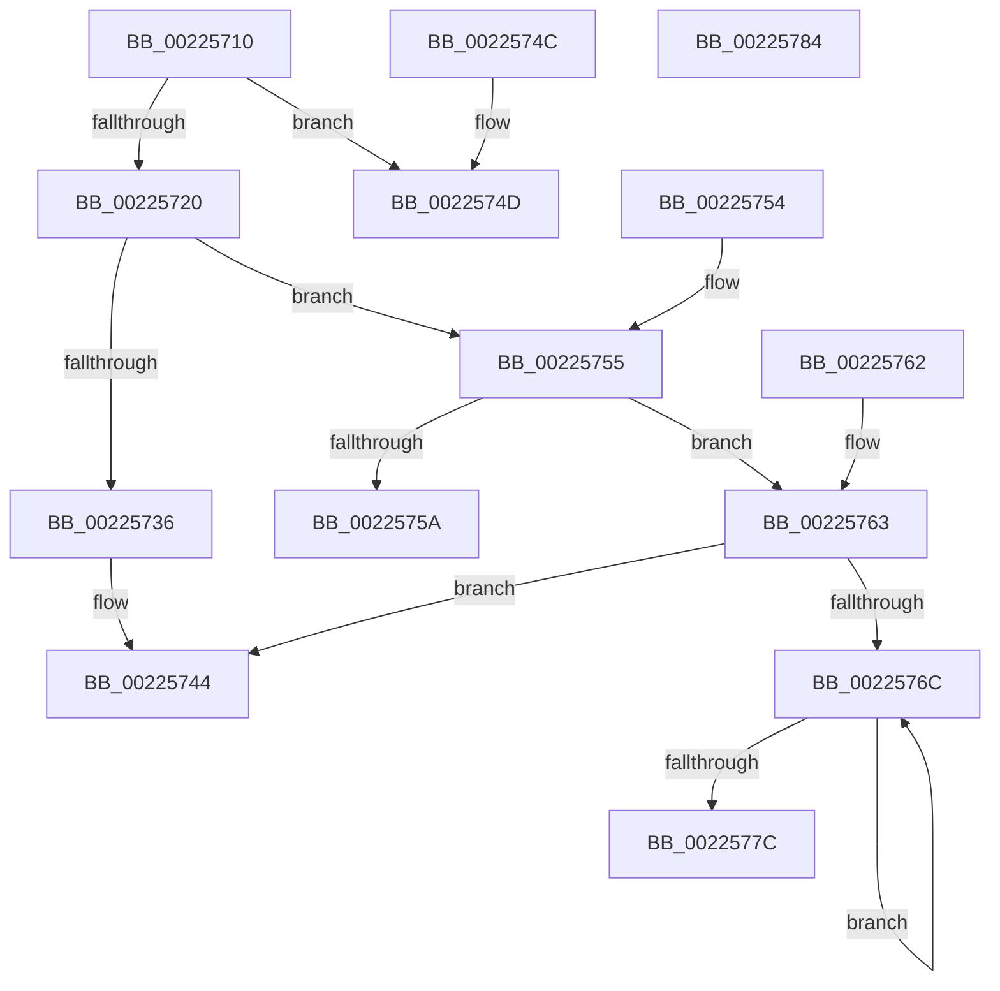

# PsGetCurrentServerSilo

- RVA: `0x00225710`–`0x00225785` (길이 `117` bytes)
- VA: `0x0000000140225710`
- 실행 섹션: `.text`
- PDB 이름 있음: `예`; PDB Function 태그: `아니요`
- unwind 정보 RVA: `0x0005FA80`
- 디코드: `35`개 명령, `117/117` bytes 표시
- 미해석 바이트: `0` (있으면 어셈블리에 `.byte`로 보존)

> 이 문서는 커널 이미지의 기계어와 PDB 기호를 분석해 생성했습니다. 4번과 5번은 함수 원형과 자료형을 바이너리 사용 방식에서 추정한 C 해석이며 원본 소스 복구 결과는 아닙니다.

## 1. Dependencies

- 직접 호출 지점: **2**; 고유 호출 대상: **1**
- 직접 호출자로 확인된 함수: **47**
- RIP 상대 이미지 참조: **0**

### Outgoing calls
- `0x00225763` → [PsIsServerSilo](PsIsServerSilo_function_00225828.md) (function, `0x00225828`)
- `0x00225773` → [PsIsServerSilo](PsIsServerSilo_function_00225828.md) (function, `0x00225828`)

### Direct callers
- [IopCheckSessionDeviceAccess](IopCheckSessionDeviceAccess_function_002233D4.md) at `0x002233F8`
- [SepAdtLogAuditRecord](SepAdtLogAuditRecord_function_00224B6C.md) at `0x00224BEE`
- [RtlGetCurrentServiceSessionId](RtlGetCurrentServiceSessionId_function_00225070.md) at `0x00225074`
- [PsGetSessionById](PsGetSessionById_function_00225150.md) at `0x00225168`
- [EtwpTraceFileName](EtwpTraceFileName_function_002251F0.md) at `0x00225234`
- [PerfInfoLogSysCallExit](PerfInfoLogSysCallExit_function_00225470.md) at `0x002254B0`
- [PerfInfoLogSysCallEntry](PerfInfoLogSysCallEntry_function_002255C0.md) at `0x00225600`
- [PsIsSessionInCurrentServerSilo](../5E/PsIsSessionInCurrentServerSilo_function_005E4FE8.md) at `0x005E5010`
- [PsSessionCreate](../../page/70/PsSessionCreate_function_00700438.md) at `0x007004E2`
- [PnpNotifyTargetDeviceChangeNotifyEntry](../../page/72/PnpNotifyTargetDeviceChangeNotifyEntry_function_00729D54.md) at `0x00729D7C`
- [RtlpInitCodePageTables](../../page/78/RtlpInitCodePageTables_function_0078C0F4.md) at `0x0078C1AA`
- [SepMakeLogonSessionsSiblings](../../page/7A/SepMakeLogonSessionsSiblings_function_007A1774.md) at `0x007A183D`
- [SepMakeLogonSessionsSiblings](../../page/7A/SepMakeLogonSessionsSiblings_function_007A1774.md) at `0x007A186A`
- [SLUpdateLicenseDataInternal](../../page/7C/SLUpdateLicenseDataInternal_function_007C9C04.md) at `0x007CA6EB`
- [sub_00868310](../../page/86/Unknown_function_00868310.md) at `0x0086842D`
- [AlpcpExposeTokenAttribute](../../page/89/AlpcpExposeTokenAttribute_function_00891390.md) at `0x00891708`
- [sub_00891948](../../page/89/Unknown_function_00891948.md) at `0x00891948`
- [sub_00891C4F](../../page/89/Unknown_function_00891C4F.md) at `0x00891C4F`
- [IopParseDevice](../../page/89/IopParseDevice_function_0089E510.md) at `0x008A0202`
- [IopParseDevice](../../page/89/IopParseDevice_function_0089E510.md) at `0x008A02DE`
- [sub_008A2AAB](../../page/8A/Unknown_function_008A2AAB.md) at `0x008A2BB2`
- [ExpWnfGenerateStateName](../../page/8B/ExpWnfGenerateStateName_function_008BE738.md) at `0x008BE809`
- [sub_008CB9B9](../../page/8C/Unknown_function_008CB9B9.md) at `0x008CBAE6`
- [PsGetNextSession](../../page/91/PsGetNextSession_function_009128C0.md) at `0x009128E0`
- [ExpGetProcessInformation](../../page/91/ExpGetProcessInformation_function_0091A878.md) at `0x0091AA27`
- [ExProcessCounterSetCallback](../../page/91/ExProcessCounterSetCallback_function_0091CDF0.md) at `0x0091CE2C`
- [NtGetNextProcess](../../page/91/NtGetNextProcess_function_0091DF50.md) at `0x0091E0A5`
- [IoRegisterPlugPlayNotification](../../page/95/IoRegisterPlugPlayNotification_function_009535A0.md) at `0x0095388F`
- [PnpNotifyDeviceClassChange](../../page/95/PnpNotifyDeviceClassChange_function_0095441C.md) at `0x009544F5`
- [PnpNotifyTargetDeviceChange](../../page/95/PnpNotifyTargetDeviceChange_function_00954790.md) at `0x0095485C`
- [sub_009669C4](../../page/96/Unknown_function_009669C4.md) at `0x00966A0B`
- [sub_009669C4](../../page/96/Unknown_function_009669C4.md) at `0x00966D0D`
- [sub_009A7748](../../page/9A/Unknown_function_009A7748.md) at `0x009A7868`
- [PsCaptureUserProcessParameters](../../page/9E/PsCaptureUserProcessParameters_function_009E6310.md) at `0x009E6320`
- [SepIsMinTCB](../../page/A1/SepIsMinTCB_function_00A13120.md) at `0x00A1314F`
- [SepIsSystemAppTCB](../../page/A1/SepIsSystemAppTCB_function_00A13434.md) at `0x00A1345F`
- [SepCreateLogonSessionTrack](../../page/A2/SepCreateLogonSessionTrack_function_00A2CD3C.md) at `0x00A2CDFE`
- [NtImpersonateAnonymousToken](../../page/A3/NtImpersonateAnonymousToken_function_00A3A150.md) at `0x00A3A283`
- [SepReferenceLogonSession](../../page/A3/SepReferenceLogonSession_function_00A3B74C.md) at `0x00A3B75C`
- [SepIsNgenImage](../../page/A5/SepIsNgenImage_function_00A557B4.md) at `0x00A557C6`
- [ExpRefreshTimeZoneInformation](../../page/A6/ExpRefreshTimeZoneInformation_function_00A6B46C.md) at `0x00A6B4E1`
- [PopTransitionCheckpoint](../../page/A8/PopTransitionCheckpoint_function_00A8F3E8.md) at `0x00A8F3FB`
- [EtwpStartLogger](../../page/A9/EtwpStartLogger_function_00A99D80.md) at `0x00A9ACB9`
- [SepDeleteLogonSessionTrack](../../page/AA/SepDeleteLogonSessionTrack_function_00AA04E0.md) at `0x00AA0548`
- [SepBlockAccessForLogonSession](../../page/AD/SepBlockAccessForLogonSession_function_00AD4848.md) at `0x00AD48AA`
- [NtManageHotPatch](../../page/AF/NtManageHotPatch_function_00AF8660.md) at `0x00AF8773`
- [sub_00B1943A](../../page/B1/Unknown_function_00B1943A.md) at `0x00B1946B`
- [sub_00B26560](../../page/B2/Unknown_function_00B26560.md) at `0x00B2659C`
- [NtSetSystemPowerState](../../pagelk/B7/NtSetSystemPowerState_function_00B70890.md) at `0x00B7094B`
- [ExpSystemErrorHandler2](../../pagelk/B7/ExpSystemErrorHandler2_function_00B72C30.md) at `0x00B73259`

### Static image references
- 디코드된 RIP-relative 메모리 참조가 없습니다.

## 2. Other-region calls and transfers

- 다른 실행 섹션으로 향하는 call: **0**
- 별도 외부 분기/꼬리 이동을 확인하지 못했습니다.

## 3. Assembly (complete function range)

```asm
00225710  48 83 EC 28                     sub rsp, 0x28
00225714  65 8A 04 25 A0 01 00 00         mov al, byte ptr gs:[0x1a0]
0022571C  84 C0                           test al, al
0022571E  75 2D                           jne 0x14022574d
00225720  65 48 8B 04 25 88 01 00 00      mov rax, qword ptr gs:[0x188]
00225729  48 8B 88 98 06 00 00            mov rcx, qword ptr [rax + 0x698]
00225730  48 83 F9 FD                     cmp rcx, -3
00225734  75 1F                           jne 0x140225755
00225736  48 8B 88 20 02 00 00            mov rcx, qword ptr [rax + 0x220]
0022573D  48 8B 89 F0 05 00 00            mov rcx, qword ptr [rcx + 0x5f0]
00225744  48 8B C1                        mov rax, rcx
00225747  48 83 C4 28                     add rsp, 0x28
0022574B  C3                              ret
0022574C  CC                              int3
0022574D  33 C0                           xor eax, eax
0022574F  48 83 C4 28                     add rsp, 0x28
00225753  C3                              ret
00225754  CC                              int3
00225755  48 85 C9                        test rcx, rcx
00225758  75 09                           jne 0x140225763
0022575A  48 8B C1                        mov rax, rcx
0022575D  48 83 C4 28                     add rsp, 0x28
00225761  C3                              ret
00225762  CC                              int3
00225763  E8 C0 00 00 00                  call 0x140225828
00225768  84 C0                           test al, al
0022576A  75 D8                           jne 0x140225744
0022576C  48 8B 89 18 05 00 00            mov rcx, qword ptr [rcx + 0x518]
00225773  E8 B0 00 00 00                  call 0x140225828
00225778  84 C0                           test al, al
0022577A  74 F0                           je 0x14022576c
0022577C  48 8B C1                        mov rax, rcx
0022577F  48 83 C4 28                     add rsp, 0x28
00225783  C3                              ret
00225784  CC                              int3
```

## 4. C-style interpretation (structured pseudocode)

```c
__int64 __fastcall PsGetCurrentServerSilo(void)
{
    __int64 result;
    __int64 v_rsp;

    v_rsp = (v_rsp) - (40);
    if ((unsigned __int8)(*(unsigned __int8 *)(gs_base + (0 + 416))) != 0) goto loc_0022574D;
    if ((*(unsigned __int64 *)(*(unsigned __int64 *)(gs_base + (0 + 392)) + 1688)) != -3) goto loc_00225755;
loc_00225744:
    v_rsp = (v_rsp) + (40);
    return *(unsigned __int64 *)(*(unsigned __int64 *)(*(unsigned __int64 *)(gs_base + (0 + 392)) + 544) + 1520);
loc_0022574D:
    result = 0;
    v_rsp = (v_rsp) + (40);
    return result;
loc_00225755:
    if (*(unsigned __int64 *)(*(unsigned __int64 *)(*(unsigned __int64 *)(gs_base + (0 + 392)) + 544) + 1520) != 0) goto loc_00225763;
    v_rsp = (v_rsp) + (40);
    return *(unsigned __int64 *)(*(unsigned __int64 *)(*(unsigned __int64 *)(gs_base + (0 + 392)) + 544) + 1520);
loc_00225763:
    result = PsIsServerSilo(*(unsigned __int64 *)(*(unsigned __int64 *)(*(unsigned __int64 *)(gs_base + (0 + 392)) + 544) + 1520), a2, a3, a4);
    if ((unsigned __int8)(result) != 0) goto loc_00225744;
loc_0022576C:
    result = PsIsServerSilo(*(unsigned __int64 *)(*(unsigned __int64 *)(*(unsigned __int64 *)(*(unsigned __int64 *)(gs_base + (0 + 392)) + 544) + 1520) + 1304), a2, a3, a4);
    if ((unsigned __int8)(result) == 0) goto loc_0022576C;
    v_rsp = (v_rsp) + (40);
    return *(unsigned __int64 *)(*(unsigned __int64 *)(*(unsigned __int64 *)(*(unsigned __int64 *)(gs_base + (0 + 392)) + 544) + 1520) + 1304);
}
```

## 5. (Beta) C Style

```c
void PsGetCurrentServerSilo(void)
{
    int64_t result;
    int64_t local_rsp;

    local_rsp = (local_rsp) - (40);
    if ((uint8_t)(*(uint8_t *)(gs_base + (0 + 0x1A0))) != 0) goto loc_0022574D;
    if ((*(uint64_t *)(*(uint64_t *)(gs_base + (0 + 0x188)) + 0x698)) != -3) goto loc_00225755;
loc_00225744:
    local_rsp = (local_rsp) + (40);
    return *(uint64_t *)(*(uint64_t *)(*(uint64_t *)(gs_base + (0 + 0x188)) + 0x220) + 0x5F0);
loc_0022574D:
    result = 0;
    local_rsp = (local_rsp) + (40);
    return result;
loc_00225755:
    if (*(uint64_t *)(*(uint64_t *)(*(uint64_t *)(gs_base + (0 + 0x188)) + 0x220) + 0x5F0) != 0) goto loc_00225763;
    local_rsp = (local_rsp) + (40);
    return *(uint64_t *)(*(uint64_t *)(*(uint64_t *)(gs_base + (0 + 0x188)) + 0x220) + 0x5F0);
loc_00225763:
    result = PsIsServerSilo(*(uint64_t *)(*(uint64_t *)(*(uint64_t *)(gs_base + (0 + 0x188)) + 0x220) + 0x5F0), a2, a3, a4);
    if ((uint8_t)(result) != 0) goto loc_00225744;
loc_0022576C:
    result = PsIsServerSilo(*(uint64_t *)(*(uint64_t *)(*(uint64_t *)(*(uint64_t *)(gs_base + (0 + 0x188)) + 0x220) + 0x5F0) + 0x518), a2, a3, a4);
    if ((uint8_t)(result) == 0) goto loc_0022576C;
    local_rsp = (local_rsp) + (40);
    return *(uint64_t *)(*(uint64_t *)(*(uint64_t *)(*(uint64_t *)(gs_base + (0 + 0x188)) + 0x220) + 0x5F0) + 0x518);
}
```

## 6. Execution-region graph

[열기: 2D/3D 그래프와 함수 탐색 컨트롤 패널](../../../control-panel.html?section=text&rva=0x00225710&view=graph)

- 2D 그래프는 위에서 아래로 흐르고, 3D 그래프는 빈 공간을 드래그해 회전합니다. Shift+드래그는 이동, 휠은 확대·축소, 함수 노드 선택은 대상 보고서 이동입니다.

### Static fallback


