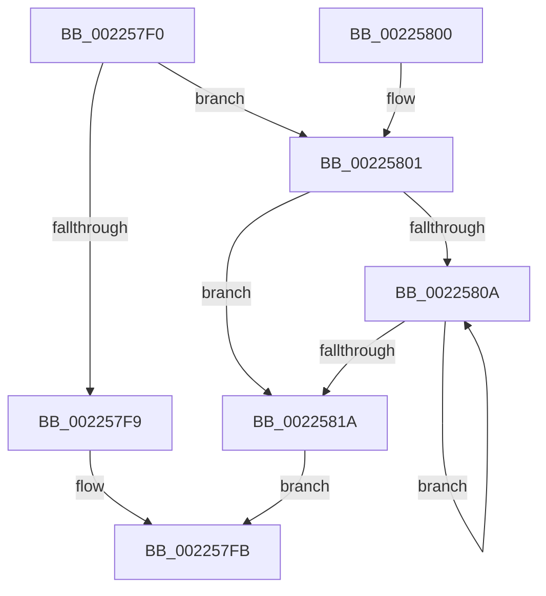

# PsGetEffectiveServerSilo

- RVA: `0x002257F0`–`0x0022581F` (길이 `47` bytes)
- VA: `0x00000001402257F0`
- 실행 섹션: `.text`
- PDB 이름 있음: `예`; PDB Function 태그: `아니요`
- unwind 정보 RVA: `0x0005FA94`
- 디코드: `16`개 명령, `47/47` bytes 표시
- 미해석 바이트: `0` (있으면 어셈블리에 `.byte`로 보존)

> 이 문서는 커널 이미지의 기계어와 PDB 기호를 분석해 생성했습니다. 4번과 5번은 함수 원형과 자료형을 바이너리 사용 방식에서 추정한 C 해석이며 원본 소스 복구 결과는 아닙니다.

## 1. Dependencies

- 직접 호출 지점: **2**; 고유 호출 대상: **1**
- 직접 호출자로 확인된 함수: **13**
- RIP 상대 이미지 참조: **0**

### Outgoing calls
- `0x00225801` → [PsIsServerSilo](PsIsServerSilo_function_00225828.md) (function, `0x00225828`)
- `0x00225811` → [PsIsServerSilo](PsIsServerSilo_function_00225828.md) (function, `0x00225828`)

### Direct callers
- [KiSwapThread](../35/KiSwapThread_function_00355640.md) at `0x00355C17`
- [KiSwapThread](../35/KiSwapThread_function_00355640.md) at `0x00355C24`
- [EtwTraceContextSwap](../41/EtwTraceContextSwap_function_004174A0.md) at `0x004175CD`
- [EtwTraceContextSwap](../41/EtwTraceContextSwap_function_004174A0.md) at `0x004175DA`
- [UpcaseUnicodeToMultiByteNHelper](../41/UpcaseUnicodeToMultiByteNHelper_function_00419990.md) at `0x00419B35`
- [PsIsCurrentThreadInServerSilo](../43/PsIsCurrentThreadInServerSilo_function_004362E0.md) at `0x0043632E`
- [PsGetJobServerSilo](../4C/PsGetJobServerSilo_function_004C2440.md) at `0x004C245D`
- [PspIsSiloInServerSilo](../5E/PspIsSiloInServerSilo_function_005E2724.md) at `0x005E2728`
- [ObpCreateDosDevicesDirectory](../../page/74/ObpCreateDosDevicesDirectory_function_0074E03C.md) at `0x0074E12A`
- [PspImplicitAssignProcessToJob](../../page/87/PspImplicitAssignProcessToJob_function_0087D584.md) at `0x0087D5F3`
- [PspGetMemoryPartitionImplicit](../../page/87/PspGetMemoryPartitionImplicit_function_0087D888.md) at `0x0087D962`
- [NtQueryInformationProcess](../../page/9A/NtQueryInformationProcess_function_009AA250.md) at `0x009ADE8C`
- [PspEstimateNewProcessServerSilo](../../page/A5/PspEstimateNewProcessServerSilo_function_00A5F7E4.md) at `0x00A5F846`
- [PspValidateJobAssignmentSiloPolicy](../../page/A7/PspValidateJobAssignmentSiloPolicy_function_00A71CAC.md) at `0x00A71CD2`
- [PspValidateJobAssignmentSiloPolicy](../../page/A7/PspValidateJobAssignmentSiloPolicy_function_00A71CAC.md) at `0x00A71CDD`
- [sub_00B1B2E4](../../page/B1/Unknown_function_00B1B2E4.md) at `0x00B1B68B`

### Static image references
- 디코드된 RIP-relative 메모리 참조가 없습니다.

## 2. Other-region calls and transfers

- 다른 실행 섹션으로 향하는 call: **0**
- 별도 외부 분기/꼬리 이동을 확인하지 못했습니다.

## 3. Assembly (complete function range)

```asm
002257F0  48 83 EC 28                     sub rsp, 0x28
002257F4  48 85 C9                        test rcx, rcx
002257F7  75 08                           jne 0x140225801
002257F9  33 C0                           xor eax, eax
002257FB  48 83 C4 28                     add rsp, 0x28
002257FF  C3                              ret
00225800  CC                              int3
00225801  E8 22 00 00 00                  call 0x140225828
00225806  84 C0                           test al, al
00225808  75 10                           jne 0x14022581a
0022580A  48 8B 89 18 05 00 00            mov rcx, qword ptr [rcx + 0x518]
00225811  E8 12 00 00 00                  call 0x140225828
00225816  84 C0                           test al, al
00225818  74 F0                           je 0x14022580a
0022581A  48 8B C1                        mov rax, rcx
0022581D  EB DC                           jmp 0x1402257fb
```

## 4. C-style interpretation (structured pseudocode)

```c
__int64 __fastcall PsGetEffectiveServerSilo(__int64 a1)
{
    __int64 result;
    __int64 v_rsp;

    v_rsp = (v_rsp) - (40);
    if (a1 != 0) goto loc_00225801;
    result = 0;
loc_002257FB:
    v_rsp = (v_rsp) + (40);
    return result;
loc_00225801:
    result = PsIsServerSilo(a1, a2, a3, a4);
    if ((unsigned __int8)(result) != 0) goto loc_0022581A;
loc_0022580A:
    result = PsIsServerSilo(*(unsigned __int64 *)(a1 + 1304), a2, a3, a4);
    if ((unsigned __int8)(result) == 0) goto loc_0022580A;
loc_0022581A:
    goto loc_002257FB;
}
```

## 5. (Beta) C Style

```c
int64_t PsGetEffectiveServerSilo(int64_t Arg1)
{
    int64_t result;
    int64_t local_rsp;

    local_rsp = (local_rsp) - (40);
    if (Arg1 != 0) goto loc_00225801;
    result = 0;
loc_002257FB:
    local_rsp = (local_rsp) + (40);
    return result;
loc_00225801:
    result = PsIsServerSilo(Arg1, a2, a3, a4);
    if ((uint8_t)(result) != 0) goto loc_0022581A;
loc_0022580A:
    result = PsIsServerSilo(*(uint64_t *)(Arg1 + 0x518), a2, a3, a4);
    if ((uint8_t)(result) == 0) goto loc_0022580A;
loc_0022581A:
    goto loc_002257FB;
}
```

## 6. Execution-region graph

[열기: 2D/3D 그래프와 함수 탐색 컨트롤 패널](../../../control-panel.html?section=text&rva=0x002257F0&view=graph)

- 2D 그래프는 위에서 아래로 흐르고, 3D 그래프는 빈 공간을 드래그해 회전합니다. Shift+드래그는 이동, 휠은 확대·축소, 함수 노드 선택은 대상 보고서 이동입니다.

### Static fallback


