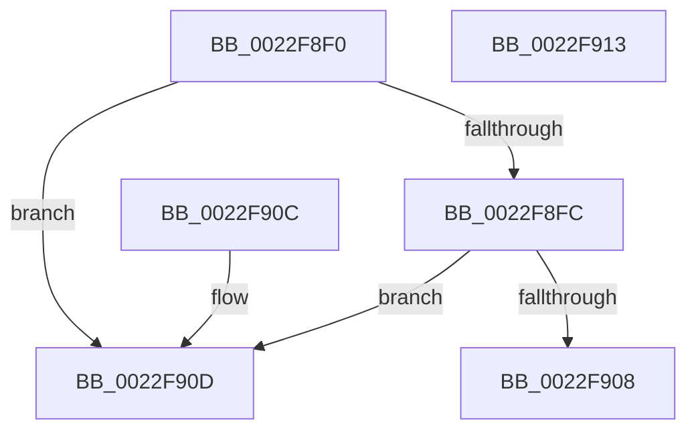

# PsGetProcessSessionIdEx

- RVA: `0x0022F8F0`–`0x0022F914` (길이 `36` bytes)
- VA: `0x000000014022F8F0`
- 실행 섹션: `.text`
- PDB 이름 있음: `예`; PDB Function 태그: `아니요`
- unwind 정보 RVA: `0x000DB714`
- 디코드: `11`개 명령, `36/36` bytes 표시
- 미해석 바이트: `0` (있으면 어셈블리에 `.byte`로 보존)

> 이 문서는 커널 이미지의 기계어와 PDB 기호를 분석해 생성했습니다. 4번과 5번은 함수 원형과 자료형을 바이너리 사용 방식에서 추정한 C 해석이며 원본 소스 복구 결과는 아닙니다.

## 1. Dependencies

- 직접 호출 지점: **0**; 고유 호출 대상: **0**
- 직접 호출자로 확인된 함수: **90**
- RIP 상대 이미지 참조: **0**

### Outgoing calls
- 직접 디코드된 call 명령이 없습니다.

### Direct callers
- [MiMakePerSessionProtoPte](MiMakePerSessionProtoPte_function_0022F7EC.md) at `0x0022F80E`
- [MiMakePerSessionProtoPte](MiMakePerSessionProtoPte_function_0022F7EC.md) at `0x0022F818`
- [PopPowerRequestCreateCommon](../23/PopPowerRequestCreateCommon_function_00230150.md) at `0x002302EC`
- [EtwTracePool](../2E/EtwTracePool_function_002ECEEC.md) at `0x002ED06B`
- [MiQueryAddressState](../32/MiQueryAddressState_function_0032C380.md) at `0x0032CE68`
- [sub_0032EA98](../32/Unknown_function_0032EA98.md) at `0x0032EBBA`
- [PoGetRequester](../5C/PoGetRequester_function_005CE468.md) at `0x005CE591`
- [PsQueryCpuQuotaInformation](../5E/PsQueryCpuQuotaInformation_function_005E27C0.md) at `0x005E288B`
- [PspSetProcessTimerDelayForWin32](../5E/PspSetProcessTimerDelayForWin32_function_005E3DB8.md) at `0x005E3E5D`
- [MiCloneImageVad](../69/MiCloneImageVad_function_006979F8.md) at `0x00697A7E`
- [sub_006E59F0](../6E/Unknown_function_006E59F0.md) at `0x006E59F7`
- [DbgkpLkmdFireCallbacks](../../page/71/DbgkpLkmdFireCallbacks_function_00711708.md) at `0x00711745`
- [DbgkpLkmdFireCallbacks](../../page/71/DbgkpLkmdFireCallbacks_function_00711708.md) at `0x0071174F`
- [KeRemoveSystemServiceTable](../../page/74/KeRemoveSystemServiceTable_function_00744EE0.md) at `0x00744EF8`
- [TtmiAcquireCurrentSession](../../page/77/TtmiAcquireCurrentSession_function_00777010.md) at `0x00777029`
- [TtmiLogCalloutStart](../../page/77/TtmiLogCalloutStart_function_00778ED8.md) at `0x00778F43`
- [TtmiLogCalloutStop](../../page/77/TtmiLogCalloutStop_function_00779014.md) at `0x00779095`
- [TtmiLogCalloutStop](../../page/77/TtmiLogCalloutStop_function_00779014.md) at `0x00779149`
- [TtmiLogCalloutWatchdogCrashSkipped](../../page/77/TtmiLogCalloutWatchdogCrashSkipped_function_00779250.md) at `0x007792C3`
- [TtmiLogDeviceArrivalNotified](../../page/77/TtmiLogDeviceArrivalNotified_function_007793BC.md) at `0x0077942B`
- [TtmiLogDeviceArrivedTerminalEvent](../../page/77/TtmiLogDeviceArrivedTerminalEvent_function_00779508.md) at `0x0077957A`
- [TtmiLogDeviceAssignedTerminalEvent](../../page/77/TtmiLogDeviceAssignedTerminalEvent_function_00779648.md) at `0x007796A3`
- [TtmiLogDeviceDepartedTerminalEvent](../../page/77/TtmiLogDeviceDepartedTerminalEvent_function_00779738.md) at `0x00779787`
- [TtmiLogDeviceDepartureNotified](../../page/77/TtmiLogDeviceDepartureNotified_function_00779808.md) at `0x0077986F`
- [TtmiLogDeviceEnumeratedTerminalEvent](../../page/77/TtmiLogDeviceEnumeratedTerminalEvent_function_00779920.md) at `0x00779992`
- [TtmiLogDeviceFromTerminalRemoved](../../page/77/TtmiLogDeviceFromTerminalRemoved_function_00779A60.md) at `0x00779ACE`
- [TtmiLogDeviceInputNotified](../../page/77/TtmiLogDeviceInputNotified_function_00779B94.md) at `0x00779C03`
- [TtmiLogDeviceSetInputWakeCapability](../../page/77/TtmiLogDeviceSetInputWakeCapability_function_00779E58.md) at `0x00779EBE`
- [TtmiLogDeviceToTerminalAssigned](../../page/77/TtmiLogDeviceToTerminalAssigned_function_00779F68.md) at `0x00779FC3`
- [TtmiLogDisplayPowerRequestSet](../../page/77/TtmiLogDisplayPowerRequestSet_function_0077A058.md) at `0x0077A0C6`
- [TtmiLogEnterProximity](../../page/77/TtmiLogEnterProximity_function_0077A188.md) at `0x0077A1D7`
- [TtmiLogExitProximity](../../page/77/TtmiLogExitProximity_function_0077A258.md) at `0x0077A2BE`
- [TtmiLogInactivityTimerReset](../../page/77/TtmiLogInactivityTimerReset_function_0077A36C.md) at `0x0077A3BB`
- [TtmiLogInactivityTimoutUpdate](../../page/77/TtmiLogInactivityTimoutUpdate_function_0077A43C.md) at `0x0077A48B`
- [TtmiLogInitiateModernStandbyTransitionStart](../../page/77/TtmiLogInitiateModernStandbyTransitionStart_function_0077A50C.md) at `0x0077A568`
- [TtmiLogInitiateModernStandbyTransitionStop](../../page/77/TtmiLogInitiateModernStandbyTransitionStop_function_0077A600.md) at `0x0077A64F`
- [TtmiLogProximityBlockedRequest](../../page/77/TtmiLogProximityBlockedRequest_function_0077A6D0.md) at `0x0077A734`
- [TtmiLogProximityPowerPress](../../page/77/TtmiLogProximityPowerPress_function_0077A7F0.md) at `0x0077A85F`
- [TtmiLogQueueCreated](../../page/77/TtmiLogQueueCreated_function_0077A940.md) at `0x0077A990`
- [TtmiLogSessionActivate](../../page/77/TtmiLogSessionActivate_function_0077ADB8.md) at `0x0077ADF9`
- [TtmiLogSessionDeactivate](../../page/77/TtmiLogSessionDeactivate_function_0077AEF4.md) at `0x0077AF35`
- [TtmiLogSessionDeviceAssignmentPolicySet](../../page/77/TtmiLogSessionDeviceAssignmentPolicySet_function_0077AF9C.md) at `0x0077AFEB`
- [TtmiLogSessionPowerControlStart](../../page/77/TtmiLogSessionPowerControlStart_function_0077B130.md) at `0x0077B18C`
- [TtmiLogSessionPowerControlStop](../../page/77/TtmiLogSessionPowerControlStop_function_0077B224.md) at `0x0077B265`
- [TtmiLogSessionPowerStateChange](../../page/77/TtmiLogSessionPowerStateChange_function_0077B59C.md) at `0x0077B5EB`
- [TtmiLogTerminalCreated](../../page/77/TtmiLogTerminalCreated_function_0077BACC.md) at `0x0077BB28`
- [TtmiLogTerminalDisplayStateChangedEvent](../../page/77/TtmiLogTerminalDisplayStateChangedEvent_function_0077BC54.md) at `0x0077BCBA`
- [TtmiLogTerminalOffRequest](../../page/77/TtmiLogTerminalOffRequest_function_0077C02C.md) at `0x0077C08F`
- [TtmiLogTerminalOnRequest](../../page/77/TtmiLogTerminalOnRequest_function_0077C144.md) at `0x0077C1A7`
- [TtmiLogTerminalStateMachine](../../page/77/TtmiLogTerminalStateMachine_function_0077C4B4.md) at `0x0077C525`
- [SeExchangePrimaryToken](../../page/7A/SeExchangePrimaryToken_function_007A07BC.md) at `0x007A0803`
- [MiDeletePartialCloneVads](../../page/81/MiDeletePartialCloneVads_function_008116E4.md) at `0x00811804`
- [CmpCheckOpenAccessOnKeyBody](../../page/87/CmpCheckOpenAccessOnKeyBody_function_00870000.md) at `0x0087078D`
- [MiDeleteVad](../../page/88/MiDeleteVad_function_00888C80.md) at `0x008891F8`
- [EtwpBuildProcessEvent](../../page/8A/EtwpBuildProcessEvent_function_008A552C.md) at `0x008A558E`
- [MiCreateSectionCommon](../../page/8A/MiCreateSectionCommon_function_008A9AA4.md) at `0x008A9C3D`
- [PfpQueryGpuUtilization](../../page/90/PfpQueryGpuUtilization_function_00903974.md) at `0x009039EA`
- [PopSetDisplayStatus](../../page/91/PopSetDisplayStatus_function_009129E0.md) at `0x009129FC`
- [PopGetSettingValue](../../page/91/PopGetSettingValue_function_00913310.md) at `0x00913344`
- [PopGetSettingNotificationName](../../page/91/PopGetSettingNotificationName_function_0091346C.md) at `0x009135F1`
- [PfpPrivSourceEnum](../../page/91/PfpPrivSourceEnum_function_0091BF00.md) at `0x0091C291`
- [DbgkpSendErrorMessage](../../page/92/DbgkpSendErrorMessage_function_009210A8.md) at `0x00921177`
- [MiPfPrepareReadList](../../page/93/MiPfPrepareReadList_function_0093CD5C.md) at `0x0093D26A`
- [MiMapImageInSystemSpace](../../page/94/MiMapImageInSystemSpace_function_00941DD8.md) at `0x00941E99`
- [NtPowerInformation](../../page/95/NtPowerInformation_function_00955D80.md) at `0x00956A78`
- [NtPowerInformation](../../page/95/NtPowerInformation_function_00955D80.md) at `0x00956FBD`
- [NtPowerInformation](../../page/95/NtPowerInformation_function_00955D80.md) at `0x009573D3`
- [NtPowerInformation](../../page/95/NtPowerInformation_function_00955D80.md) at `0x009573F7`
- [NtPowerInformation](../../page/95/NtPowerInformation_function_00955D80.md) at `0x0095751D`
- [NtPowerInformation](../../page/95/NtPowerInformation_function_00955D80.md) at `0x009576CA`
- [NtPowerInformation](../../page/95/NtPowerInformation_function_00955D80.md) at `0x009578D1`
- [MiFillMapFileInfo](../../page/97/MiFillMapFileInfo_function_0097E15C.md) at `0x0097E2AA`
- [MiMapViewOfImageSection](../../page/97/MiMapViewOfImageSection_function_0097E92C.md) at `0x0097F806`
- [MiMapViewOfImageSection](../../page/97/MiMapViewOfImageSection_function_0097E92C.md) at `0x0097F836`
- [MmCreateSectionEx](../../page/98/MmCreateSectionEx_function_009839CC.md) at `0x00983A98`
- [MiRelocateImageAgain](../../page/98/MiRelocateImageAgain_function_009885C8.md) at `0x0098872D`
- [TtmInitCurrentSession](../../page/98/TtmInitCurrentSession_function_0098AA18.md) at `0x0098AA37`
- [TtmiLogInitCurrentSessionStart](../../page/98/TtmiLogInitCurrentSessionStart_function_0098AC60.md) at `0x0098ACA1`
- [TtmiLogDispatchApiStart](../../page/98/TtmiLogDispatchApiStart_function_0098AFB4.md) at `0x0098B003`
- [TtmiLogDispatchApiStop](../../page/98/TtmiLogDispatchApiStop_function_0098B084.md) at `0x0098B0DF`
- [TtmiLogError](../../page/98/TtmiLogError_function_0098B39C.md) at `0x0098B439`
- [TtmiLogInitCurrentSessionStop](../../page/98/TtmiLogInitCurrentSessionStop_function_0098B598.md) at `0x0098B5E7`
- [AlpcpPortQueryServerSessionInfo](../../page/9C/AlpcpPortQueryServerSessionInfo_function_009CAB0C.md) at `0x009CABD7`
- [PspAllocateProcess](../../page/A1/PspAllocateProcess_function_00A13B3C.md) at `0x00A15012`
- [PspAllocateProcess](../../page/A1/PspAllocateProcess_function_00A13B3C.md) at `0x00A15081`
- [PspAllocateProcess](../../page/A1/PspAllocateProcess_function_00A13B3C.md) at `0x00A15097`
- [PopGetSessionId](../../page/A6/PopGetSessionId_function_00A66D6C.md) at `0x00A66D80`
- [PopPowerInformationInternal](../../page/A8/PopPowerInformationInternal_function_00A8B7C0.md) at `0x00A8CE14`
- [PopPowerInformationInternal](../../page/A8/PopPowerInformationInternal_function_00A8B7C0.md) at `0x00A8CE36`
- [PopPowerInformationInternal](../../page/A8/PopPowerInformationInternal_function_00A8B7C0.md) at `0x00A8CE83`
- [PopPowerInformationInternal](../../page/A8/PopPowerInformationInternal_function_00A8B7C0.md) at `0x00A8D370`
- [PopPowerInformationInternal](../../page/A8/PopPowerInformationInternal_function_00A8B7C0.md) at `0x00A8D397`
- [PspPostFreezeOperationWorker](../../page/A9/PspPostFreezeOperationWorker_function_00A94CB0.md) at `0x00A94F23`
- [PsApplyDeepFreezeOptimizations](../../page/AA/PsApplyDeepFreezeOptimizations_function_00AA9EDC.md) at `0x00AA9F02`
- [MiOpenHotPatchFile](../../page/AB/MiOpenHotPatchFile_function_00AB5684.md) at `0x00AB58CD`
- [PsRemoveDeepFreezeOptimizations](../../page/AB/PsRemoveDeepFreezeOptimizations_function_00AB5FA4.md) at `0x00AB5FCA`
- [MmCreateSpecialImageSection](../../page/AB/MmCreateSpecialImageSection_function_00AB7360.md) at `0x00AB73E6`
- [NtSetThreadExecutionState](../../page/AC/NtSetThreadExecutionState_function_00AC0A40.md) at `0x00AC0C65`
- [NtSetThreadExecutionState](../../page/AC/NtSetThreadExecutionState_function_00AC0A40.md) at `0x00AC0D03`
- [TtmCleanupCurrentSession](../../page/AC/TtmCleanupCurrentSession_function_00AC54DC.md) at `0x00AC54FB`
- [TtmiLogCleanupCurrentSessionStart](../../page/AC/TtmiLogCleanupCurrentSessionStart_function_00AC55D4.md) at `0x00AC5615`
- [TtmiLogCleanupCurrentSessionStop](../../page/AC/TtmiLogCleanupCurrentSessionStop_function_00AC567C.md) at `0x00AC56BD`
- [PsRegisterSyscallProviderServiceTableMetadata](../../page/AD/PsRegisterSyscallProviderServiceTableMetadata_function_00ADB224.md) at `0x00ADB27E`
- [NtSetSystemInformation](../../page/AF/NtSetSystemInformation_function_00AF4A60.md) at `0x00AF502D`
- [NtSetSystemInformation](../../page/AF/NtSetSystemInformation_function_00AF4A60.md) at `0x00AF6303`
- [NtSetSystemInformation](../../page/AF/NtSetSystemInformation_function_00AF4A60.md) at `0x00AF6361`
- [sub_00B16F66](../../page/B1/Unknown_function_00B16F66.md) at `0x00B1712D`
- [sub_00B16F66](../../page/B1/Unknown_function_00B16F66.md) at `0x00B17213`
- [sub_00B2B6D0](../../page/B2/Unknown_function_00B2B6D0.md) at `0x00B2B798`
- [sub_00B314C0](../../page/B3/Unknown_function_00B314C0.md) at `0x00B31542`

### Static image references
- 디코드된 RIP-relative 메모리 참조가 없습니다.

## 2. Other-region calls and transfers

- 다른 실행 섹션으로 향하는 call: **0**
- 별도 외부 분기/꼬리 이동을 확인하지 못했습니다.

## 3. Assembly (complete function range)

```asm
0022F8F0  48 8B 81 E8 02 00 00            mov rax, qword ptr [rcx + 0x2e8]
0022F8F7  48 85 C0                        test rax, rax
0022F8FA  74 11                           je 0x14022f90d
0022F8FC  F7 81 FC 05 00 00 00 10 00 00   test dword ptr [rcx + 0x5fc], 0x1000
0022F906  75 05                           jne 0x14022f90d
0022F908  8B 40 08                        mov eax, dword ptr [rax + 8]
0022F90B  C3                              ret
0022F90C  CC                              int3
0022F90D  B8 FF FF FF FF                  mov eax, 0xffffffff
0022F912  C3                              ret
0022F913  CC                              int3
```

## 4. C-style interpretation (structured pseudocode)

```c
__int64 __fastcall PsGetProcessSessionIdEx(__int64 a1)
{
    if (*(unsigned __int64 *)(a1 + 744) == 0) goto loc_0022F90D;
    if (((*(unsigned int *)(a1 + 1532)) & (0x1000ULL)) != 0) goto loc_0022F90D;
    return (unsigned int)(*(unsigned int *)(*(unsigned __int64 *)(a1 + 744) + 8));
loc_0022F90D:
    return (unsigned int)(0xFFFFFFFFULL);
}
```

## 5. (Beta) C Style

```c
int64_t PsGetProcessSessionIdEx(void *Arg1)
{
    uint8_t *arg1 = (uint8_t *)Arg1;

    if (*(uint64_t *)(arg1 + 0x2E8) == 0) goto loc_0022F90D;
    if (((*(uint32_t *)(arg1 + 0x5FC)) & (0x1000ULL)) != 0) goto loc_0022F90D;
    return (uint32_t)(*(uint32_t *)(*(uint64_t *)(arg1 + 0x2E8) + 0x8));
loc_0022F90D:
    return (uint32_t)(0xFFFFFFFFULL);
}
```

### 관측된 메모리 오프셋

구조체 형식이 확인되지 않은 접근은 인자 기준의 오프셋으로만 기록했습니다.

| 기준 인자 | 오프셋 표현 | 폭 (bit) | 접근 |
|---|---:|---:|---|
| `Arg1` | `+ 0x2E8` | `64` | `R` |
| `Arg1` | `+ 0x5FC` | `32` | `R` |

## 6. Execution-region graph

[열기: 2D/3D 그래프와 함수 탐색 컨트롤 패널](../../../control-panel.html?section=text&rva=0x0022F8F0&view=graph)

- 2D 그래프는 위에서 아래로 흐르고, 3D 그래프는 빈 공간을 드래그해 회전합니다. Shift+드래그는 이동, 휠은 확대·축소, 함수 노드 선택은 대상 보고서 이동입니다.

### Static fallback


