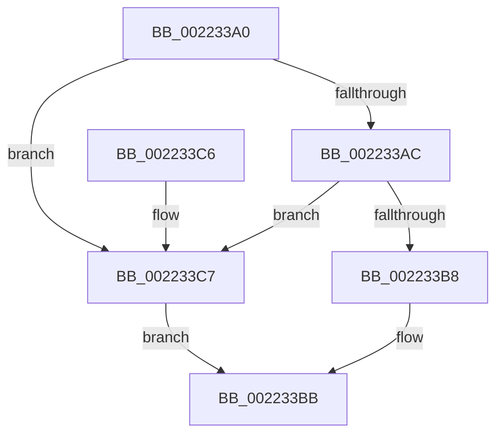

# PsGetProcessSessionId

- RVA: `0x002233A0`–`0x002233CE` (길이 `46` bytes)
- VA: `0x00000001402233A0`
- 실행 섹션: `.text`
- PDB 이름 있음: `예`; PDB Function 태그: `아니요`
- unwind 정보 RVA: `0x000DB714`
- 디코드: `14`개 명령, `46/46` bytes 표시
- 미해석 바이트: `0` (있으면 어셈블리에 `.byte`로 보존)

> 이 문서는 커널 이미지의 기계어와 PDB 기호를 분석해 생성했습니다. 4번과 5번은 함수 원형과 자료형을 바이너리 사용 방식에서 추정한 C 해석이며 원본 소스 복구 결과는 아닙니다.

## 1. Dependencies

- 직접 호출 지점: **0**; 고유 호출 대상: **0**
- 직접 호출자로 확인된 함수: **26**
- RIP 상대 이미지 참조: **0**

### Outgoing calls
- 직접 디코드된 call 명령이 없습니다.

### Direct callers
- [IoRaiseHardError](IoRaiseHardError_function_002230D0.md) at `0x0022313A`
- [IoGetRequestorSessionId](IoGetRequestorSessionId_function_00223360.md) at `0x0022337A`
- [IopCheckSessionDeviceAccess](IopCheckSessionDeviceAccess_function_002233D4.md) at `0x002233F1`
- [PfpLogApplicationEvent](../3B/PfpLogApplicationEvent_function_003BA3A0.md) at `0x003BA4FE`
- [PfpLogApplicationEvent](../3B/PfpLogApplicationEvent_function_003BA3A0.md) at `0x003BA50A`
- [PopDirectedDripsSendSuspendResumeNotification](../../page/75/PopDirectedDripsSendSuspendResumeNotification_function_00757CCC.md) at `0x00757D7B`
- [PopSendSuspendResumeApplicationNotification](../../page/75/PopSendSuspendResumeApplicationNotification_function_0075EC74.md) at `0x0075ECD2`
- [PspTerminateSiloSubsystemProcesses](../../page/78/PspTerminateSiloSubsystemProcesses_function_00780918.md) at `0x00780999`
- [SeExchangePrimaryToken](../../page/7A/SeExchangePrimaryToken_function_007A07BC.md) at `0x007A0823`
- [PspEstablishJobHierarchy](../../page/87/PspEstablishJobHierarchy_function_0087E17C.md) at `0x0087E63A`
- [PspBindProcessSessionToJob](../../page/87/PspBindProcessSessionToJob_function_0087E660.md) at `0x0087E671`
- [EtwpPsProvTraceProcess](../../page/8A/EtwpPsProvTraceProcess_function_008A3954.md) at `0x008A3AD6`
- [EtwpInitStateChangeInfo](../../page/8A/EtwpInitStateChangeInfo_function_008A48D4.md) at `0x008A4904`
- [EtwQueryProcessTelemetryInfo](../../page/8A/EtwQueryProcessTelemetryInfo_function_008A51A0.md) at `0x008A53DE`
- [PopInvokeWin32Callout](../../page/91/PopInvokeWin32Callout_function_009125F4.md) at `0x00912786`
- [ExpGetProcessInformation](../../page/91/ExpGetProcessInformation_function_0091A878.md) at `0x0091B1AE`
- [MmCreatePeb](../../page/98/MmCreatePeb_function_00980FB4.md) at `0x00981241`
- [ExpWnfGetCurrentScopeInstance](../../page/98/ExpWnfGetCurrentScopeInstance_function_0098FE40.md) at `0x0098FE80`
- [NtQueryInformationProcess](../../page/9A/NtQueryInformationProcess_function_009AA250.md) at `0x009ABAF4`
- [PsGetThreadSessionId](../../page/9F/PsGetThreadSessionId_function_009FDC80.md) at `0x009FDC8B`
- [EtwpWriteProcessStarted](../../page/A4/EtwpWriteProcessStarted_function_00A487A4.md) at `0x00A48875`
- [EtwpStartLogger](../../page/A9/EtwpStartLogger_function_00A99D80.md) at `0x00A9A20B`
- [PspInitializeProcessSecurity](../../page/AA/PspInitializeProcessSecurity_function_00AAD368.md) at `0x00AAD40F`
- [MiLogCommitRequestFailed](../../page/AC/MiLogCommitRequestFailed_function_00AC4240.md) at `0x00AC42C2`
- [NtSetInformationProcess](../../page/AE/NtSetInformationProcess_function_00AE5370.md) at `0x00AE683F`
- [sub_00B20A40](../../page/B2/Unknown_function_00B20A40.md) at `0x00B20AA7`
- [sub_00B4A0F6](../../page/B4/Unknown_function_00B4A0F6.md) at `0x00B4A103`

### Static image references
- 디코드된 RIP-relative 메모리 참조가 없습니다.

## 2. Other-region calls and transfers

- 다른 실행 섹션으로 향하는 call: **0**
- 별도 외부 분기/꼬리 이동을 확인하지 못했습니다.

## 3. Assembly (complete function range)

```asm
002233A0  48 8B 91 E8 02 00 00            mov rdx, qword ptr [rcx + 0x2e8]
002233A7  48 85 D2                        test rdx, rdx
002233AA  74 1B                           je 0x1402233c7
002233AC  F7 81 FC 05 00 00 00 10 00 00   test dword ptr [rcx + 0x5fc], 0x1000
002233B6  75 0F                           jne 0x1402233c7
002233B8  8B 42 08                        mov eax, dword ptr [rdx + 8]
002233BB  33 C9                           xor ecx, ecx
002233BD  83 F8 FF                        cmp eax, -1
002233C0  0F 45 C8                        cmovne ecx, eax
002233C3  8B C1                           mov eax, ecx
002233C5  C3                              ret
002233C6  CC                              int3
002233C7  B8 FF FF FF FF                  mov eax, 0xffffffff
002233CC  EB ED                           jmp 0x1402233bb
```

## 4. C-style interpretation (structured pseudocode)

```c
__int64 __fastcall PsGetProcessSessionId(__int64 a1)
{
    if (*(unsigned __int64 *)(a1 + 744) == 0) goto loc_002233C7;
    if (((*(unsigned int *)(a1 + 1532)) & (0x1000ULL)) != 0) goto loc_002233C7;
loc_002233BB:
    a1 = 0;
    if (((unsigned int)((unsigned int)(*(unsigned int *)(*(unsigned __int64 *)(a1 + 744) + 8)))) != -1) { a1 = (unsigned int)((unsigned int)(*(unsigned int *)(*(unsigned __int64 *)(a1 + 744) + 8))); }
    return (unsigned int)((unsigned int)(a1));
loc_002233C7:
    goto loc_002233BB;
}
```

## 5. (Beta) C Style

```c
int64_t PsGetProcessSessionId(void *Arg1)
{
    uint8_t *arg1 = (uint8_t *)Arg1;

    if (*(uint64_t *)(arg1 + 0x2E8) == 0) goto loc_002233C7;
    if (((*(uint32_t *)(arg1 + 0x5FC)) & (0x1000ULL)) != 0) goto loc_002233C7;
loc_002233BB:
    Arg1 = 0;
    if (((uint32_t)((uint32_t)(*(uint32_t *)(*(uint64_t *)(arg1 + 0x2E8) + 0x8)))) != -1) { Arg1 = (uint32_t)((uint32_t)(*(uint32_t *)(*(uint64_t *)(arg1 + 0x2E8) + 0x8))); }
    return (uint32_t)((uint32_t)(Arg1));
loc_002233C7:
    goto loc_002233BB;
}
```

### 관측된 메모리 오프셋

구조체 형식이 확인되지 않은 접근은 인자 기준의 오프셋으로만 기록했습니다.

| 기준 인자 | 오프셋 표현 | 폭 (bit) | 접근 |
|---|---:|---:|---|
| `Arg1` | `+ 0x2E8` | `64` | `R` |
| `Arg1` | `+ 0x5FC` | `32` | `R` |

## 6. Execution-region graph

[열기: 2D/3D 그래프와 함수 탐색 컨트롤 패널](../../../control-panel.html?section=text&rva=0x002233A0&view=graph)

- 2D 그래프는 위에서 아래로 흐르고, 3D 그래프는 빈 공간을 드래그해 회전합니다. Shift+드래그는 이동, 휠은 확대·축소, 함수 노드 선택은 대상 보고서 이동입니다.

### Static fallback


