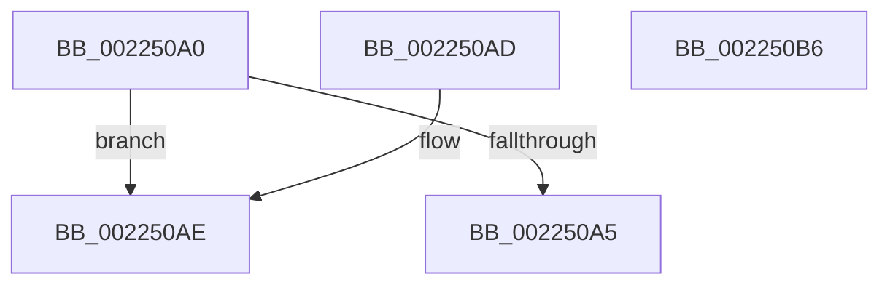

# PsGetServerSiloGlobals

- RVA: `0x002250A0`–`0x002250B7` (길이 `23` bytes)
- VA: `0x00000001402250A0`
- 실행 섹션: `.text`
- PDB 이름 있음: `예`; PDB Function 태그: `아니요`
- unwind 정보 RVA: `0x000DB714`
- 디코드: `8`개 명령, `23/23` bytes 표시
- 미해석 바이트: `0` (있으면 어셈블리에 `.byte`로 보존)

> 이 문서는 커널 이미지의 기계어와 PDB 기호를 분석해 생성했습니다. 4번과 5번은 함수 원형과 자료형을 바이너리 사용 방식에서 추정한 C 해석이며 원본 소스 복구 결과는 아닙니다.

## 1. Dependencies

- 직접 호출 지점: **0**; 고유 호출 대상: **0**
- 직접 호출자로 확인된 함수: **76**
- RIP 상대 이미지 참조: **1**

### Outgoing calls
- 직접 디코드된 call 명령이 없습니다.

### Direct callers
- [IopCheckSessionDeviceAccess](IopCheckSessionDeviceAccess_function_002233D4.md) at `0x00223400`
- [ExpCenturyDpcRoutine](ExpCenturyDpcRoutine_function_00223520.md) at `0x002235C9`
- [SepRmDispatchDataToLsa](SepRmDispatchDataToLsa_function_0022395C.md) at `0x002239C3`
- [PsGetServerSiloActiveConsoleId](PsGetServerSiloActiveConsoleId_function_00223B88.md) at `0x00223B8C`
- [EtwpTraceFileIo](EtwpTraceFileIo_function_00223BB0.md) at `0x00223F1A`
- [EtwTraceSiloKernelEvent](EtwTraceSiloKernelEvent_function_002242A0.md) at `0x0022436D`
- [EtwpTraceIo](EtwpTraceIo_function_00224400.md) at `0x00224711`
- [RtlGetCurrentServiceSessionId](RtlGetCurrentServiceSessionId_function_00225070.md) at `0x0022507C`
- [EtwpTraceFileName](EtwpTraceFileName_function_002251F0.md) at `0x00225386`
- [EtwpTraceFileName](EtwpTraceFileName_function_002251F0.md) at `0x002253E8`
- [PerfInfoLogSysCallExit](PerfInfoLogSysCallExit_function_00225470.md) at `0x0022554C`
- [PerfInfoLogSysCallEntry](PerfInfoLogSysCallEntry_function_002255C0.md) at `0x0022569D`
- [SessionIsInteractive](SessionIsInteractive_function_0022F768.md) at `0x0022F796`
- [SessionIsInteractive](SessionIsInteractive_function_0022F768.md) at `0x0022F7D4`
- [EtwTraceReadyThread](../25/EtwTraceReadyThread_function_00251F70.md) at `0x00252117`
- [EtwpTraceImageUnload](../44/EtwpTraceImageUnload_function_0044C048.md) at `0x0044C20C`
- [EtwTraceSiloTimedEvent](../48/EtwTraceSiloTimedEvent_function_00485260.md) at `0x00485345`
- [EtwTraceThreadSchedulingGroupRundown](../65/EtwTraceThreadSchedulingGroupRundown_function_00650430.md) at `0x00650460`
- [ExpNextYearDpcRoutine](../65/ExpNextYearDpcRoutine_function_006555A0.md) at `0x006555AC`
- [ExpTimeZoneDpcRoutine](../65/ExpTimeZoneDpcRoutine_function_00655710.md) at `0x006557E3`
- [sub_006578CC](../65/Unknown_function_006578CC.md) at `0x006578EE`
- [PsSessionCreate](../../page/70/PsSessionCreate_function_00700438.md) at `0x00700507`
- [PspInitializeSessionGlobals](../../page/70/PspInitializeSessionGlobals_function_007005B8.md) at `0x00700696`
- [DbgkpRemoveErrorPort](../../page/71/DbgkpRemoveErrorPort_function_00711038.md) at `0x007110C0`
- [ObInitServerSilo](../../page/74/ObInitServerSilo_function_0074D8FC.md) at `0x0074D92A`
- [ObShutdownSystem](../../page/74/ObShutdownSystem_function_0074DBB0.md) at `0x0074DD12`
- [PsBootPhaseComplete](../../page/77/PsBootPhaseComplete_function_0077EA18.md) at `0x0077ED3A`
- [PspCompleteServerSiloShutdown](../../page/77/PspCompleteServerSiloShutdown_function_0077F808.md) at `0x0077F825`
- [PspCompleteServerSiloShutdownDeferred](../../page/77/PspCompleteServerSiloShutdownDeferred_function_0077F860.md) at `0x0077F878`
- [PspDeleteExternalServerSiloState](../../page/77/PspDeleteExternalServerSiloState_function_0077FB88.md) at `0x0077FB9A`
- [PspInitializeServerSiloDeferred](../../page/77/PspInitializeServerSiloDeferred_function_0077FEE0.md) at `0x0077FEF5`
- [PspInitializeServerSiloDeferred](../../page/77/PspInitializeServerSiloDeferred_function_0077FEE0.md) at `0x007800B8`
- [PspInitializeServerSiloDeferred](../../page/77/PspInitializeServerSiloDeferred_function_0077FEE0.md) at `0x00780107`
- [PspSiloInitializeSystemRootSymlink](../../page/78/PspSiloInitializeSystemRootSymlink_function_00780558.md) at `0x00780582`
- [PspSiloInitializeUserSharedData](../../page/78/PspSiloInitializeUserSharedData_function_00780684.md) at `0x00780714`
- [PspSiloLoadApiSets](../../page/78/PspSiloLoadApiSets_function_00780848.md) at `0x007808BF`
- [PspTerminateSiloSubsystemProcesses](../../page/78/PspTerminateSiloSubsystemProcesses_function_00780918.md) at `0x007809CD`
- [PsShutdownSystem](../../page/78/PsShutdownSystem_function_00785E94.md) at `0x00785EE3`
- [PspCatchCriticalBreak](../../page/78/PspCatchCriticalBreak_function_00786408.md) at `0x00786534`
- [PspFreezeProcessWorker](../../page/78/PspFreezeProcessWorker_function_007865B0.md) at `0x007865BB`
- [SeInitServerSilo](../../page/79/SeInitServerSilo_function_0079C3EC.md) at `0x0079C426`
- [EtwpInitializeSiloState](../../page/7B/EtwpInitializeSiloState_function_007B6A3C.md) at `0x007B6A5A`
- [EtwpPreInitializeSiloState](../../page/7B/EtwpPreInitializeSiloState_function_007B76BC.md) at `0x007B7703`
- [EtwpPreInitializeSiloState](../../page/7B/EtwpPreInitializeSiloState_function_007B76BC.md) at `0x007B7812`
- [ExpTimeZoneCleanupSiloState](../../page/7C/ExpTimeZoneCleanupSiloState_function_007C638C.md) at `0x007C639E`
- [ExpTimeZoneInitSiloState](../../page/7C/ExpTimeZoneInitSiloState_function_007C6430.md) at `0x007C6441`
- [ExpTimeZoneWork](../../page/7C/ExpTimeZoneWork_function_007C64F0.md) at `0x007C650D`
- [CmpMountPreloadedHives](../../page/7D/CmpMountPreloadedHives_function_007DBE18.md) at `0x007DBFB5`
- [CmpSetVersionData](../../page/7E/CmpSetVersionData_function_007E7854.md) at `0x007E7CEB`
- [ObpLookupObjectName](../../page/89/ObpLookupObjectName_function_0089BE90.md) at `0x0089D5A8`
- [ObpLookupObjectName](../../page/89/ObpLookupObjectName_function_0089BE90.md) at `0x0089D638`
- [EtwpProcessEnumCallback](../../page/8A/EtwpProcessEnumCallback_function_008A5F40.md) at `0x008A6235`
- [ExpWnfGenerateStateName](../../page/8B/ExpWnfGenerateStateName_function_008BE738.md) at `0x008BE774`
- [NtSetInformationThread](../../page/8C/NtSetInformationThread_function_008C9F60.md) at `0x008CB449`
- [DbgkFlushErrorPort](../../page/90/DbgkFlushErrorPort_function_00903FA4.md) at `0x00903FC5`
- [ObClearProcessDeviceMap](../../page/90/ObClearProcessDeviceMap_function_00907688.md) at `0x009076B5`
- [ExpWnfResolveScopeInstance](../../page/90/ExpWnfResolveScopeInstance_function_0090B280.md) at `0x0090B2D2`
- [PspJobClose](../../page/91/PspJobClose_function_00916FE0.md) at `0x00917101`
- [DbgkpSendErrorMessage](../../page/92/DbgkpSendErrorMessage_function_009210A8.md) at `0x00921126`
- [ObQueryDeviceMapInformation](../../page/96/ObQueryDeviceMapInformation_function_0096C5C0.md) at `0x0096C64E`
- [ObpReferenceCurrentDeviceMap](../../page/96/ObpReferenceCurrentDeviceMap_function_0096CBD0.md) at `0x0096CE3D`
- [ObDereferenceDeviceMap](../../page/96/ObDereferenceDeviceMap_function_0096D0E8.md) at `0x0096D153`
- [MmMapApiSetView](../../page/98/MmMapApiSetView_function_00980E98.md) at `0x00980F9B`
- [PspCaptureUserProcessParameters](../../page/9E/PspCaptureUserProcessParameters_function_009E63C0.md) at `0x009E64F5`
- [SepIsMinTCB](../../page/A1/SepIsMinTCB_function_00A13120.md) at `0x00A13157`
- [SepIsSystemAppTCB](../../page/A1/SepIsSystemAppTCB_function_00A13434.md) at `0x00A13467`
- [EtwpUpdateGlobalGroupMasks](../../page/A4/EtwpUpdateGlobalGroupMasks_function_00A4F55C.md) at `0x00A4F64E`
- [SepIsNgenImage](../../page/A5/SepIsNgenImage_function_00A557B4.md) at `0x00A557CE`
- [SepRmCommandServerThread](../../page/A6/SepRmCommandServerThread_function_00A6A8D0.md) at `0x00A6AADA`
- [SepRmLsaConnectRequest](../../page/A6/SepRmLsaConnectRequest_function_00A6AB54.md) at `0x00A6AC82`
- [ExpRefreshTimeZoneInformation](../../page/A6/ExpRefreshTimeZoneInformation_function_00A6B46C.md) at `0x00A6B4E9`
- [ExpWnfEnumerateScopeInstances](../../page/A7/ExpWnfEnumerateScopeInstances_function_00A7ECE8.md) at `0x00A7ED1D`
- [DbgkpGetServerSiloState](../../page/A9/DbgkpGetServerSiloState_function_00A95774.md) at `0x00A95778`
- [DbgkRegisterErrorPort](../../page/A9/DbgkRegisterErrorPort_function_00A9C39C.md) at `0x00A9C5D3`
- [RtlGetHostNtSystemRoot](../../page/AB/RtlGetHostNtSystemRoot_function_00AB7800.md) at `0x00AB780C`
- [PspBeginServerSiloShutdown](../../page/AD/PspBeginServerSiloShutdown_function_00AD2B7C.md) at `0x00AD2B95`
- [PspSetupUserProcessAddressSpace](../../page/AE/PspSetupUserProcessAddressSpace_function_00AEBDC8.md) at `0x00AEBEA0`
- [sub_00B316B4](../../page/B3/Unknown_function_00B316B4.md) at `0x00B31F7E`
- [sub_00B316B4](../../page/B3/Unknown_function_00B316B4.md) at `0x00B322F9`
- [sub_00B316B4](../../page/B3/Unknown_function_00B316B4.md) at `0x00B32407`
- [sub_00B47284](../../page/B4/Unknown_function_00B47284.md) at `0x00B4728A`
- [ExShutdownSystem](../../pagelk/B7/ExShutdownSystem_function_00B7290C.md) at `0x00B7291F`
- [PspInitPhase2](../../init/C4/PspInitPhase2_function_00C45460.md) at `0x00C455D9`
- [EtwpInitialize](../../init/C4/EtwpInitialize_function_00C4DBCC.md) at `0x00C4DC8A`

### Static image references
- `0x002250A5` → RVA `0x00FCF940` (`CACHEALI`; read)

## 2. Other-region calls and transfers

- 다른 실행 섹션으로 향하는 call: **0**
- 별도 외부 분기/꼬리 이동을 확인하지 못했습니다.

## 3. Assembly (complete function range)

```asm
002250A0  48 85 C9                        test rcx, rcx
002250A3  75 09                           jne 0x1402250ae
002250A5  48 8D 05 94 A8 DA 00            lea rax, [rip + 0xdaa894]
002250AC  C3                              ret
002250AD  CC                              int3
002250AE  48 8B 81 E0 05 00 00            mov rax, qword ptr [rcx + 0x5e0]
002250B5  C3                              ret
002250B6  CC                              int3
```

## 4. C-style interpretation (structured pseudocode)

```c
__int64 __fastcall PsGetServerSiloGlobals(__int64 a1)
{
    if (a1 != 0) goto loc_002250AE;
    return v_rip + 14330004;
loc_002250AE:
    return *(unsigned __int64 *)(a1 + 1504);
}
```

## 5. (Beta) C Style

```c
int64_t PsGetServerSiloGlobals(int64_t Arg1)
{
    if (Arg1 != 0) goto loc_002250AE;
    return v_rip + 14330004;
loc_002250AE:
    return *(uint64_t *)(Arg1 + 0x5E0);
}
```

## 6. Execution-region graph

[열기: 2D/3D 그래프와 함수 탐색 컨트롤 패널](../../../control-panel.html?section=text&rva=0x002250A0&view=graph)

- 2D 그래프는 위에서 아래로 흐르고, 3D 그래프는 빈 공간을 드래그해 회전합니다. Shift+드래그는 이동, 휠은 확대·축소, 함수 노드 선택은 대상 보고서 이동입니다.

### Static fallback


