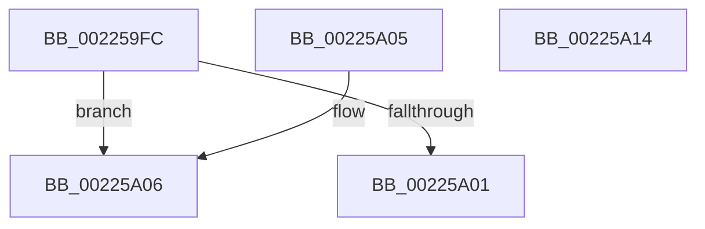

# PsGetServerSiloState

- RVA: `0x002259FC`–`0x00225A15` (길이 `25` bytes)
- VA: `0x00000001402259FC`
- 실행 섹션: `.text`
- PDB 이름 있음: `예`; PDB Function 태그: `아니요`
- unwind 정보 RVA: `0x000DB714`
- 디코드: `9`개 명령, `25/25` bytes 표시
- 미해석 바이트: `0` (있으면 어셈블리에 `.byte`로 보존)

> 이 문서는 커널 이미지의 기계어와 PDB 기호를 분석해 생성했습니다. 4번과 5번은 함수 원형과 자료형을 바이너리 사용 방식에서 추정한 C 해석이며 원본 소스 복구 결과는 아닙니다.

## 1. Dependencies

- 직접 호출 지점: **0**; 고유 호출 대상: **0**
- 직접 호출자로 확인된 함수: **4**
- RIP 상대 이미지 참조: **0**

### Outgoing calls
- 직접 디코드된 call 명령이 없습니다.

### Direct callers
- [SepQueueWorkItem](SepQueueWorkItem_function_00225844.md) at `0x0022587C`
- [PspCompleteServerSiloShutdown](../../page/77/PspCompleteServerSiloShutdown_function_0077F808.md) at `0x0077F811`
- [PspCompleteServerSiloShutdownDeferred](../../page/77/PspCompleteServerSiloShutdownDeferred_function_0077F860.md) at `0x0077F880`
- [PspCatchCriticalBreak](../../page/78/PspCatchCriticalBreak_function_00786408.md) at `0x00786448`

### Static image references
- 디코드된 RIP-relative 메모리 참조가 없습니다.

## 2. Other-region calls and transfers

- 다른 실행 섹션으로 향하는 call: **0**
- 별도 외부 분기/꼬리 이동을 확인하지 못했습니다.

## 3. Assembly (complete function range)

```asm
002259FC  48 85 C9                        test rcx, rcx
002259FF  75 05                           jne 0x140225a06
00225A01  8D 41 01                        lea eax, [rcx + 1]
00225A04  C3                              ret
00225A05  CC                              int3
00225A06  48 8B 81 E0 05 00 00            mov rax, qword ptr [rcx + 0x5e0]
00225A0D  8B 80 F8 04 00 00               mov eax, dword ptr [rax + 0x4f8]
00225A13  C3                              ret
00225A14  CC                              int3
```

## 4. C-style interpretation (structured pseudocode)

```c
__int64 __fastcall PsGetServerSiloState(__int64 a1)
{
    if (a1 != 0) goto loc_00225A06;
    return a1 + 1;
loc_00225A06:
    return (unsigned int)(*(unsigned int *)(*(unsigned __int64 *)(a1 + 1504) + 1272));
}
```

## 5. (Beta) C Style

```c
int64_t PsGetServerSiloState(int64_t Arg1)
{
    if (Arg1 != 0) goto loc_00225A06;
    return Arg1 + 1;
loc_00225A06:
    return (uint32_t)(*(uint32_t *)(*(uint64_t *)(Arg1 + 0x5E0) + 0x4F8));
}
```

## 6. Execution-region graph

[열기: 2D/3D 그래프와 함수 탐색 컨트롤 패널](../../../control-panel.html?section=text&rva=0x002259FC&view=graph)

- 2D 그래프는 위에서 아래로 흐르고, 3D 그래프는 빈 공간을 드래그해 회전합니다. Shift+드래그는 이동, 휠은 확대·축소, 함수 노드 선택은 대상 보고서 이동입니다.

### Static fallback


