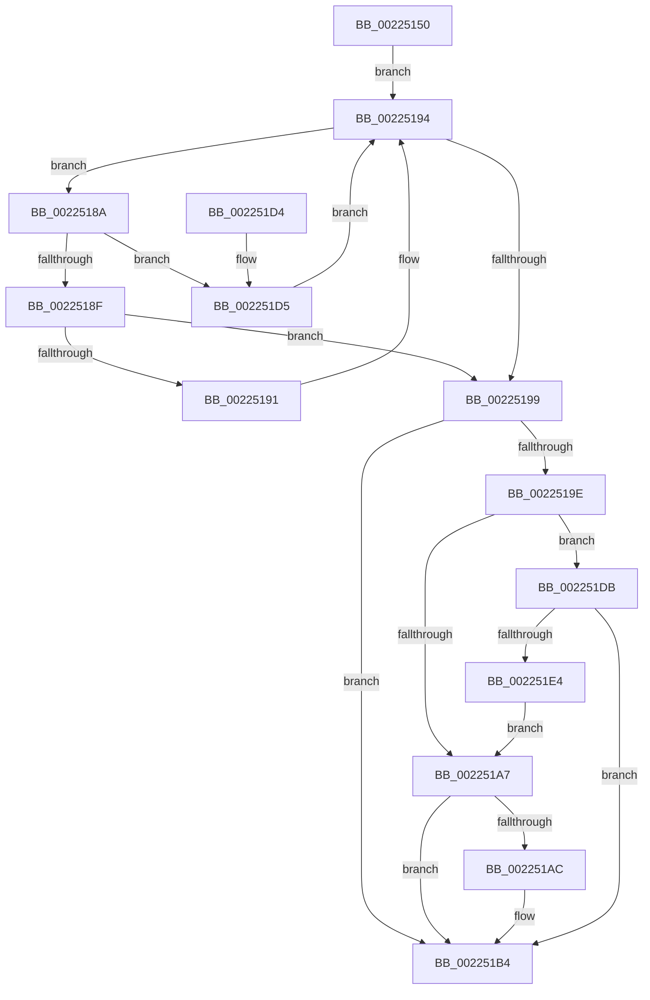

# PsGetSessionById

- RVA: `0x00225150`–`0x002251E6` (길이 `150` bytes)
- VA: `0x0000000140225150`
- 실행 섹션: `.text`
- PDB 이름 있음: `예`; PDB Function 태그: `아니요`
- unwind 정보 RVA: `0x0005FA04`
- 디코드: `44`개 명령, `150/150` bytes 표시
- 미해석 바이트: `0` (있으면 어셈블리에 `.byte`로 보존)

> 이 문서는 커널 이미지의 기계어와 PDB 기호를 분석해 생성했습니다. 4번과 5번은 함수 원형과 자료형을 바이너리 사용 방식에서 추정한 C 해석이며 원본 소스 복구 결과는 아닙니다.

## 1. Dependencies

- 직접 호출 지점: **4**; 고유 호출 대상: **4**
- 직접 호출자로 확인된 함수: **17**
- RIP 상대 이미지 참조: **1**

### Outgoing calls
- `0x00225168` → [PsGetCurrentServerSilo](PsGetCurrentServerSilo_function_00225710.md) (function, `0x00225710`)
- `0x0022517C` → [PspLockProcessListExclusive](PspLockProcessListExclusive_function_0022578C.md) (function, `0x0022578C`)
- `0x002251AC` → [PspSelectSessionAttachProcess](../../page/A2/PspSelectSessionAttachProcess_function_00A25CA0.md) (function, `0x00A25CA0`)
- `0x002251B7` → [PspUnlockProcessListExclusive](../2D/PspUnlockProcessListExclusive_function_002DFD18.md) (function, `0x002DFD18`)

### Direct callers
- [PsGetSessionObjectById](PsGetSessionObjectById_function_002250C0.md) at `0x002250D6`
- [PiUEventBroadcastHardwareProfilesChangedEvent](../../page/72/PiUEventBroadcastHardwareProfilesChangedEvent_function_0072DD18.md) at `0x0072DD52`
- [PiUEventBroadcastPortsChangedEvent](../../page/72/PiUEventBroadcastPortsChangedEvent_function_0072DDA8.md) at `0x0072DE8C`
- [PiUEventBroadcastVolumesChangedEvent](../../page/72/PiUEventBroadcastVolumesChangedEvent_function_0072DF04.md) at `0x0072DF37`
- [PspAttachSession](../../page/78/PspAttachSession_function_00788EB0.md) at `0x00788ED3`
- [IopDeviceInterfaceFilterCallback](../../page/8E/IopDeviceInterfaceFilterCallback_function_008E5410.md) at `0x008E54B5`
- [PiPnpRtlApplyMandatoryFilters](../../page/8E/PiPnpRtlApplyMandatoryFilters_function_008E5C80.md) at `0x008E5DD0`
- [PiPnpRtlApplyMandatoryDeviceFilters](../../page/8E/PiPnpRtlApplyMandatoryDeviceFilters_function_008E5E90.md) at `0x008E60D6`
- [PiCMMandatoryFilterCallback](../../page/8E/PiCMMandatoryFilterCallback_function_008E6490.md) at `0x008E6516`
- [sub_008E6883](../../page/8E/Unknown_function_008E6883.md) at `0x008E68DA`
- [PiCMValidateDeviceInstance](../../page/8E/PiCMValidateDeviceInstance_function_008E799C.md) at `0x008E7AFE`
- [NtQueryWnfStateData](../../page/90/NtQueryWnfStateData_function_00909DF0.md) at `0x0090A0F5`
- [ExpNtUpdateWnfStateData](../../page/90/ExpNtUpdateWnfStateData_function_0090A7A0.md) at `0x0090AA5F`
- [PsGetSiloBySessionId](../../page/91/PsGetSiloBySessionId_function_00912F94.md) at `0x00912FA1`
- [SeQuerySessionIdTokenEx](../../page/9E/SeQuerySessionIdTokenEx_function_009E7680.md) at `0x009E76F9`
- [ExpWnfCaptureScopeInstanceId](../../page/9E/ExpWnfCaptureScopeInstanceId_function_009EC110.md) at `0x009EC1AF`
- [PiUEventBroadcastDevnodesChangedEvent](../../page/A7/PiUEventBroadcastDevnodesChangedEvent_function_00A76600.md) at `0x00A76638`

### Static image references
- `0x00225181` → RVA `0x00F05D50` (`.data`; read)

## 2. Other-region calls and transfers

- 다른 실행 섹션으로 향하는 call: **1**
  - `0x002251AC` → [PspSelectSessionAttachProcess](../../page/A2/PspSelectSessionAttachProcess_function_00A25CA0.md) (`.text` → `PAGE`)
- 별도 외부 분기/꼬리 이동을 확인하지 못했습니다.

## 3. Assembly (complete function range)

```asm
00225150  48 89 5C 24 08                  mov qword ptr [rsp + 8], rbx
00225155  48 89 6C 24 10                  mov qword ptr [rsp + 0x10], rbp
0022515A  48 89 74 24 18                  mov qword ptr [rsp + 0x18], rsi
0022515F  57                              push rdi
00225160  48 83 EC 20                     sub rsp, 0x20
00225164  8B F9                           mov edi, ecx
00225166  33 DB                           xor ebx, ebx
00225168  E8 A3 05 00 00                  call 0x140225710
0022516D  65 48 8B 2C 25 88 01 00 00      mov rbp, qword ptr gs:[0x188]
00225176  48 8B F0                        mov rsi, rax
00225179  48 8B CD                        mov rcx, rbp
0022517C  E8 0B 06 00 00                  call 0x14022578c
00225181  48 8B 05 C8 0B CE 00            mov rax, qword ptr [rip + 0xce0bc8]
00225188  EB 0A                           jmp 0x140225194
0022518A  3B 78 A8                        cmp edi, dword ptr [rax - 0x58]
0022518D  77 46                           ja 0x1402251d5
0022518F  73 08                           jae 0x140225199
00225191  48 8B 00                        mov rax, qword ptr [rax]
00225194  48 85 C0                        test rax, rax
00225197  75 F1                           jne 0x14022518a
00225199  48 85 C0                        test rax, rax
0022519C  74 16                           je 0x1402251b4
0022519E  48 8D 48 A0                     lea rcx, [rax - 0x60]
002251A2  48 85 F6                        test rsi, rsi
002251A5  75 34                           jne 0x1402251db
002251A7  39 79 08                        cmp dword ptr [rcx + 8], edi
002251AA  75 08                           jne 0x1402251b4
002251AC  E8 EF 0A 80 00                  call 0x140a25ca0
002251B1  48 8B D8                        mov rbx, rax
002251B4  48 8B CD                        mov rcx, rbp
002251B7  E8 5C AB 0B 00                  call 0x1402dfd18
002251BC  48 8B 6C 24 38                  mov rbp, qword ptr [rsp + 0x38]
002251C1  48 8B C3                        mov rax, rbx
002251C4  48 8B 5C 24 30                  mov rbx, qword ptr [rsp + 0x30]
002251C9  48 8B 74 24 40                  mov rsi, qword ptr [rsp + 0x40]
002251CE  48 83 C4 20                     add rsp, 0x20
002251D2  5F                              pop rdi
002251D3  C3                              ret
002251D4  CC                              int3
002251D5  48 8B 40 08                     mov rax, qword ptr [rax + 8]
002251D9  EB B9                           jmp 0x140225194
002251DB  48 39 B1 A0 00 00 00            cmp qword ptr [rcx + 0xa0], rsi
002251E2  75 D0                           jne 0x1402251b4
002251E4  EB C1                           jmp 0x1402251a7
```

## 4. C-style interpretation (structured pseudocode)

```c
__int64 __fastcall PsGetSessionById(int a1)
{
    __int64 result;
    __int64 v_rbx;
    __int64 v_rsp;
    unsigned __int64 v_stack_p10;
    unsigned __int64 v_stack_p18;
    unsigned __int64 v_stack_p8;

    v_stack_p8 = v_rbx;
    v_stack_p10 = v_rbp;
    v_stack_p18 = v_rsi;
    v_rsp = (v_rsp) - (32);
    v_rbx = 0;
    result = PsGetCurrentServerSilo(a1, a2, a3, a4);
    result = PspLockProcessListExclusive(*(unsigned __int64 *)(gs_base + (0 + 392)), a2, a3, a4);
    goto loc_00225194;
loc_0022518A:
    if (((unsigned int)((unsigned int)(a1))) > (*(unsigned int *)(*(unsigned __int64 *)(v_rip + 13503432) - 88))) goto loc_002251D5;
    if (((unsigned int)((unsigned int)(a1))) >= (*(unsigned int *)(*(unsigned __int64 *)(v_rip + 13503432) - 88))) goto loc_00225199;
loc_00225194:
    if (*(unsigned __int64 *)(*(unsigned __int64 *)(v_rip + 13503432)) != 0) goto loc_0022518A;
loc_00225199:
    if (*(unsigned __int64 *)(*(unsigned __int64 *)(v_rip + 13503432)) == 0) goto loc_002251B4;
    if (result != 0) goto loc_002251DB;
loc_002251A7:
    result = *(unsigned __int64 *)(*(unsigned __int64 *)(v_rip + 13503432));
    if ((*(unsigned int *)(*(unsigned __int64 *)(*(unsigned __int64 *)(v_rip + 13503432)) - 96 + 8)) == ((unsigned int)((unsigned int)(a1)))) {
        result = PspSelectSessionAttachProcess(*(unsigned __int64 *)(*(unsigned __int64 *)(v_rip + 13503432)) - 96, a2, a3, a4);
        v_rbx = result;
    }
    result = PspUnlockProcessListExclusive(*(unsigned __int64 *)(gs_base + (0 + 392)), a2, a3, a4);
    v_rsp = (v_rsp) + (32);
    return v_rbx;
loc_002251D5:
    goto loc_00225194;
loc_002251DB:
    if ((*(unsigned __int64 *)(*(unsigned __int64 *)(gs_base + (0 + 392)) + 160)) != v_stack_p18) goto loc_002251B4;
    goto loc_002251A7;
}
```

## 5. (Beta) C Style

```c
int64_t PsGetSessionById(int32_t Arg1)
{
    int64_t result;
    int64_t local_rbx;
    int64_t local_rsp;
    uint64_t v_stack_p10;
    uint64_t v_stack_p18;
    uint64_t v_stack_p8;

    v_stack_p8 = local_rbx;
    v_stack_p10 = local_rbp;
    v_stack_p18 = local_rsi;
    local_rsp = (local_rsp) - (32);
    local_rbx = 0;
    result = PsGetCurrentServerSilo(Arg1, a2, a3, a4);
    result = PspLockProcessListExclusive(*(uint64_t *)(gs_base + (0 + 0x188)), a2, a3, a4);
    goto loc_00225194;
loc_0022518A:
    if (((uint32_t)((uint32_t)(Arg1))) > (*(uint32_t *)(*(uint64_t *)(v_rip + 0xCE0BC8) - 0x58))) goto loc_002251D5;
    if (((uint32_t)((uint32_t)(Arg1))) >= (*(uint32_t *)(*(uint64_t *)(v_rip + 0xCE0BC8) - 0x58))) goto loc_00225199;
loc_00225194:
    if (*(uint64_t *)(*(uint64_t *)(v_rip + 0xCE0BC8)) != 0) goto loc_0022518A;
loc_00225199:
    if (*(uint64_t *)(*(uint64_t *)(v_rip + 0xCE0BC8)) == 0) goto loc_002251B4;
    if (result != 0) goto loc_002251DB;
loc_002251A7:
    result = *(uint64_t *)(*(uint64_t *)(v_rip + 0xCE0BC8));
    if ((*(uint32_t *)(*(uint64_t *)(*(uint64_t *)(v_rip + 0xCE0BC8)) - 0x60 + 0x8)) == ((uint32_t)((uint32_t)(Arg1)))) {
        result = PspSelectSessionAttachProcess(*(uint64_t *)(*(uint64_t *)(v_rip + 0xCE0BC8)) - 96, a2, a3, a4);
        local_rbx = result;
    }
    result = PspUnlockProcessListExclusive(*(uint64_t *)(gs_base + (0 + 0x188)), a2, a3, a4);
    local_rsp = (local_rsp) + (32);
    return local_rbx;
loc_002251D5:
    goto loc_00225194;
loc_002251DB:
    if ((*(uint64_t *)(*(uint64_t *)(gs_base + (0 + 0x188)) + 0xA0)) != v_stack_p18) goto loc_002251B4;
    goto loc_002251A7;
}
```

## 6. Execution-region graph

[열기: 2D/3D 그래프와 함수 탐색 컨트롤 패널](../../../control-panel.html?section=text&rva=0x00225150&view=graph)

- 2D 그래프는 위에서 아래로 흐르고, 3D 그래프는 빈 공간을 드래그해 회전합니다. Shift+드래그는 이동, 휠은 확대·축소, 함수 노드 선택은 대상 보고서 이동입니다.

### Static fallback


