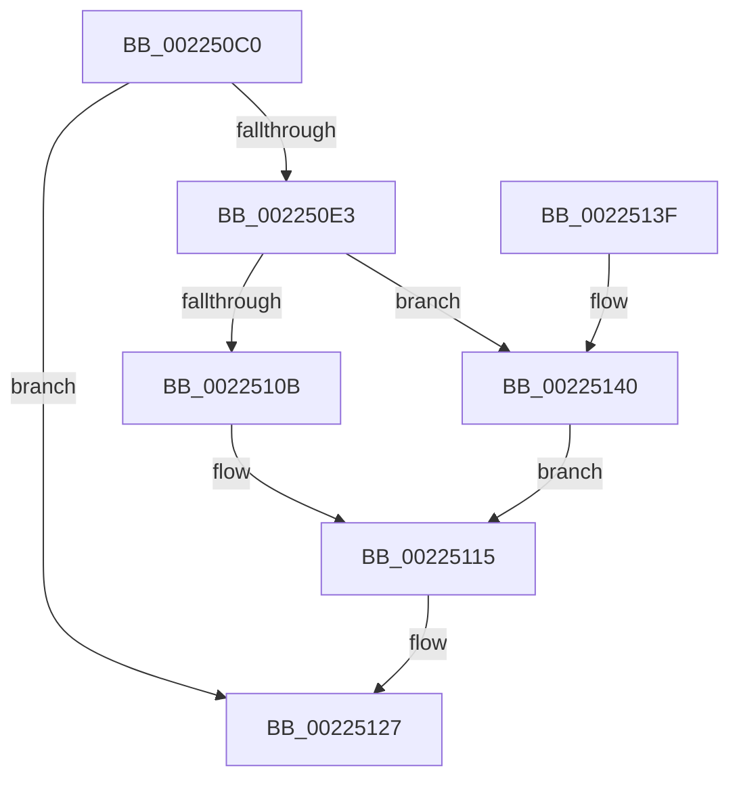

# PsGetSessionObjectById

- RVA: `0x002250C0`–`0x00225144` (길이 `132` bytes)
- VA: `0x00000001402250C0`
- 실행 섹션: `.text`
- PDB 이름 있음: `예`; PDB Function 태그: `아니요`
- unwind 정보 RVA: `0x0005F9EC`
- 디코드: `37`개 명령, `132/132` bytes 표시
- 미해석 바이트: `0` (있으면 어셈블리에 `.byte`로 보존)

> 이 문서는 커널 이미지의 기계어와 PDB 기호를 분석해 생성했습니다. 4번과 5번은 함수 원형과 자료형을 바이너리 사용 방식에서 추정한 C 해석이며 원본 소스 복구 결과는 아닙니다.

## 1. Dependencies

- 직접 호출 지점: **5**; 고유 호출 대상: **5**
- 직접 호출자로 확인된 함수: **6**
- RIP 상대 이미지 참조: **0**

### Outgoing calls
- `0x002250D6` → [PsGetSessionById](PsGetSessionById_function_00225150.md) (function, `0x00225150`)
- `0x002250FA` → [PspLockProcessListExclusive](PspLockProcessListExclusive_function_0022578C.md) (function, `0x0022578C`)
- `0x00225110` → [ObfReferenceObjectWithTag](../21/ObfReferenceObjectWithTag_function_00210710.md) (function, `0x00210710`)
- `0x00225118` → [PspUnlockProcessListExclusive](../2D/PspUnlockProcessListExclusive_function_002DFD18.md) (function, `0x002DFD18`)
- `0x00225122` → [ObfDereferenceObjectWithTag](../2F/ObfDereferenceObjectWithTag_function_002F78E0.md) (function, `0x002F78E0`)

### Direct callers
- [IoGetContainerInformation](../../page/71/IoGetContainerInformation_function_0071E680.md) at `0x0071E6B0`
- [IoRegisterContainerNotification](../../page/71/IoRegisterContainerNotification_function_0071E700.md) at `0x0071E907`
- [SeExchangePrimaryToken](../../page/7A/SeExchangePrimaryToken_function_007A07BC.md) at `0x007A0818`
- [SepSetTokenSessionById](../../page/A0/SepSetTokenSessionById_function_00A0DAE4.md) at `0x00A0DB17`
- [SeSetSessionIdToken](../../page/AF/SeSetSessionIdToken_function_00AF1F0C.md) at `0x00AF1F3E`
- [sub_00B334D2](../../page/B3/Unknown_function_00B334D2.md) at `0x00B3353A`

### Static image references
- 디코드된 RIP-relative 메모리 참조가 없습니다.

## 2. Other-region calls and transfers

- 다른 실행 섹션으로 향하는 call: **0**
- 별도 외부 분기/꼬리 이동을 확인하지 못했습니다.

## 3. Assembly (complete function range)

```asm
002250C0  48 89 5C 24 08                  mov qword ptr [rsp + 8], rbx
002250C5  48 89 6C 24 10                  mov qword ptr [rsp + 0x10], rbp
002250CA  48 89 74 24 18                  mov qword ptr [rsp + 0x18], rsi
002250CF  57                              push rdi
002250D0  48 83 EC 20                     sub rsp, 0x20
002250D4  33 FF                           xor edi, edi
002250D6  E8 75 00 00 00                  call 0x140225150
002250DB  48 8B F0                        mov rsi, rax
002250DE  48 85 C0                        test rax, rax
002250E1  74 44                           je 0x140225127
002250E3  48 8B 98 E8 02 00 00            mov rbx, qword ptr [rax + 0x2e8]
002250EA  65 48 8B 2C 25 88 01 00 00      mov rbp, qword ptr gs:[0x188]
002250F3  48 8B CD                        mov rcx, rbp
002250F6  48 8B 7B 20                     mov rdi, qword ptr [rbx + 0x20]
002250FA  E8 8D 06 00 00                  call 0x14022578c
002250FF  8B 43 04                        mov eax, dword ptr [rbx + 4]
00225102  BB 50 73 51 79                  mov ebx, 0x79517350
00225107  A8 02                           test al, 2
00225109  75 35                           jne 0x140225140
0022510B  8B D3                           mov edx, ebx
0022510D  48 8B CF                        mov rcx, rdi
00225110  E8 FB B5 FE FF                  call 0x140210710
00225115  48 8B CD                        mov rcx, rbp
00225118  E8 FB AB 0B 00                  call 0x1402dfd18
0022511D  8B D3                           mov edx, ebx
0022511F  48 8B CE                        mov rcx, rsi
00225122  E8 B9 27 0D 00                  call 0x1402f78e0
00225127  48 8B 5C 24 30                  mov rbx, qword ptr [rsp + 0x30]
0022512C  48 8B C7                        mov rax, rdi
0022512F  48 8B 6C 24 38                  mov rbp, qword ptr [rsp + 0x38]
00225134  48 8B 74 24 40                  mov rsi, qword ptr [rsp + 0x40]
00225139  48 83 C4 20                     add rsp, 0x20
0022513D  5F                              pop rdi
0022513E  C3                              ret
0022513F  CC                              int3
00225140  33 FF                           xor edi, edi
00225142  EB D1                           jmp 0x140225115
```

## 4. C-style interpretation (structured pseudocode)

```c
__int64 __fastcall PsGetSessionObjectById(void)
{
    __int64 result;
    __int64 v_rdi;
    __int64 v_rsp;
    unsigned __int64 v_stack_p10;
    unsigned __int64 v_stack_p18;
    unsigned __int64 v_stack_p8;

    v_stack_p8 = v_rbx;
    v_stack_p10 = v_rbp;
    v_stack_p18 = v_rsi;
    v_rsp = (v_rsp) - (32);
    v_rdi = 0;
    result = PsGetSessionById(a1, a2, a3, a4);
    if (result == 0) goto loc_00225127;
    result = PspLockProcessListExclusive(*(unsigned __int64 *)(gs_base + (0 + 392)), a2, a3, a4);
    if ((((unsigned __int8)((unsigned int)(*(unsigned int *)(*(unsigned __int64 *)(result + 744) + 4)))) & (2)) != 0) goto loc_00225140;
    result = ObfReferenceObjectWithTag(*(unsigned __int64 *)(*(unsigned __int64 *)(result + 744) + 32), (unsigned int)((unsigned int)((unsigned int)(0x79517350ULL))), a3, a4);
loc_00225115:
    result = PspUnlockProcessListExclusive(*(unsigned __int64 *)(gs_base + (0 + 392)), (unsigned int)((unsigned int)((unsigned int)(0x79517350ULL))), a3, a4);
    result = ObfDereferenceObjectWithTag(result, (unsigned int)((unsigned int)((unsigned int)(0x79517350ULL))), a3, a4);
loc_00225127:
    v_rsp = (v_rsp) + (32);
    return *(unsigned __int64 *)(*(unsigned __int64 *)(result + 744) + 32);
loc_00225140:
    v_rdi = 0;
    goto loc_00225115;
}
```

## 5. (Beta) C Style

```c
void PsGetSessionObjectById(void)
{
    int64_t result;
    int64_t local_rdi;
    int64_t local_rsp;
    uint64_t v_stack_p10;
    uint64_t v_stack_p18;
    uint64_t v_stack_p8;

    v_stack_p8 = local_rbx;
    v_stack_p10 = local_rbp;
    v_stack_p18 = local_rsi;
    local_rsp = (local_rsp) - (32);
    local_rdi = 0;
    result = PsGetSessionById(a1, a2, a3, a4);
    if (result == 0) goto loc_00225127;
    result = PspLockProcessListExclusive(*(uint64_t *)(gs_base + (0 + 0x188)), a2, a3, a4);
    if ((((uint8_t)((uint32_t)(*(uint32_t *)(*(uint64_t *)(result + 0x2E8) + 0x4)))) & (2)) != 0) goto loc_00225140;
    result = ObfReferenceObjectWithTag(*(uint64_t *)(*(uint64_t *)(result + 0x2E8) + 0x20), (uint32_t)((uint32_t)((uint32_t)(0x79517350ULL))), a3, a4);
loc_00225115:
    result = PspUnlockProcessListExclusive(*(uint64_t *)(gs_base + (0 + 0x188)), (uint32_t)((uint32_t)((uint32_t)(0x79517350ULL))), a3, a4);
    result = ObfDereferenceObjectWithTag(result, (uint32_t)((uint32_t)((uint32_t)(0x79517350ULL))), a3, a4);
loc_00225127:
    local_rsp = (local_rsp) + (32);
    return *(uint64_t *)(*(uint64_t *)(result + 0x2E8) + 0x20);
loc_00225140:
    local_rdi = 0;
    goto loc_00225115;
}
```

## 6. Execution-region graph

[열기: 2D/3D 그래프와 함수 탐색 컨트롤 패널](../../../control-panel.html?section=text&rva=0x002250C0&view=graph)

- 2D 그래프는 위에서 아래로 흐르고, 3D 그래프는 빈 공간을 드래그해 회전합니다. Shift+드래그는 이동, 휠은 확대·축소, 함수 노드 선택은 대상 보고서 이동입니다.

### Static fallback


