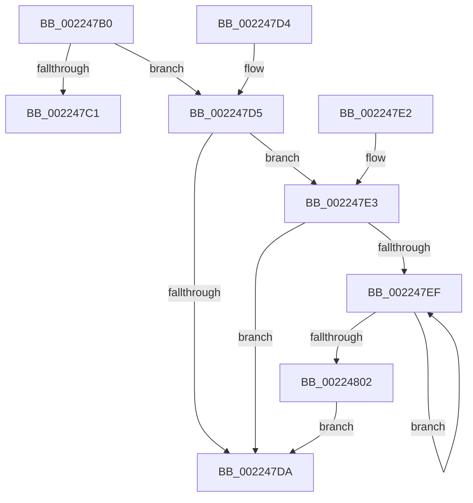

# PsGetThreadServerSilo

- RVA: `0x002247B0`–`0x00224804` (길이 `84` bytes)
- VA: `0x00000001402247B0`
- 실행 섹션: `.text`
- PDB 이름 있음: `예`; PDB Function 태그: `아니요`
- unwind 정보 RVA: `0x0005F934`
- 디코드: `25`개 명령, `84/84` bytes 표시
- 미해석 바이트: `0` (있으면 어셈블리에 `.byte`로 보존)

> 이 문서는 커널 이미지의 기계어와 PDB 기호를 분석해 생성했습니다. 4번과 5번은 함수 원형과 자료형을 바이너리 사용 방식에서 추정한 C 해석이며 원본 소스 복구 결과는 아닙니다.

## 1. Dependencies

- 직접 호출 지점: **2**; 고유 호출 대상: **1**
- 직접 호출자로 확인된 함수: **7**
- RIP 상대 이미지 참조: **0**

### Outgoing calls
- `0x002247E6` → [PsIsServerSilo](PsIsServerSilo_function_00225828.md) (function, `0x00225828`)
- `0x002247F9` → [PsIsServerSilo](PsIsServerSilo_function_00225828.md) (function, `0x00225828`)

### Direct callers
- [EtwpTraceIoInit](EtwpTraceIoInit_function_002241C0.md) at `0x00224219`
- [EtwpTraceIo](EtwpTraceIo_function_00224400.md) at `0x00224476`
- [EtwTracePageFault](../2A/EtwTracePageFault_function_002A2E74.md) at `0x002A2F25`
- [EtwTracePageFault](../2A/EtwTracePageFault_function_002A2E74.md) at `0x002A301C`
- [EtwpTraceRedirectedIo](../65/EtwpTraceRedirectedIo_function_00651190.md) at `0x006511BC`
- [ObpLookupObjectName](../../page/89/ObpLookupObjectName_function_0089BE90.md) at `0x0089C191`
- [ObpReferenceCurrentDeviceMap](../../page/96/ObpReferenceCurrentDeviceMap_function_0096CBD0.md) at `0x0096CC10`
- [IopGetThreadActiveConsoleId](../../page/AB/IopGetThreadActiveConsoleId_function_00AB4EE8.md) at `0x00AB4EEC`

### Static image references
- 디코드된 RIP-relative 메모리 참조가 없습니다.

## 2. Other-region calls and transfers

- 다른 실행 섹션으로 향하는 call: **0**
- 별도 외부 분기/꼬리 이동을 확인하지 못했습니다.

## 3. Assembly (complete function range)

```asm
002247B0  48 83 EC 28                     sub rsp, 0x28
002247B4  48 8B 91 98 06 00 00            mov rdx, qword ptr [rcx + 0x698]
002247BB  48 83 FA FD                     cmp rdx, -3
002247BF  75 14                           jne 0x1402247d5
002247C1  48 8B 81 20 02 00 00            mov rax, qword ptr [rcx + 0x220]
002247C8  48 8B 80 F0 05 00 00            mov rax, qword ptr [rax + 0x5f0]
002247CF  48 83 C4 28                     add rsp, 0x28
002247D3  C3                              ret
002247D4  CC                              int3
002247D5  48 85 D2                        test rdx, rdx
002247D8  75 09                           jne 0x1402247e3
002247DA  48 8B C2                        mov rax, rdx
002247DD  48 83 C4 28                     add rsp, 0x28
002247E1  C3                              ret
002247E2  CC                              int3
002247E3  48 8B CA                        mov rcx, rdx
002247E6  E8 3D 10 00 00                  call 0x140225828
002247EB  84 C0                           test al, al
002247ED  75 EB                           jne 0x1402247da
002247EF  48 8B 92 18 05 00 00            mov rdx, qword ptr [rdx + 0x518]
002247F6  48 8B CA                        mov rcx, rdx
002247F9  E8 2A 10 00 00                  call 0x140225828
002247FE  84 C0                           test al, al
00224800  74 ED                           je 0x1402247ef
00224802  EB D6                           jmp 0x1402247da
```

## 4. C-style interpretation (structured pseudocode)

```c
__int64 __fastcall PsGetThreadServerSilo(__int64 a1)
{
    __int64 result;
    __int64 v_rsp;

    v_rsp = (v_rsp) - (40);
    if ((*(unsigned __int64 *)(a1 + 1688)) != -3) goto loc_002247D5;
    v_rsp = (v_rsp) + (40);
    return *(unsigned __int64 *)(*(unsigned __int64 *)(a1 + 544) + 1520);
loc_002247D5:
    if (*(unsigned __int64 *)(a1 + 1688) != 0) goto loc_002247E3;
loc_002247DA:
    v_rsp = (v_rsp) + (40);
    return *(unsigned __int64 *)(a1 + 1688);
loc_002247E3:
    result = PsIsServerSilo(*(unsigned __int64 *)(a1 + 1688), *(unsigned __int64 *)(a1 + 1688), a3, a4);
    if ((unsigned __int8)(result) != 0) goto loc_002247DA;
loc_002247EF:
    result = PsIsServerSilo(*(unsigned __int64 *)(*(unsigned __int64 *)(a1 + 1688) + 1304), *(unsigned __int64 *)(*(unsigned __int64 *)(a1 + 1688) + 1304), a3, a4);
    if ((unsigned __int8)(result) == 0) goto loc_002247EF;
    goto loc_002247DA;
}
```

## 5. (Beta) C Style

```c
int64_t PsGetThreadServerSilo(void *Arg1)
{
    uint8_t *arg1 = (uint8_t *)Arg1;

    int64_t result;
    int64_t local_rsp;

    local_rsp = (local_rsp) - (40);
    if ((*(uint64_t *)(arg1 + 0x698)) != -3) goto loc_002247D5;
    local_rsp = (local_rsp) + (40);
    return *(uint64_t *)(*(uint64_t *)(arg1 + 0x220) + 0x5F0);
loc_002247D5:
    if (*(uint64_t *)(arg1 + 0x698) != 0) goto loc_002247E3;
loc_002247DA:
    local_rsp = (local_rsp) + (40);
    return *(uint64_t *)(arg1 + 0x698);
loc_002247E3:
    result = PsIsServerSilo(*(uint64_t *)(arg1 + 0x698), *(uint64_t *)(arg1 + 0x698), a3, a4);
    if ((uint8_t)(result) != 0) goto loc_002247DA;
loc_002247EF:
    result = PsIsServerSilo(*(uint64_t *)(*(uint64_t *)(arg1 + 0x698) + 0x518), *(uint64_t *)(*(uint64_t *)(arg1 + 0x698) + 0x518), a3, a4);
    if ((uint8_t)(result) == 0) goto loc_002247EF;
    goto loc_002247DA;
}
```

### 관측된 메모리 오프셋

구조체 형식이 확인되지 않은 접근은 인자 기준의 오프셋으로만 기록했습니다.

| 기준 인자 | 오프셋 표현 | 폭 (bit) | 접근 |
|---|---:|---:|---|
| `Arg1` | `+ 0x220` | `64` | `R` |
| `Arg1` | `+ 0x698` | `64` | `R` |

## 6. Execution-region graph

[열기: 2D/3D 그래프와 함수 탐색 컨트롤 패널](../../../control-panel.html?section=text&rva=0x002247B0&view=graph)

- 2D 그래프는 위에서 아래로 흐르고, 3D 그래프는 빈 공간을 드래그해 회전합니다. Shift+드래그는 이동, 휠은 확대·축소, 함수 노드 선택은 대상 보고서 이동입니다.

### Static fallback


