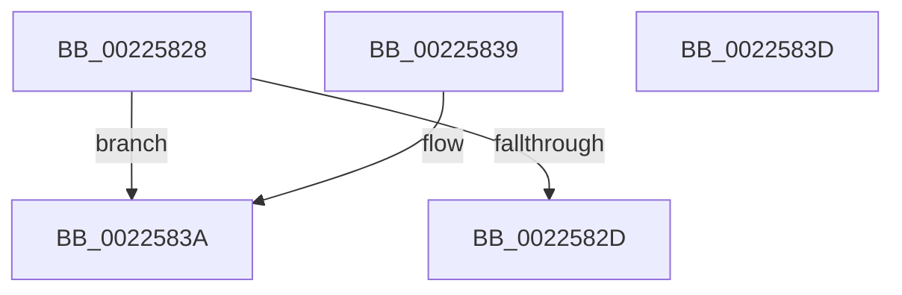

# PsIsServerSilo

- RVA: `0x00225828`–`0x0022583E` (길이 `22` bytes)
- VA: `0x0000000140225828`
- 실행 섹션: `.text`
- PDB 이름 있음: `예`; PDB Function 태그: `아니요`
- unwind 정보 RVA: `0x000DB714`
- 디코드: `9`개 명령, `22/22` bytes 표시
- 미해석 바이트: `0` (있으면 어셈블리에 `.byte`로 보존)

> 이 문서는 커널 이미지의 기계어와 PDB 기호를 분석해 생성했습니다. 4번과 5번은 함수 원형과 자료형을 바이너리 사용 방식에서 추정한 C 해석이며 원본 소스 복구 결과는 아닙니다.

## 1. Dependencies

- 직접 호출 지점: **0**; 고유 호출 대상: **0**
- 직접 호출자로 확인된 함수: **20**
- RIP 상대 이미지 참조: **0**

### Outgoing calls
- 직접 디코드된 call 명령이 없습니다.

### Direct callers
- [EtwpTraceFileIo](EtwpTraceFileIo_function_00223BB0.md) at `0x00223FA9`
- [EtwpTraceFileIo](EtwpTraceFileIo_function_00223BB0.md) at `0x00223FC0`
- [sub_00224177](Unknown_function_00224177.md) at `0x0022418C`
- [sub_00224177](Unknown_function_00224177.md) at `0x002241A0`
- [PsGetThreadServerSilo](PsGetThreadServerSilo_function_002247B0.md) at `0x002247E6`
- [PsGetThreadServerSilo](PsGetThreadServerSilo_function_002247B0.md) at `0x002247F9`
- [PsGetCurrentServerSilo](PsGetCurrentServerSilo_function_00225710.md) at `0x00225763`
- [PsGetCurrentServerSilo](PsGetCurrentServerSilo_function_00225710.md) at `0x00225773`
- [PsGetEffectiveServerSilo](PsGetEffectiveServerSilo_function_002257F0.md) at `0x00225801`
- [PsGetEffectiveServerSilo](PsGetEffectiveServerSilo_function_002257F0.md) at `0x00225811`
- [EtwpTraceMessageVa](../2F/EtwpTraceMessageVa_function_002FB2B0.md) at `0x002FBED8`
- [EtwpTraceMessageVa](../2F/EtwpTraceMessageVa_function_002FB2B0.md) at `0x002FBEEC`
- [PsGetCurrentServerSiloGlobals](../2F/PsGetCurrentServerSiloGlobals_function_002FE1F0.md) at `0x002FE248`
- [PsGetCurrentServerSiloGlobals](../2F/PsGetCurrentServerSiloGlobals_function_002FE1F0.md) at `0x002FE258`
- [PspJobIsAppSilo](../5E/PspJobIsAppSilo_function_005E2740.md) at `0x005E2752`
- [PsIsProcessInAppSilo](../../page/77/PsIsProcessInAppSilo_function_0077F420.md) at `0x0077F433`
- [PsTerminateServerSilo](../../page/77/PsTerminateServerSilo_function_0077F620.md) at `0x0077F629`
- [PspConvertSiloToServerSilo](../../page/77/PspConvertSiloToServerSilo_function_0077F9B4.md) at `0x0077FAA5`
- [PspDeleteSilo](../../page/77/PspDeleteSilo_function_0077FE94.md) at `0x0077FEA8`
- [PspSetJobMemoryPartition](../../page/78/PspSetJobMemoryPartition_function_00785574.md) at `0x007855EC`
- [IopAllocRealFileObject](../../page/89/IopAllocRealFileObject_function_00899720.md) at `0x00899E1A`
- [IopParseDevice](../../page/89/IopParseDevice_function_0089E510.md) at `0x008A0561`
- [PspJobClose](../../page/91/PspJobClose_function_00916FE0.md) at `0x009170F8`
- [PspTerminateProcessesJobCallback](../../page/91/PspTerminateProcessesJobCallback_function_00917430.md) at `0x0091745C`
- [PspGetNextSilo](../../page/91/PspGetNextSilo_function_00919F78.md) at `0x00919FA5`
- [EtwpUpdateGlobalGroupMasks](../../page/A4/EtwpUpdateGlobalGroupMasks_function_00A4F55C.md) at `0x00A4F645`
- [EtwpUpdateGlobalGroupMasks](../../page/A4/EtwpUpdateGlobalGroupMasks_function_00A4F55C.md) at `0x00A4F67C`
- [PspValidateJobAssignmentSiloPolicy](../../page/A7/PspValidateJobAssignmentSiloPolicy_function_00A71CAC.md) at `0x00A71D00`

### Static image references
- 디코드된 RIP-relative 메모리 참조가 없습니다.

## 2. Other-region calls and transfers

- 다른 실행 섹션으로 향하는 call: **0**
- 별도 외부 분기/꼬리 이동을 확인하지 못했습니다.

## 3. Assembly (complete function range)

```asm
00225828  48 85 C9                        test rcx, rcx
0022582B  74 0D                           je 0x14022583a
0022582D  48 83 B9 E0 05 00 00 00         cmp qword ptr [rcx + 0x5e0], 0
00225835  0F 95 C0                        setne al
00225838  C3                              ret
00225839  CC                              int3
0022583A  B0 01                           mov al, 1
0022583C  C3                              ret
0022583D  CC                              int3
```

## 4. C-style interpretation (structured pseudocode)

```c
__int64 __fastcall PsIsServerSilo(__int64 a1)
{
    __int64 result;

    if (a1 == 0) goto loc_0022583A;
    result = ((*(unsigned __int64 *)(a1 + 1504)) != 0) ? 1 : 0;
    return result;
loc_0022583A:
    return 1;
}
```

## 5. (Beta) C Style

```c
int64_t PsIsServerSilo(int64_t Arg1)
{
    int64_t result;

    if (Arg1 == 0) goto loc_0022583A;
    result = ((*(uint64_t *)(Arg1 + 0x5E0)) != 0) ? 1 : 0;
    return result;
loc_0022583A:
    return 1;
}
```

## 6. Execution-region graph

[열기: 2D/3D 그래프와 함수 탐색 컨트롤 패널](../../../control-panel.html?section=text&rva=0x00225828&view=graph)

- 2D 그래프는 위에서 아래로 흐르고, 3D 그래프는 빈 공간을 드래그해 회전합니다. Shift+드래그는 이동, 휠은 확대·축소, 함수 노드 선택은 대상 보고서 이동입니다.

### Static fallback


