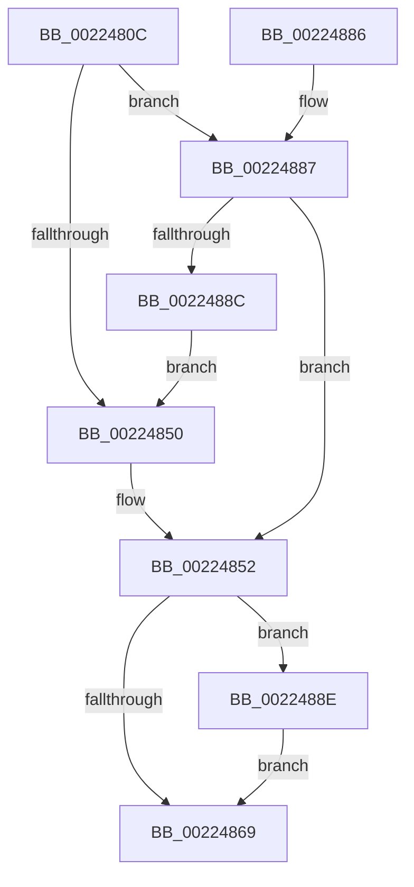

# PspDetachSession

- RVA: `0x0022480C`–`0x0022489E` (길이 `146` bytes)
- VA: `0x000000014022480C`
- 실행 섹션: `.text`
- PDB 이름 있음: `예`; PDB Function 태그: `아니요`
- unwind 정보 RVA: `0x0005F944`
- 디코드: `41`개 명령, `146/146` bytes 표시
- 미해석 바이트: `0` (있으면 어셈블리에 `.byte`로 보존)

> 이 문서는 커널 이미지의 기계어와 PDB 기호를 분석해 생성했습니다. 4번과 5번은 함수 원형과 자료형을 바이너리 사용 방식에서 추정한 C 해석이며 원본 소스 복구 결과는 아닙니다.

## 1. Dependencies

- 직접 호출 지점: **5**; 고유 호출 대상: **5**
- 직접 호출자로 확인된 함수: **2**
- RIP 상대 이미지 참조: **0**

### Outgoing calls
- `0x00224839` → [PspLockProcessListExclusive](PspLockProcessListExclusive_function_0022578C.md) (function, `0x0022578C`)
- `0x00224855` → [PspUnlockProcessListExclusive](../2D/PspUnlockProcessListExclusive_function_002DFD18.md) (function, `0x002DFD18`)
- `0x0022485F` → [KiUnstackDetachProcess](../21/KiUnstackDetachProcess_function_00217D30.md) (function, `0x00217D30`)
- `0x0022486C` → [PsQuitNextSession](../../page/A1/PsQuitNextSession_function_00A1D870.md) (function, `0x00A1D870`)
- `0x00224897` → [KeSignalGate](../2C/KeSignalGate_function_002C748C.md) (function, `0x002C748C`)

### Direct callers
- [PsDetachSession](../5E/PsDetachSession_function_005E4FD0.md) at `0x005E4FD4`
- [PspAllocateProcess](../../page/A1/PspAllocateProcess_function_00A13B3C.md) at `0x00A150FA`
- [PspAllocateProcess](../../page/A1/PspAllocateProcess_function_00A13B3C.md) at `0x00A151B0`

### Static image references
- 디코드된 RIP-relative 메모리 참조가 없습니다.

## 2. Other-region calls and transfers

- 다른 실행 섹션으로 향하는 call: **1**
  - `0x0022486C` → [PsQuitNextSession](../../page/A1/PsQuitNextSession_function_00A1D870.md) (`.text` → `PAGE`)
- 별도 외부 분기/꼬리 이동을 확인하지 못했습니다.

## 3. Assembly (complete function range)

```asm
0022480C  48 89 5C 24 08                  mov qword ptr [rsp + 8], rbx
00224811  48 89 6C 24 10                  mov qword ptr [rsp + 0x10], rbp
00224816  48 89 74 24 18                  mov qword ptr [rsp + 0x18], rsi
0022481B  57                              push rdi
0022481C  48 83 EC 20                     sub rsp, 0x20
00224820  65 48 8B 34 25 88 01 00 00      mov rsi, qword ptr gs:[0x188]
00224829  48 8B F9                        mov rdi, rcx
0022482C  48 8B 99 E8 02 00 00            mov rbx, qword ptr [rcx + 0x2e8]
00224833  48 8B EA                        mov rbp, rdx
00224836  48 8B CE                        mov rcx, rsi
00224839  E8 4E 0F 00 00                  call 0x14022578c
0022483E  44 8B 43 34                     mov r8d, dword ptr [rbx + 0x34]
00224842  8B 43 04                        mov eax, dword ptr [rbx + 4]
00224845  41 FF C8                        dec r8d
00224848  44 89 43 34                     mov dword ptr [rbx + 0x34], r8d
0022484C  A8 02                           test al, 2
0022484E  75 37                           jne 0x140224887
00224850  33 DB                           xor ebx, ebx
00224852  48 8B CE                        mov rcx, rsi
00224855  E8 BE B4 0B 00                  call 0x1402dfd18
0022485A  33 D2                           xor edx, edx
0022485C  48 8B CD                        mov rcx, rbp
0022485F  E8 CC 34 FF FF                  call 0x140217d30
00224864  48 85 DB                        test rbx, rbx
00224867  75 25                           jne 0x14022488e
00224869  48 8B CF                        mov rcx, rdi
0022486C  E8 FF 8F 7F 00                  call 0x140a1d870
00224871  48 8B 5C 24 30                  mov rbx, qword ptr [rsp + 0x30]
00224876  48 8B 6C 24 38                  mov rbp, qword ptr [rsp + 0x38]
0022487B  48 8B 74 24 40                  mov rsi, qword ptr [rsp + 0x40]
00224880  48 83 C4 20                     add rsp, 0x20
00224884  5F                              pop rdi
00224885  C3                              ret
00224886  CC                              int3
00224887  45 85 C0                        test r8d, r8d
0022488A  74 C6                           je 0x140224852
0022488C  EB C2                           jmp 0x140224850
0022488E  48 8D 4B 38                     lea rcx, [rbx + 0x38]
00224892  BA 01 00 00 00                  mov edx, 1
00224897  E8 F0 2B 0A 00                  call 0x1402c748c
0022489C  EB CB                           jmp 0x140224869
```

## 4. C-style interpretation (structured pseudocode)

```c
__int64 __fastcall PspDetachSession(__int64 a1, __int64 a2)
{
    __int64 result;
    __int64 v_rbx;
    __int64 v_rsp;
    unsigned __int64 v_stack_p10;
    unsigned __int64 v_stack_p18;
    unsigned __int64 v_stack_p8;

    v_stack_p8 = v_rbx;
    v_stack_p10 = v_rbp;
    v_stack_p18 = v_rsi;
    v_rsp = (v_rsp) - (32);
    result = PspLockProcessListExclusive(*(unsigned __int64 *)(gs_base + (0 + 392)), a2, a3, a4);
    a3 = (unsigned int)(((unsigned int)(*(unsigned int *)(*(unsigned __int64 *)(a1 + 744) + 52))) - 1);
    *(unsigned int *)(*(unsigned __int64 *)(a1 + 744) + 52) = (unsigned int)(a3);
    if ((((unsigned __int8)((unsigned int)(*(unsigned int *)(*(unsigned __int64 *)(a1 + 744) + 4)))) & (2)) != 0) goto loc_00224887;
loc_00224850:
    v_rbx = 0;
loc_00224852:
    result = PspUnlockProcessListExclusive(*(unsigned __int64 *)(gs_base + (0 + 392)), a2, a3, a4);
    a2 = 0;
    result = KiUnstackDetachProcess(0, a2, a3, a4);
    if (0 != 0) goto loc_0022488E;
loc_00224869:
    result = PsQuitNextSession(a1, a2, a3, a4);
    v_rsp = (v_rsp) + (32);
    return result;
loc_00224887:
    if ((unsigned int)(a3) == 0) goto loc_00224852;
    goto loc_00224850;
loc_0022488E:
    result = KeSignalGate(v_stack_p8 + 56, 1, a3, a4);
    goto loc_00224869;
}
```

## 5. (Beta) C Style

```c
int64_t PspDetachSession(void *Arg1, int64_t Arg2)
{
    uint8_t *arg1 = (uint8_t *)Arg1;

    int64_t result;
    int64_t local_rbx;
    int64_t local_rsp;
    uint64_t v_stack_p10;
    uint64_t v_stack_p18;
    uint64_t v_stack_p8;

    v_stack_p8 = local_rbx;
    v_stack_p10 = local_rbp;
    v_stack_p18 = local_rsi;
    local_rsp = (local_rsp) - (32);
    result = PspLockProcessListExclusive(*(uint64_t *)(gs_base + (0 + 0x188)), Arg2, a3, a4);
    a3 = (uint32_t)(((uint32_t)(*(uint32_t *)(*(uint64_t *)(arg1 + 0x2E8) + 0x34))) - 1);
    *(uint32_t *)(*(uint64_t *)(arg1 + 0x2E8) + 0x34) = (uint32_t)(a3);
    if ((((uint8_t)((uint32_t)(*(uint32_t *)(*(uint64_t *)(arg1 + 0x2E8) + 0x4)))) & (2)) != 0) goto loc_00224887;
loc_00224850:
    local_rbx = 0;
loc_00224852:
    result = PspUnlockProcessListExclusive(*(uint64_t *)(gs_base + (0 + 0x188)), Arg2, a3, a4);
    Arg2 = 0;
    result = KiUnstackDetachProcess(0, Arg2, a3, a4);
    if (0 != 0) goto loc_0022488E;
loc_00224869:
    result = PsQuitNextSession(Arg1, Arg2, a3, a4);
    local_rsp = (local_rsp) + (32);
    return result;
loc_00224887:
    if ((uint32_t)(a3) == 0) goto loc_00224852;
    goto loc_00224850;
loc_0022488E:
    result = KeSignalGate(v_stack_p8 + 56, 1, a3, a4);
    goto loc_00224869;
}
```

### 관측된 메모리 오프셋

구조체 형식이 확인되지 않은 접근은 인자 기준의 오프셋으로만 기록했습니다.

| 기준 인자 | 오프셋 표현 | 폭 (bit) | 접근 |
|---|---:|---:|---|
| `Arg1` | `+ 0x2E8` | `64` | `R` |

## 6. Execution-region graph

[열기: 2D/3D 그래프와 함수 탐색 컨트롤 패널](../../../control-panel.html?section=text&rva=0x0022480C&view=graph)

- 2D 그래프는 위에서 아래로 흐르고, 3D 그래프는 빈 공간을 드래그해 회전합니다. Shift+드래그는 이동, 휠은 확대·축소, 함수 노드 선택은 대상 보고서 이동입니다.

### Static fallback


