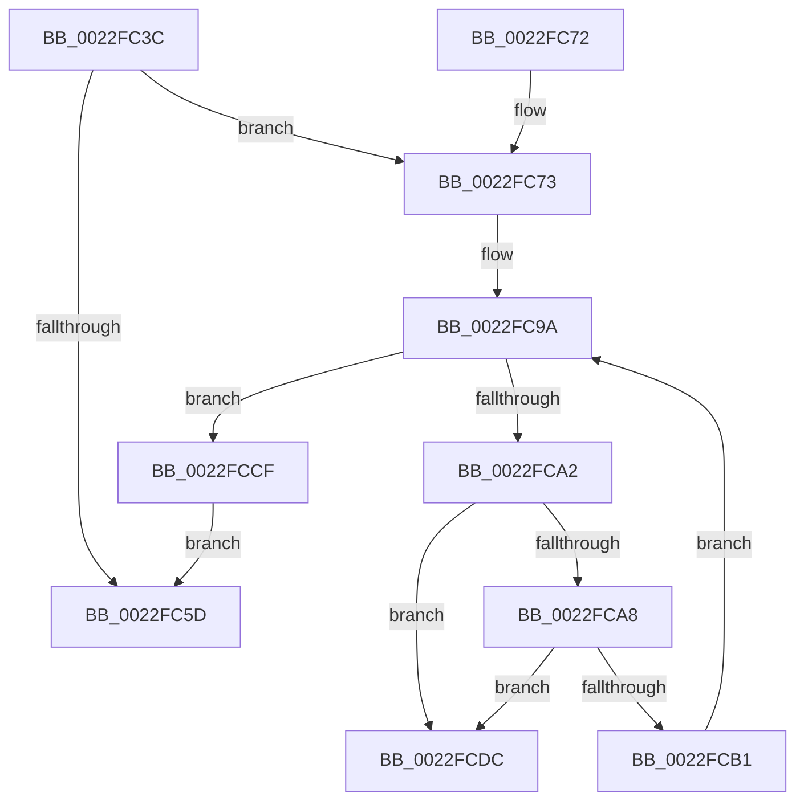

# PspProcessUnbindVirtualizedTimers

- RVA: `0x0022FC3C`–`0x0022FCE3` (길이 `167` bytes)
- VA: `0x000000014022FC3C`
- 실행 섹션: `.text`
- PDB 이름 있음: `예`; PDB Function 태그: `아니요`
- unwind 정보 RVA: `0x000601DC`
- 디코드: `45`개 명령, `167/167` bytes 표시
- 미해석 바이트: `0` (있으면 어셈블리에 `.byte`로 보존)

> 이 문서는 커널 이미지의 기계어와 PDB 기호를 분석해 생성했습니다. 4번과 5번은 함수 원형과 자료형을 바이너리 사용 방식에서 추정한 C 해석이며 원본 소스 복구 결과는 아닙니다.

## 1. Dependencies

- 직접 호출 지점: **4**; 고유 호출 대상: **4**
- 직접 호출자로 확인된 함수: **1**
- RIP 상대 이미지 참조: **0**

### Outgoing calls
- `0x0022FC7D` → [KeAcquireSpinLockRaiseToDpc](../20/KeAcquireSpinLockRaiseToDpc_function_00208470.md) (function, `0x00208470`)
- `0x0022FCBB` → [ExRemoveVirtualizedTimer](ExRemoveVirtualizedTimer_function_0022FCEC.md) (function, `0x0022FCEC`)
- `0x0022FCC8` → [ObfDereferenceObjectWithTag](../2F/ObfDereferenceObjectWithTag_function_002F78E0.md) (function, `0x002F78E0`)
- `0x0022FCD5` → [KeReleaseSpinLock](../39/KeReleaseSpinLock_function_00392BA0.md) (function, `0x00392BA0`)

### Direct callers
- [PspExitProcess](../../page/90/PspExitProcess_function_00904830.md) at `0x00904905`

### Static image references
- 디코드된 RIP-relative 메모리 참조가 없습니다.

## 2. Other-region calls and transfers

- 다른 실행 섹션으로 향하는 call: **0**
- 별도 외부 분기/꼬리 이동을 확인하지 못했습니다.

## 3. Assembly (complete function range)

```asm
0022FC3C  48 89 5C 24 08                  mov qword ptr [rsp + 8], rbx
0022FC41  48 89 6C 24 10                  mov qword ptr [rsp + 0x10], rbp
0022FC46  48 89 74 24 18                  mov qword ptr [rsp + 0x18], rsi
0022FC4B  57                              push rdi
0022FC4C  48 83 EC 20                     sub rsp, 0x20
0022FC50  8B 81 88 00 00 00               mov eax, dword ptr [rcx + 0x88]
0022FC56  48 8B D9                        mov rbx, rcx
0022FC59  A8 10                           test al, 0x10
0022FC5B  75 16                           jne 0x14022fc73
0022FC5D  48 8B 5C 24 30                  mov rbx, qword ptr [rsp + 0x30]
0022FC62  48 8B 6C 24 38                  mov rbp, qword ptr [rsp + 0x38]
0022FC67  48 8B 74 24 40                  mov rsi, qword ptr [rsp + 0x40]
0022FC6C  48 83 C4 20                     add rsp, 0x20
0022FC70  5F                              pop rdi
0022FC71  C3                              ret
0022FC72  CC                              int3
0022FC73  48 8D B9 08 07 00 00            lea rdi, [rcx + 0x708]
0022FC7A  48 8B CF                        mov rcx, rdi
0022FC7D  E8 EE 87 FD FF                  call 0x140208470
0022FC82  48 BD 08 00 00 00 80 F7 FF FF   movabs rbp, 0xfffff78000000008
0022FC8C  40 8A F0                        mov sil, al
0022FC8F  48 81 C3 10 07 00 00            add rbx, 0x710
0022FC96  48 8B 6D 00                     mov rbp, qword ptr [rbp]
0022FC9A  48 8B 0B                        mov rcx, qword ptr [rbx]
0022FC9D  48 3B CB                        cmp rcx, rbx
0022FCA0  74 2D                           je 0x14022fccf
0022FCA2  48 39 59 08                     cmp qword ptr [rcx + 8], rbx
0022FCA6  75 34                           jne 0x14022fcdc
0022FCA8  48 8B 01                        mov rax, qword ptr [rcx]
0022FCAB  48 39 48 08                     cmp qword ptr [rax + 8], rcx
0022FCAF  75 2B                           jne 0x14022fcdc
0022FCB1  48 89 03                        mov qword ptr [rbx], rax
0022FCB4  48 8B D5                        mov rdx, rbp
0022FCB7  48 89 58 08                     mov qword ptr [rax + 8], rbx
0022FCBB  E8 2C 00 00 00                  call 0x14022fcec
0022FCC0  BA 50 73 56 54                  mov edx, 0x54567350
0022FCC5  48 8B C8                        mov rcx, rax
0022FCC8  E8 13 7C 0C 00                  call 0x1402f78e0
0022FCCD  EB CB                           jmp 0x14022fc9a
0022FCCF  40 8A D6                        mov dl, sil
0022FCD2  48 8B CF                        mov rcx, rdi
0022FCD5  E8 C6 2E 16 00                  call 0x140392ba0
0022FCDA  EB 81                           jmp 0x14022fc5d
0022FCDC  B9 03 00 00 00                  mov ecx, 3
0022FCE1  CD 29                           int 0x29
```

## 4. C-style interpretation (structured pseudocode)

```c
__int64 __fastcall PspProcessUnbindVirtualizedTimers(__int64 a1)
{
    __int64 result;
    __int64 v_rbx;
    __int64 v_rsp;
    unsigned __int64 v_stack_p10;
    unsigned __int64 v_stack_p18;
    unsigned __int64 v_stack_p8;

    v_stack_p8 = v_rbx;
    v_stack_p10 = v_rbp;
    v_stack_p18 = v_rsi;
    v_rsp = (v_rsp) - (32);
    if ((((unsigned __int8)((unsigned int)(*(unsigned int *)(a1 + 136)))) & (16)) != 0) goto loc_0022FC73;
loc_0022FC5D:
    v_rsp = (v_rsp) + (32);
    return (unsigned int)(*(unsigned int *)(a1 + 136));
loc_0022FC73:
    result = KeAcquireSpinLockRaiseToDpc(a1 + 1800, a2, a3, a4);
    v_rbx = (v_stack_p8) + (0x710ULL);
loc_0022FC9A:
    if ((*(unsigned __int64 *)(v_rbx)) == v_rbx) goto loc_0022FCCF;
    if ((*(unsigned __int64 *)(*(unsigned __int64 *)(v_rbx) + 8)) != v_rbx) goto loc_0022FCDC;
    if ((*(unsigned __int64 *)(*(unsigned __int64 *)(*(unsigned __int64 *)(v_rbx)) + 8)) != (*(unsigned __int64 *)(v_rbx))) goto loc_0022FCDC;
    *(unsigned __int64 *)(v_rbx) = *(unsigned __int64 *)(*(unsigned __int64 *)(v_rbx));
    *(unsigned __int64 *)(*(unsigned __int64 *)(*(unsigned __int64 *)(v_rbx)) + 8) = v_rbx;
    result = ExRemoveVirtualizedTimer(*(unsigned __int64 *)(v_rbx), *(unsigned __int64 *)(v_stack_p10), a3, a4);
    result = ObfDereferenceObjectWithTag(result, (unsigned int)(0x54567350ULL), a3, a4);
    goto loc_0022FC9A;
loc_0022FCCF:
    result = KeReleaseSpinLock(a1 + 1800, (unsigned __int8)((unsigned __int8)(result)), a3, a4);
    goto loc_0022FC5D;
loc_0022FCDC:
    return result;
}
```

## 5. (Beta) C Style

```c
int64_t PspProcessUnbindVirtualizedTimers(void *Arg1)
{
    uint8_t *arg1 = (uint8_t *)Arg1;

    int64_t result;
    int64_t local_rbx;
    int64_t local_rsp;
    uint64_t v_stack_p10;
    uint64_t v_stack_p18;
    uint64_t v_stack_p8;

    v_stack_p8 = local_rbx;
    v_stack_p10 = local_rbp;
    v_stack_p18 = local_rsi;
    local_rsp = (local_rsp) - (32);
    if ((((uint8_t)((uint32_t)(*(uint32_t *)(arg1 + 0x88)))) & (16)) != 0) goto loc_0022FC73;
loc_0022FC5D:
    local_rsp = (local_rsp) + (32);
    return (uint32_t)(*(uint32_t *)(arg1 + 0x88));
loc_0022FC73:
    result = KeAcquireSpinLockRaiseToDpc(Arg1 + 1800, a2, a3, a4);
    local_rbx = (v_stack_p8) + (0x710ULL);
loc_0022FC9A:
    if ((*(uint64_t *)(local_rbx)) == local_rbx) goto loc_0022FCCF;
    if ((*(uint64_t *)(*(uint64_t *)(local_rbx) + 0x8)) != local_rbx) goto loc_0022FCDC;
    if ((*(uint64_t *)(*(uint64_t *)(*(uint64_t *)(local_rbx)) + 0x8)) != (*(uint64_t *)(local_rbx))) goto loc_0022FCDC;
    *(uint64_t *)(local_rbx) = *(uint64_t *)(*(uint64_t *)(local_rbx));
    *(uint64_t *)(*(uint64_t *)(*(uint64_t *)(local_rbx)) + 0x8) = local_rbx;
    result = ExRemoveVirtualizedTimer(*(uint64_t *)(local_rbx), *(uint64_t *)(v_stack_p10), a3, a4);
    result = ObfDereferenceObjectWithTag(result, (uint32_t)(0x54567350ULL), a3, a4);
    goto loc_0022FC9A;
loc_0022FCCF:
    result = KeReleaseSpinLock(Arg1 + 1800, (uint8_t)((uint8_t)(result)), a3, a4);
    goto loc_0022FC5D;
loc_0022FCDC:
    return result;
}
```

### 관측된 메모리 오프셋

구조체 형식이 확인되지 않은 접근은 인자 기준의 오프셋으로만 기록했습니다.

| 기준 인자 | 오프셋 표현 | 폭 (bit) | 접근 |
|---|---:|---:|---|
| `Arg1` | `+ 0x0` | `64` | `R` |
| `Arg1` | `+ 0x0` | `64` | `W` |
| `Arg1` | `+ 0x88` | `32` | `R` |
| `Arg1` | `+ 0x708` | `64` | `R` |

## 6. Execution-region graph

[열기: 2D/3D 그래프와 함수 탐색 컨트롤 패널](../../../control-panel.html?section=text&rva=0x0022FC3C&view=graph)

- 2D 그래프는 위에서 아래로 흐르고, 3D 그래프는 빈 공간을 드래그해 회전합니다. Shift+드래그는 이동, 휠은 확대·축소, 함수 노드 선택은 대상 보고서 이동입니다.

### Static fallback


