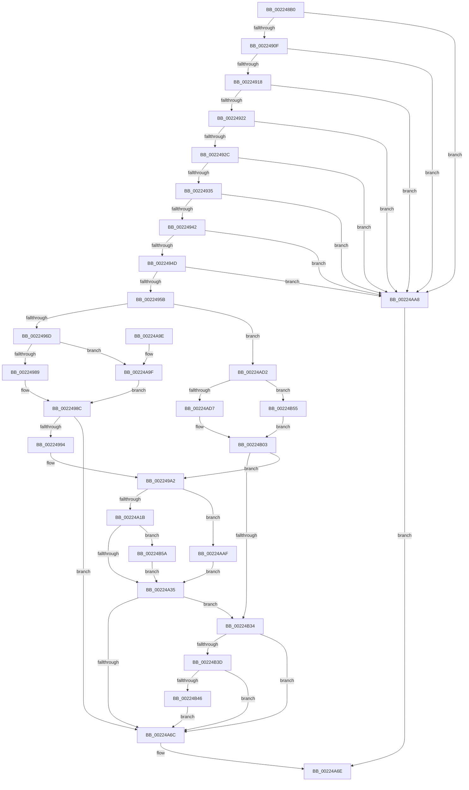

# SeReportSecurityEventWithSubCategory

- RVA: `0x002248B0`–`0x00224B66` (길이 `694` bytes)
- VA: `0x00000001402248B0`
- 실행 섹션: `.text`
- PDB 이름 있음: `예`; PDB Function 태그: `아니요`
- unwind 정보 RVA: `0x0005F95C`
- 디코드: `165`개 명령, `694/694` bytes 표시
- 미해석 바이트: `0` (있으면 어셈블리에 `.byte`로 보존)

> 이 문서는 커널 이미지의 기계어와 PDB 기호를 분석해 생성했습니다. 4번과 5번은 함수 원형과 자료형을 바이너리 사용 방식에서 추정한 C 해석이며 원본 소스 복구 결과는 아닙니다.

## 1. Dependencies

- 직접 호출 지점: **7**; 고유 호출 대상: **7**
- 직접 호출자로 확인된 함수: **2**
- RIP 상대 이미지 참조: **4**

### Outgoing calls
- `0x002249AF` → [memset](../6C/memset_function_006C6C40.md) (function, `0x006C6C40`)
- `0x00224A4F` → [memcpy](../6C/memcpy_function_006C6840.md) (function, `0x006C6840`)
- `0x00224A5D` → [SepAdtLogAuditRecord](SepAdtLogAuditRecord_function_00224B6C.md) (function, `0x00224B6C`)
- `0x00224A78` → [_security_check_cookie](../6A/_security_check_cookie_function_006AC640.md) (function, `0x006AC640`)
- `0x00224ADC` → [SeCaptureSubjectContext](../../page/86/SeCaptureSubjectContext_function_0086B820.md) (function, `0x0086B820`)
- `0x00224B27` → [SepAdtAuditThisEventWithContext](../../page/87/SepAdtAuditThisEventWithContext_function_00870AC0.md) (function, `0x00870AC0`)
- `0x00224B4B` → [SeReleaseSubjectContext](../../page/86/SeReleaseSubjectContext_function_0086B710.md) (function, `0x0086B710`)

### Direct callers
- [SeReportSecurityEvent](../60/SeReportSecurityEvent_function_006093F0.md) at `0x00609408`
- [CmpReportAuditVirtualizationEvent](../../page/7E/CmpReportAuditVirtualizationEvent_function_007ED758.md) at `0x007ED98D`

### Static image references
- `0x002248D6` → RVA `0x00E0A740` (`.data`; read)
- `0x00224978` → RVA `0x00F04AE0` (`.data`; read)
- `0x00224994` → RVA `0x00E67D58` (`.data`; read)
- `0x002249F5` → RVA `0x000013A8` (`.rdata`; read)

## 2. Other-region calls and transfers

- 다른 실행 섹션으로 향하는 call: **3**
  - `0x00224ADC` → [SeCaptureSubjectContext](../../page/86/SeCaptureSubjectContext_function_0086B820.md) (`.text` → `PAGE`)
  - `0x00224B27` → [SepAdtAuditThisEventWithContext](../../page/87/SepAdtAuditThisEventWithContext_function_00870AC0.md) (`.text` → `PAGE`)
  - `0x00224B4B` → [SeReleaseSubjectContext](../../page/86/SeReleaseSubjectContext_function_0086B710.md) (`.text` → `PAGE`)
- 별도 외부 분기/꼬리 이동을 확인하지 못했습니다.

## 3. Assembly (complete function range)

```asm
002248B0  48 8B C4                        mov rax, rsp
002248B3  48 89 58 08                     mov qword ptr [rax + 8], rbx
002248B7  48 89 70 10                     mov qword ptr [rax + 0x10], rsi
002248BB  48 89 78 18                     mov qword ptr [rax + 0x18], rdi
002248BF  55                              push rbp
002248C0  41 54                           push r12
002248C2  41 55                           push r13
002248C4  41 56                           push r14
002248C6  41 57                           push r15
002248C8  48 8D A8 68 FC FF FF            lea rbp, [rax - 0x398]
002248CF  48 81 EC 70 04 00 00            sub rsp, 0x470
002248D6  48 8B 05 63 5E BE 00            mov rax, qword ptr [rip + 0xbe5e63]
002248DD  48 33 C4                        xor rax, rsp
002248E0  48 89 85 60 03 00 00            mov qword ptr [rbp + 0x360], rax
002248E7  44 8B BD C0 03 00 00            mov r15d, dword ptr [rbp + 0x3c0]
002248EE  0F 57 C0                        xorps xmm0, xmm0
002248F1  4D 8B F0                        mov r14, r8
002248F4  49 8B F1                        mov rsi, r9
002248F7  45 33 C0                        xor r8d, r8d
002248FA  48 8B DA                        mov rbx, rdx
002248FD  0F 11 44 24 20                  movups xmmword ptr [rsp + 0x20], xmm0
00224902  0F 11 44 24 30                  movups xmmword ptr [rsp + 0x30], xmm0
00224907  85 C9                           test ecx, ecx
00224909  0F 85 99 01 00 00               jne 0x140224aa8
0022490F  48 85 D2                        test rdx, rdx
00224912  0F 84 90 01 00 00               je 0x140224aa8
00224918  4C 39 42 08                     cmp qword ptr [rdx + 8], r8
0022491C  0F 84 86 01 00 00               je 0x140224aa8
00224922  66 44 39 02                     cmp word ptr [rdx], r8w
00224926  0F 84 7C 01 00 00               je 0x140224aa8
0022492C  4D 85 C9                        test r9, r9
0022492F  0F 84 73 01 00 00               je 0x140224aa8
00224935  41 8D 47 9C                     lea eax, [r15 - 0x64]
00224939  83 F8 3B                        cmp eax, 0x3b
0022493C  0F 87 66 01 00 00               ja 0x140224aa8
00224942  41 83 79 08 1C                  cmp dword ptr [r9 + 8], 0x1c
00224947  0F 87 5B 01 00 00               ja 0x140224aa8
0022494D  41 0F B7 49 12                  movzx ecx, word ptr [r9 + 0x12]
00224952  F6 C1 18                        test cl, 0x18
00224955  0F 84 4D 01 00 00               je 0x140224aa8
0022495B  45 0F 20 C5                     mov r13, cr8
0022495F  45 8D 60 10                     lea r12d, [r8 + 0x10]
00224963  41 80 FD 02                     cmp r13b, 2
00224967  0F 82 65 01 00 00               jb 0x140224ad2
0022496D  41 8D 57 9C                     lea edx, [r15 - 0x64]
00224971  48 03 D2                        add rdx, rdx
00224974  45 8D 60 08                     lea r12d, [r8 + 8]
00224978  48 8D 05 61 01 CE 00            lea rax, [rip + 0xce0161]
0022497F  66 41 3B CC                     cmp cx, r12w
00224983  0F 85 16 01 00 00               jne 0x140224a9f
00224989  8A 0C 02                        mov cl, byte ptr [rdx + rax]
0022498C  84 C9                           test cl, cl
0022498E  0F 84 D8 00 00 00               je 0x140224a6c
00224994  48 8B 3D BD 33 C4 00            mov rdi, qword ptr [rip + 0xc433bd]
0022499B  4D 85 F6                        test r14, r14
0022499E  49 0F 45 FE                     cmovne rdi, r14
002249A2  33 D2                           xor edx, edx
002249A4  48 8D 4C 24 40                  lea rcx, [rsp + 0x40]
002249A9  41 B8 18 04 00 00               mov r8d, 0x418
002249AF  E8 8C 22 4A 00                  call 0x1406c6c40
002249B4  8B 06                           mov eax, dword ptr [rsi]
002249B6  B9 01 00 00 00                  mov ecx, 1
002249BB  8B 56 04                        mov edx, dword ptr [rsi + 4]
002249BE  89 44 24 40                     mov dword ptr [rsp + 0x40], eax
002249C2  0F B7 46 12                     movzx eax, word ptr [rsi + 0x12]
002249C6  66 89 44 24 52                  mov word ptr [rsp + 0x52], ax
002249CB  44 8D 41 01                     lea r8d, [rcx + 1]
002249CF  0F B6 47 01                     movzx eax, byte ptr [rdi + 1]
002249D3  89 54 24 44                     mov dword ptr [rsp + 0x44], edx
002249D7  66 44 89 7C 24 50               mov word ptr [rsp + 0x50], r15w
002249DD  C7 44 24 58 04 00 00 00         mov dword ptr [rsp + 0x58], 4
002249E5  48 89 7C 24 70                  mov qword ptr [rsp + 0x70], rdi
002249EA  8D 04 85 08 00 00 00            lea eax, [rax*4 + 8]
002249F1  89 44 24 5C                     mov dword ptr [rsp + 0x5c], eax
002249F5  48 8D 05 AC C9 DD FF            lea rax, [rip - 0x223654]
002249FC  48 89 45 90                     mov qword ptr [rbp - 0x70], rax
00224A00  89 4C 24 78                     mov dword ptr [rsp + 0x78], ecx
00224A04  C7 44 24 7C 20 00 00 00         mov dword ptr [rsp + 0x7c], 0x20
00224A0C  44 89 44 24 48                  mov dword ptr [rsp + 0x48], r8d
00224A11  41 83 FF 7B                     cmp r15d, 0x7b
00224A15  0F 84 94 00 00 00               je 0x140224aaf
00224A1B  8B 44 24 54                     mov eax, dword ptr [rsp + 0x54]
00224A1F  41 8B C8                        mov ecx, r8d
00224A22  41 0B C4                        or eax, r12d
00224A25  89 44 24 54                     mov dword ptr [rsp + 0x54], eax
00224A29  81 FA FF 05 00 00               cmp edx, 0x5ff
00224A2F  0F 82 25 01 00 00               jb 0x140224b5a
00224A35  8B 5E 08                        mov ebx, dword ptr [rsi + 8]
00224A38  48 8D 44 24 58                  lea rax, [rsp + 0x58]
00224A3D  48 C1 E1 05                     shl rcx, 5
00224A41  48 8D 56 18                     lea rdx, [rsi + 0x18]
00224A45  44 8B C3                        mov r8d, ebx
00224A48  48 03 C8                        add rcx, rax
00224A4B  49 C1 E0 05                     shl r8, 5
00224A4F  E8 EC 1D 4A 00                  call 0x1406c6840
00224A54  01 5C 24 48                     add dword ptr [rsp + 0x48], ebx
00224A58  48 8D 4C 24 40                  lea rcx, [rsp + 0x40]
00224A5D  E8 0A 01 00 00                  call 0x140224b6c
00224A62  41 80 FD 02                     cmp r13b, 2
00224A66  0F 82 C8 00 00 00               jb 0x140224b34
00224A6C  33 C0                           xor eax, eax
00224A6E  48 8B 8D 60 03 00 00            mov rcx, qword ptr [rbp + 0x360]
00224A75  48 33 CC                        xor rcx, rsp
00224A78  E8 C3 7B 48 00                  call 0x1406ac640
00224A7D  4C 8D 9C 24 70 04 00 00         lea r11, [rsp + 0x470]
00224A85  49 8B 5B 30                     mov rbx, qword ptr [r11 + 0x30]
00224A89  49 8B 73 38                     mov rsi, qword ptr [r11 + 0x38]
00224A8D  49 8B 7B 40                     mov rdi, qword ptr [r11 + 0x40]
00224A91  49 8B E3                        mov rsp, r11
00224A94  41 5F                           pop r15
00224A96  41 5E                           pop r14
00224A98  41 5D                           pop r13
00224A9A  41 5C                           pop r12
00224A9C  5D                              pop rbp
00224A9D  C3                              ret
00224A9E  CC                              int3
00224A9F  8A 4C 02 01                     mov cl, byte ptr [rdx + rax + 1]
00224AA3  E9 E4 FE FF FF                  jmp 0x14022498c
00224AA8  B8 0D 00 00 C0                  mov eax, 0xc000000d
00224AAD  EB BF                           jmp 0x140224a6e
00224AAF  83 4C 24 54 06                  or dword ptr [rsp + 0x54], 6
00224AB4  0F B7 03                        movzx eax, word ptr [rbx]
00224AB7  89 4D 98                        mov dword ptr [rbp - 0x68], ecx
00224ABA  83 C0 10                        add eax, 0x10
00224ABD  B9 03 00 00 00                  mov ecx, 3
00224AC2  89 45 9C                        mov dword ptr [rbp - 0x64], eax
00224AC5  48 89 5D B0                     mov qword ptr [rbp - 0x50], rbx
00224AC9  89 4C 24 48                     mov dword ptr [rsp + 0x48], ecx
00224ACD  E9 63 FF FF FF                  jmp 0x140224a35
00224AD2  4D 85 F6                        test r14, r14
00224AD5  75 7E                           jne 0x140224b55
00224AD7  48 8D 4C 24 20                  lea rcx, [rsp + 0x20]
00224ADC  E8 3F 6D 64 00                  call 0x14086b820
00224AE1  48 8B 44 24 20                  mov rax, qword ptr [rsp + 0x20]
00224AE6  45 33 C0                        xor r8d, r8d
00224AE9  48 8B 4C 24 30                  mov rcx, qword ptr [rsp + 0x30]
00224AEE  48 85 C0                        test rax, rax
00224AF1  48 0F 45 C8                     cmovne rcx, rax
00224AF5  48 8B 81 98 00 00 00            mov rax, qword ptr [rcx + 0x98]
00224AFC  0F B7 4E 12                     movzx ecx, word ptr [rsi + 0x12]
00224B00  48 8B 38                        mov rdi, qword ptr [rax]
00224B03  49 3B FE                        cmp rdi, r14
00224B06  4C 8D 4C 24 20                  lea r9, [rsp + 0x20]
00224B0B  4D 0F 44 C8                     cmove r9, r8
00224B0F  66 41 3B CC                     cmp cx, r12w
00224B13  41 BC 08 00 00 00               mov r12d, 8
00224B19  41 0F 94 C0                     sete r8b
00224B1D  66 41 3B CC                     cmp cx, r12w
00224B21  41 8B CF                        mov ecx, r15d
00224B24  0F 94 C2                        sete dl
00224B27  E8 94 BF 64 00                  call 0x140870ac0
00224B2C  84 C0                           test al, al
00224B2E  0F 85 6E FE FF FF               jne 0x1402249a2
00224B34  48 85 FF                        test rdi, rdi
00224B37  0F 84 2F FF FF FF               je 0x140224a6c
00224B3D  49 3B FE                        cmp rdi, r14
00224B40  0F 84 26 FF FF FF               je 0x140224a6c
00224B46  48 8D 4C 24 20                  lea rcx, [rsp + 0x20]
00224B4B  E8 C0 6B 64 00                  call 0x14086b710
00224B50  E9 17 FF FF FF                  jmp 0x140224a6c
00224B55  49 8B FE                        mov rdi, r14
00224B58  EB A9                           jmp 0x140224b03
00224B5A  41 0B C0                        or eax, r8d
00224B5D  89 44 24 54                     mov dword ptr [rsp + 0x54], eax
00224B61  E9 CF FE FF FF                  jmp 0x140224a35
```

## 4. C-style interpretation (structured pseudocode)

```c
__int64 __fastcall SeReportSecurityEventWithSubCategory(int a1, __int64 a2, __int64 a3, __int64 a4)
{
    __int64 result;
    __int64 v_rdi;
    __int64 v_rsp;
    unsigned __int64 v_stack_m28;
    unsigned int v_stack_m41C;
    unsigned int v_stack_m420;
    unsigned __int64 v_stack_m428;
    unsigned int v_stack_m43C;
    unsigned int v_stack_m440;
    unsigned int v_stack_m444;
    unsigned __int16 v_stack_m446;
    unsigned __int16 v_stack_m448;
    unsigned int v_stack_m450;
    unsigned int v_stack_m454;
    unsigned __int64 v_stack_m458;
    unsigned __int64 v_stack_m468;
    unsigned __int64 v_stack_m478;

    *(unsigned __int64 *)(v_rsp + 8) = v_rbx;
    *(unsigned __int64 *)(v_rsp + 16) = v_rsi;
    *(unsigned __int64 *)(v_rsp + 24) = v_rdi;
    v_rsp = (v_rsp) - (0x470ULL);
    result = (*(unsigned __int64 *)(v_rip + 12476003)) ^ (v_rsp);
    *(unsigned __int64 *)(v_rsp - 920 + 864) = result;
    a3 = 0;
    v_stack_m478 = v_xmm0;
    v_stack_m468 = v_xmm0;
    if (a1 != 0) goto loc_00224AA8;
    if (a2 == 0) goto loc_00224AA8;
    if ((*(unsigned __int64 *)(a2 + 8)) == 0) goto loc_00224AA8;
    if ((*(unsigned __int16 *)(a2)) == 0) goto loc_00224AA8;
    if (a4 == 0) goto loc_00224AA8;
    if (((unsigned int)((unsigned int)(*(unsigned int *)(v_rsp - 920 + 960)) - 100)) > 59) goto loc_00224AA8;
    if ((*(unsigned int *)(a4 + 8)) > 28) goto loc_00224AA8;
    if ((((unsigned __int8)(*(unsigned __int16 *)(a4 + 18))) & (24)) == 0) goto loc_00224AA8;
    if (((unsigned __int8)(v_cr8)) < 2) goto loc_00224AD2;
    a2 = ((unsigned int)(*(unsigned int *)(v_rsp - 920 + 960)) - 100) + ((unsigned int)(*(unsigned int *)(v_rsp - 920 + 960)) - 100);
    if (((unsigned __int16)(*(unsigned __int16 *)(a4 + 18))) != ((unsigned __int16)(a3 + 8))) goto loc_00224A9F;
loc_0022498C:
    if ((unsigned __int8)(*(unsigned __int8 *)(a2 + v_rip + 13500769 * 1)) == 0) goto loc_00224A6C;
    v_rdi = *(unsigned __int64 *)(v_rip + 12858301);
    if (0 != 0) { v_rdi = 0; }
loc_002249A2:
    a2 = 0;
    result = memset(v_stack_m458, a2, (unsigned int)(0x418ULL), a4);
    v_stack_m458 = (unsigned int)((unsigned int)(*(unsigned int *)(a4)));
    v_stack_m446 = (unsigned __int16)(*(unsigned __int16 *)(a4 + 18));
    v_stack_m454 = (unsigned int)((unsigned int)(*(unsigned int *)(a4 + 4)));
    v_stack_m448 = (unsigned __int16)((unsigned int)(*(unsigned int *)(v_rsp - 920 + 960)));
    v_stack_m440 = 4;
    v_stack_m428 = v_rdi;
    v_stack_m43C = (unsigned int)(*(unsigned __int8 *)(v_rdi + 1) * 4 + 8);
    *(unsigned __int64 *)(v_rsp - 920 - 112) = v_rip - 2242132;
    v_stack_m420 = 1;
    v_stack_m41C = 32;
    v_stack_m450 = (unsigned int)(1 + 1);
    if (((unsigned int)((unsigned int)(*(unsigned int *)(v_rsp - 920 + 960)))) == 123) goto loc_00224AAF;
    result = (unsigned int)(((unsigned int)(v_stack_m444)) | ((unsigned int)(a3 + 8)));
    v_stack_m444 = (unsigned int)(result);
    if (((unsigned int)((unsigned int)(*(unsigned int *)(a4 + 4)))) < 0x5FFULL) goto loc_00224B5A;
loc_00224A35:
    a1 = ((unsigned int)((unsigned int)(1 + 1))) << (5);
    a1 = (a1) + (v_stack_m440);
    a3 = ((unsigned int)((unsigned int)((unsigned int)(*(unsigned int *)(a4 + 8))))) << (5);
    result = memcpy(a1, a4 + 24, a3, a4);
    result = SepAdtLogAuditRecord(v_stack_m458, a4 + 24, a3, a4);
    if (((unsigned __int8)(v_cr8)) < 2) goto loc_00224B34;
loc_00224A6C:
    result = 0;
loc_00224A6E:
    a1 = (*(unsigned __int64 *)(v_rsp - 920 + 864)) ^ (v_rsp);
    result = _security_check_cookie(a1, a4 + 24, a3, a4);
    return result;
loc_00224A9F:
    goto loc_0022498C;
loc_00224AA8:
    goto loc_00224A6E;
loc_00224AAF:
    *(unsigned int *)(v_rsp - 920 - 104) = (unsigned int)(*(unsigned __int8 *)(a4 + 24 + result * 1 + 1));
    result = (unsigned int)((*(unsigned __int16 *)(*(unsigned __int64 *)(v_stack_m28 + 48))) + (16));
    *(unsigned int *)(v_rsp - 920 - 100) = (unsigned int)(result);
    *(unsigned __int64 *)(v_rsp - 920 - 80) = *(unsigned __int64 *)(v_stack_m28 + 48);
    v_stack_m428 = 3;
    goto loc_00224A35;
loc_00224AD2:
    if (a3 != 0) goto loc_00224B55;
    result = SeCaptureSubjectContext(v_stack_m450, a4 + 24, a3, a4);
    a3 = 0;
    a1 = v_stack_m440;
    if (v_stack_m450 != 0) { a1 = v_stack_m450; }
loc_00224B03:
    a4 = v_stack_m450;
    if ((*(unsigned __int64 *)(*(unsigned __int64 *)(a1 + 152))) == 0) { a4 = 0; }
    a3 = (((unsigned __int16)(*(unsigned __int16 *)(*(unsigned __int64 *)(v_stack_m28 + 56) + 18))) == ((unsigned __int16)(a3 + 8))) ? 1 : 0;
    a2 = (((unsigned __int16)(*(unsigned __int16 *)(*(unsigned __int64 *)(v_stack_m28 + 56) + 18))) == 8) ? 1 : 0;
    result = SepAdtAuditThisEventWithContext((unsigned int)((unsigned int)((unsigned int)(*(unsigned int *)(v_rsp - 920 + 960)))), a2, a3, a4);
    if ((unsigned __int8)(result) != 0) goto loc_002249A2;
loc_00224B34:
    if (*(unsigned __int64 *)(*(unsigned __int64 *)(a1 + 152)) == 0) goto loc_00224A6C;
    if ((*(unsigned __int64 *)(*(unsigned __int64 *)(a1 + 152))) == a3) goto loc_00224A6C;
    result = SeReleaseSubjectContext(v_stack_m450, a2, a3, a4);
    goto loc_00224A6C;
loc_00224B55:
    goto loc_00224B03;
loc_00224B5A:
    result = (unsigned int)((result) | ((unsigned int)(a3)));
    v_stack_m41C = (unsigned int)(result);
    goto loc_00224A35;
}
```

## 5. (Beta) C Style

```c
int64_t SeReportSecurityEventWithSubCategory(int32_t Arg1, void *Arg2, int64_t Arg3, void *Arg4)
{
    uint8_t *arg2 = (uint8_t *)Arg2;
    uint8_t *arg4 = (uint8_t *)Arg4;

    int64_t result;
    int64_t local_rdi;
    int64_t local_rsp;
    uint64_t v_stack_m28;
    uint32_t v_stack_m41C;
    uint32_t v_stack_m420;
    uint64_t v_stack_m428;
    uint32_t v_stack_m43C;
    uint32_t v_stack_m440;
    uint32_t v_stack_m444;
    uint16_t v_stack_m446;
    uint16_t v_stack_m448;
    uint32_t v_stack_m450;
    uint32_t v_stack_m454;
    uint64_t v_stack_m458;
    uint64_t v_stack_m468;
    uint64_t v_stack_m478;

    *(uint64_t *)(local_rsp + 0x8) = local_rbx;
    *(uint64_t *)(local_rsp + 0x10) = local_rsi;
    *(uint64_t *)(local_rsp + 0x18) = local_rdi;
    local_rsp = (local_rsp) - (0x470ULL);
    result = (*(uint64_t *)(v_rip + 0xBE5E63)) ^ (local_rsp);
    *(uint64_t *)(local_rsp - 0x398 + 0x360) = result;
    Arg3 = 0;
    v_stack_m478 = v_xmm0;
    v_stack_m468 = v_xmm0;
    if (Arg1 != 0) goto loc_00224AA8;
    if (Arg2 == NULL) goto loc_00224AA8;
    if ((*(uint64_t *)(arg2 + 0x8)) == 0) goto loc_00224AA8;
    if ((*(uint16_t *)(arg2)) == 0) goto loc_00224AA8;
    if (Arg4 == NULL) goto loc_00224AA8;
    if (((uint32_t)((uint32_t)(*(uint32_t *)(local_rsp - 0x398 + 0x3C0)) - 100)) > 59) goto loc_00224AA8;
    if ((*(uint32_t *)(arg4 + 0x8)) > 28) goto loc_00224AA8;
    if ((((uint8_t)(*(uint16_t *)(arg4 + 0x12))) & (24)) == 0) goto loc_00224AA8;
    if (((uint8_t)(v_cr8)) < 2) goto loc_00224AD2;
    Arg2 = ((uint32_t)(*(uint32_t *)(local_rsp - 0x398 + 0x3C0)) - 100) + ((uint32_t)(*(uint32_t *)(local_rsp - 0x398 + 0x3C0)) - 100);
    if (((uint16_t)(*(uint16_t *)(arg4 + 0x12))) != ((uint16_t)(Arg3 + 8))) goto loc_00224A9F;
loc_0022498C:
    if ((uint8_t)(*(uint8_t *)(arg2 + v_rip + 0xCE0161 * 1)) == 0) goto loc_00224A6C;
    local_rdi = *(uint64_t *)(v_rip + 0xC433BD);
    if (0 != 0) { local_rdi = 0; }
loc_002249A2:
    Arg2 = 0;
    result = memset(v_stack_m458, Arg2, (uint32_t)(0x418ULL), Arg4);
    v_stack_m458 = (uint32_t)((uint32_t)(*(uint32_t *)(arg4)));
    v_stack_m446 = (uint16_t)(*(uint16_t *)(arg4 + 0x12));
    v_stack_m454 = (uint32_t)((uint32_t)(*(uint32_t *)(arg4 + 0x4)));
    v_stack_m448 = (uint16_t)((uint32_t)(*(uint32_t *)(local_rsp - 0x398 + 0x3C0)));
    v_stack_m440 = 4;
    v_stack_m428 = local_rdi;
    v_stack_m43C = (uint32_t)(*(uint8_t *)(local_rdi + 0x1) * 4 + 8);
    *(uint64_t *)(local_rsp - 0x398 - 0x70) = v_rip - 2242132;
    v_stack_m420 = 1;
    v_stack_m41C = 32;
    v_stack_m450 = (uint32_t)(1 + 1);
    if (((uint32_t)((uint32_t)(*(uint32_t *)(local_rsp - 0x398 + 0x3C0)))) == 123) goto loc_00224AAF;
    result = (uint32_t)(((uint32_t)(v_stack_m444)) | ((uint32_t)(Arg3 + 8)));
    v_stack_m444 = (uint32_t)(result);
    if (((uint32_t)((uint32_t)(*(uint32_t *)(arg4 + 0x4)))) < 0x5FFULL) goto loc_00224B5A;
loc_00224A35:
    Arg1 = ((uint32_t)((uint32_t)(1 + 1))) << (5);
    Arg1 = (Arg1) + (v_stack_m440);
    Arg3 = ((uint32_t)((uint32_t)((uint32_t)(*(uint32_t *)(arg4 + 0x8))))) << (5);
    result = memcpy(Arg1, Arg4 + 24, Arg3, Arg4);
    result = SepAdtLogAuditRecord(v_stack_m458, Arg4 + 24, Arg3, Arg4);
    if (((uint8_t)(v_cr8)) < 2) goto loc_00224B34;
loc_00224A6C:
    result = 0;
loc_00224A6E:
    Arg1 = (*(uint64_t *)(local_rsp - 0x398 + 0x360)) ^ (local_rsp);
    result = _security_check_cookie(Arg1, Arg4 + 24, Arg3, Arg4);
    return result;
loc_00224A9F:
    goto loc_0022498C;
loc_00224AA8:
    goto loc_00224A6E;
loc_00224AAF:
    *(uint32_t *)(local_rsp - 0x398 - 0x68) = (uint32_t)(*(uint8_t *)(arg4 + 0x18 + result * 1 + 0x1));
    result = (uint32_t)((*(uint16_t *)(*(uint64_t *)(v_stack_m28 + 0x30))) + (16));
    *(uint32_t *)(local_rsp - 0x398 - 0x64) = (uint32_t)(result);
    *(uint64_t *)(local_rsp - 0x398 - 0x50) = *(uint64_t *)(v_stack_m28 + 0x30);
    v_stack_m428 = 3;
    goto loc_00224A35;
loc_00224AD2:
    if (Arg3 != 0) goto loc_00224B55;
    result = SeCaptureSubjectContext(v_stack_m450, Arg4 + 24, Arg3, Arg4);
    Arg3 = 0;
    Arg1 = v_stack_m440;
    if (v_stack_m450 != 0) { Arg1 = v_stack_m450; }
loc_00224B03:
    Arg4 = v_stack_m450;
    if ((*(uint64_t *)(*(uint64_t *)(Arg1 + 0x98))) == 0) { Arg4 = 0; }
    Arg3 = (((uint16_t)(*(uint16_t *)(*(uint64_t *)(v_stack_m28 + 0x38) + 0x12))) == ((uint16_t)(Arg3 + 8))) ? 1 : 0;
    Arg2 = (((uint16_t)(*(uint16_t *)(*(uint64_t *)(v_stack_m28 + 0x38) + 0x12))) == 8) ? 1 : 0;
    result = SepAdtAuditThisEventWithContext((uint32_t)((uint32_t)((uint32_t)(*(uint32_t *)(local_rsp - 0x398 + 0x3C0)))), Arg2, Arg3, Arg4);
    if ((uint8_t)(result) != 0) goto loc_002249A2;
loc_00224B34:
    if (*(uint64_t *)(*(uint64_t *)(Arg1 + 0x98)) == 0) goto loc_00224A6C;
    if ((*(uint64_t *)(*(uint64_t *)(Arg1 + 0x98))) == Arg3) goto loc_00224A6C;
    result = SeReleaseSubjectContext(v_stack_m450, Arg2, Arg3, Arg4);
    goto loc_00224A6C;
loc_00224B55:
    goto loc_00224B03;
loc_00224B5A:
    result = (uint32_t)((result) | ((uint32_t)(Arg3)));
    v_stack_m41C = (uint32_t)(result);
    goto loc_00224A35;
}
```

### 관측된 메모리 오프셋

구조체 형식이 확인되지 않은 접근은 인자 기준의 오프셋으로만 기록했습니다.

| 기준 인자 | 오프셋 표현 | 폭 (bit) | 접근 |
|---|---:|---:|---|
| `Arg2` | `+ 0x0` | `16` | `R` |
| `Arg4` | `+ 0x0` | `32` | `R` |
| `Arg4` | `+ 0x4` | `32` | `R` |
| `Arg4` | `+ 0x8` | `32` | `R` |
| `Arg4` | `+ 0x12` | `16` | `R` |
| `Arg4` | `+ 0x18` | `64` | `R` |

## 6. Execution-region graph

[열기: 2D/3D 그래프와 함수 탐색 컨트롤 패널](../../../control-panel.html?section=text&rva=0x002248B0&view=graph)

- 2D 그래프는 위에서 아래로 흐르고, 3D 그래프는 빈 공간을 드래그해 회전합니다. Shift+드래그는 이동, 휠은 확대·축소, 함수 노드 선택은 대상 보고서 이동입니다.

### Static fallback


