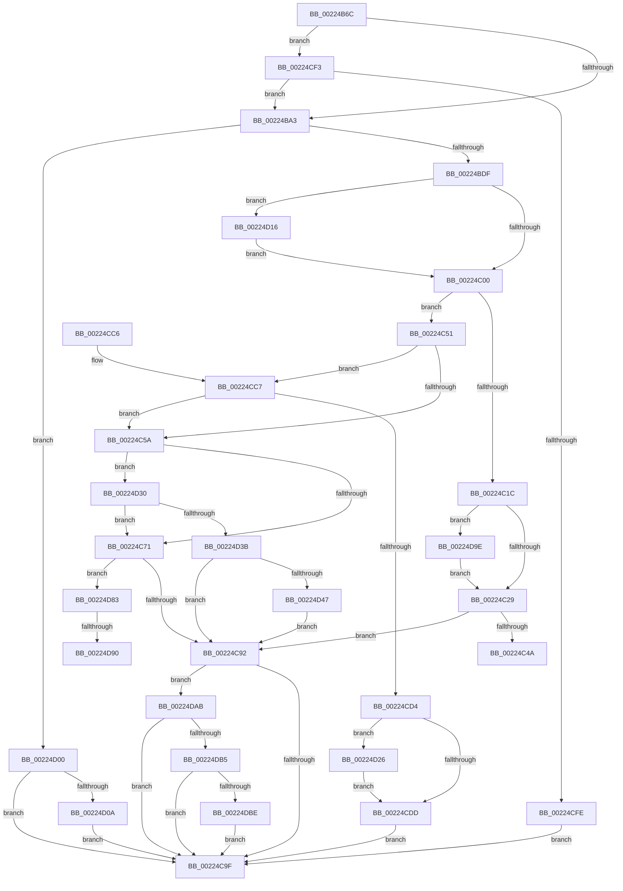

# SepAdtLogAuditRecord

- RVA: `0x00224B6C`–`0x00224DD0` (길이 `612` bytes)
- VA: `0x0000000140224B6C`
- 실행 섹션: `.text`
- PDB 이름 있음: `예`; PDB Function 태그: `예`
- unwind 정보 RVA: `0x0005F988`
- 디코드: `155`개 명령, `612/612` bytes 표시
- 미해석 바이트: `0` (있으면 어셈블리에 `.byte`로 보존)

> 이 문서는 커널 이미지의 기계어와 PDB 기호를 분석해 생성했습니다. 4번과 5번은 함수 원형과 자료형을 바이너리 사용 방식에서 추정한 C 해석이며 원본 소스 복구 결과는 아닙니다.

## 1. Dependencies

- 직접 호출 지점: **17**; 고유 호출 대상: **13**
- 직접 호출자로 확인된 함수: **24**
- RIP 상대 이미지 참조: **8**

### Outgoing calls
- `0x00224BCE` → [ExAllocatePool2](../../poolcode/B8/ExAllocatePool2_function_00B820F0.md) (function, `0x00B820F0`)
- `0x00224BEE` → [PsGetCurrentServerSilo](PsGetCurrentServerSilo_function_00225710.md) (function, `0x00225710`)
- `0x00224C11` → [SepAdtMarshallAuditRecord](SepAdtMarshallAuditRecord_function_00224DD8.md) (function, `0x00224DD8`)
- `0x00224C2E` → [ExFreePoolWithTag](../../poolcode/B8/ExFreePoolWithTag_function_00B82870.md) (function, `0x00B82870`)
- `0x00224C85` → [SepQueueWorkItem](SepQueueWorkItem_function_00225844.md) (function, `0x00225844`)
- `0x00224CA7` → [_security_check_cookie](../6A/_security_check_cookie_function_006AC640.md) (function, `0x006AC640`)
- `0x00224CE2` → [ExFreePoolWithTag](../../poolcode/B8/ExFreePoolWithTag_function_00B82870.md) (function, `0x00B82870`)
- `0x00224CEC` → [ExFreePoolWithTag](../../poolcode/B8/ExFreePoolWithTag_function_00B82870.md) (function, `0x00B82870`)
- `0x00224D0F` → [SepAuditFailedRaisedIrql](../60/SepAuditFailedRaisedIrql_function_0060B894.md) (function, `0x0060B894`)
- `0x00224D1C` → [ObfReferenceObjectWithTag](../21/ObfReferenceObjectWithTag_function_00210710.md) (function, `0x00210710`)
- `0x00224D29` → [ObfDereferenceObjectWithTag](../2F/ObfDereferenceObjectWithTag_function_002F78E0.md) (function, `0x002F78E0`)
- `0x00224D65` → [KeStackAttachProcess](../21/KeStackAttachProcess_function_00216800.md) (function, `0x00216800`)
- `0x00224D6D` → [SepRmDispatchDataToLsa](SepRmDispatchDataToLsa_function_0022395C.md) (function, `0x0022395C`)
- `0x00224D79` → [KiUnstackDetachProcess](../21/KiUnstackDetachProcess_function_00217D30.md) (function, `0x00217D30`)
- `0x00224D93` → [ObfDereferenceObjectWithTag](../2F/ObfDereferenceObjectWithTag_function_002F78E0.md) (function, `0x002F78E0`)
- `0x00224DA1` → [ObfDereferenceObjectWithTag](../2F/ObfDereferenceObjectWithTag_function_002F78E0.md) (function, `0x002F78E0`)
- `0x00224DC6` → [SepAdtLogAuditFailureEvent](../../page/79/SepAdtLogAuditFailureEvent_function_0079F084.md) (function, `0x0079F084`)

### Direct callers
- [SeReportSecurityEventWithSubCategory](SeReportSecurityEventWithSubCategory_function_002248B0.md) at `0x00224A5D`
- [SeAdtRegistryValueChangedAuditAlarm](../../page/79/SeAdtRegistryValueChangedAuditAlarm_function_0079DDD4.md) at `0x0079E2DC`
- [SeAuditBootConfiguration](../../page/79/SeAuditBootConfiguration_function_0079E374.md) at `0x0079E7D3`
- [SeAuditFipsCryptoSelftests](../../page/79/SeAuditFipsCryptoSelftests_function_0079E820.md) at `0x0079E98B`
- [SeAuditProcessExit](../../page/79/SeAuditProcessExit_function_0079EA08.md) at `0x0079EB36`
- [SeAuditSystemTimeChange](../../page/79/SeAuditSystemTimeChange_function_0079EB8C.md) at `0x0079ECEC`
- [SeAuditTransactionStateChange](../../page/79/SeAuditTransactionStateChange_function_0079ED50.md) at `0x0079EF29`
- [SepAdtGenerateDiscardAudit](../../page/79/SepAdtGenerateDiscardAudit_function_0079EF90.md) at `0x0079F043`
- [SepAdtLogAuditFailureEvent](../../page/79/SepAdtLogAuditFailureEvent_function_0079F084.md) at `0x0079F24A`
- [SepAdtObjectReferenceAuditAlarm](../../page/79/SepAdtObjectReferenceAuditAlarm_function_0079F27C.md) at `0x0079F57C`
- [SepAdtOpenObjectForDeleteAuditAlarm](../../page/79/SepAdtOpenObjectForDeleteAuditAlarm_function_0079F5EC.md) at `0x0079F7EE`
- [SepAuditAssignPrimaryToken](../../page/79/SepAuditAssignPrimaryToken_function_0079F828.md) at `0x0079F9DD`
- [SepAdtCloseObjectAuditAlarm](../../page/86/SepAdtCloseObjectAuditAlarm_function_0086B4E8.md) at `0x0086B6D4`
- [SepAdtPrivilegeObjectAuditAlarm](../../page/86/SepAdtPrivilegeObjectAuditAlarm_function_0086E3F0.md) at `0x0086E715`
- [SepAdtPrivilegedServiceAuditAlarm](../../page/87/SepAdtPrivilegedServiceAuditAlarm_function_008714F0.md) at `0x0087178F`
- [SepAdtTokenRightAdjusted](../../page/90/SepAdtTokenRightAdjusted_function_0090445C.md) at `0x00904787`
- [SepAdtSecurityDescriptorChangedAuditAlarm](../../page/91/SepAdtSecurityDescriptorChangedAuditAlarm_function_0091E3E8.md) at `0x0091E5EE`
- [SepAdtDeleteObjectAuditAlarm](../../page/91/SepAdtDeleteObjectAuditAlarm_function_0091E824.md) at `0x0091EA10`
- [SeOperationAuditAlarm](../../page/91/SeOperationAuditAlarm_function_0091EA78.md) at `0x0091EE0A`
- [SepAdtOpenObjectAuditAlarm](../../page/91/SepAdtOpenObjectAuditAlarm_function_0091F23C.md) at `0x0091F732`
- [SeAuditProcessCreation](../../page/94/SeAuditProcessCreation_function_00947624.md) at `0x00947976`
- [SeAuditHardLinkCreationWithTransaction](../../page/A9/SeAuditHardLinkCreationWithTransaction_function_00A90E40.md) at `0x00A90FB1`
- [SeAuditHandleDuplication](../../page/AC/SeAuditHandleDuplication_function_00AC1458.md) at `0x00AC15B5`
- [sub_00B21E9E](../../page/B2/Unknown_function_00B21E9E.md) at `0x00B22232`

### Static image references
- `0x00224B84` → RVA `0x00E0A740` (`.data`; read)
- `0x00224B93` → RVA `0x00F04AC8` (`.data`; read)
- `0x00224C33` → RVA `0x00E0CDCC` (`.data`; write)
- `0x00224C39` → RVA `0x00E67F18` (`.data`; read/write)
- `0x00224C7E` → RVA `0x00E67E30` (`.data`; read)
- `0x00224C92` → RVA `0x00E67F18` (`.data`; read)
- `0x00224D47` → RVA `0x00FD9E48` (`PAGEDATA`; read)
- `0x00224DBE` → RVA `0x00E0CDCC` (`.data`; read)

## 2. Other-region calls and transfers

- 다른 실행 섹션으로 향하는 call: **5**
  - `0x00224BCE` → [ExAllocatePool2](../../poolcode/B8/ExAllocatePool2_function_00B820F0.md) (`.text` → `POOLCODE`)
  - `0x00224C2E` → [ExFreePoolWithTag](../../poolcode/B8/ExFreePoolWithTag_function_00B82870.md) (`.text` → `POOLCODE`)
  - `0x00224CE2` → [ExFreePoolWithTag](../../poolcode/B8/ExFreePoolWithTag_function_00B82870.md) (`.text` → `POOLCODE`)
  - `0x00224CEC` → [ExFreePoolWithTag](../../poolcode/B8/ExFreePoolWithTag_function_00B82870.md) (`.text` → `POOLCODE`)
  - `0x00224DC6` → [SepAdtLogAuditFailureEvent](../../page/79/SepAdtLogAuditFailureEvent_function_0079F084.md) (`.text` → `PAGE`)
- call이 아닌 외부 분기/꼬리 이동: **3**
  - `0x00224C4C` → [sub_006D6AD0 + 0x25](../6D/Unknown_function_006D6AD0.md) (`tail-transfer`)
  - `0x00224D8A` → [sub_006D6AD0](../6D/Unknown_function_006D6AD0.md) (`tail-transfer`)
  - `0x00224D99` → [sub_006D6AD0](../6D/Unknown_function_006D6AD0.md) (`tail-transfer`)

## 3. Assembly (complete function range)

```asm
00224B6C  48 89 5C 24 10                  mov qword ptr [rsp + 0x10], rbx
00224B71  48 89 6C 24 18                  mov qword ptr [rsp + 0x18], rbp
00224B76  48 89 74 24 20                  mov qword ptr [rsp + 0x20], rsi
00224B7B  57                              push rdi
00224B7C  41 55                           push r13
00224B7E  41 56                           push r14
00224B80  48 83 EC 60                     sub rsp, 0x60
00224B84  48 8B 05 B5 5B BE 00            mov rax, qword ptr [rip + 0xbe5bb5]
00224B8B  48 33 C4                        xor rax, rsp
00224B8E  48 89 44 24 58                  mov qword ptr [rsp + 0x58], rax
00224B93  83 3D 2E FF CD 00 00            cmp dword ptr [rip + 0xcdff2e], 0
00224B9A  48 8B F9                        mov rdi, rcx
00224B9D  0F 84 50 01 00 00               je 0x140224cf3
00224BA3  45 0F 20 C6                     mov r14, cr8
00224BA7  BE 01 00 00 00                  mov esi, 1
00224BAC  41 80 FE 02                     cmp r14b, 2
00224BB0  B8 00 01 00 00                  mov eax, 0x100
00224BB5  41 BD 53 65 41 69               mov r13d, 0x69416553
00224BBB  BD 00 02 00 00                  mov ebp, 0x200
00224BC0  45 8B C5                        mov r8d, r13d
00224BC3  0F 45 EE                        cmovne ebp, esi
00224BC6  8D 56 3F                        lea edx, [rsi + 0x3f]
00224BC9  8B CA                           mov ecx, edx
00224BCB  0F 45 C8                        cmovne ecx, eax
00224BCE  E8 1D D5 95 00                  call 0x140b820f0
00224BD3  48 8B D8                        mov rbx, rax
00224BD6  48 85 C0                        test rax, rax
00224BD9  0F 84 21 01 00 00               je 0x140224d00
00224BDF  48 83 60 28 00                  and qword ptr [rax + 0x28], 0
00224BE4  83 60 30 00                     and dword ptr [rax + 0x30], 0
00224BE8  89 70 14                        mov dword ptr [rax + 0x14], esi
00224BEB  89 70 20                        mov dword ptr [rax + 0x20], esi
00224BEE  E8 1D 0B 00 00                  call 0x140225710
00224BF3  48 89 43 38                     mov qword ptr [rbx + 0x38], rax
00224BF7  48 85 C0                        test rax, rax
00224BFA  0F 85 16 01 00 00               jne 0x140224d16
00224C00  48 8D 73 18                     lea rsi, [rbx + 0x18]
00224C04  44 8B CD                        mov r9d, ebp
00224C07  48 8B D6                        mov rdx, rsi
00224C0A  4C 8D 43 10                     lea r8, [rbx + 0x10]
00224C0E  48 8B CF                        mov rcx, rdi
00224C11  E8 C2 01 00 00                  call 0x140224dd8
00224C16  8B E8                           mov ebp, eax
00224C18  85 C0                           test eax, eax
00224C1A  79 35                           jns 0x140224c51
00224C1C  48 8B 4B 38                     mov rcx, qword ptr [rbx + 0x38]
00224C20  48 85 C9                        test rcx, rcx
00224C23  0F 85 75 01 00 00               jne 0x140224d9e
00224C29  33 D2                           xor edx, edx
00224C2B  48 8B CB                        mov rcx, rbx
00224C2E  E8 3D DC 95 00                  call 0x140b82870
00224C33  89 2D 93 81 BE 00               mov dword ptr [rip + 0xbe8193], ebp
00224C39  F0 FF 05 D8 32 C4 00            lock inc dword ptr [rip + 0xc432d8]
00224C40  BE 09 02 00 00                  mov esi, 0x209
00224C45  39 77 04                        cmp dword ptr [rdi + 4], esi
00224C48  74 48                           je 0x140224c92
00224C4A  8B CD                           mov ecx, ebp
00224C4C  E9 A4 1E 4B 00                  jmp 0x1406d6af5
00224C51  83 3D 70 FE CD 00 00            cmp dword ptr [rip + 0xcdfe70], 0
00224C58  74 6D                           je 0x140224cc7
00224C5A  48 8B 06                        mov rax, qword ptr [rsi]
00224C5D  BE 09 02 00 00                  mov esi, 0x209
00224C62  8B 48 0C                        mov ecx, dword ptr [rax + 0xc]
00224C65  89 4B 24                        mov dword ptr [rbx + 0x24], ecx
00224C68  39 77 04                        cmp dword ptr [rdi + 4], esi
00224C6B  0F 84 BF 00 00 00               je 0x140224d30
00224C71  4C 8D 44 24 20                  lea r8, [rsp + 0x20]
00224C76  C6 44 24 20 00                  mov byte ptr [rsp + 0x20], 0
00224C7B  48 8B D3                        mov rdx, rbx
00224C7E  48 8D 0D AB 31 C4 00            lea rcx, [rip + 0xc431ab]
00224C85  E8 BA 0B 00 00                  call 0x140225844
00224C8A  84 C0                           test al, al
00224C8C  0F 84 F1 00 00 00               je 0x140224d83
00224C92  83 3D 7F 32 C4 00 00            cmp dword ptr [rip + 0xc4327f], 0
00224C99  0F 85 0C 01 00 00               jne 0x140224dab
00224C9F  48 8B 4C 24 58                  mov rcx, qword ptr [rsp + 0x58]
00224CA4  48 33 CC                        xor rcx, rsp
00224CA7  E8 94 79 48 00                  call 0x1406ac640
00224CAC  4C 8D 5C 24 60                  lea r11, [rsp + 0x60]
00224CB1  49 8B 5B 28                     mov rbx, qword ptr [r11 + 0x28]
00224CB5  49 8B 6B 30                     mov rbp, qword ptr [r11 + 0x30]
00224CB9  49 8B 73 38                     mov rsi, qword ptr [r11 + 0x38]
00224CBD  49 8B E3                        mov rsp, r11
00224CC0  41 5E                           pop r14
00224CC2  41 5D                           pop r13
00224CC4  5F                              pop rdi
00224CC5  C3                              ret
00224CC6  CC                              int3
00224CC7  48 8B 06                        mov rax, qword ptr [rsi]
00224CCA  44 8B 40 14                     mov r8d, dword ptr [rax + 0x14]
00224CCE  41 F6 C0 02                     test r8b, 2
00224CD2  74 86                           je 0x140224c5a
00224CD4  48 8B 4B 38                     mov rcx, qword ptr [rbx + 0x38]
00224CD8  48 85 C9                        test rcx, rcx
00224CDB  75 49                           jne 0x140224d26
00224CDD  48 8B 0E                        mov rcx, qword ptr [rsi]
00224CE0  33 D2                           xor edx, edx
00224CE2  E8 89 DB 95 00                  call 0x140b82870
00224CE7  33 D2                           xor edx, edx
00224CE9  48 8B CB                        mov rcx, rbx
00224CEC  E8 7F DB 95 00                  call 0x140b82870
00224CF1  EB AC                           jmp 0x140224c9f
00224CF3  8B 41 14                        mov eax, dword ptr [rcx + 0x14]
00224CF6  A8 02                           test al, 2
00224CF8  0F 84 A5 FE FF FF               je 0x140224ba3
00224CFE  EB 9F                           jmp 0x140224c9f
00224D00  BE 09 02 00 00                  mov esi, 0x209
00224D05  39 77 04                        cmp dword ptr [rdi + 4], esi
00224D08  74 95                           je 0x140224c9f
00224D0A  B9 9A 00 00 C0                  mov ecx, 0xc000009a
00224D0F  E8 80 6B 3E 00                  call 0x14060b894
00224D14  EB 89                           jmp 0x140224c9f
00224D16  41 8B D5                        mov edx, r13d
00224D19  48 8B C8                        mov rcx, rax
00224D1C  E8 EF B9 FE FF                  call 0x140210710
00224D21  E9 DA FE FF FF                  jmp 0x140224c00
00224D26  41 8B D5                        mov edx, r13d
00224D29  E8 B2 2B 0D 00                  call 0x1402f78e0
00224D2E  EB AD                           jmp 0x140224cdd
00224D30  8B 47 14                        mov eax, dword ptr [rdi + 0x14]
00224D33  A8 10                           test al, 0x10
00224D35  0F 84 36 FF FF FF               je 0x140224c71
00224D3B  81 F9 D0 01 00 00               cmp ecx, 0x1d0
00224D41  0F 87 4B FF FF FF               ja 0x140224c92
00224D47  48 8B 0D FA 50 DB 00            mov rcx, qword ptr [rip + 0xdb50fa]
00224D4E  48 8D 54 24 28                  lea rdx, [rsp + 0x28]
00224D53  0F 57 C0                        xorps xmm0, xmm0
00224D56  0F 11 44 24 28                  movups xmmword ptr [rsp + 0x28], xmm0
00224D5B  0F 11 44 24 38                  movups xmmword ptr [rsp + 0x38], xmm0
00224D60  0F 11 44 24 48                  movups xmmword ptr [rsp + 0x48], xmm0
00224D65  E8 96 1A FF FF                  call 0x140216800
00224D6A  48 8B CB                        mov rcx, rbx
00224D6D  E8 EA EB FF FF                  call 0x14022395c
00224D72  33 D2                           xor edx, edx
00224D74  48 8D 4C 24 28                  lea rcx, [rsp + 0x28]
00224D79  E8 B2 2F FF FF                  call 0x140217d30
00224D7E  E9 0F FF FF FF                  jmp 0x140224c92
00224D83  48 8B 4B 38                     mov rcx, qword ptr [rbx + 0x38]
00224D87  48 85 C9                        test rcx, rcx
00224D8A  0F 84 40 1D 4B 00               je 0x1406d6ad0
00224D90  41 8B D5                        mov edx, r13d
00224D93  E8 48 2B 0D 00                  call 0x1402f78e0
00224D98  90                              nop
00224D99  E9 32 1D 4B 00                  jmp 0x1406d6ad0
00224D9E  41 8B D5                        mov edx, r13d
00224DA1  E8 3A 2B 0D 00                  call 0x1402f78e0
00224DA6  E9 7E FE FF FF                  jmp 0x140224c29
00224DAB  41 80 FE 02                     cmp r14b, 2
00224DAF  0F 83 EA FE FF FF               jae 0x140224c9f
00224DB5  39 77 04                        cmp dword ptr [rdi + 4], esi
00224DB8  0F 84 E1 FE FF FF               je 0x140224c9f
00224DBE  8B 0D 08 80 BE 00               mov ecx, dword ptr [rip + 0xbe8008]
00224DC4  33 D2                           xor edx, edx
00224DC6  E8 B9 A2 57 00                  call 0x14079f084
00224DCB  E9 CF FE FF FF                  jmp 0x140224c9f
```

## 4. C-style interpretation (structured pseudocode)

```c
__int64 __fastcall SepAdtLogAuditRecord(__int64 a1)
{
    __int64 result;
    __int64 v_rbp;
    __int64 v_rsp;
    unsigned __int64 v_stack_m18;
    unsigned __int64 v_stack_m20;
    unsigned __int64 v_stack_m28;
    unsigned __int64 v_stack_m38;
    unsigned __int64 v_stack_m58;
    unsigned __int64 v_stack_p10;
    unsigned __int64 v_stack_p18;
    unsigned __int64 v_stack_p20;

    v_stack_p10 = v_rbx;
    v_stack_p18 = v_rbp;
    v_stack_p20 = v_rsi;
    v_rsp = (v_rsp) - (96);
    result = (*(unsigned __int64 *)(v_rip + 12475317)) ^ (v_rsp);
    v_stack_m20 = result;
    if ((*(unsigned int *)(v_rip + 13500206)) == 0) goto loc_00224CF3;
loc_00224BA3:
    v_rbp = 512;
    if (((unsigned __int8)(v_cr8)) != 2) { v_rbp = 1; }
    a1 = (unsigned int)((unsigned int)(1 + 63));
    if (((unsigned __int8)(v_cr8)) != 2) { a1 = 256; }
    result = ExAllocatePool2(a1, 1 + 63, (unsigned int)((unsigned int)((unsigned int)(0x69416553ULL))), a4);
    if (result == 0) goto loc_00224D00;
    *(unsigned int *)(result + 20) = 1;
    *(unsigned int *)(result + 32) = 1;
    result = PsGetCurrentServerSilo(a1, 1 + 63, (unsigned int)((unsigned int)((unsigned int)(0x69416553ULL))), a4);
    *(unsigned __int64 *)(result + 56) = result;
    if (result != 0) goto loc_00224D16;
loc_00224C00:
    result = SepAdtMarshallAuditRecord(a1, result + 24, result + 16, (unsigned int)((unsigned int)(v_rbp)));
    if (!sign_flag) goto loc_00224C51;
    if (*(unsigned __int64 *)(result + 56) != 0) goto loc_00224D9E;
loc_00224C29:
    a2 = 0;
    result = ExFreePoolWithTag(result, a2, result + 16, (unsigned int)((unsigned int)(v_rbp)));
    *(unsigned int *)(v_rip + 12485011) = (unsigned int)((unsigned int)((unsigned int)(result)));
    if ((*(unsigned int *)(a1 + 4)) == 521) goto loc_00224C92;
loc_00224C51:
    if ((*(unsigned int *)(v_rip + 13500016)) == 0) goto loc_00224CC7;
loc_00224C5A:
    *(unsigned int *)(result + 36) = (unsigned int)((unsigned int)(*(unsigned int *)(*(unsigned __int64 *)(521) + 12)));
    if ((*(unsigned int *)(a1 + 4)) == 521) goto loc_00224D30;
loc_00224C71:
    v_stack_m58 = 0;
    result = SepQueueWorkItem(v_rip + 12857771, result, v_stack_m58, (unsigned int)((unsigned int)(v_rbp)));
    if ((unsigned __int8)(result) == 0) goto loc_00224D83;
loc_00224C92:
    if ((*(unsigned int *)(v_rip + 12857983)) != 0) goto loc_00224DAB;
loc_00224C9F:
    a1 = (v_stack_m20) ^ (v_rsp);
    result = _security_check_cookie(a1, result, v_stack_m58, (unsigned int)((unsigned int)(v_rbp)));
    return result;
loc_00224CC7:
    if ((((unsigned __int8)((unsigned int)(*(unsigned int *)(*(unsigned __int64 *)(*(unsigned __int64 *)(v_stack_m18 + 56)) + 20)))) & (2)) == 0) goto loc_00224C5A;
    if (*(unsigned __int64 *)(*(unsigned __int64 *)(v_stack_m18 + 40) + 56) != 0) goto loc_00224D26;
loc_00224CDD:
    a2 = 0;
    result = ExFreePoolWithTag(*(unsigned __int64 *)(*(unsigned __int64 *)(v_stack_m18 + 56)), a2, (unsigned int)(*(unsigned int *)(*(unsigned __int64 *)(*(unsigned __int64 *)(v_stack_m18 + 56)) + 20)), (unsigned int)((unsigned int)(v_rbp)));
    a2 = 0;
    result = ExFreePoolWithTag(*(unsigned __int64 *)(v_stack_m18 + 40), a2, (unsigned int)(*(unsigned int *)(*(unsigned __int64 *)(*(unsigned __int64 *)(v_stack_m18 + 56)) + 20)), (unsigned int)((unsigned int)(v_rbp)));
    goto loc_00224C9F;
loc_00224CF3:
    if ((((unsigned __int8)((unsigned int)(*(unsigned int *)(*(unsigned __int64 *)(v_stack_m18 + 40) + 20)))) & (2)) == 0) goto loc_00224BA3;
    goto loc_00224C9F;
loc_00224D00:
    if ((*(unsigned int *)(a1 + 4)) == 521) goto loc_00224C9F;
    result = SepAuditFailedRaisedIrql((unsigned int)(0xC000009AULL), a2, (unsigned int)(*(unsigned int *)(*(unsigned __int64 *)(*(unsigned __int64 *)(v_stack_m18 + 56)) + 20)), (unsigned int)((unsigned int)(v_rbp)));
    goto loc_00224C9F;
loc_00224D16:
    result = ObfReferenceObjectWithTag(result, (unsigned int)((unsigned int)((unsigned int)(0x69416553ULL))), (unsigned int)(*(unsigned int *)(*(unsigned __int64 *)(*(unsigned __int64 *)(v_stack_m18 + 56)) + 20)), (unsigned int)((unsigned int)(v_rbp)));
    goto loc_00224C00;
loc_00224D26:
    result = ObfDereferenceObjectWithTag(result, (unsigned int)((unsigned int)((unsigned int)(0x69416553ULL))), (unsigned int)(*(unsigned int *)(*(unsigned __int64 *)(*(unsigned __int64 *)(v_stack_m18 + 56)) + 20)), (unsigned int)((unsigned int)(v_rbp)));
    goto loc_00224CDD;
loc_00224D30:
    if ((((unsigned __int8)((unsigned int)(*(unsigned int *)(a1 + 20)))) & (16)) == 0) goto loc_00224C71;
    if (((unsigned int)(result)) > 464) goto loc_00224C92;
    v_stack_m38 = v_xmm0;
    v_stack_m28 = v_xmm0;
    v_stack_m18 = v_xmm0;
    result = KeStackAttachProcess(*(unsigned __int64 *)(v_rip + 14373114), v_stack_m38, (unsigned int)(*(unsigned int *)(*(unsigned __int64 *)(*(unsigned __int64 *)(v_stack_m18 + 56)) + 20)), (unsigned int)((unsigned int)(v_rbp)));
    result = SepRmDispatchDataToLsa(*(unsigned __int64 *)(v_stack_m18 + 40), v_stack_m38, (unsigned int)(*(unsigned int *)(*(unsigned __int64 *)(*(unsigned __int64 *)(v_stack_m18 + 56)) + 20)), (unsigned int)((unsigned int)(v_rbp)));
    a2 = 0;
    result = KiUnstackDetachProcess(v_stack_m38, a2, (unsigned int)(*(unsigned int *)(*(unsigned __int64 *)(*(unsigned __int64 *)(v_stack_m18 + 56)) + 20)), (unsigned int)((unsigned int)(v_rbp)));
    goto loc_00224C92;
loc_00224D83:
    result = ObfDereferenceObjectWithTag(*(unsigned __int64 *)(*(unsigned __int64 *)(v_stack_m18 + 40) + 56), (unsigned int)((unsigned int)((unsigned int)(0x69416553ULL))), (unsigned int)(*(unsigned int *)(*(unsigned __int64 *)(*(unsigned __int64 *)(v_stack_m18 + 56)) + 20)), (unsigned int)((unsigned int)(v_rbp)));
loc_00224D9E:
    result = ObfDereferenceObjectWithTag(*(unsigned __int64 *)(*(unsigned __int64 *)(v_stack_m18 + 40) + 56), (unsigned int)((unsigned int)((unsigned int)(0x69416553ULL))), (unsigned int)(*(unsigned int *)(*(unsigned __int64 *)(*(unsigned __int64 *)(v_stack_m18 + 56)) + 20)), (unsigned int)((unsigned int)(v_rbp)));
    goto loc_00224C29;
loc_00224DAB:
    if (((unsigned __int8)(v_cr8)) >= 2) goto loc_00224C9F;
    if ((*(unsigned int *)(a1 + 4)) == 521) goto loc_00224C9F;
    a2 = 0;
    result = SepAdtLogAuditFailureEvent((unsigned int)(*(unsigned int *)(v_rip + 12484616)), a2, (unsigned int)(*(unsigned int *)(*(unsigned __int64 *)(*(unsigned __int64 *)(v_stack_m18 + 56)) + 20)), (unsigned int)((unsigned int)(v_rbp)));
    goto loc_00224C9F;
}
```

## 5. (Beta) C Style

```c
int64_t SepAdtLogAuditRecord(void *Arg1)
{
    uint8_t *arg1 = (uint8_t *)Arg1;

    int64_t result;
    int64_t local_rbp;
    int64_t local_rsp;
    uint64_t v_stack_m18;
    uint64_t v_stack_m20;
    uint64_t v_stack_m28;
    uint64_t v_stack_m38;
    uint64_t v_stack_m58;
    uint64_t v_stack_p10;
    uint64_t v_stack_p18;
    uint64_t v_stack_p20;

    v_stack_p10 = local_rbx;
    v_stack_p18 = local_rbp;
    v_stack_p20 = local_rsi;
    local_rsp = (local_rsp) - (96);
    result = (*(uint64_t *)(v_rip + 0xBE5BB5)) ^ (local_rsp);
    v_stack_m20 = result;
    if ((*(uint32_t *)(v_rip + 0xCDFF2E)) == 0) goto loc_00224CF3;
loc_00224BA3:
    local_rbp = 512;
    if (((uint8_t)(v_cr8)) != 2) { local_rbp = 1; }
    Arg1 = (uint32_t)((uint32_t)(1 + 63));
    if (((uint8_t)(v_cr8)) != 2) { Arg1 = 256; }
    result = ExAllocatePool2(Arg1, 1 + 63, (uint32_t)((uint32_t)((uint32_t)(0x69416553ULL))), a4);
    if (result == 0) goto loc_00224D00;
    *(uint32_t *)(result + 0x14) = 1;
    *(uint32_t *)(result + 0x20) = 1;
    result = PsGetCurrentServerSilo(Arg1, 1 + 63, (uint32_t)((uint32_t)((uint32_t)(0x69416553ULL))), a4);
    *(uint64_t *)(result + 0x38) = result;
    if (result != 0) goto loc_00224D16;
loc_00224C00:
    result = SepAdtMarshallAuditRecord(Arg1, result + 24, result + 16, (uint32_t)((uint32_t)(local_rbp)));
    if (!sign_flag) goto loc_00224C51;
    if (*(uint64_t *)(result + 0x38) != 0) goto loc_00224D9E;
loc_00224C29:
    a2 = 0;
    result = ExFreePoolWithTag(result, a2, result + 16, (uint32_t)((uint32_t)(local_rbp)));
    *(uint32_t *)(v_rip + 0xBE8193) = (uint32_t)((uint32_t)((uint32_t)(result)));
    if ((*(uint32_t *)(arg1 + 0x4)) == 521) goto loc_00224C92;
loc_00224C51:
    if ((*(uint32_t *)(v_rip + 0xCDFE70)) == 0) goto loc_00224CC7;
loc_00224C5A:
    *(uint32_t *)(result + 0x24) = (uint32_t)((uint32_t)(*(uint32_t *)(*(uint64_t *)(521) + 0xC)));
    if ((*(uint32_t *)(arg1 + 0x4)) == 521) goto loc_00224D30;
loc_00224C71:
    v_stack_m58 = 0;
    result = SepQueueWorkItem(v_rip + 12857771, result, v_stack_m58, (uint32_t)((uint32_t)(local_rbp)));
    if ((uint8_t)(result) == 0) goto loc_00224D83;
loc_00224C92:
    if ((*(uint32_t *)(v_rip + 0xC4327F)) != 0) goto loc_00224DAB;
loc_00224C9F:
    Arg1 = (v_stack_m20) ^ (local_rsp);
    result = _security_check_cookie(Arg1, result, v_stack_m58, (uint32_t)((uint32_t)(local_rbp)));
    return result;
loc_00224CC7:
    if ((((uint8_t)((uint32_t)(*(uint32_t *)(*(uint64_t *)(*(uint64_t *)(v_stack_m18 + 0x38)) + 0x14)))) & (2)) == 0) goto loc_00224C5A;
    if (*(uint64_t *)(*(uint64_t *)(v_stack_m18 + 0x28) + 0x38) != 0) goto loc_00224D26;
loc_00224CDD:
    a2 = 0;
    result = ExFreePoolWithTag(*(uint64_t *)(*(uint64_t *)(v_stack_m18 + 0x38)), a2, (uint32_t)(*(uint32_t *)(*(uint64_t *)(*(uint64_t *)(v_stack_m18 + 0x38)) + 0x14)), (uint32_t)((uint32_t)(local_rbp)));
    a2 = 0;
    result = ExFreePoolWithTag(*(uint64_t *)(v_stack_m18 + 0x28), a2, (uint32_t)(*(uint32_t *)(*(uint64_t *)(*(uint64_t *)(v_stack_m18 + 0x38)) + 0x14)), (uint32_t)((uint32_t)(local_rbp)));
    goto loc_00224C9F;
loc_00224CF3:
    if ((((uint8_t)((uint32_t)(*(uint32_t *)(*(uint64_t *)(v_stack_m18 + 0x28) + 0x14)))) & (2)) == 0) goto loc_00224BA3;
    goto loc_00224C9F;
loc_00224D00:
    if ((*(uint32_t *)(arg1 + 0x4)) == 521) goto loc_00224C9F;
    result = SepAuditFailedRaisedIrql((uint32_t)(0xC000009AULL), a2, (uint32_t)(*(uint32_t *)(*(uint64_t *)(*(uint64_t *)(v_stack_m18 + 0x38)) + 0x14)), (uint32_t)((uint32_t)(local_rbp)));
    goto loc_00224C9F;
loc_00224D16:
    result = ObfReferenceObjectWithTag(result, (uint32_t)((uint32_t)((uint32_t)(0x69416553ULL))), (uint32_t)(*(uint32_t *)(*(uint64_t *)(*(uint64_t *)(v_stack_m18 + 0x38)) + 0x14)), (uint32_t)((uint32_t)(local_rbp)));
    goto loc_00224C00;
loc_00224D26:
    result = ObfDereferenceObjectWithTag(result, (uint32_t)((uint32_t)((uint32_t)(0x69416553ULL))), (uint32_t)(*(uint32_t *)(*(uint64_t *)(*(uint64_t *)(v_stack_m18 + 0x38)) + 0x14)), (uint32_t)((uint32_t)(local_rbp)));
    goto loc_00224CDD;
loc_00224D30:
    if ((((uint8_t)((uint32_t)(*(uint32_t *)(arg1 + 0x14)))) & (16)) == 0) goto loc_00224C71;
    if (((uint32_t)(result)) > 464) goto loc_00224C92;
    v_stack_m38 = v_xmm0;
    v_stack_m28 = v_xmm0;
    v_stack_m18 = v_xmm0;
    result = KeStackAttachProcess(*(uint64_t *)(v_rip + 0xDB50FA), v_stack_m38, (uint32_t)(*(uint32_t *)(*(uint64_t *)(*(uint64_t *)(v_stack_m18 + 0x38)) + 0x14)), (uint32_t)((uint32_t)(local_rbp)));
    result = SepRmDispatchDataToLsa(*(uint64_t *)(v_stack_m18 + 0x28), v_stack_m38, (uint32_t)(*(uint32_t *)(*(uint64_t *)(*(uint64_t *)(v_stack_m18 + 0x38)) + 0x14)), (uint32_t)((uint32_t)(local_rbp)));
    a2 = 0;
    result = KiUnstackDetachProcess(v_stack_m38, a2, (uint32_t)(*(uint32_t *)(*(uint64_t *)(*(uint64_t *)(v_stack_m18 + 0x38)) + 0x14)), (uint32_t)((uint32_t)(local_rbp)));
    goto loc_00224C92;
loc_00224D83:
    result = ObfDereferenceObjectWithTag(*(uint64_t *)(*(uint64_t *)(v_stack_m18 + 0x28) + 0x38), (uint32_t)((uint32_t)((uint32_t)(0x69416553ULL))), (uint32_t)(*(uint32_t *)(*(uint64_t *)(*(uint64_t *)(v_stack_m18 + 0x38)) + 0x14)), (uint32_t)((uint32_t)(local_rbp)));
loc_00224D9E:
    result = ObfDereferenceObjectWithTag(*(uint64_t *)(*(uint64_t *)(v_stack_m18 + 0x28) + 0x38), (uint32_t)((uint32_t)((uint32_t)(0x69416553ULL))), (uint32_t)(*(uint32_t *)(*(uint64_t *)(*(uint64_t *)(v_stack_m18 + 0x38)) + 0x14)), (uint32_t)((uint32_t)(local_rbp)));
    goto loc_00224C29;
loc_00224DAB:
    if (((uint8_t)(v_cr8)) >= 2) goto loc_00224C9F;
    if ((*(uint32_t *)(arg1 + 0x4)) == 521) goto loc_00224C9F;
    a2 = 0;
    result = SepAdtLogAuditFailureEvent((uint32_t)(*(uint32_t *)(v_rip + 0xBE8008)), a2, (uint32_t)(*(uint32_t *)(*(uint64_t *)(*(uint64_t *)(v_stack_m18 + 0x38)) + 0x14)), (uint32_t)((uint32_t)(local_rbp)));
    goto loc_00224C9F;
}
```

### 관측된 메모리 오프셋

구조체 형식이 확인되지 않은 접근은 인자 기준의 오프셋으로만 기록했습니다.

| 기준 인자 | 오프셋 표현 | 폭 (bit) | 접근 |
|---|---:|---:|---|
| `Arg1` | `+ 0x4` | `32` | `R` |
| `Arg1` | `+ 0x14` | `32` | `R` |

## 6. Execution-region graph

[열기: 2D/3D 그래프와 함수 탐색 컨트롤 패널](../../../control-panel.html?section=text&rva=0x00224B6C&view=graph)

- 2D 그래프는 위에서 아래로 흐르고, 3D 그래프는 빈 공간을 드래그해 회전합니다. Shift+드래그는 이동, 휠은 확대·축소, 함수 노드 선택은 대상 보고서 이동입니다.

### Static fallback


