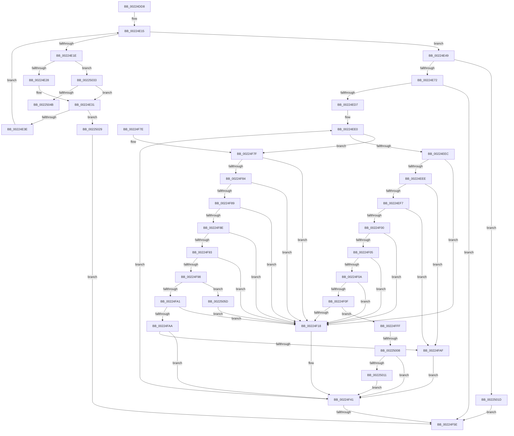

# SepAdtMarshallAuditRecord

- RVA: `0x00224DD8`–`0x00225069` (길이 `657` bytes)
- VA: `0x0000000140224DD8`
- 실행 섹션: `.text`
- PDB 이름 있음: `예`; PDB Function 태그: `예`
- unwind 정보 RVA: `0x0005F9BC`
- 디코드: `190`개 명령, `657/657` bytes 표시
- 미해석 바이트: `0` (있으면 어셈블리에 `.byte`로 보존)

> 이 문서는 커널 이미지의 기계어와 PDB 기호를 분석해 생성했습니다. 4번과 5번은 함수 원형과 자료형을 바이너리 사용 방식에서 추정한 C 해석이며 원본 소스 복구 결과는 아닙니다.

## 1. Dependencies

- 직접 호출 지점: **4**; 고유 호출 대상: **2**
- 직접 호출자로 확인된 함수: **1**
- RIP 상대 이미지 참조: **0**

### Outgoing calls
- `0x00224E61` → [ExAllocatePoolWithTag](../../poolcode/B8/ExAllocatePoolWithTag_function_00B82010.md) (function, `0x00B82010`)
- `0x00224E9E` → [memcpy](../6C/memcpy_function_006C6840.md) (function, `0x006C6840`)
- `0x00224F23` → [memcpy](../6C/memcpy_function_006C6840.md) (function, `0x006C6840`)
- `0x00224FCF` → [memcpy](../6C/memcpy_function_006C6840.md) (function, `0x006C6840`)

### Direct callers
- [SepAdtLogAuditRecord](SepAdtLogAuditRecord_function_00224B6C.md) at `0x00224C11`

### Static image references
- 디코드된 RIP-relative 메모리 참조가 없습니다.

## 2. Other-region calls and transfers

- 다른 실행 섹션으로 향하는 call: **1**
  - `0x00224E61` → [ExAllocatePoolWithTag](../../poolcode/B8/ExAllocatePoolWithTag_function_00B82010.md) (`.text` → `POOLCODE`)
- call이 아닌 외부 분기/꼬리 이동: **2**
  - `0x00225002` → [sub_006D6B00 + 0x27](../6D/Unknown_function_006D6B00.md) (`tail-transfer`)
  - `0x00225058` → [sub_006D6B00](../6D/Unknown_function_006D6B00.md) (`tail-transfer`)

## 3. Assembly (complete function range)

```asm
00224DD8  48 8B C4                        mov rax, rsp
00224DDB  48 89 58 10                     mov qword ptr [rax + 0x10], rbx
00224DDF  48 89 68 18                     mov qword ptr [rax + 0x18], rbp
00224DE3  48 89 70 20                     mov qword ptr [rax + 0x20], rsi
00224DE7  48 89 48 08                     mov qword ptr [rax + 8], rcx
00224DEB  57                              push rdi
00224DEC  41 54                           push r12
00224DEE  41 55                           push r13
00224DF0  41 56                           push r14
00224DF2  41 57                           push r15
00224DF4  48 83 EC 40                     sub rsp, 0x40
00224DF8  8B 59 08                        mov ebx, dword ptr [rcx + 8]
00224DFB  4C 8D 79 18                     lea r15, [rcx + 0x18]
00224DFF  33 ED                           xor ebp, ebp
00224E01  4D 8B D7                        mov r10, r15
00224E04  44 8B DD                        mov r11d, ebp
00224E07  8B FD                           mov edi, ebp
00224E09  45 8B E1                        mov r12d, r9d
00224E0C  49 8B F0                        mov rsi, r8
00224E0F  4C 8B F2                        mov r14, rdx
00224E12  4C 8B E9                        mov r13, rcx
00224E15  B8 F8 FF FF FF                  mov eax, 0xfffffff8
00224E1A  3B FB                           cmp edi, ebx
00224E1C  73 2B                           jae 0x140224e49
00224E1E  41 83 3A 11                     cmp dword ptr [r10], 0x11
00224E22  0F 84 0B 02 00 00               je 0x140225033
00224E28  41 8B 52 04                     mov edx, dword ptr [r10 + 4]
00224E2C  83 C2 07                        add edx, 7
00224E2F  23 D0                           and edx, eax
00224E31  42 8D 04 1A                     lea eax, [rdx + r11]
00224E35  41 3B C3                        cmp eax, r11d
00224E38  0F 82 EB 01 00 00               jb 0x140225029
00224E3E  FF C7                           inc edi
00224E40  44 8B D8                        mov r11d, eax
00224E43  49 83 C2 20                     add r10, 0x20
00224E47  EB CC                           jmp 0x140224e15
00224E49  C1 E3 05                        shl ebx, 5
00224E4C  41 8B CC                        mov ecx, r12d
00224E4F  83 C3 18                        add ebx, 0x18
00224E52  0F BA E9 0A                     bts ecx, 0xa
00224E56  41 03 DB                        add ebx, r11d
00224E59  41 B8 53 65 41 70               mov r8d, 0x70416553
00224E5F  8B D3                           mov edx, ebx
00224E61  E8 AA D1 95 00                  call 0x140b82010
00224E66  49 89 06                        mov qword ptr [r14], rax
00224E69  48 85 C0                        test rax, rax
00224E6C  0F 84 AB 01 00 00               je 0x14022501d
00224E72  8B C5                           mov eax, ebp
00224E74  B9 20 00 00 00                  mov ecx, 0x20
00224E79  41 83 FC 01                     cmp r12d, 1
00224E7D  BF 18 04 00 00                  mov edi, 0x418
00224E82  44 8B C7                        mov r8d, edi
00224E85  49 8B D5                        mov rdx, r13
00224E88  0F 95 C0                        setne al
00224E8B  83 C0 04                        add eax, 4
00224E8E  89 06                           mov dword ptr [rsi], eax
00224E90  41 2B 4D 08                     sub ecx, dword ptr [r13 + 8]
00224E94  48 C1 E1 05                     shl rcx, 5
00224E98  4C 2B C1                        sub r8, rcx
00224E9B  49 8B 0E                        mov rcx, qword ptr [r14]
00224E9E  E8 9D 19 4A 00                  call 0x1406c6840
00224EA3  49 8B 06                        mov rax, qword ptr [r14]
00224EA6  B9 20 00 00 00                  mov ecx, 0x20
00224EAB  89 6C 24 20                     mov dword ptr [rsp + 0x20], ebp
00224EAF  89 58 0C                        mov dword ptr [rax + 0xc], ebx
00224EB2  49 8B 06                        mov rax, qword ptr [r14]
00224EB5  83 48 14 01                     or dword ptr [rax + 0x14], 1
00224EB9  41 8B 55 08                     mov edx, dword ptr [r13 + 8]
00224EBD  2B CA                           sub ecx, edx
00224EBF  4D 8B 26                        mov r12, qword ptr [r14]
00224EC2  48 C1 E1 05                     shl rcx, 5
00224EC6  49 8B F4                        mov rsi, r12
00224EC9  48 2B F1                        sub rsi, rcx
00224ECC  48 03 F7                        add rsi, rdi
00224ECF  85 D2                           test edx, edx
00224ED1  0F 84 87 00 00 00               je 0x140224f5e
00224ED7  49 83 C4 30                     add r12, 0x30
00224EDB  4C 89 64 24 30                  mov qword ptr [rsp + 0x30], r12
00224EE0  41 8B 0F                        mov ecx, dword ptr [r15]
00224EE3  83 F9 17                        cmp ecx, 0x17
00224EE6  0F 8F 93 00 00 00               jg 0x140224f7f
00224EEC  74 2A                           je 0x140224f18
00224EEE  83 E9 01                        sub ecx, 1
00224EF1  0F 84 B8 00 00 00               je 0x140224faf
00224EF7  83 E9 01                        sub ecx, 1
00224EFA  0F 84 AF 00 00 00               je 0x140224faf
00224F00  83 E9 02                        sub ecx, 2
00224F03  74 13                           je 0x140224f18
00224F05  83 E9 04                        sub ecx, 4
00224F08  74 0E                           je 0x140224f18
00224F0A  83 E9 01                        sub ecx, 1
00224F0D  74 09                           je 0x140224f18
00224F0F  83 E9 04                        sub ecx, 4
00224F12  0F 85 E7 00 00 00               jne 0x140224fff
00224F18  45 8B 47 04                     mov r8d, dword ptr [r15 + 4]
00224F1C  48 8B CE                        mov rcx, rsi
00224F1F  49 8B 57 18                     mov rdx, qword ptr [r15 + 0x18]
00224F23  E8 18 19 4A 00                  call 0x1406c6840
00224F28  48 8B C6                        mov rax, rsi
00224F2B  49 2B 06                        sub rax, qword ptr [r14]
00224F2E  49 89 04 24                     mov qword ptr [r12], rax
00224F32  41 8B 4F 04                     mov ecx, dword ptr [r15 + 4]
00224F36  48 83 C1 07                     add rcx, 7
00224F3A  48 83 E1 F8                     and rcx, 0xfffffffffffffff8
00224F3E  48 03 F1                        add rsi, rcx
00224F41  8B 44 24 20                     mov eax, dword ptr [rsp + 0x20]
00224F45  49 83 C4 20                     add r12, 0x20
00224F49  FF C0                           inc eax
00224F4B  4C 89 64 24 30                  mov qword ptr [rsp + 0x30], r12
00224F50  49 83 C7 20                     add r15, 0x20
00224F54  89 44 24 20                     mov dword ptr [rsp + 0x20], eax
00224F58  41 3B 45 08                     cmp eax, dword ptr [r13 + 8]
00224F5C  72 82                           jb 0x140224ee0
00224F5E  4C 8D 5C 24 40                  lea r11, [rsp + 0x40]
00224F63  8B C5                           mov eax, ebp
00224F65  49 8B 5B 38                     mov rbx, qword ptr [r11 + 0x38]
00224F69  49 8B 6B 40                     mov rbp, qword ptr [r11 + 0x40]
00224F6D  49 8B 73 48                     mov rsi, qword ptr [r11 + 0x48]
00224F71  49 8B E3                        mov rsp, r11
00224F74  41 5F                           pop r15
00224F76  41 5E                           pop r14
00224F78  41 5D                           pop r13
00224F7A  41 5C                           pop r12
00224F7C  5F                              pop rdi
00224F7D  C3                              ret
00224F7E  CC                              int3
00224F7F  83 E9 18                        sub ecx, 0x18
00224F82  74 94                           je 0x140224f18
00224F84  83 E9 04                        sub ecx, 4
00224F87  74 8F                           je 0x140224f18
00224F89  83 E9 01                        sub ecx, 1
00224F8C  74 8A                           je 0x140224f18
00224F8E  83 E9 01                        sub ecx, 1
00224F91  74 85                           je 0x140224f18
00224F93  83 E9 01                        sub ecx, 1
00224F96  74 80                           je 0x140224f18
00224F98  83 E9 01                        sub ecx, 1
00224F9B  0F 84 BC 00 00 00               je 0x14022505d
00224FA1  83 E9 01                        sub ecx, 1
00224FA4  0F 84 6E FF FF FF               je 0x140224f18
00224FAA  83 F9 01                        cmp ecx, 1
00224FAD  75 92                           jne 0x140224f41
00224FAF  49 8B 7F 18                     mov rdi, qword ptr [r15 + 0x18]
00224FB3  48 8B C6                        mov rax, rsi
00224FB6  49 2B 06                        sub rax, qword ptr [r14]
00224FB9  48 8B DE                        mov rbx, rsi
00224FBC  49 89 04 24                     mov qword ptr [r12], rax
00224FC0  48 83 C6 10                     add rsi, 0x10
00224FC4  48 8B CE                        mov rcx, rsi
00224FC7  44 0F B7 07                     movzx r8d, word ptr [rdi]
00224FCB  48 8B 57 08                     mov rdx, qword ptr [rdi + 8]
00224FCF  E8 6C 18 4A 00                  call 0x1406c6840
00224FD4  0F B7 07                        movzx eax, word ptr [rdi]
00224FD7  B9 F8 FF FF FF                  mov ecx, 0xfffffff8
00224FDC  66 89 03                        mov word ptr [rbx], ax
00224FDF  66 89 43 02                     mov word ptr [rbx + 2], ax
00224FE3  48 8B C6                        mov rax, rsi
00224FE6  49 2B 06                        sub rax, qword ptr [r14]
00224FE9  48 89 43 08                     mov qword ptr [rbx + 8], rax
00224FED  0F B7 07                        movzx eax, word ptr [rdi]
00224FF0  48 83 C0 07                     add rax, 7
00224FF4  48 23 C1                        and rax, rcx
00224FF7  48 03 F0                        add rsi, rax
00224FFA  E9 42 FF FF FF                  jmp 0x140224f41
00224FFF  83 E9 04                        sub ecx, 4
00225002  0F 84 1F 1B 4B 00               je 0x1406d6b27
00225008  83 F9 05                        cmp ecx, 5
0022500B  0F 85 30 FF FF FF               jne 0x140224f41
00225011  49 8B 06                        mov rax, qword ptr [r14]
00225014  83 48 14 02                     or dword ptr [rax + 0x14], 2
00225018  E9 24 FF FF FF                  jmp 0x140224f41
0022501D  89 2E                           mov dword ptr [rsi], ebp
0022501F  BD 9A 00 00 C0                  mov ebp, 0xc000009a
00225024  E9 35 FF FF FF                  jmp 0x140224f5e
00225029  BD 0D 00 00 C0                  mov ebp, 0xc000000d
0022502E  E9 2B FF FF FF                  jmp 0x140224f5e
00225033  49 8B 42 18                     mov rax, qword ptr [r10 + 0x18]
00225037  8B 08                           mov ecx, dword ptr [rax]
00225039  4C 8B 40 08                     mov r8, qword ptr [rax + 8]
0022503D  8D 51 01                        lea edx, [rcx + 1]
00225040  C1 E2 04                        shl edx, 4
00225043  85 C9                           test ecx, ecx
00225045  0F 84 E6 FD FF FF               je 0x140224e31
0022504B  49 83 C0 08                     add r8, 8
0022504F  44 8B C9                        mov r9d, ecx
00225052  41 BD F8 FF FF FF               mov r13d, 0xfffffff8
00225058  E9 A3 1A 4B 00                  jmp 0x1406d6b00
0022505D  49 8B 06                        mov rax, qword ptr [r14]
00225060  83 48 14 02                     or dword ptr [rax + 0x14], 2
00225064  E9 AF FE FF FF                  jmp 0x140224f18
```

## 4. C-style interpretation (structured pseudocode)

```c
__int64 __fastcall SepAdtMarshallAuditRecord(__int64 a1, __int64 a2, __int64 a3, int a4)
{
    __int64 result;
    __int64 v_r10;
    __int64 v_r12;
    __int64 v_r15;
    __int64 v_rbp;
    __int64 v_rbx;
    __int64 v_rdi;
    __int64 v_rsi;
    __int64 v_rsp;
    unsigned __int64 v_stack_m28;
    unsigned __int64 v_stack_m38;
    unsigned int v_stack_m48;

    *(unsigned __int64 *)(v_rsp + 16) = v_rbx;
    *(unsigned __int64 *)(v_rsp + 24) = v_rbp;
    *(unsigned __int64 *)(v_rsp + 32) = v_rsi;
    *(unsigned __int64 *)(v_rsp + 8) = a1;
    v_rsp = (v_rsp) - (64);
    v_rbp = 0;
loc_00224E15:
    if (0 >= ((unsigned int)((unsigned int)(*(unsigned int *)(a1 + 8))))) goto loc_00224E49;
    if ((*(unsigned int *)(a1 + 24)) == 17) goto loc_00225033;
    a2 = (unsigned int)(((unsigned int)(*(unsigned int *)(a1 + 24 + 4))) + (7));
    a2 = (unsigned int)((a2) & ((unsigned int)((unsigned int)(0xFFFFFFF8ULL))));
loc_00224E31:
    if (((unsigned int)(a2 + 0 * 1)) < 0) goto loc_00225029;
    v_rdi = (unsigned int)((0) + 1);
    v_r10 = (a1 + 24) + (32);
    goto loc_00224E15;
loc_00224E49:
    v_rbx = (unsigned int)(((unsigned int)(*(unsigned int *)(a1 + 8))) << (5));
    v_rbx = (unsigned int)((v_rbx) + (24));
    v_rbx = (unsigned int)((v_rbx) + ((unsigned int)((unsigned int)((unsigned int)(a2 + 0 * 1)))));
    result = ExAllocatePoolWithTag((unsigned int)((unsigned int)((unsigned int)(a4))), (unsigned int)((unsigned int)(v_rbx)), (unsigned int)(0x70416553ULL), a4);
    *(unsigned __int64 *)(a2) = result;
    if (result == 0) goto loc_0022501D;
    result = (((unsigned int)((unsigned int)(a4))) != 1) ? 1 : 0;
    result = (unsigned int)((result) + (4));
    *(unsigned int *)(a3) = (unsigned int)(result);
    a1 = (unsigned int)((32) - (*(unsigned int *)(a1 + 8)));
    a1 = (a1) << (5);
    a3 = ((unsigned int)((unsigned int)((unsigned int)(0x418ULL)))) - (a1);
    result = memcpy(*(unsigned __int64 *)(a2), a1, a3, a4);
    v_stack_m48 = 0;
    *(unsigned int *)(*(unsigned __int64 *)(a2) + 12) = (unsigned int)(v_rbx);
    a1 = (unsigned int)((32) - ((unsigned int)((unsigned int)(*(unsigned int *)(a1 + 8)))));
    a1 = (a1) << (5);
    v_rsi = (*(unsigned __int64 *)(a2)) - (a1);
    v_rsi = (v_rsi) + ((unsigned int)(0x418ULL));
    if ((unsigned int)((unsigned int)(*(unsigned int *)(a1 + 8))) == 0) goto loc_00224F5E;
    v_r12 = (*(unsigned __int64 *)(a2)) + (48);
    v_stack_m38 = v_r12;
loc_00224EE0:
    if (((unsigned int)((unsigned int)(*(unsigned int *)(a1 + 24)))) > 23) goto loc_00224F7F;
    if (((unsigned int)((unsigned int)(*(unsigned int *)(a1 + 24)))) == 23) goto loc_00224F18;
    a1 = (unsigned int)(((unsigned int)(*(unsigned int *)(a1 + 24))) - (1));
    if (condition_is_equal) goto loc_00224FAF;
    a1 = (unsigned int)((a1) - (1));
    if (condition_is_equal) goto loc_00224FAF;
    a1 = (unsigned int)((a1) - (2));
    if (condition_is_equal) goto loc_00224F18;
    a1 = (unsigned int)((a1) - (4));
    if (condition_is_equal) goto loc_00224F18;
    a1 = (unsigned int)((a1) - (1));
    if (condition_is_equal) goto loc_00224F18;
    a1 = (unsigned int)((a1) - (4));
    if (condition_is_not_equal) goto loc_00224FFF;
loc_00224F18:
    result = memcpy(v_rsi, *(unsigned __int64 *)(a1 + 24 + 24), (unsigned int)(*(unsigned int *)(a1 + 24 + 4)), a4);
    result = (v_rsi) - (*(unsigned __int64 *)(a2));
    *(unsigned __int64 *)(v_r12) = result;
    a1 = ((unsigned int)(*(unsigned int *)(a1 + 24 + 4))) + (7);
    a1 = (a1) & (-8);
    v_rsi = (v_rsi) + (a1);
loc_00224F41:
    v_r12 = (v_r12) + (32);
    result = (unsigned int)(((unsigned int)(v_stack_m48)) + 1);
    v_stack_m38 = v_r12;
    v_r15 = (a1 + 24) + (32);
    v_stack_m48 = (unsigned int)(result);
    if (((unsigned int)(result)) < (*(unsigned int *)(a1 + 8))) goto loc_00224EE0;
loc_00224F5E:
    return 0;
loc_00224F7F:
    a1 = (unsigned int)((a1) - (24));
    if (condition_is_equal) goto loc_00224F18;
    a1 = (unsigned int)((a1) - (4));
    if (condition_is_equal) goto loc_00224F18;
    a1 = (unsigned int)((a1) - (1));
    if (condition_is_equal) goto loc_00224F18;
    a1 = (unsigned int)((a1) - (1));
    if (condition_is_equal) goto loc_00224F18;
    a1 = (unsigned int)((a1) - (1));
    if (condition_is_equal) goto loc_00224F18;
    a1 = (unsigned int)((a1) - (1));
    if (condition_is_equal) goto loc_0022505D;
    a1 = (unsigned int)((a1) - (1));
    if (condition_is_equal) goto loc_00224F18;
    if (((unsigned int)(a1)) != 1) goto loc_00224F41;
loc_00224FAF:
    result = (*(unsigned __int64 *)(v_stack_m28 + 72)) - (*(unsigned __int64 *)(a2));
    *(unsigned __int64 *)(v_r12) = result;
    v_rsi = (*(unsigned __int64 *)(v_stack_m28 + 72)) + (16);
    result = memcpy(v_rsi, *(unsigned __int64 *)(*(unsigned __int64 *)(v_r15 + 24) + 8), *(unsigned __int16 *)(*(unsigned __int64 *)(v_r15 + 24)), a4);
    *(unsigned __int16 *)(*(unsigned __int64 *)(v_stack_m28 + 72)) = (unsigned __int16)(*(unsigned __int16 *)(*(unsigned __int64 *)(v_r15 + 24)));
    *(unsigned __int16 *)(*(unsigned __int64 *)(v_stack_m28 + 72) + 2) = (unsigned __int16)(*(unsigned __int16 *)(*(unsigned __int64 *)(v_r15 + 24)));
    result = (v_rsi) - (*(unsigned __int64 *)(a2));
    *(unsigned __int64 *)(*(unsigned __int64 *)(v_stack_m28 + 72) + 8) = result;
    result = (*(unsigned __int16 *)(*(unsigned __int64 *)(v_r15 + 24))) + (7);
    result = (result) & ((unsigned int)(0xFFFFFFF8ULL));
    v_rsi = (v_rsi) + (result);
    goto loc_00224F41;
loc_00224FFF:
    a1 = (unsigned int)(((unsigned int)(0xFFFFFFF8ULL)) - (4));
    if (((unsigned int)(a1)) != 5) goto loc_00224F41;
    goto loc_00224F41;
loc_0022501D:
    *(unsigned int *)(v_rsi) = (unsigned int)(*(unsigned __int64 *)(v_stack_m28 + 64));
    goto loc_00224F5E;
loc_00225029:
    goto loc_00224F5E;
loc_00225033:
    a2 = (unsigned int)(((unsigned int)(*(unsigned int *)(*(unsigned __int64 *)(v_r10 + 24))) + 1) << (4));
    if ((unsigned int)((unsigned int)(*(unsigned int *)(*(unsigned __int64 *)(v_r10 + 24)))) == 0) goto loc_00224E31;
    a3 = (*(unsigned __int64 *)(*(unsigned __int64 *)(v_r10 + 24) + 8)) + (8);
loc_0022505D:
    goto loc_00224F18;
}
```

## 5. (Beta) C Style

```c
int64_t SepAdtMarshallAuditRecord(void *Arg1, void *Arg2, void *Arg3, int32_t Arg4)
{
    uint8_t *arg1 = (uint8_t *)Arg1;
    uint8_t *arg2 = (uint8_t *)Arg2;
    uint8_t *arg3 = (uint8_t *)Arg3;

    int64_t result;
    int64_t local_r10;
    int64_t local_r12;
    int64_t local_r15;
    int64_t local_rbp;
    int64_t local_rbx;
    int64_t local_rdi;
    int64_t local_rsi;
    int64_t local_rsp;
    uint64_t v_stack_m28;
    uint64_t v_stack_m38;
    uint32_t v_stack_m48;

    *(uint64_t *)(local_rsp + 0x10) = local_rbx;
    *(uint64_t *)(local_rsp + 0x18) = local_rbp;
    *(uint64_t *)(local_rsp + 0x20) = local_rsi;
    *(void **)(local_rsp + 0x8) = Arg1;
    local_rsp = (local_rsp) - (64);
    local_rbp = 0;
loc_00224E15:
    if (0 >= ((uint32_t)((uint32_t)(*(uint32_t *)(arg1 + 0x8))))) goto loc_00224E49;
    if ((*(uint32_t *)(arg1 + 0x18)) == 17) goto loc_00225033;
    Arg2 = (uint32_t)(((uint32_t)(*(uint32_t *)(arg1 + 0x18 + 0x4))) + (7));
    Arg2 = (uint32_t)((Arg2) & ((uint32_t)((uint32_t)(0xFFFFFFF8ULL))));
loc_00224E31:
    if (((uint32_t)(Arg2 + 0 * 1)) < 0) goto loc_00225029;
    local_rdi = (uint32_t)((0) + 1);
    local_r10 = (Arg1 + 24) + (32);
    goto loc_00224E15;
loc_00224E49:
    local_rbx = (uint32_t)(((uint32_t)(*(uint32_t *)(arg1 + 0x8))) << (5));
    local_rbx = (uint32_t)((local_rbx) + (24));
    local_rbx = (uint32_t)((local_rbx) + ((uint32_t)((uint32_t)((uint32_t)(Arg2 + 0 * 1)))));
    result = ExAllocatePoolWithTag((uint32_t)((uint32_t)((uint32_t)(Arg4))), (uint32_t)((uint32_t)(local_rbx)), (uint32_t)(0x70416553ULL), Arg4);
    *(uint64_t *)(arg2) = result;
    if (result == 0) goto loc_0022501D;
    result = (((uint32_t)((uint32_t)(Arg4))) != 1) ? 1 : 0;
    result = (uint32_t)((result) + (4));
    *(uint32_t *)(arg3) = (uint32_t)(result);
    Arg1 = (uint32_t)((32) - (*(uint32_t *)(arg1 + 0x8)));
    Arg1 = (Arg1) << (5);
    Arg3 = ((uint32_t)((uint32_t)((uint32_t)(0x418ULL)))) - (Arg1);
    result = memcpy(*(uint64_t *)(arg2), Arg1, Arg3, Arg4);
    v_stack_m48 = 0;
    *(uint32_t *)(*(uint64_t *)(arg2) + 0xC) = (uint32_t)(local_rbx);
    Arg1 = (uint32_t)((32) - ((uint32_t)((uint32_t)(*(uint32_t *)(arg1 + 0x8)))));
    Arg1 = (Arg1) << (5);
    local_rsi = (*(uint64_t *)(arg2)) - (Arg1);
    local_rsi = (local_rsi) + ((uint32_t)(0x418ULL));
    if ((uint32_t)((uint32_t)(*(uint32_t *)(arg1 + 0x8))) == 0) goto loc_00224F5E;
    local_r12 = (*(uint64_t *)(arg2)) + (48);
    v_stack_m38 = local_r12;
loc_00224EE0:
    if (((uint32_t)((uint32_t)(*(uint32_t *)(arg1 + 0x18)))) > 23) goto loc_00224F7F;
    if (((uint32_t)((uint32_t)(*(uint32_t *)(arg1 + 0x18)))) == 23) goto loc_00224F18;
    Arg1 = (uint32_t)(((uint32_t)(*(uint32_t *)(arg1 + 0x18))) - (1));
    if (condition_is_equal) goto loc_00224FAF;
    Arg1 = (uint32_t)((Arg1) - (1));
    if (condition_is_equal) goto loc_00224FAF;
    Arg1 = (uint32_t)((Arg1) - (2));
    if (condition_is_equal) goto loc_00224F18;
    Arg1 = (uint32_t)((Arg1) - (4));
    if (condition_is_equal) goto loc_00224F18;
    Arg1 = (uint32_t)((Arg1) - (1));
    if (condition_is_equal) goto loc_00224F18;
    Arg1 = (uint32_t)((Arg1) - (4));
    if (condition_is_not_equal) goto loc_00224FFF;
loc_00224F18:
    result = memcpy(local_rsi, *(uint64_t *)(arg1 + 0x18 + 0x18), (uint32_t)(*(uint32_t *)(arg1 + 0x18 + 0x4)), Arg4);
    result = (local_rsi) - (*(uint64_t *)(arg2));
    *(uint64_t *)(local_r12) = result;
    Arg1 = ((uint32_t)(*(uint32_t *)(arg1 + 0x18 + 0x4))) + (7);
    Arg1 = (Arg1) & (-8);
    local_rsi = (local_rsi) + (Arg1);
loc_00224F41:
    local_r12 = (local_r12) + (32);
    result = (uint32_t)(((uint32_t)(v_stack_m48)) + 1);
    v_stack_m38 = local_r12;
    local_r15 = (Arg1 + 24) + (32);
    v_stack_m48 = (uint32_t)(result);
    if (((uint32_t)(result)) < (*(uint32_t *)(arg1 + 0x8))) goto loc_00224EE0;
loc_00224F5E:
    return 0;
loc_00224F7F:
    Arg1 = (uint32_t)((Arg1) - (24));
    if (condition_is_equal) goto loc_00224F18;
    Arg1 = (uint32_t)((Arg1) - (4));
    if (condition_is_equal) goto loc_00224F18;
    Arg1 = (uint32_t)((Arg1) - (1));
    if (condition_is_equal) goto loc_00224F18;
    Arg1 = (uint32_t)((Arg1) - (1));
    if (condition_is_equal) goto loc_00224F18;
    Arg1 = (uint32_t)((Arg1) - (1));
    if (condition_is_equal) goto loc_00224F18;
    Arg1 = (uint32_t)((Arg1) - (1));
    if (condition_is_equal) goto loc_0022505D;
    Arg1 = (uint32_t)((Arg1) - (1));
    if (condition_is_equal) goto loc_00224F18;
    if (((uint32_t)(Arg1)) != 1) goto loc_00224F41;
loc_00224FAF:
    result = (*(uint64_t *)(v_stack_m28 + 0x48)) - (*(uint64_t *)(arg2));
    *(uint64_t *)(local_r12) = result;
    local_rsi = (*(uint64_t *)(v_stack_m28 + 0x48)) + (16);
    result = memcpy(local_rsi, *(uint64_t *)(*(uint64_t *)(local_r15 + 0x18) + 0x8), *(uint16_t *)(*(uint64_t *)(local_r15 + 0x18)), Arg4);
    *(uint16_t *)(*(uint64_t *)(v_stack_m28 + 0x48)) = (uint16_t)(*(uint16_t *)(*(uint64_t *)(local_r15 + 0x18)));
    *(uint16_t *)(*(uint64_t *)(v_stack_m28 + 0x48) + 0x2) = (uint16_t)(*(uint16_t *)(*(uint64_t *)(local_r15 + 0x18)));
    result = (local_rsi) - (*(uint64_t *)(arg2));
    *(uint64_t *)(*(uint64_t *)(v_stack_m28 + 0x48) + 0x8) = result;
    result = (*(uint16_t *)(*(uint64_t *)(local_r15 + 0x18))) + (7);
    result = (result) & ((uint32_t)(0xFFFFFFF8ULL));
    local_rsi = (local_rsi) + (result);
    goto loc_00224F41;
loc_00224FFF:
    Arg1 = (uint32_t)(((uint32_t)(0xFFFFFFF8ULL)) - (4));
    if (((uint32_t)(Arg1)) != 5) goto loc_00224F41;
    goto loc_00224F41;
loc_0022501D:
    *(uint32_t *)(local_rsi) = (uint32_t)(*(uint64_t *)(v_stack_m28 + 0x40));
    goto loc_00224F5E;
loc_00225029:
    goto loc_00224F5E;
loc_00225033:
    Arg2 = (uint32_t)(((uint32_t)(*(uint32_t *)(*(uint64_t *)(local_r10 + 0x18))) + 1) << (4));
    if ((uint32_t)((uint32_t)(*(uint32_t *)(*(uint64_t *)(local_r10 + 0x18)))) == 0) goto loc_00224E31;
    Arg3 = (*(uint64_t *)(*(uint64_t *)(local_r10 + 0x18) + 0x8)) + (8);
loc_0022505D:
    goto loc_00224F18;
}
```

### 관측된 메모리 오프셋

구조체 형식이 확인되지 않은 접근은 인자 기준의 오프셋으로만 기록했습니다.

| 기준 인자 | 오프셋 표현 | 폭 (bit) | 접근 |
|---|---:|---:|---|
| `Arg1` | `+ 0x0` | `32` | `R` |
| `Arg1` | `+ 0x4` | `32` | `R` |
| `Arg1` | `+ 0x8` | `32` | `R` |
| `Arg1` | `+ 0x18` | `64` | `R` |
| `Arg2` | `+ 0x0` | `64` | `R` |
| `Arg2` | `+ 0x0` | `64` | `W` |
| `Arg3` | `+ 0x0` | `32` | `W` |

## 6. Execution-region graph

[열기: 2D/3D 그래프와 함수 탐색 컨트롤 패널](../../../control-panel.html?section=text&rva=0x00224DD8&view=graph)

- 2D 그래프는 위에서 아래로 흐르고, 3D 그래프는 빈 공간을 드래그해 회전합니다. Shift+드래그는 이동, 휠은 확대·축소, 함수 노드 선택은 대상 보고서 이동입니다.

### Static fallback


