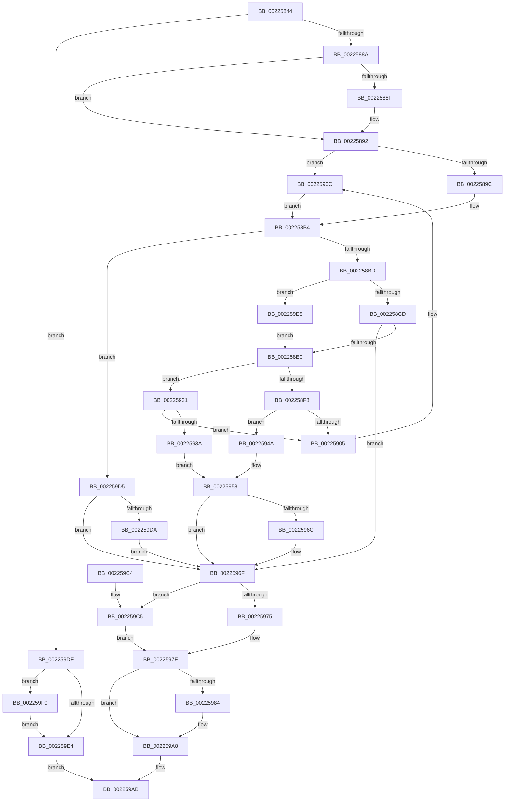

# SepQueueWorkItem

- RVA: `0x00225844`–`0x002259F6` (길이 `434` bytes)
- VA: `0x0000000140225844`
- 실행 섹션: `.text`
- PDB 이름 있음: `예`; PDB Function 태그: `아니요`
- unwind 정보 RVA: `0x0005FAA0`
- 디코드: `120`개 명령, `434/434` bytes 표시
- 미해석 바이트: `0` (있으면 어셈블리에 `.byte`로 보존)

> 이 문서는 커널 이미지의 기계어와 PDB 기호를 분석해 생성했습니다. 4번과 5번은 함수 원형과 자료형을 바이너리 사용 방식에서 추정한 C 해석이며 원본 소스 복구 결과는 아닙니다.

## 1. Dependencies

- 직접 호출 지점: **8**; 고유 호출 대상: **8**
- 직접 호출자로 확인된 함수: **2**
- RIP 상대 이미지 참조: **1**

### Outgoing calls
- `0x0022587C` → [PsGetServerSiloState](PsGetServerSiloState_function_002259FC.md) (function, `0x002259FC`)
- `0x002258A8` → [KeAcquireInStackQueuedSpinLock](../27/KeAcquireInStackQueuedSpinLock_function_002757A0.md) (function, `0x002757A0`)
- `0x002258D0` → [guard_dispatch_icall](../6B/guard_dispatch_icall_function_006BAAD0.md) (function, `0x006BAAD0`)
- `0x00225923` → [ExAcquireResourceExclusiveLite](../21/ExAcquireResourceExclusiveLite_function_00214E20.md) (function, `0x00214E20`)
- `0x0022597A` → [KeReleaseInStackQueuedSpinLock](../34/KeReleaseInStackQueuedSpinLock_function_00342CE0.md) (function, `0x00342CE0`)
- `0x002259A3` → [ExQueueWorkItem](../2F/ExQueueWorkItem_function_002F9520.md) (function, `0x002F9520`)
- `0x002259C9` → [ExReleaseResourceLite](../25/ExReleaseResourceLite_function_0025FA10.md) (function, `0x0025FA10`)
- `0x002259CE` → [KeLeaveCriticalRegion](../25/KeLeaveCriticalRegion_function_0025D8B0.md) (function, `0x0025D8B0`)

### Direct callers
- [SepAdtLogAuditRecord](SepAdtLogAuditRecord_function_00224B6C.md) at `0x00224C85`
- [SepInformLsaOfDeletedLogon](../../page/AC/SepInformLsaOfDeletedLogon_function_00AC3274.md) at `0x00AC32FB`

### Static image references
- `0x00225994` → RVA `0x00223630` (`SepRmCallLsa`; read)

## 2. Other-region calls and transfers

- 다른 실행 섹션으로 향하는 call: **0**
- 별도 외부 분기/꼬리 이동을 확인하지 못했습니다.

## 3. Assembly (complete function range)

```asm
00225844  48 89 5C 24 08                  mov qword ptr [rsp + 8], rbx
00225849  48 89 6C 24 18                  mov qword ptr [rsp + 0x18], rbp
0022584E  56                              push rsi
0022584F  57                              push rdi
00225850  41 54                           push r12
00225852  41 56                           push r14
00225854  41 57                           push r15
00225856  48 83 EC 40                     sub rsp, 0x40
0022585A  33 C0                           xor eax, eax
0022585C  48 8B D9                        mov rbx, rcx
0022585F  48 8B 4A 38                     mov rcx, qword ptr [rdx + 0x38]
00225863  0F 57 C0                        xorps xmm0, xmm0
00225866  0F 11 44 24 20                  movups xmmword ptr [rsp + 0x20], xmm0
0022586B  48 89 44 24 30                  mov qword ptr [rsp + 0x30], rax
00225870  49 8B F8                        mov rdi, r8
00225873  48 8B F2                        mov rsi, rdx
00225876  40 32 ED                        xor bpl, bpl
00225879  45 32 E4                        xor r12b, r12b
0022587C  E8 7B 01 00 00                  call 0x1402259fc
00225881  83 F8 01                        cmp eax, 1
00225884  0F 85 55 01 00 00               jne 0x1402259df
0022588A  4D 85 C0                        test r8, r8
0022588D  74 03                           je 0x140225892
0022588F  41 88 28                        mov byte ptr [r8], bpl
00225892  45 0F 20 C6                     mov r14, cr8
00225896  41 80 FE 02                     cmp r14b, 2
0022589A  75 70                           jne 0x14022590c
0022589C  48 8D 8B 88 00 00 00            lea rcx, [rbx + 0x88]
002258A3  48 8D 54 24 20                  lea rdx, [rsp + 0x20]
002258A8  E8 F3 FE 04 00                  call 0x1402757a0
002258AD  48 8B 83 C8 00 00 00            mov rax, qword ptr [rbx + 0xc8]
002258B4  48 85 C0                        test rax, rax
002258B7  0F 85 18 01 00 00               jne 0x1402259d5
002258BD  48 8B 83 D0 00 00 00            mov rax, qword ptr [rbx + 0xd0]
002258C4  48 85 C0                        test rax, rax
002258C7  0F 84 1B 01 00 00               je 0x1402259e8
002258CD  48 8B CE                        mov rcx, rsi
002258D0  E8 FB 51 49 00                  call 0x1406baad0
002258D5  40 8A E8                        mov bpl, al
002258D8  84 C0                           test al, al
002258DA  0F 84 8F 00 00 00               je 0x14022596f
002258E0  B8 01 00 00 00                  mov eax, 1
002258E5  F0 0F C1 83 B4 00 00 00         lock xadd dword ptr [rbx + 0xb4], eax
002258ED  FF C0                           inc eax
002258EF  89 46 34                        mov dword ptr [rsi + 0x34], eax
002258F2  41 80 FE 02                     cmp r14b, 2
002258F6  75 39                           jne 0x140225931
002258F8  48 8D 43 10                     lea rax, [rbx + 0x10]
002258FC  48 8B 48 08                     mov rcx, qword ptr [rax + 8]
00225900  48 39 01                        cmp qword ptr [rcx], rax
00225903  74 45                           je 0x14022594a
00225905  B9 03 00 00 00                  mov ecx, 3
0022590A  CD 29                           int 0x29
0022590C  65 48 8B 04 25 88 01 00 00      mov rax, qword ptr gs:[0x188]
00225915  48 8D 4B 20                     lea rcx, [rbx + 0x20]
00225919  B2 01                           mov dl, 1
0022591B  66 FF 88 E4 01 00 00            dec word ptr [rax + 0x1e4]
00225922  90                              nop
00225923  E8 F8 F4 FE FF                  call 0x140214e20
00225928  48 8B 83 C0 00 00 00            mov rax, qword ptr [rbx + 0xc0]
0022592F  EB 83                           jmp 0x1402258b4
00225931  48 8B 43 08                     mov rax, qword ptr [rbx + 8]
00225935  48 39 18                        cmp qword ptr [rax], rbx
00225938  75 CB                           jne 0x140225905
0022593A  48 89 1E                        mov qword ptr [rsi], rbx
0022593D  48 89 46 08                     mov qword ptr [rsi + 8], rax
00225941  48 89 30                        mov qword ptr [rax], rsi
00225944  48 89 73 08                     mov qword ptr [rbx + 8], rsi
00225948  EB 0E                           jmp 0x140225958
0022594A  48 89 06                        mov qword ptr [rsi], rax
0022594D  48 89 4E 08                     mov qword ptr [rsi + 8], rcx
00225951  48 89 31                        mov qword ptr [rcx], rsi
00225954  48 89 70 08                     mov qword ptr [rax + 8], rsi
00225958  B8 01 00 00 00                  mov eax, 1
0022595D  F0 0F C1 83 B0 00 00 00         lock xadd dword ptr [rbx + 0xb0], eax
00225965  FF C0                           inc eax
00225967  83 F8 01                        cmp eax, 1
0022596A  75 03                           jne 0x14022596f
0022596C  44 8A E0                        mov r12b, al
0022596F  41 80 FE 02                     cmp r14b, 2
00225973  75 50                           jne 0x1402259c5
00225975  48 8D 4C 24 20                  lea rcx, [rsp + 0x20]
0022597A  E8 61 D3 11 00                  call 0x140342ce0
0022597F  45 84 E4                        test r12b, r12b
00225982  74 24                           je 0x1402259a8
00225984  48 8D 8B 90 00 00 00            lea rcx, [rbx + 0x90]
0022598B  BA 01 00 00 00                  mov edx, 1
00225990  48 83 21 00                     and qword ptr [rcx], 0
00225994  48 8D 05 95 DC FF FF            lea rax, [rip - 0x236b]
0022599B  48 89 41 10                     mov qword ptr [rcx + 0x10], rax
0022599F  48 89 59 18                     mov qword ptr [rcx + 0x18], rbx
002259A3  E8 78 3B 0D 00                  call 0x1402f9520
002259A8  40 8A C5                        mov al, bpl
002259AB  4C 8D 5C 24 40                  lea r11, [rsp + 0x40]
002259B0  49 8B 5B 30                     mov rbx, qword ptr [r11 + 0x30]
002259B4  49 8B 6B 40                     mov rbp, qword ptr [r11 + 0x40]
002259B8  49 8B E3                        mov rsp, r11
002259BB  41 5F                           pop r15
002259BD  41 5E                           pop r14
002259BF  41 5C                           pop r12
002259C1  5F                              pop rdi
002259C2  5E                              pop rsi
002259C3  C3                              ret
002259C4  CC                              int3
002259C5  48 8D 4B 20                     lea rcx, [rbx + 0x20]
002259C9  E8 42 A0 03 00                  call 0x14025fa10
002259CE  E8 DD 7E 03 00                  call 0x14025d8b0
002259D3  EB AA                           jmp 0x14022597f
002259D5  48 85 FF                        test rdi, rdi
002259D8  74 95                           je 0x14022596f
002259DA  C6 07 01                        mov byte ptr [rdi], 1
002259DD  EB 90                           jmp 0x14022596f
002259DF  48 85 FF                        test rdi, rdi
002259E2  75 0C                           jne 0x1402259f0
002259E4  32 C0                           xor al, al
002259E6  EB C3                           jmp 0x1402259ab
002259E8  40 B5 01                        mov bpl, 1
002259EB  E9 F0 FE FF FF                  jmp 0x1402258e0
002259F0  41 C6 00 01                     mov byte ptr [r8], 1
002259F4  EB EE                           jmp 0x1402259e4
```

## 4. C-style interpretation (structured pseudocode)

```c
__int64 __fastcall SepQueueWorkItem(__int64 a1, __int64 a2, __int64 a3)
{
    __int64 result;
    __int64 v_r12;
    __int64 v_rbp;
    __int64 v_rsp;
    unsigned __int64 v_stack_m28;
    unsigned __int64 v_stack_m38;
    unsigned __int64 v_stack_m48;
    unsigned __int64 v_stack_p18;
    unsigned __int64 v_stack_p8;

    v_stack_p8 = v_rbx;
    v_stack_p18 = v_rbp;
    v_rsp = (v_rsp) - (64);
    result = 0;
    v_stack_m48 = v_xmm0;
    v_stack_m38 = 0;
    v_rbp = 0;
    v_r12 = 0;
    result = PsGetServerSiloState(*(unsigned __int64 *)(a2 + 56), a2, a3, a4);
    if (((unsigned int)(result)) != 1) goto loc_002259DF;
    if (a3 != 0) {
        *(unsigned __int8 *)(a3) = 0;
    }
    if (((unsigned __int8)(v_cr8)) != 2) goto loc_0022590C;
    result = KeAcquireInStackQueuedSpinLock(a1 + 136, v_stack_m48, a3, a4);
loc_002258B4:
    if (*(unsigned __int64 *)(a1 + 200) != 0) goto loc_002259D5;
    if (*(unsigned __int64 *)(a1 + 208) == 0) goto loc_002259E8;
    result = guard_dispatch_icall(a2, v_stack_m48, a3, a4);
    if ((unsigned __int8)(result) == 0) goto loc_0022596F;
loc_002258E0:
    result = (unsigned int)((1) + 1);
    *(unsigned int *)(a2 + 52) = (unsigned int)(result);
    if (((unsigned __int8)(v_cr8)) != 2) goto loc_00225931;
    if ((*(unsigned __int64 *)(*(unsigned __int64 *)(a1 + 16 + 8))) == (a1 + 16)) goto loc_0022594A;
loc_00225905:
loc_0022590C:
    result = ExAcquireResourceExclusiveLite(a1 + 32, 1, a3, a4);
    goto loc_002258B4;
loc_00225931:
    if ((*(unsigned __int64 *)(*(unsigned __int64 *)(a1 + 8))) != a1) goto loc_00225905;
    *(unsigned __int64 *)(a2) = a1;
    *(unsigned __int64 *)(a2 + 8) = *(unsigned __int64 *)(a1 + 8);
    *(unsigned __int64 *)(*(unsigned __int64 *)(a1 + 8)) = a2;
    *(unsigned __int64 *)(a1 + 8) = a2;
    goto loc_00225958;
loc_0022594A:
    *(unsigned __int64 *)(a2) = *(unsigned __int64 *)(a1 + 8);
    *(unsigned __int64 *)(a2 + 8) = a1 + 32;
    *(unsigned __int64 *)(a1 + 32) = a2;
    *(unsigned __int64 *)(*(unsigned __int64 *)(a1 + 8) + 8) = a2;
loc_00225958:
    result = (unsigned int)((1) + 1);
    if (((unsigned int)(result)) == 1) {
        v_r12 = (unsigned __int8)(result);
    }
    if (((unsigned __int8)(v_cr8)) != 2) goto loc_002259C5;
    result = KeReleaseInStackQueuedSpinLock(v_stack_m48, 1, a3, a4);
loc_0022597F:
    if ((unsigned __int8)(v_r12) != 0) {
        a1 = a1 + 144;
        a2 = 1;
        result = v_rip - 9067;
        *(unsigned __int64 *)(a1 + 16) = result;
        *(unsigned __int64 *)(a1 + 24) = a1;
        result = ExQueueWorkItem(a1, a2, a3, a4);
    }
loc_002259AB:
    return (unsigned __int8)((unsigned __int8)(result));
loc_002259C5:
    result = ExReleaseResourceLite(*(unsigned __int64 *)(v_stack_m28 + 48) + 32, a2, a3, a4);
    result = KeLeaveCriticalRegion(*(unsigned __int64 *)(v_stack_m28 + 48) + 32, a2, a3, a4);
    goto loc_0022597F;
loc_002259D5:
    if (a3 == 0) goto loc_0022596F;
    *(unsigned __int8 *)(a3) = 1;
    goto loc_0022596F;
loc_002259DF:
    if (a3 != 0) goto loc_002259F0;
loc_002259E4:
    result = 0;
    goto loc_002259AB;
loc_002259E8:
    goto loc_002258E0;
loc_002259F0:
    *(unsigned __int8 *)(a3) = 1;
    goto loc_002259E4;
}
```

## 5. (Beta) C Style

```c
int64_t SepQueueWorkItem(void *Arg1, void *Arg2, int64_t Arg3)
{
    uint8_t *arg1 = (uint8_t *)Arg1;
    uint8_t *arg2 = (uint8_t *)Arg2;

    int64_t result;
    int64_t local_r12;
    int64_t local_rbp;
    int64_t local_rsp;
    uint64_t v_stack_m28;
    uint64_t v_stack_m38;
    uint64_t v_stack_m48;
    uint64_t v_stack_p18;
    uint64_t v_stack_p8;

    v_stack_p8 = local_rbx;
    v_stack_p18 = local_rbp;
    local_rsp = (local_rsp) - (64);
    result = 0;
    v_stack_m48 = v_xmm0;
    v_stack_m38 = 0;
    local_rbp = 0;
    local_r12 = 0;
    result = PsGetServerSiloState(*(uint64_t *)(arg2 + 0x38), Arg2, Arg3, a4);
    if (((uint32_t)(result)) != 1) goto loc_002259DF;
    if (Arg3 != 0) {
        *(uint8_t *)(Arg3) = 0;
    }
    if (((uint8_t)(v_cr8)) != 2) goto loc_0022590C;
    result = KeAcquireInStackQueuedSpinLock(Arg1 + 136, v_stack_m48, Arg3, a4);
loc_002258B4:
    if (*(uint64_t *)(arg1 + 0xC8) != 0) goto loc_002259D5;
    if (*(uint64_t *)(arg1 + 0xD0) == 0) goto loc_002259E8;
    result = guard_dispatch_icall(Arg2, v_stack_m48, Arg3, a4);
    if ((uint8_t)(result) == 0) goto loc_0022596F;
loc_002258E0:
    result = (uint32_t)((1) + 1);
    *(uint32_t *)(arg2 + 0x34) = (uint32_t)(result);
    if (((uint8_t)(v_cr8)) != 2) goto loc_00225931;
    if ((*(uint64_t *)(*(uint64_t *)(arg1 + 0x10 + 0x8))) == (Arg1 + 16)) goto loc_0022594A;
loc_00225905:
loc_0022590C:
    result = ExAcquireResourceExclusiveLite(Arg1 + 32, 1, Arg3, a4);
    goto loc_002258B4;
loc_00225931:
    if ((*(uint64_t *)(*(uint64_t *)(arg1 + 0x8))) != Arg1) goto loc_00225905;
    *(void **)(arg2) = Arg1;
    *(uint64_t *)(arg2 + 0x8) = *(uint64_t *)(arg1 + 0x8);
    *(void **)(*(uint64_t *)(arg1 + 0x8)) = Arg2;
    *(void **)(arg1 + 0x8) = Arg2;
    goto loc_00225958;
loc_0022594A:
    *(uint64_t *)(arg2) = *(uint64_t *)(arg1 + 0x8);
    *(void **)(arg2 + 0x8) = Arg1 + 32;
    *(void **)(arg1 + 0x20) = Arg2;
    *(void **)(*(uint64_t *)(arg1 + 0x8) + 0x8) = Arg2;
loc_00225958:
    result = (uint32_t)((1) + 1);
    if (((uint32_t)(result)) == 1) {
        local_r12 = (uint8_t)(result);
    }
    if (((uint8_t)(v_cr8)) != 2) goto loc_002259C5;
    result = KeReleaseInStackQueuedSpinLock(v_stack_m48, 1, Arg3, a4);
loc_0022597F:
    if ((uint8_t)(local_r12) != 0) {
        Arg1 = Arg1 + 144;
        Arg2 = 1;
        result = v_rip - 9067;
        *(uint64_t *)(arg1 + 0x10) = result;
        *(void **)(arg1 + 0x18) = Arg1;
        result = ExQueueWorkItem(Arg1, Arg2, Arg3, a4);
    }
loc_002259AB:
    return (uint8_t)((uint8_t)(result));
loc_002259C5:
    result = ExReleaseResourceLite(*(uint64_t *)(v_stack_m28 + 0x30) + 32, Arg2, Arg3, a4);
    result = KeLeaveCriticalRegion(*(uint64_t *)(v_stack_m28 + 0x30) + 32, Arg2, Arg3, a4);
    goto loc_0022597F;
loc_002259D5:
    if (Arg3 == 0) goto loc_0022596F;
    *(uint8_t *)(Arg3) = 1;
    goto loc_0022596F;
loc_002259DF:
    if (Arg3 != 0) goto loc_002259F0;
loc_002259E4:
    result = 0;
    goto loc_002259AB;
loc_002259E8:
    goto loc_002258E0;
loc_002259F0:
    *(uint8_t *)(Arg3) = 1;
    goto loc_002259E4;
}
```

### 관측된 메모리 오프셋

구조체 형식이 확인되지 않은 접근은 인자 기준의 오프셋으로만 기록했습니다.

| 기준 인자 | 오프셋 표현 | 폭 (bit) | 접근 |
|---|---:|---:|---|
| `Arg1` | `+ 0x0` | `64` | `R/W` |
| `Arg1` | `+ 0x8` | `64` | `R` |
| `Arg1` | `+ 0x8` | `64` | `W` |
| `Arg1` | `+ 0x10` | `64` | `R` |
| `Arg1` | `+ 0x10` | `64` | `W` |
| `Arg1` | `+ 0x18` | `64` | `W` |
| `Arg1` | `+ 0x20` | `64` | `R` |
| `Arg1` | `+ 0x88` | `64` | `R` |
| `Arg1` | `+ 0x90` | `64` | `R` |
| `Arg1` | `+ 0xB0` | `32` | `R/W` |
| `Arg1` | `+ 0xB4` | `32` | `R/W` |
| `Arg1` | `+ 0xC0` | `64` | `R` |
| `Arg1` | `+ 0xC8` | `64` | `R` |
| `Arg1` | `+ 0xD0` | `64` | `R` |
| `Arg2` | `+ 0x0` | `64` | `W` |
| `Arg2` | `+ 0x8` | `64` | `W` |
| `Arg2` | `+ 0x34` | `32` | `W` |
| `Arg2` | `+ 0x38` | `64` | `R` |

## 6. Execution-region graph

[열기: 2D/3D 그래프와 함수 탐색 컨트롤 패널](../../../control-panel.html?section=text&rva=0x00225844&view=graph)

- 2D 그래프는 위에서 아래로 흐르고, 3D 그래프는 빈 공간을 드래그해 회전합니다. Shift+드래그는 이동, 휠은 확대·축소, 함수 노드 선택은 대상 보고서 이동입니다.

### Static fallback


