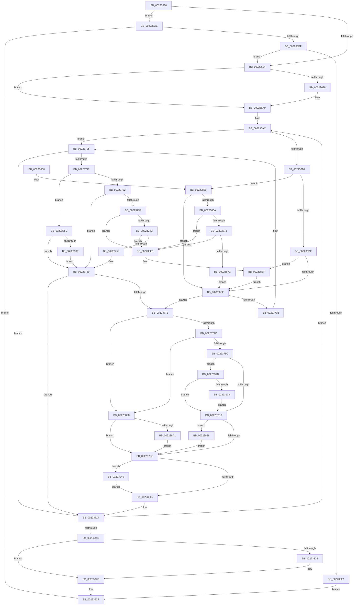

# SepRmCallLsa

- RVA: `0x00223630`–`0x00223954` (길이 `804` bytes)
- VA: `0x0000000140223630`
- 실행 섹션: `.text`
- PDB 이름 있음: `예`; PDB Function 태그: `아니요`
- unwind 정보 RVA: `0x0005F7E0`
- 디코드: `191`개 명령, `804/804` bytes 표시
- 미해석 바이트: `0` (있으면 어셈블리에 `.byte`로 보존)

> 이 문서는 커널 이미지의 기계어와 PDB 기호를 분석해 생성했습니다. 4번과 5번은 함수 원형과 자료형을 바이너리 사용 방식에서 추정한 C 해석이며 원본 소스 복구 결과는 아닙니다.

## 1. Dependencies

- 직접 호출 지점: **19**; 고유 호출 대상: **18**
- 직접 호출자로 확인된 함수: **0**
- RIP 상대 이미지 참조: **6**

### Outgoing calls
- `0x002236A4` → [KeStackAttachProcess](../21/KeStackAttachProcess_function_00216800.md) (function, `0x00216800`)
- `0x002236CE` → [ExAcquireResourceExclusiveLite](../21/ExAcquireResourceExclusiveLite_function_00214E20.md) (function, `0x00214E20`)
- `0x002236F3` → [ExReleaseResourceLite](../25/ExReleaseResourceLite_function_0025FA10.md) (function, `0x0025FA10`)
- `0x002236F8` → [KeLeaveCriticalRegion](../25/KeLeaveCriticalRegion_function_0025D8B0.md) (function, `0x0025D8B0`)
- `0x0022371D` → [KeAcquireInStackQueuedSpinLock](../27/KeAcquireInStackQueuedSpinLock_function_002757A0.md) (function, `0x002757A0`)
- `0x00223764` → [KeReleaseInStackQueuedSpinLock](../34/KeReleaseInStackQueuedSpinLock_function_00342CE0.md) (function, `0x00342CE0`)
- `0x002237B3` → [AdtpWriteToEtw](../../page/AF/AdtpWriteToEtw_function_00AF98B0.md) (function, `0x00AF98B0`)
- `0x0022380F` → [guard_dispatch_icall](../6B/guard_dispatch_icall_function_006BAAD0.md) (function, `0x006BAAD0`)
- `0x00223828` → [KiUnstackDetachProcess](../21/KiUnstackDetachProcess_function_00217D30.md) (function, `0x00217D30`)
- `0x00223836` → [_security_check_cookie](../6A/_security_check_cookie_function_006AC640.md) (function, `0x006AC640`)
- `0x0022388E` → [ExFreePoolWithTag](../../poolcode/B8/ExFreePoolWithTag_function_00B82870.md) (function, `0x00B82870`)
- `0x002238A4` → [SepRmDispatchDataToLsa](SepRmDispatchDataToLsa_function_0022395C.md) (function, `0x0022395C`)
- `0x002238B2` → [SepAdtOpenEtwReadyEvent](../../page/AC/SepAdtOpenEtwReadyEvent_function_00AC403C.md) (function, `0x00AC403C`)
- `0x002238C9` → [NtWaitForSingleObject](../../page/86/NtWaitForSingleObject_function_00868BD0.md) (function, `0x00868BD0`)
- `0x002238D4` → [NtClose](../../page/86/NtClose_function_00868870.md) (function, `0x00868870`)
- `0x002238F4` → [KeSetEvent](../33/KeSetEvent_function_0033F310.md) (function, `0x0033F310`)
- `0x00223913` → [KeSetEvent](../33/KeSetEvent_function_0033F310.md) (function, `0x0033F310`)
- `0x00223936` → [SepAuditFailed](../../page/86/SepAuditFailed_function_0086EE20.md) (function, `0x0086EE20`)
- `0x00223945` → [ObfDereferenceObjectWithTag](../2F/ObfDereferenceObjectWithTag_function_002F78E0.md) (function, `0x002F78E0`)

### Direct callers
- 이 함수 시작 RVA로 연결되는 직접 call은 확인되지 않았습니다. 간접 호출은 완전히 역산할 수 없습니다.

### Static image references
- `0x0022364E` → RVA `0x00E0A740` (`.data`; read)
- `0x00223664` → RVA `0x00F04AC8` (`.data`; read)
- `0x0022366D` → RVA `0x00FD9A73` (`PAGEDATA`; read)
- `0x00223699` → RVA `0x00FD9E48` (`PAGEDATA`; read)
- `0x0022391D` → RVA `0x00E0CDCC` (`.data`; write)
- `0x00223923` → RVA `0x00E67F18` (`.data`; read/write)

## 2. Other-region calls and transfers

- 다른 실행 섹션으로 향하는 call: **6**
  - `0x002237B3` → [AdtpWriteToEtw](../../page/AF/AdtpWriteToEtw_function_00AF98B0.md) (`.text` → `PAGE`)
  - `0x0022388E` → [ExFreePoolWithTag](../../poolcode/B8/ExFreePoolWithTag_function_00B82870.md) (`.text` → `POOLCODE`)
  - `0x002238B2` → [SepAdtOpenEtwReadyEvent](../../page/AC/SepAdtOpenEtwReadyEvent_function_00AC403C.md) (`.text` → `PAGE`)
  - `0x002238C9` → [NtWaitForSingleObject](../../page/86/NtWaitForSingleObject_function_00868BD0.md) (`.text` → `PAGE`)
  - `0x002238D4` → [NtClose](../../page/86/NtClose_function_00868870.md) (`.text` → `PAGE`)
  - `0x00223936` → [SepAuditFailed](../../page/86/SepAuditFailed_function_0086EE20.md) (`.text` → `PAGE`)
- 별도 외부 분기/꼬리 이동을 확인하지 못했습니다.

## 3. Assembly (complete function range)

```asm
00223630  48 89 5C 24 10                  mov qword ptr [rsp + 0x10], rbx
00223635  48 89 74 24 18                  mov qword ptr [rsp + 0x18], rsi
0022363A  48 89 7C 24 20                  mov qword ptr [rsp + 0x20], rdi
0022363F  55                              push rbp
00223640  41 56                           push r14
00223642  41 57                           push r15
00223644  48 8B EC                        mov rbp, rsp
00223647  48 81 EC 80 00 00 00            sub rsp, 0x80
0022364E  48 8B 05 EB 70 BE 00            mov rax, qword ptr [rip + 0xbe70eb]
00223655  48 33 C4                        xor rax, rsp
00223658  48 89 45 F8                     mov qword ptr [rbp - 8], rax
0022365C  48 83 65 A8 00                  and qword ptr [rbp - 0x58], 0
00223661  0F 57 C0                        xorps xmm0, xmm0
00223664  44 8A 3D 5D 14 CE 00            mov r15b, byte ptr [rip + 0xce145d]
0022366B  33 C0                           xor eax, eax
0022366D  38 05 00 64 DB 00               cmp byte ptr [rip + 0xdb6400], al
00223673  48 8B F9                        mov rdi, rcx
00223676  0F 11 45 C8                     movups xmmword ptr [rbp - 0x38], xmm0
0022367A  48 89 45 C0                     mov qword ptr [rbp - 0x40], rax
0022367E  44 8D 70 01                     lea r14d, [rax + 1]
00223682  0F 11 45 D8                     movups xmmword ptr [rbp - 0x28], xmm0
00223686  0F 11 45 E8                     movups xmmword ptr [rbp - 0x18], xmm0
0022368A  0F 11 45 B0                     movups xmmword ptr [rbp - 0x50], xmm0
0022368E  0F 84 1A 02 00 00               je 0x1402238ae
00223694  45 84 FF                        test r15b, r15b
00223697  74 10                           je 0x1402236a9
00223699  48 8B 0D A8 67 DB 00            mov rcx, qword ptr [rip + 0xdb67a8]
002236A0  48 8D 55 C8                     lea rdx, [rbp - 0x38]
002236A4  E8 57 31 FF FF                  call 0x140216800
002236A9  83 CB FF                        or ebx, 0xffffffff
002236AC  33 F6                           xor esi, esi
002236AE  F6 87 E0 00 00 00 01            test byte ptr [rdi + 0xe0], 1
002236B5  74 4E                           je 0x140223705
002236B7  65 48 8B 04 25 88 01 00 00      mov rax, qword ptr gs:[0x188]
002236C0  48 8D 4F 20                     lea rcx, [rdi + 0x20]
002236C4  B2 01                           mov dl, 1
002236C6  66 01 98 E4 01 00 00            add word ptr [rax + 0x1e4], bx
002236CD  90                              nop
002236CE  E8 4D 17 FF FF                  call 0x140214e20
002236D3  48 8B 0F                        mov rcx, qword ptr [rdi]
002236D6  48 3B CF                        cmp rcx, rdi
002236D9  0F 85 7A 01 00 00               jne 0x140223859
002236DF  48 8B 8F C0 00 00 00            mov rcx, qword ptr [rdi + 0xc0]
002236E6  48 85 C9                        test rcx, rcx
002236E9  0F 85 00 02 00 00               jne 0x1402238ef
002236EF  48 8D 4F 20                     lea rcx, [rdi + 0x20]
002236F3  E8 18 C3 03 00                  call 0x14025fa10
002236F8  E8 B3 A1 03 00                  call 0x14025d8b0
002236FD  48 85 F6                        test rsi, rsi
00223700  75 70                           jne 0x140223772
00223702  83 CB FF                        or ebx, 0xffffffff
00223705  F6 87 E0 00 00 00 02            test byte ptr [rdi + 0xe0], 2
0022370C  0F 84 02 01 00 00               je 0x140223814
00223712  48 8D 8F 88 00 00 00            lea rcx, [rdi + 0x88]
00223719  48 8D 55 B0                     lea rdx, [rbp - 0x50]
0022371D  E8 7E 20 05 00                  call 0x1402757a0
00223722  48 8D 57 10                     lea rdx, [rdi + 0x10]
00223726  48 8B 0A                        mov rcx, qword ptr [rdx]
00223729  48 3B CA                        cmp rcx, rdx
0022372C  0F 84 CC 01 00 00               je 0x1402238fe
00223732  8B 87 B8 00 00 00               mov eax, dword ptr [rdi + 0xb8]
00223738  FF C0                           inc eax
0022373A  39 41 34                        cmp dword ptr [rcx + 0x34], eax
0022373D  75 21                           jne 0x140223760
0022373F  48 8B F1                        mov rsi, rcx
00223742  48 39 51 08                     cmp qword ptr [rcx + 8], rdx
00223746  0F 85 9C 01 00 00               jne 0x1402238e8
0022374C  48 8B 01                        mov rax, qword ptr [rcx]
0022374F  48 39 48 08                     cmp qword ptr [rax + 8], rcx
00223753  0F 85 8F 01 00 00               jne 0x1402238e8
00223759  48 89 02                        mov qword ptr [rdx], rax
0022375C  48 89 50 08                     mov qword ptr [rax + 8], rdx
00223760  48 8D 4D B0                     lea rcx, [rbp - 0x50]
00223764  E8 77 F5 11 00                  call 0x140342ce0
00223769  48 85 F6                        test rsi, rsi
0022376C  0F 84 A2 00 00 00               je 0x140223814
00223772  83 7E 20 01                     cmp dword ptr [rsi + 0x20], 1
00223776  0F 85 1C 01 00 00               jne 0x140223898
0022377C  48 8B 46 18                     mov rax, qword ptr [rsi + 0x18]
00223780  8B 48 14                        mov ecx, dword ptr [rax + 0x14]
00223783  F6 C1 02                        test cl, 2
00223786  0F 85 0C 01 00 00               jne 0x140223898
0022378C  65 48 8B 04 25 88 01 00 00      mov rax, qword ptr gs:[0x188]
00223795  48 8D 55 A0                     lea rdx, [rbp - 0x60]
00223799  48 8B 4E 38                     mov rcx, qword ptr [rsi + 0x38]
0022379D  C6 45 A0 00                     mov byte ptr [rbp - 0x60], 0
002237A1  48 8B 98 98 06 00 00            mov rbx, qword ptr [rax + 0x698]
002237A8  48 89 88 98 06 00 00            mov qword ptr [rax + 0x698], rcx
002237AF  48 8B 4E 18                     mov rcx, qword ptr [rsi + 0x18]
002237B3  E8 F8 60 8D 00                  call 0x140af98b0
002237B8  65 48 8B 0C 25 88 01 00 00      mov rcx, qword ptr gs:[0x188]
002237C1  48 89 99 98 06 00 00            mov qword ptr [rcx + 0x698], rbx
002237C8  85 C0                           test eax, eax
002237CA  0F 88 4D 01 00 00               js 0x14022391d
002237D0  8B 46 10                        mov eax, dword ptr [rsi + 0x10]
002237D3  83 E8 04                        sub eax, 4
002237D6  83 F8 01                        cmp eax, 1
002237D9  0F 86 A9 00 00 00               jbe 0x140223888
002237DF  F0 FF 87 B8 00 00 00            lock inc dword ptr [rdi + 0xb8]
002237E6  83 CB FF                        or ebx, 0xffffffff
002237E9  44 8B F3                        mov r14d, ebx
002237EC  F0 44 0F C1 B7 B0 00 00 00      lock xadd dword ptr [rdi + 0xb0], r14d
002237F5  48 8B 4E 38                     mov rcx, qword ptr [rsi + 0x38]
002237F9  44 03 F3                        add r14d, ebx
002237FC  48 85 C9                        test rcx, rcx
002237FF  0F 85 3B 01 00 00               jne 0x140223940
00223805  48 8B 87 D8 00 00 00            mov rax, qword ptr [rdi + 0xd8]
0022380C  48 8B CE                        mov rcx, rsi
0022380F  E8 BC 72 49 00                  call 0x1406baad0
00223814  45 85 F6                        test r14d, r14d
00223817  0F 85 8F FE FF FF               jne 0x1402236ac
0022381D  45 84 FF                        test r15b, r15b
00223820  74 0B                           je 0x14022382d
00223822  33 D2                           xor edx, edx
00223824  48 8D 4D C8                     lea rcx, [rbp - 0x38]
00223828  E8 03 45 FF FF                  call 0x140217d30
0022382D  33 C0                           xor eax, eax
0022382F  48 8B 4D F8                     mov rcx, qword ptr [rbp - 8]
00223833  48 33 CC                        xor rcx, rsp
00223836  E8 05 8E 48 00                  call 0x1406ac640
0022383B  4C 8D 9C 24 80 00 00 00         lea r11, [rsp + 0x80]
00223843  49 8B 5B 28                     mov rbx, qword ptr [r11 + 0x28]
00223847  49 8B 73 30                     mov rsi, qword ptr [r11 + 0x30]
0022384B  49 8B 7B 38                     mov rdi, qword ptr [r11 + 0x38]
0022384F  49 8B E3                        mov rsp, r11
00223852  41 5F                           pop r15
00223854  41 5E                           pop r14
00223856  5D                              pop rbp
00223857  C3                              ret
00223858  CC                              int3
00223859  8B 87 B8 00 00 00               mov eax, dword ptr [rdi + 0xb8]
0022385F  FF C0                           inc eax
00223861  39 41 34                        cmp dword ptr [rcx + 0x34], eax
00223864  0F 85 85 FE FF FF               jne 0x1402236ef
0022386A  48 8B F1                        mov rsi, rcx
0022386D  48 39 79 08                     cmp qword ptr [rcx + 8], rdi
00223871  75 75                           jne 0x1402238e8
00223873  48 8B 01                        mov rax, qword ptr [rcx]
00223876  48 39 48 08                     cmp qword ptr [rax + 8], rcx
0022387A  75 6C                           jne 0x1402238e8
0022387C  48 89 07                        mov qword ptr [rdi], rax
0022387F  48 89 78 08                     mov qword ptr [rax + 8], rdi
00223883  E9 67 FE FF FF                  jmp 0x1402236ef
00223888  48 8B 4E 18                     mov rcx, qword ptr [rsi + 0x18]
0022388C  33 D2                           xor edx, edx
0022388E  E8 DD EF 95 00                  call 0x140b82870
00223893  E9 47 FF FF FF                  jmp 0x1402237df
00223898  45 84 FF                        test r15b, r15b
0022389B  0F 84 3E FF FF FF               je 0x1402237df
002238A1  48 8B CE                        mov rcx, rsi
002238A4  E8 B3 00 00 00                  call 0x14022395c
002238A9  E9 31 FF FF FF                  jmp 0x1402237df
002238AE  48 8D 4D A8                     lea rcx, [rbp - 0x58]
002238B2  E8 85 07 8A 00                  call 0x140ac403c
002238B7  85 C0                           test eax, eax
002238B9  0F 88 70 FF FF FF               js 0x14022382f
002238BF  48 8B 4D A8                     mov rcx, qword ptr [rbp - 0x58]
002238C3  45 33 C0                        xor r8d, r8d
002238C6  41 8A D6                        mov dl, r14b
002238C9  E8 02 53 64 00                  call 0x140868bd0
002238CE  48 8B 4D A8                     mov rcx, qword ptr [rbp - 0x58]
002238D2  8B D8                           mov ebx, eax
002238D4  E8 97 4F 64 00                  call 0x140868870
002238D9  85 DB                           test ebx, ebx
002238DB  0F 89 B3 FD FF FF               jns 0x140223694
002238E1  8B C3                           mov eax, ebx
002238E3  E9 47 FF FF FF                  jmp 0x14022382f
002238E8  B9 03 00 00 00                  mov ecx, 3
002238ED  CD 29                           int 0x29
002238EF  45 33 C0                        xor r8d, r8d
002238F2  33 D2                           xor edx, edx
002238F4  E8 17 BA 11 00                  call 0x14033f310
002238F9  E9 F1 FD FF FF                  jmp 0x1402236ef
002238FE  48 8B 8F C8 00 00 00            mov rcx, qword ptr [rdi + 0xc8]
00223905  48 85 C9                        test rcx, rcx
00223908  0F 84 52 FE FF FF               je 0x140223760
0022390E  45 33 C0                        xor r8d, r8d
00223911  33 D2                           xor edx, edx
00223913  E8 F8 B9 11 00                  call 0x14033f310
00223918  E9 43 FE FF FF                  jmp 0x140223760
0022391D  89 05 A9 94 BE 00               mov dword ptr [rip + 0xbe94a9], eax
00223923  F0 FF 05 EE 45 C4 00            lock inc dword ptr [rip + 0xc445ee]
0022392A  80 7D A0 00                     cmp byte ptr [rbp - 0x60], 0
0022392E  0F 85 9C FE FF FF               jne 0x1402237d0
00223934  8B C8                           mov ecx, eax
00223936  E8 E5 B4 64 00                  call 0x14086ee20
0022393B  E9 90 FE FF FF                  jmp 0x1402237d0
00223940  BA 53 65 41 69                  mov edx, 0x69416553
00223945  E8 96 3F 0D 00                  call 0x1402f78e0
0022394A  48 83 66 38 00                  and qword ptr [rsi + 0x38], 0
0022394F  E9 B1 FE FF FF                  jmp 0x140223805
```

## 4. C-style interpretation (structured pseudocode)

```c
__int64 __fastcall SepRmCallLsa(__int64 a1, __int64 a2, int a3)
{
    __int64 result;
    __int64 v_r14;
    __int64 v_rbx;
    __int64 v_rsi;
    __int64 v_rsp;
    unsigned __int64 v_stack_m18;
    unsigned __int64 v_stack_m20;
    unsigned __int64 v_stack_m30;
    unsigned __int64 v_stack_m40;
    unsigned __int64 v_stack_m50;
    unsigned __int64 v_stack_m58;
    unsigned __int64 v_stack_m68;
    unsigned __int64 v_stack_m70;
    unsigned __int64 v_stack_m78;
    unsigned __int64 v_stack_p10;
    unsigned __int64 v_stack_p18;
    unsigned __int64 v_stack_p20;

    v_stack_p10 = v_rbx;
    v_stack_p18 = v_rsi;
    v_stack_p20 = v_rdi;
    v_rsp = (v_rsp) - (128);
    result = (*(unsigned __int64 *)(v_rip + 12480747)) ^ (v_rsp);
    v_stack_m20 = result;
    result = 0;
    v_stack_m50 = v_xmm0;
    v_stack_m58 = 0;
    v_stack_m40 = v_xmm0;
    v_stack_m30 = v_xmm0;
    v_stack_m68 = v_xmm0;
    if ((*(unsigned __int8 *)(v_rip + 14377984)) == 0) goto loc_002238AE;
loc_00223694:
    if ((unsigned __int8)(*(unsigned __int8 *)(v_rip + 13505629)) != 0) {
        a1 = *(unsigned __int64 *)(v_rip + 14378920);
        a2 = v_stack_m50;
        result = KeStackAttachProcess(a1, a2, a3, a4);
    }
    v_rbx = (unsigned int)((v_rbx) | (0xFFFFFFFFULL));
loc_002236AC:
    v_rsi = 0;
    if (((*(unsigned __int8 *)(a1 + 224)) & (1)) == 0) goto loc_00223705;
    result = ExAcquireResourceExclusiveLite(a1 + 32, 1, a3, a4);
    if ((*(unsigned __int64 *)(a1)) != a1) goto loc_00223859;
    if (*(unsigned __int64 *)(a1 + 192) != 0) goto loc_002238EF;
loc_002236EF:
    result = ExReleaseResourceLite(a1 + 32, 1, a3, a4);
    result = KeLeaveCriticalRegion(a1 + 32, 1, a3, a4);
    if (0 != 0) goto loc_00223772;
    v_rbx = (unsigned int)((v_rbx) | (0xFFFFFFFFULL));
loc_00223705:
    if (((*(unsigned __int8 *)(a1 + 224)) & (2)) == 0) goto loc_00223814;
    result = KeAcquireInStackQueuedSpinLock(a1 + 136, v_stack_m68, a3, a4);
    if ((*(unsigned __int64 *)(a1 + 16)) == (a1 + 16)) goto loc_002238FE;
    result = (unsigned int)(((unsigned int)(*(unsigned int *)(a1 + 184))) + 1);
    if ((*(unsigned int *)(*(unsigned __int64 *)(a1 + 16) + 52)) != ((unsigned int)(result))) goto loc_00223760;
    if ((*(unsigned __int64 *)(*(unsigned __int64 *)(a1 + 16) + 8)) != (a1 + 16)) goto loc_002238E8;
    if ((*(unsigned __int64 *)(*(unsigned __int64 *)(*(unsigned __int64 *)(a1 + 16)) + 8)) != (*(unsigned __int64 *)(a1 + 16))) goto loc_002238E8;
    *(unsigned __int64 *)(a1 + 16) = *(unsigned __int64 *)(*(unsigned __int64 *)(a1 + 16));
    *(unsigned __int64 *)(*(unsigned __int64 *)(*(unsigned __int64 *)(a1 + 16)) + 8) = a1 + 16;
loc_00223760:
    result = KeReleaseInStackQueuedSpinLock(v_stack_m68, a1 + 16, a3, a4);
    if (*(unsigned __int64 *)(a1 + 16) == 0) goto loc_00223814;
loc_00223772:
    if ((*(unsigned int *)(*(unsigned __int64 *)(a1 + 16) + 32)) != 1) goto loc_00223898;
    if ((((unsigned __int8)((unsigned int)(*(unsigned int *)(*(unsigned __int64 *)(*(unsigned __int64 *)(a1 + 16) + 24) + 20)))) & (2)) != 0) goto loc_00223898;
    v_stack_m78 = 0;
    *(unsigned __int64 *)(*(unsigned __int64 *)(gs_base + (0 + 392)) + 1688) = *(unsigned __int64 *)(*(unsigned __int64 *)(a1 + 16) + 56);
    result = AdtpWriteToEtw(*(unsigned __int64 *)(*(unsigned __int64 *)(a1 + 16) + 24), v_stack_m78, a3, a4);
    *(unsigned __int64 *)(*(unsigned __int64 *)(gs_base + (0 + 392)) + 1688) = *(unsigned __int64 *)(*(unsigned __int64 *)(gs_base + (0 + 392)) + 1688);
    if (sign_flag) goto loc_0022391D;
loc_002237D0:
    result = (unsigned int)(((unsigned int)(*(unsigned int *)(*(unsigned __int64 *)(a1 + 16) + 16))) - (4));
    if (((unsigned int)(result)) <= 1) goto loc_00223888;
loc_002237DF:
    v_rbx = (unsigned int)((*(unsigned __int64 *)(*(unsigned __int64 *)(gs_base + (0 + 392)) + 1688)) | (0xFFFFFFFFULL));
    v_r14 = (unsigned int)(((unsigned int)((unsigned int)(v_rbx))) + ((unsigned int)(v_rbx)));
    if (*(unsigned __int64 *)(*(unsigned __int64 *)(a1 + 16) + 56) != 0) goto loc_00223940;
loc_00223805:
    result = guard_dispatch_icall(*(unsigned __int64 *)(a1 + 16), v_stack_m78, a3, a4);
loc_00223814:
    if ((unsigned int)(v_r14) != 0) goto loc_002236AC;
    if ((unsigned __int8)(*(unsigned __int8 *)(v_rip + 13505629)) != 0) {
        a2 = 0;
        a1 = v_stack_m50;
        result = KiUnstackDetachProcess(a1, a2, a3, a4);
    }
    result = 0;
loc_0022382F:
    a1 = (v_stack_m20) ^ (v_rsp);
    result = _security_check_cookie(a1, a2, a3, a4);
    return result;
loc_00223859:
    result = (unsigned int)(((unsigned int)(*(unsigned int *)(*(unsigned __int64 *)(v_stack_m18 + 56) + 184))) + 1);
    if ((*(unsigned int *)(a1 + 52)) != ((unsigned int)(result))) goto loc_002236EF;
    if ((*(unsigned __int64 *)(a1 + 8)) != (*(unsigned __int64 *)(v_stack_m18 + 56))) goto loc_002238E8;
    if ((*(unsigned __int64 *)(*(unsigned __int64 *)(a1) + 8)) != a1) goto loc_002238E8;
    *(unsigned __int64 *)(*(unsigned __int64 *)(v_stack_m18 + 56)) = *(unsigned __int64 *)(a1);
    *(unsigned __int64 *)(*(unsigned __int64 *)(a1) + 8) = *(unsigned __int64 *)(v_stack_m18 + 56);
    goto loc_002236EF;
loc_00223888:
    a2 = 0;
    result = ExFreePoolWithTag(*(unsigned __int64 *)(a1 + 24), a2, a3, a4);
    goto loc_002237DF;
loc_00223898:
    if ((unsigned __int8)(*(unsigned __int8 *)(v_rip + 13505629)) == 0) goto loc_002237DF;
    result = SepRmDispatchDataToLsa(a1, a2, a3, a4);
    goto loc_002237DF;
loc_002238AE:
    result = SepAdtOpenEtwReadyEvent(v_stack_m70, a2, a3, a4);
    if (sign_flag) goto loc_0022382F;
    a3 = 0;
    result = NtWaitForSingleObject(v_stack_m70, (unsigned __int8)(v_r14), a3, a4);
    result = NtClose(v_stack_m70, (unsigned __int8)(v_r14), a3, a4);
    if (!sign_flag) goto loc_00223694;
    goto loc_0022382F;
loc_002238E8:
loc_002238EF:
    a3 = 0;
    a2 = 0;
    result = KeSetEvent(3, a2, a3, a4);
    goto loc_002236EF;
loc_002238FE:
    if (*(unsigned __int64 *)(*(unsigned __int64 *)(v_stack_m18 + 56) + 200) == 0) goto loc_00223760;
    a3 = 0;
    a2 = 0;
    result = KeSetEvent(*(unsigned __int64 *)(*(unsigned __int64 *)(v_stack_m18 + 56) + 200), a2, a3, a4);
    goto loc_00223760;
loc_0022391D:
    *(unsigned int *)(v_rip + 12489897) = (unsigned int)(result);
    if (v_stack_m78 != 0) goto loc_002237D0;
    result = SepAuditFailed((unsigned int)((unsigned int)(result)), a2, a3, a4);
    goto loc_002237D0;
loc_00223940:
    result = ObfDereferenceObjectWithTag((unsigned int)((unsigned int)(result)), (unsigned int)(0x69416553ULL), a3, a4);
    goto loc_00223805;
}
```

## 5. (Beta) C Style

```c
int64_t SepRmCallLsa(void *Arg1, int64_t Arg2, int32_t Arg3)
{
    uint8_t *arg1 = (uint8_t *)Arg1;

    int64_t result;
    int64_t local_r14;
    int64_t local_rbx;
    int64_t local_rsi;
    int64_t local_rsp;
    uint64_t v_stack_m18;
    uint64_t v_stack_m20;
    uint64_t v_stack_m30;
    uint64_t v_stack_m40;
    uint64_t v_stack_m50;
    uint64_t v_stack_m58;
    uint64_t v_stack_m68;
    uint64_t v_stack_m70;
    uint64_t v_stack_m78;
    uint64_t v_stack_p10;
    uint64_t v_stack_p18;
    uint64_t v_stack_p20;

    v_stack_p10 = local_rbx;
    v_stack_p18 = local_rsi;
    v_stack_p20 = local_rdi;
    local_rsp = (local_rsp) - (128);
    result = (*(uint64_t *)(v_rip + 0xBE70EB)) ^ (local_rsp);
    v_stack_m20 = result;
    result = 0;
    v_stack_m50 = v_xmm0;
    v_stack_m58 = 0;
    v_stack_m40 = v_xmm0;
    v_stack_m30 = v_xmm0;
    v_stack_m68 = v_xmm0;
    if ((*(uint8_t *)(v_rip + 0xDB6400)) == 0) goto loc_002238AE;
loc_00223694:
    if ((uint8_t)(*(uint8_t *)(v_rip + 0xCE145D)) != 0) {
        Arg1 = *(uint64_t *)(v_rip + 0xDB67A8);
        Arg2 = v_stack_m50;
        result = KeStackAttachProcess(Arg1, Arg2, Arg3, a4);
    }
    local_rbx = (uint32_t)((local_rbx) | (0xFFFFFFFFULL));
loc_002236AC:
    local_rsi = 0;
    if (((*(uint8_t *)(arg1 + 0xE0)) & (1)) == 0) goto loc_00223705;
    result = ExAcquireResourceExclusiveLite(Arg1 + 32, 1, Arg3, a4);
    if ((*(uint64_t *)(arg1)) != Arg1) goto loc_00223859;
    if (*(uint64_t *)(arg1 + 0xC0) != 0) goto loc_002238EF;
loc_002236EF:
    result = ExReleaseResourceLite(Arg1 + 32, 1, Arg3, a4);
    result = KeLeaveCriticalRegion(Arg1 + 32, 1, Arg3, a4);
    if (0 != 0) goto loc_00223772;
    local_rbx = (uint32_t)((local_rbx) | (0xFFFFFFFFULL));
loc_00223705:
    if (((*(uint8_t *)(arg1 + 0xE0)) & (2)) == 0) goto loc_00223814;
    result = KeAcquireInStackQueuedSpinLock(Arg1 + 136, v_stack_m68, Arg3, a4);
    if ((*(uint64_t *)(arg1 + 0x10)) == (Arg1 + 16)) goto loc_002238FE;
    result = (uint32_t)(((uint32_t)(*(uint32_t *)(arg1 + 0xB8))) + 1);
    if ((*(uint32_t *)(*(uint64_t *)(arg1 + 0x10) + 0x34)) != ((uint32_t)(result))) goto loc_00223760;
    if ((*(uint64_t *)(*(uint64_t *)(arg1 + 0x10) + 0x8)) != (Arg1 + 16)) goto loc_002238E8;
    if ((*(uint64_t *)(*(uint64_t *)(*(uint64_t *)(arg1 + 0x10)) + 0x8)) != (*(uint64_t *)(arg1 + 0x10))) goto loc_002238E8;
    *(uint64_t *)(arg1 + 0x10) = *(uint64_t *)(*(uint64_t *)(arg1 + 0x10));
    *(void **)(*(uint64_t *)(*(uint64_t *)(arg1 + 0x10)) + 0x8) = Arg1 + 16;
loc_00223760:
    result = KeReleaseInStackQueuedSpinLock(v_stack_m68, Arg1 + 16, Arg3, a4);
    if (*(uint64_t *)(arg1 + 0x10) == 0) goto loc_00223814;
loc_00223772:
    if ((*(uint32_t *)(*(uint64_t *)(arg1 + 0x10) + 0x20)) != 1) goto loc_00223898;
    if ((((uint8_t)((uint32_t)(*(uint32_t *)(*(uint64_t *)(*(uint64_t *)(arg1 + 0x10) + 0x18) + 0x14)))) & (2)) != 0) goto loc_00223898;
    v_stack_m78 = 0;
    *(uint64_t *)(*(uint64_t *)(gs_base + (0 + 0x188)) + 0x698) = *(uint64_t *)(*(uint64_t *)(arg1 + 0x10) + 0x38);
    result = AdtpWriteToEtw(*(uint64_t *)(*(uint64_t *)(arg1 + 0x10) + 0x18), v_stack_m78, Arg3, a4);
    *(uint64_t *)(*(uint64_t *)(gs_base + (0 + 0x188)) + 0x698) = *(uint64_t *)(*(uint64_t *)(gs_base + (0 + 0x188)) + 0x698);
    if (sign_flag) goto loc_0022391D;
loc_002237D0:
    result = (uint32_t)(((uint32_t)(*(uint32_t *)(*(uint64_t *)(arg1 + 0x10) + 0x10))) - (4));
    if (((uint32_t)(result)) <= 1) goto loc_00223888;
loc_002237DF:
    local_rbx = (uint32_t)((*(uint64_t *)(*(uint64_t *)(gs_base + (0 + 0x188)) + 0x698)) | (0xFFFFFFFFULL));
    local_r14 = (uint32_t)(((uint32_t)((uint32_t)(local_rbx))) + ((uint32_t)(local_rbx)));
    if (*(uint64_t *)(*(uint64_t *)(arg1 + 0x10) + 0x38) != 0) goto loc_00223940;
loc_00223805:
    result = guard_dispatch_icall(*(uint64_t *)(arg1 + 0x10), v_stack_m78, Arg3, a4);
loc_00223814:
    if ((uint32_t)(local_r14) != 0) goto loc_002236AC;
    if ((uint8_t)(*(uint8_t *)(v_rip + 0xCE145D)) != 0) {
        Arg2 = 0;
        Arg1 = v_stack_m50;
        result = KiUnstackDetachProcess(Arg1, Arg2, Arg3, a4);
    }
    result = 0;
loc_0022382F:
    Arg1 = (v_stack_m20) ^ (local_rsp);
    result = _security_check_cookie(Arg1, Arg2, Arg3, a4);
    return result;
loc_00223859:
    result = (uint32_t)(((uint32_t)(*(uint32_t *)(*(uint64_t *)(v_stack_m18 + 0x38) + 0xB8))) + 1);
    if ((*(uint32_t *)(arg1 + 0x34)) != ((uint32_t)(result))) goto loc_002236EF;
    if ((*(uint64_t *)(arg1 + 0x8)) != (*(uint64_t *)(v_stack_m18 + 0x38))) goto loc_002238E8;
    if ((*(uint64_t *)(*(uint64_t *)(arg1) + 0x8)) != Arg1) goto loc_002238E8;
    *(uint64_t *)(*(uint64_t *)(v_stack_m18 + 0x38)) = *(uint64_t *)(arg1);
    *(uint64_t *)(*(uint64_t *)(arg1) + 0x8) = *(uint64_t *)(v_stack_m18 + 0x38);
    goto loc_002236EF;
loc_00223888:
    Arg2 = 0;
    result = ExFreePoolWithTag(*(uint64_t *)(arg1 + 0x18), Arg2, Arg3, a4);
    goto loc_002237DF;
loc_00223898:
    if ((uint8_t)(*(uint8_t *)(v_rip + 0xCE145D)) == 0) goto loc_002237DF;
    result = SepRmDispatchDataToLsa(Arg1, Arg2, Arg3, a4);
    goto loc_002237DF;
loc_002238AE:
    result = SepAdtOpenEtwReadyEvent(v_stack_m70, Arg2, Arg3, a4);
    if (sign_flag) goto loc_0022382F;
    Arg3 = 0;
    result = NtWaitForSingleObject(v_stack_m70, (uint8_t)(local_r14), Arg3, a4);
    result = NtClose(v_stack_m70, (uint8_t)(local_r14), Arg3, a4);
    if (!sign_flag) goto loc_00223694;
    goto loc_0022382F;
loc_002238E8:
loc_002238EF:
    Arg3 = 0;
    Arg2 = 0;
    result = KeSetEvent(3, Arg2, Arg3, a4);
    goto loc_002236EF;
loc_002238FE:
    if (*(uint64_t *)(*(uint64_t *)(v_stack_m18 + 0x38) + 0xC8) == 0) goto loc_00223760;
    Arg3 = 0;
    Arg2 = 0;
    result = KeSetEvent(*(uint64_t *)(*(uint64_t *)(v_stack_m18 + 0x38) + 0xC8), Arg2, Arg3, a4);
    goto loc_00223760;
loc_0022391D:
    *(uint32_t *)(v_rip + 0xBE94A9) = (uint32_t)(result);
    if (v_stack_m78 != 0) goto loc_002237D0;
    result = SepAuditFailed((uint32_t)((uint32_t)(result)), Arg2, Arg3, a4);
    goto loc_002237D0;
loc_00223940:
    result = ObfDereferenceObjectWithTag((uint32_t)((uint32_t)(result)), (uint32_t)(0x69416553ULL), Arg3, a4);
    goto loc_00223805;
}
```

### 관측된 메모리 오프셋

구조체 형식이 확인되지 않은 접근은 인자 기준의 오프셋으로만 기록했습니다.

| 기준 인자 | 오프셋 표현 | 폭 (bit) | 접근 |
|---|---:|---:|---|
| `Arg1` | `+ 0x0` | `64` | `R` |
| `Arg1` | `+ 0x0` | `64` | `W` |
| `Arg1` | `+ 0x10` | `64` | `R` |
| `Arg1` | `+ 0x20` | `64` | `R` |
| `Arg1` | `+ 0x88` | `64` | `R` |
| `Arg1` | `+ 0xB0` | `32` | `R/W` |
| `Arg1` | `+ 0xB8` | `32` | `R` |
| `Arg1` | `+ 0xB8` | `32` | `R/W` |
| `Arg1` | `+ 0xC0` | `64` | `R` |
| `Arg1` | `+ 0xC8` | `64` | `R` |
| `Arg1` | `+ 0xD8` | `64` | `R` |
| `Arg1` | `+ 0xE0` | `8` | `R` |

## 6. Execution-region graph

[열기: 2D/3D 그래프와 함수 탐색 컨트롤 패널](../../../control-panel.html?section=text&rva=0x00223630&view=graph)

- 2D 그래프는 위에서 아래로 흐르고, 3D 그래프는 빈 공간을 드래그해 회전합니다. Shift+드래그는 이동, 휠은 확대·축소, 함수 노드 선택은 대상 보고서 이동입니다.

### Static fallback


