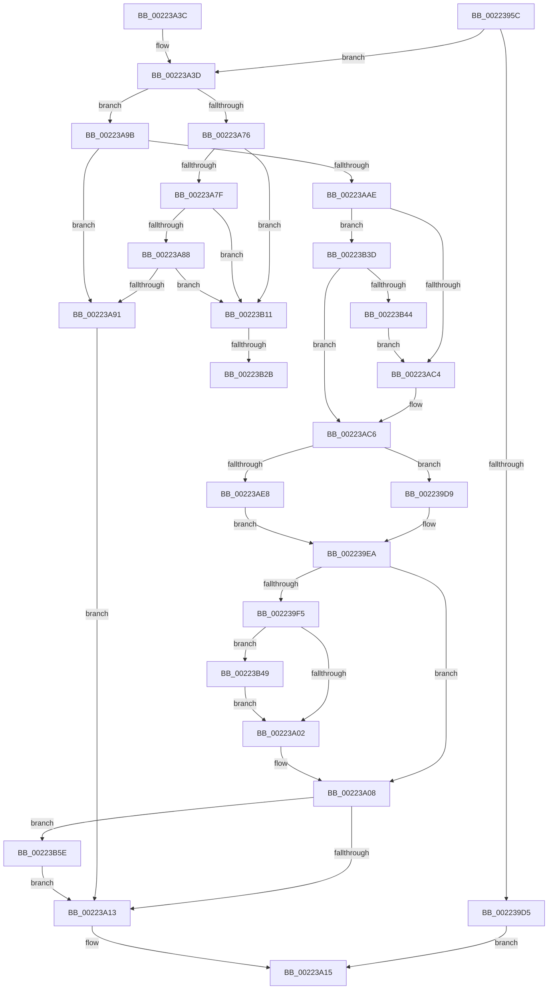

# SepRmDispatchDataToLsa

- RVA: `0x0022395C`–`0x00223B80` (길이 `548` bytes)
- VA: `0x000000014022395C`
- 실행 섹션: `.text`
- PDB 이름 있음: `예`; PDB Function 태그: `예`
- unwind 정보 RVA: `0x0005F804`
- 디코드: `126`개 명령, `548/548` bytes 표시
- 미해석 바이트: `0` (있으면 어셈블리에 `.byte`로 보존)

> 이 문서는 커널 이미지의 기계어와 PDB 기호를 분석해 생성했습니다. 4번과 5번은 함수 원형과 자료형을 바이너리 사용 방식에서 추정한 C 해석이며 원본 소스 복구 결과는 아닙니다.

## 1. Dependencies

- 직접 호출 지점: **9**; 고유 호출 대상: **6**
- 직접 호출자로 확인된 함수: **2**
- RIP 상대 이미지 참조: **1**

### Outgoing calls
- `0x0022399A` → [memset](../6C/memset_function_006C6C40.md) (function, `0x006C6C40`)
- `0x002239AE` → [memset](../6C/memset_function_006C6C40.md) (function, `0x006C6C40`)
- `0x002239C3` → [PsGetServerSiloGlobals](PsGetServerSiloGlobals_function_002250A0.md) (function, `0x002250A0`)
- `0x002239EA` → [ZwAlpcSendWaitReceivePort](../6A/ZwAlpcSendWaitReceivePort_function_006AE290.md) (function, `0x006AE290`)
- `0x00223A1F` → [_security_check_cookie](../6A/_security_check_cookie_function_006AC640.md) (function, `0x006AC640`)
- `0x00223AB9` → [memcpy](../6C/memcpy_function_006C6840.md) (function, `0x006C6840`)
- `0x00223B2F` → [memcpy](../6C/memcpy_function_006C6840.md) (function, `0x006C6840`)
- `0x00223B54` → [memcpy](../6C/memcpy_function_006C6840.md) (function, `0x006C6840`)
- `0x00223B74` → [ZwFreeVirtualMemory](../6A/ZwFreeVirtualMemory_function_006AD490.md) (function, `0x006AD490`)

### Direct callers
- [SepRmCallLsa](SepRmCallLsa_function_00223630.md) at `0x002238A4`
- [SepAdtLogAuditRecord](SepAdtLogAuditRecord_function_00224B6C.md) at `0x00224D6D`

### Static image references
- `0x00223979` → RVA `0x00E0A740` (`.data`; read)

## 2. Other-region calls and transfers

- 다른 실행 섹션으로 향하는 call: **0**
- call이 아닌 외부 분기/꼬리 이동: **2**
  - `0x00223B25` → [sub_006D6A74](../6D/Unknown_function_006D6A74.md) (`tail-transfer`)
  - `0x00223B38` → [sub_006D6A74 + 0x3D](../6D/Unknown_function_006D6A74.md) (`tail-transfer`)

## 3. Assembly (complete function range)

```asm
0022395C  48 89 5C 24 10                  mov qword ptr [rsp + 0x10], rbx
00223961  48 89 74 24 18                  mov qword ptr [rsp + 0x18], rsi
00223966  55                              push rbp
00223967  57                              push rdi
00223968  41 56                           push r14
0022396A  48 8D AC 24 A0 FC FF FF         lea rbp, [rsp - 0x360]
00223972  48 81 EC 60 04 00 00            sub rsp, 0x460
00223979  48 8B 05 C0 6D BE 00            mov rax, qword ptr [rip + 0xbe6dc0]
00223980  48 33 C4                        xor rax, rsp
00223983  48 89 85 50 03 00 00            mov qword ptr [rbp + 0x350], rax
0022398A  48 8B F9                        mov rdi, rcx
0022398D  33 D2                           xor edx, edx
0022398F  48 8D 4C 24 7C                  lea rcx, [rsp + 0x7c]
00223994  41 B8 D4 01 00 00               mov r8d, 0x1d4
0022399A  E8 A1 32 4A 00                  call 0x1406c6c40
0022399F  33 D2                           xor edx, edx
002239A1  48 8D 8D 50 01 00 00            lea rcx, [rbp + 0x150]
002239A8  41 B8 00 02 00 00               mov r8d, 0x200
002239AE  E8 8D 32 4A 00                  call 0x1406c6c40
002239B3  48 8B 4F 38                     mov rcx, qword ptr [rdi + 0x38]
002239B7  48 83 64 24 48 00               and qword ptr [rsp + 0x48], 0
002239BD  48 83 64 24 40 00               and qword ptr [rsp + 0x40], 0
002239C3  E8 D8 16 00 00                  call 0x1402250a0
002239C8  4C 8B F0                        mov r14, rax
002239CB  48 83 B8 18 03 00 00 00         cmp qword ptr [rax + 0x318], 0
002239D3  75 68                           jne 0x140223a3d
002239D5  33 C0                           xor eax, eax
002239D7  EB 3C                           jmp 0x140223a15
002239D9  48 83 64 24 28 00               and qword ptr [rsp + 0x28], 0
002239DF  BA 00 00 01 00                  mov edx, 0x10000
002239E4  48 83 64 24 20 00               and qword ptr [rsp + 0x20], 0
002239EA  E8 A1 A8 48 00                  call 0x1406ae290
002239EF  8B D8                           mov ebx, eax
002239F1  85 C0                           test eax, eax
002239F3  78 13                           js 0x140223a08
002239F5  48 8B 4F 28                     mov rcx, qword ptr [rdi + 0x28]
002239F9  48 85 C9                        test rcx, rcx
002239FC  0F 85 47 01 00 00               jne 0x140223b49
00223A02  8B 9D 78 01 00 00               mov ebx, dword ptr [rbp + 0x178]
00223A08  83 7C 24 7C 03                  cmp dword ptr [rsp + 0x7c], 3
00223A0D  0F 84 4B 01 00 00               je 0x140223b5e
00223A13  8B C3                           mov eax, ebx
00223A15  48 8B 8D 50 03 00 00            mov rcx, qword ptr [rbp + 0x350]
00223A1C  48 33 CC                        xor rcx, rsp
00223A1F  E8 1C 8C 48 00                  call 0x1406ac640
00223A24  4C 8D 9C 24 60 04 00 00         lea r11, [rsp + 0x460]
00223A2C  49 8B 5B 28                     mov rbx, qword ptr [r11 + 0x28]
00223A30  49 8B 73 30                     mov rsi, qword ptr [r11 + 0x30]
00223A34  49 8B E3                        mov rsp, r11
00223A37  41 5E                           pop r14
00223A39  5F                              pop rdi
00223A3A  5D                              pop rbp
00223A3B  C3                              ret
00223A3C  CC                              int3
00223A3D  8B 4F 10                        mov ecx, dword ptr [rdi + 0x10]
00223A40  33 C0                           xor eax, eax
00223A42  48 89 44 24 70                  mov qword ptr [rsp + 0x70], rax
00223A47  0F 57 C0                        xorps xmm0, xmm0
00223A4A  0F B7 47 24                     movzx eax, word ptr [rdi + 0x24]
00223A4E  66 83 C0 30                     add ax, 0x30
00223A52  0F 11 44 24 50                  movups xmmword ptr [rsp + 0x50], xmm0
00223A57  66 89 44 24 52                  mov word ptr [rsp + 0x52], ax
00223A5C  66 83 E8 28                     sub ax, 0x28
00223A60  66 89 44 24 50                  mov word ptr [rsp + 0x50], ax
00223A65  8B 47 20                        mov eax, dword ptr [rdi + 0x20]
00223A68  89 44 24 78                     mov dword ptr [rsp + 0x78], eax
00223A6C  0F 11 44 24 60                  movups xmmword ptr [rsp + 0x60], xmm0
00223A71  83 E9 01                        sub ecx, 1
00223A74  74 25                           je 0x140223a9b
00223A76  83 E9 03                        sub ecx, 3
00223A79  0F 84 92 00 00 00               je 0x140223b11
00223A7F  83 E9 01                        sub ecx, 1
00223A82  0F 84 89 00 00 00               je 0x140223b11
00223A88  83 F9 01                        cmp ecx, 1
00223A8B  0F 84 80 00 00 00               je 0x140223b11
00223A91  BB 0D 00 00 C0                  mov ebx, 0xc000000d
00223A96  E9 78 FF FF FF                  jmp 0x140223a13
00223A9B  8B 47 24                        mov eax, dword ptr [rdi + 0x24]
00223A9E  BE 01 00 00 00                  mov esi, 1
00223AA3  89 74 24 7C                     mov dword ptr [rsp + 0x7c], esi
00223AA7  3D D0 01 00 00                  cmp eax, 0x1d0
00223AAC  77 E3                           ja 0x140223a91
00223AAE  44 8B C0                        mov r8d, eax
00223AB1  48 8D 57 18                     lea rdx, [rdi + 0x18]
00223AB5  48 8D 4D 80                     lea rcx, [rbp - 0x80]
00223AB9  E8 82 2D 4A 00                  call 0x1406c6840
00223ABE  83 7F 20 03                     cmp dword ptr [rdi + 0x20], 3
00223AC2  74 79                           je 0x140223b3d
00223AC4  33 F6                           xor esi, esi
00223AC6  48 83 64 24 38 00               and qword ptr [rsp + 0x38], 0
00223ACC  4C 8D 44 24 50                  lea r8, [rsp + 0x50]
00223AD1  49 8B 8E 18 03 00 00            mov rcx, qword ptr [r14 + 0x318]
00223AD8  45 33 C9                        xor r9d, r9d
00223ADB  4C 21 4C 24 30                  and qword ptr [rsp + 0x30], r9
00223AE0  85 F6                           test esi, esi
00223AE2  0F 85 F1 FE FF FF               jne 0x1402239d9
00223AE8  48 8D 44 24 40                  lea rax, [rsp + 0x40]
00223AED  48 C7 44 24 40 00 02 00 00      mov qword ptr [rsp + 0x40], 0x200
00223AF6  48 89 44 24 28                  mov qword ptr [rsp + 0x28], rax
00223AFB  BA 00 00 02 00                  mov edx, 0x20000
00223B00  48 8D 85 50 01 00 00            lea rax, [rbp + 0x150]
00223B07  48 89 44 24 20                  mov qword ptr [rsp + 0x20], rax
00223B0C  E9 D9 FE FF FF                  jmp 0x1402239ea
00223B11  44 8B 47 24                     mov r8d, dword ptr [rdi + 0x24]
00223B15  BE 01 00 00 00                  mov esi, 1
00223B1A  48 8B 57 18                     mov rdx, qword ptr [rdi + 0x18]
00223B1E  41 81 F8 D0 01 00 00            cmp r8d, 0x1d0
00223B25  0F 87 49 2F 4B 00               ja 0x1406d6a74
00223B2B  48 8D 4D 80                     lea rcx, [rbp - 0x80]
00223B2F  E8 0C 2D 4A 00                  call 0x1406c6840
00223B34  89 74 24 7C                     mov dword ptr [rsp + 0x7c], esi
00223B38  E9 74 2F 4B 00                  jmp 0x1406d6ab1
00223B3D  48 83 7F 28 00                  cmp qword ptr [rdi + 0x28], 0
00223B42  74 82                           je 0x140223ac6
00223B44  E9 7B FF FF FF                  jmp 0x140223ac4
00223B49  44 8B 47 30                     mov r8d, dword ptr [rdi + 0x30]
00223B4D  48 8D 95 7C 01 00 00            lea rdx, [rbp + 0x17c]
00223B54  E8 E7 2C 4A 00                  call 0x1406c6840
00223B59  E9 A4 FE FF FF                  jmp 0x140223a02
00223B5E  49 8B 8E 10 03 00 00            mov rcx, qword ptr [r14 + 0x310]
00223B65  4C 8D 44 24 48                  lea r8, [rsp + 0x48]
00223B6A  41 B9 00 80 00 00               mov r9d, 0x8000
00223B70  48 8D 55 80                     lea rdx, [rbp - 0x80]
00223B74  E8 17 99 48 00                  call 0x1406ad490
00223B79  8B D8                           mov ebx, eax
00223B7B  E9 93 FE FF FF                  jmp 0x140223a13
```

## 4. C-style interpretation (structured pseudocode)

```c
__int64 __fastcall SepRmDispatchDataToLsa(__int64 a1, int a2, __int64 a3, int a4)
{
    __int64 result;
    __int64 v_rsi;
    __int64 v_rsp;
    unsigned __int64 v_stack_m18;
    unsigned __int64 v_stack_m1FC;
    unsigned int v_stack_m200;
    unsigned __int64 v_stack_m228;
    unsigned __int64 v_stack_m28;
    unsigned __int64 v_stack_m378;
    unsigned int v_stack_m3E4;
    unsigned int v_stack_m3E8;
    unsigned __int64 v_stack_m3F0;
    unsigned __int64 v_stack_m3F8;
    unsigned __int64 v_stack_m3FC;
    unsigned __int64 v_stack_m400;
    unsigned __int16 v_stack_m40E;
    unsigned __int64 v_stack_m410;
    unsigned __int64 v_stack_m418;
    unsigned __int64 v_stack_m420;
    unsigned __int64 v_stack_m428;
    unsigned __int64 v_stack_m430;
    unsigned __int64 v_stack_m438;
    unsigned __int64 v_stack_m440;
    unsigned __int64 v_stack_m450;
    unsigned __int64 v_stack_m458;
    unsigned __int64 v_stack_p10;
    unsigned __int64 v_stack_p18;

    v_stack_p10 = v_rbx;
    v_stack_p18 = v_rsi;
    v_rsp = (v_rsp) - (0x460ULL);
    result = (*(unsigned __int64 *)(v_rip + 12479936)) ^ (v_rsp);
    v_stack_m28 = result;
    a2 = 0;
    result = memset(v_stack_m3FC, a2, 468, a4);
    a2 = 0;
    result = memset(v_stack_m228, a2, 512, a4);
    result = PsGetServerSiloGlobals(*(unsigned __int64 *)(a1 + 56), a2, 512, a4);
    if ((*(unsigned __int64 *)(result + 792)) != 0) goto loc_00223A3D;
    result = 0;
    goto loc_00223A15;
loc_002239D9:
loc_002239EA:
    result = ZwAlpcSendWaitReceivePort(*(unsigned __int64 *)(a1 + 56), (unsigned int)(0x10000ULL), 512, a4);
    if (sign_flag) goto loc_00223A08;
    if (*(unsigned __int64 *)(a1 + 40) != 0) goto loc_00223B49;
loc_00223A02:
loc_00223A08:
    if (v_stack_m3FC == 3) goto loc_00223B5E;
loc_00223A13:
loc_00223A15:
    a1 = (v_stack_m28) ^ (v_rsp);
    result = _security_check_cookie(a1, (unsigned int)(0x10000ULL), 512, a4);
    return result;
loc_00223A3D:
    result = 0;
    v_stack_m3F0 = 0;
    result = (unsigned __int16)((*(unsigned __int16 *)(a1 + 36)) + (48));
    v_stack_m410 = v_xmm0;
    v_stack_m40E = (unsigned __int16)(result);
    result = (unsigned __int16)((result) - (40));
    v_stack_m410 = (unsigned __int16)(result);
    v_stack_m3E8 = (unsigned int)((unsigned int)(*(unsigned int *)(a1 + 32)));
    v_stack_m400 = v_xmm0;
    a1 = (unsigned int)(((unsigned int)(*(unsigned int *)(a1 + 16))) - (1));
    if (condition_is_equal) goto loc_00223A9B;
    a1 = (unsigned int)((a1) - (3));
    if (condition_is_equal) goto loc_00223B11;
    a1 = (unsigned int)((a1) - (1));
    if (condition_is_equal) goto loc_00223B11;
    if (((unsigned int)(a1)) == 1) goto loc_00223B11;
loc_00223A91:
    goto loc_00223A13;
loc_00223A9B:
    v_stack_m3E4 = 1;
    if (((unsigned int)((unsigned int)(*(unsigned int *)(a1 + 36)))) > 464) goto loc_00223A91;
    result = memcpy(v_stack_m3F8, a1 + 24, (unsigned int)((unsigned int)((unsigned int)(*(unsigned int *)(a1 + 36)))), a4);
    if ((*(unsigned int *)(a1 + 32)) == 3) goto loc_00223B3D;
loc_00223AC4:
    v_rsi = 0;
loc_00223AC6:
    a4 = 0;
    if (0 != 0) goto loc_002239D9;
    v_stack_m420 = 512;
    v_stack_m438 = v_stack_m420;
    v_stack_m440 = v_stack_m228;
    goto loc_002239EA;
loc_00223B11:
    result = memcpy(v_stack_m3F8, *(unsigned __int64 *)(a1 + 24), (unsigned int)(*(unsigned int *)(a1 + 36)), a4);
    v_stack_m3E4 = 1;
loc_00223B3D:
    if ((*(unsigned __int64 *)(a1 + 40)) == 0) goto loc_00223AC6;
    goto loc_00223AC4;
loc_00223B49:
    result = memcpy(v_stack_m3F8, v_stack_m1FC, (unsigned int)(*(unsigned int *)(a1 + 48)), a4);
    goto loc_00223A02;
loc_00223B5E:
    result = ZwFreeVirtualMemory(*(unsigned __int64 *)(result + 784), v_stack_m3F8, v_stack_m418, (unsigned int)(0x8000ULL));
    goto loc_00223A13;
}
```

## 5. (Beta) C Style

```c
int64_t SepRmDispatchDataToLsa(void *Arg1, int32_t Arg2, int64_t Arg3, int32_t Arg4)
{
    uint8_t *arg1 = (uint8_t *)Arg1;

    int64_t result;
    int64_t local_rsi;
    int64_t local_rsp;
    uint64_t v_stack_m18;
    uint64_t v_stack_m1FC;
    uint32_t v_stack_m200;
    uint64_t v_stack_m228;
    uint64_t v_stack_m28;
    uint64_t v_stack_m378;
    uint32_t v_stack_m3E4;
    uint32_t v_stack_m3E8;
    uint64_t v_stack_m3F0;
    uint64_t v_stack_m3F8;
    uint64_t v_stack_m3FC;
    uint64_t v_stack_m400;
    uint16_t v_stack_m40E;
    uint64_t v_stack_m410;
    uint64_t v_stack_m418;
    uint64_t v_stack_m420;
    uint64_t v_stack_m428;
    uint64_t v_stack_m430;
    uint64_t v_stack_m438;
    uint64_t v_stack_m440;
    uint64_t v_stack_m450;
    uint64_t v_stack_m458;
    uint64_t v_stack_p10;
    uint64_t v_stack_p18;

    v_stack_p10 = local_rbx;
    v_stack_p18 = local_rsi;
    local_rsp = (local_rsp) - (0x460ULL);
    result = (*(uint64_t *)(v_rip + 0xBE6DC0)) ^ (local_rsp);
    v_stack_m28 = result;
    Arg2 = 0;
    result = memset(v_stack_m3FC, Arg2, 468, Arg4);
    Arg2 = 0;
    result = memset(v_stack_m228, Arg2, 512, Arg4);
    result = PsGetServerSiloGlobals(*(uint64_t *)(arg1 + 0x38), Arg2, 512, Arg4);
    if ((*(uint64_t *)(result + 0x318)) != 0) goto loc_00223A3D;
    result = 0;
    goto loc_00223A15;
loc_002239D9:
loc_002239EA:
    result = ZwAlpcSendWaitReceivePort(*(uint64_t *)(arg1 + 0x38), (uint32_t)(0x10000ULL), 512, Arg4);
    if (sign_flag) goto loc_00223A08;
    if (*(uint64_t *)(arg1 + 0x28) != 0) goto loc_00223B49;
loc_00223A02:
loc_00223A08:
    if (v_stack_m3FC == 3) goto loc_00223B5E;
loc_00223A13:
loc_00223A15:
    Arg1 = (v_stack_m28) ^ (local_rsp);
    result = _security_check_cookie(Arg1, (uint32_t)(0x10000ULL), 512, Arg4);
    return result;
loc_00223A3D:
    result = 0;
    v_stack_m3F0 = 0;
    result = (uint16_t)((*(uint16_t *)(arg1 + 0x24)) + (48));
    v_stack_m410 = v_xmm0;
    v_stack_m40E = (uint16_t)(result);
    result = (uint16_t)((result) - (40));
    v_stack_m410 = (uint16_t)(result);
    v_stack_m3E8 = (uint32_t)((uint32_t)(*(uint32_t *)(arg1 + 0x20)));
    v_stack_m400 = v_xmm0;
    Arg1 = (uint32_t)(((uint32_t)(*(uint32_t *)(arg1 + 0x10))) - (1));
    if (condition_is_equal) goto loc_00223A9B;
    Arg1 = (uint32_t)((Arg1) - (3));
    if (condition_is_equal) goto loc_00223B11;
    Arg1 = (uint32_t)((Arg1) - (1));
    if (condition_is_equal) goto loc_00223B11;
    if (((uint32_t)(Arg1)) == 1) goto loc_00223B11;
loc_00223A91:
    goto loc_00223A13;
loc_00223A9B:
    v_stack_m3E4 = 1;
    if (((uint32_t)((uint32_t)(*(uint32_t *)(arg1 + 0x24)))) > 464) goto loc_00223A91;
    result = memcpy(v_stack_m3F8, Arg1 + 24, (uint32_t)((uint32_t)((uint32_t)(*(uint32_t *)(arg1 + 0x24)))), Arg4);
    if ((*(uint32_t *)(arg1 + 0x20)) == 3) goto loc_00223B3D;
loc_00223AC4:
    local_rsi = 0;
loc_00223AC6:
    Arg4 = 0;
    if (0 != 0) goto loc_002239D9;
    v_stack_m420 = 512;
    v_stack_m438 = v_stack_m420;
    v_stack_m440 = v_stack_m228;
    goto loc_002239EA;
loc_00223B11:
    result = memcpy(v_stack_m3F8, *(uint64_t *)(arg1 + 0x18), (uint32_t)(*(uint32_t *)(arg1 + 0x24)), Arg4);
    v_stack_m3E4 = 1;
loc_00223B3D:
    if ((*(uint64_t *)(arg1 + 0x28)) == 0) goto loc_00223AC6;
    goto loc_00223AC4;
loc_00223B49:
    result = memcpy(v_stack_m3F8, v_stack_m1FC, (uint32_t)(*(uint32_t *)(arg1 + 0x30)), Arg4);
    goto loc_00223A02;
loc_00223B5E:
    result = ZwFreeVirtualMemory(*(uint64_t *)(result + 0x310), v_stack_m3F8, v_stack_m418, (uint32_t)(0x8000ULL));
    goto loc_00223A13;
}
```

### 관측된 메모리 오프셋

구조체 형식이 확인되지 않은 접근은 인자 기준의 오프셋으로만 기록했습니다.

| 기준 인자 | 오프셋 표현 | 폭 (bit) | 접근 |
|---|---:|---:|---|
| `Arg1` | `+ 0x10` | `32` | `R` |
| `Arg1` | `+ 0x18` | `64` | `R` |
| `Arg1` | `+ 0x20` | `32` | `R` |
| `Arg1` | `+ 0x24` | `16` | `R` |
| `Arg1` | `+ 0x24` | `32` | `R` |
| `Arg1` | `+ 0x28` | `64` | `R` |
| `Arg1` | `+ 0x30` | `32` | `R` |
| `Arg1` | `+ 0x38` | `64` | `R` |

## 6. Execution-region graph

[열기: 2D/3D 그래프와 함수 탐색 컨트롤 패널](../../../control-panel.html?section=text&rva=0x0022395C&view=graph)

- 2D 그래프는 위에서 아래로 흐르고, 3D 그래프는 빈 공간을 드래그해 회전합니다. Shift+드래그는 이동, 휠은 확대·축소, 함수 노드 선택은 대상 보고서 이동입니다.

### Static fallback


