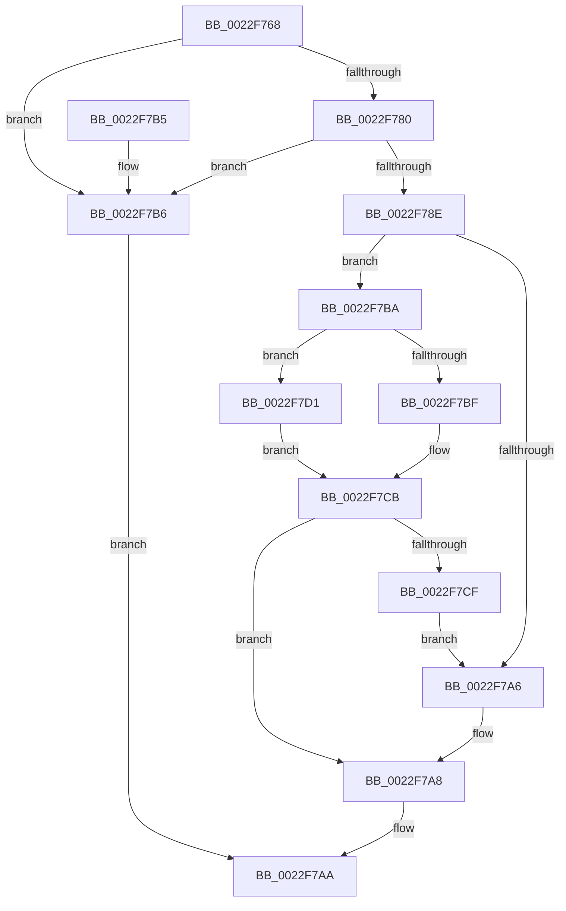

# SessionIsInteractive

- RVA: `0x0022F768`–`0x0022F7E5` (길이 `125` bytes)
- VA: `0x000000014022F768`
- 실행 섹션: `.text`
- PDB 이름 있음: `예`; PDB Function 태그: `아니요`
- unwind 정보 RVA: `0x0006015C`
- 디코드: `39`개 명령, `125/125` bytes 표시
- 미해석 바이트: `0` (있으면 어셈블리에 `.byte`로 보존)

> 이 문서는 커널 이미지의 기계어와 PDB 기호를 분석해 생성했습니다. 4번과 5번은 함수 원형과 자료형을 바이너리 사용 방식에서 추정한 C 해석이며 원본 소스 복구 결과는 아닙니다.

## 1. Dependencies

- 직접 호출 지점: **3**; 고유 호출 대상: **2**
- 직접 호출자로 확인된 함수: **2**
- RIP 상대 이미지 참조: **0**

### Outgoing calls
- `0x0022F785` → [PsGetSiloBySessionId](../../page/91/PsGetSiloBySessionId_function_00912F94.md) (function, `0x00912F94`)
- `0x0022F796` → [PsGetServerSiloGlobals](PsGetServerSiloGlobals_function_002250A0.md) (function, `0x002250A0`)
- `0x0022F7D4` → [PsGetServerSiloGlobals](PsGetServerSiloGlobals_function_002250A0.md) (function, `0x002250A0`)

### Direct callers
- [PopPowerRequestCreateCommon](../23/PopPowerRequestCreateCommon_function_00230150.md) at `0x002302FC`
- [NtSetThreadExecutionState](../../page/AC/NtSetThreadExecutionState_function_00AC0A40.md) at `0x00AC0C6C`
- [NtSetThreadExecutionState](../../page/AC/NtSetThreadExecutionState_function_00AC0A40.md) at `0x00AC0D0A`

### Static image references
- 디코드된 RIP-relative 메모리 참조가 없습니다.

## 2. Other-region calls and transfers

- 다른 실행 섹션으로 향하는 call: **1**
  - `0x0022F785` → [PsGetSiloBySessionId](../../page/91/PsGetSiloBySessionId_function_00912F94.md) (`.text` → `PAGE`)
- 별도 외부 분기/꼬리 이동을 확인하지 못했습니다.

## 3. Assembly (complete function range)

```asm
0022F768  48 89 5C 24 08                  mov qword ptr [rsp + 8], rbx
0022F76D  57                              push rdi
0022F76E  48 83 EC 20                     sub rsp, 0x20
0022F772  33 DB                           xor ebx, ebx
0022F774  8B F9                           mov edi, ecx
0022F776  48 89 5C 24 38                  mov qword ptr [rsp + 0x38], rbx
0022F77B  83 F9 FF                        cmp ecx, -1
0022F77E  74 36                           je 0x14022f7b6
0022F780  48 8D 54 24 38                  lea rdx, [rsp + 0x38]
0022F785  E8 0A 38 6E 00                  call 0x140912f94
0022F78A  85 C0                           test eax, eax
0022F78C  78 28                           js 0x14022f7b6
0022F78E  48 8B 54 24 38                  mov rdx, qword ptr [rsp + 0x38]
0022F793  48 8B CA                        mov rcx, rdx
0022F796  E8 05 59 FF FF                  call 0x1402250a0
0022F79B  48 8B 88 08 05 00 00            mov rcx, qword ptr [rax + 0x508]
0022F7A2  3B 39                           cmp edi, dword ptr [rcx]
0022F7A4  74 14                           je 0x14022f7ba
0022F7A6  B3 01                           mov bl, 1
0022F7A8  8A C3                           mov al, bl
0022F7AA  48 8B 5C 24 30                  mov rbx, qword ptr [rsp + 0x30]
0022F7AF  48 83 C4 20                     add rsp, 0x20
0022F7B3  5F                              pop rdi
0022F7B4  C3                              ret
0022F7B5  CC                              int3
0022F7B6  32 C0                           xor al, al
0022F7B8  EB F0                           jmp 0x14022f7aa
0022F7BA  48 85 D2                        test rdx, rdx
0022F7BD  75 12                           jne 0x14022f7d1
0022F7BF  48 B8 D8 02 00 00 80 F7 FF FF   movabs rax, 0xfffff780000002d8
0022F7C9  8B 00                           mov eax, dword ptr [rax]
0022F7CB  3B F8                           cmp edi, eax
0022F7CD  75 D9                           jne 0x14022f7a8
0022F7CF  EB D5                           jmp 0x14022f7a6
0022F7D1  48 8B CA                        mov rcx, rdx
0022F7D4  E8 C7 58 FF FF                  call 0x1402250a0
0022F7D9  48 8B 88 08 05 00 00            mov rcx, qword ptr [rax + 0x508]
0022F7E0  8B 41 04                        mov eax, dword ptr [rcx + 4]
0022F7E3  EB E6                           jmp 0x14022f7cb
```

## 4. C-style interpretation (structured pseudocode)

```c
__int64 __fastcall SessionIsInteractive(int a1)
{
    __int64 result;
    __int64 v_rbx;
    __int64 v_rsp;
    unsigned __int64 v_stack_p10;
    unsigned __int64 v_stack_p8;

    v_stack_p8 = v_rbx;
    v_rsp = (v_rsp) - (32);
    v_rbx = 0;
    v_stack_p10 = 0;
    if (a1 == -1) goto loc_0022F7B6;
    result = PsGetSiloBySessionId(a1, v_stack_p10, a3, a4);
    if (sign_flag) goto loc_0022F7B6;
    result = PsGetServerSiloGlobals(v_stack_p10, v_stack_p10, a3, a4);
    if (((unsigned int)((unsigned int)(a1))) == (*(unsigned int *)(*(unsigned __int64 *)(result + 1288)))) goto loc_0022F7BA;
loc_0022F7A6:
loc_0022F7A8:
loc_0022F7AA:
    v_rsp = (v_rsp) + (32);
    return 1;
loc_0022F7B6:
    result = 0;
    goto loc_0022F7AA;
loc_0022F7BA:
    if (v_stack_p10 != 0) goto loc_0022F7D1;
loc_0022F7CB:
    if (((unsigned int)((unsigned int)(a1))) != ((unsigned int)((unsigned int)(*(unsigned int *)(result))))) goto loc_0022F7A8;
    goto loc_0022F7A6;
loc_0022F7D1:
    result = PsGetServerSiloGlobals(v_stack_p10, v_stack_p10, a3, a4);
    goto loc_0022F7CB;
}
```

## 5. (Beta) C Style

```c
int64_t SessionIsInteractive(int32_t Arg1)
{
    int64_t result;
    int64_t local_rbx;
    int64_t local_rsp;
    uint64_t v_stack_p10;
    uint64_t v_stack_p8;

    v_stack_p8 = local_rbx;
    local_rsp = (local_rsp) - (32);
    local_rbx = 0;
    v_stack_p10 = 0;
    if (Arg1 == -1) goto loc_0022F7B6;
    result = PsGetSiloBySessionId(Arg1, v_stack_p10, a3, a4);
    if (sign_flag) goto loc_0022F7B6;
    result = PsGetServerSiloGlobals(v_stack_p10, v_stack_p10, a3, a4);
    if (((uint32_t)((uint32_t)(Arg1))) == (*(uint32_t *)(*(uint64_t *)(result + 0x508)))) goto loc_0022F7BA;
loc_0022F7A6:
loc_0022F7A8:
loc_0022F7AA:
    local_rsp = (local_rsp) + (32);
    return 1;
loc_0022F7B6:
    result = 0;
    goto loc_0022F7AA;
loc_0022F7BA:
    if (v_stack_p10 != 0) goto loc_0022F7D1;
loc_0022F7CB:
    if (((uint32_t)((uint32_t)(Arg1))) != ((uint32_t)((uint32_t)(*(uint32_t *)(result))))) goto loc_0022F7A8;
    goto loc_0022F7A6;
loc_0022F7D1:
    result = PsGetServerSiloGlobals(v_stack_p10, v_stack_p10, a3, a4);
    goto loc_0022F7CB;
}
```

## 6. Execution-region graph

[열기: 2D/3D 그래프와 함수 탐색 컨트롤 패널](../../../control-panel.html?section=text&rva=0x0022F768&view=graph)

- 2D 그래프는 위에서 아래로 흐르고, 3D 그래프는 빈 공간을 드래그해 회전합니다. Shift+드래그는 이동, 휠은 확대·축소, 함수 노드 선택은 대상 보고서 이동입니다.

### Static fallback


