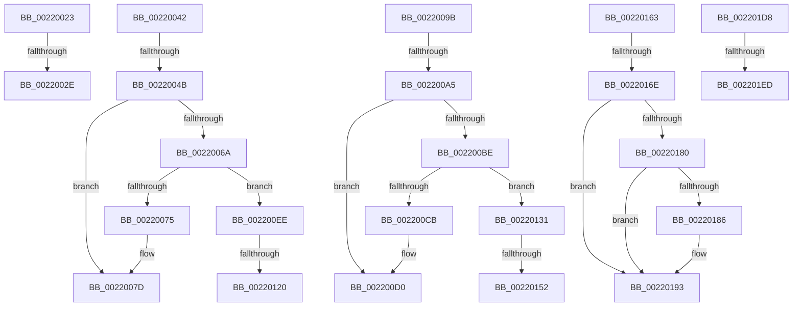

# sub_00220023

- RVA: `0x00220023`–`0x002201F2` (길이 `463` bytes)
- VA: `0x0000000140220023`
- 실행 섹션: `.text`
- PDB 이름 있음: `아니요`; PDB Function 태그: `아니요`
- unwind 정보 RVA: `0x0005F2F8`
- 디코드: `98`개 명령, `463/463` bytes 표시
- 미해석 바이트: `0` (있으면 어셈블리에 `.byte`로 보존)

> 이 문서는 커널 이미지의 기계어와 PDB 기호를 분석해 생성했습니다. 4번과 5번은 함수 원형과 자료형을 바이너리 사용 방식에서 추정한 C 해석이며 원본 소스 복구 결과는 아닙니다.

## 1. Dependencies

- 직접 호출 지점: **9**; 고유 호출 대상: **5**
- 직접 호출자로 확인된 함수: **0**
- RIP 상대 이미지 참조: **0**

### Outgoing calls
- `0x0022003B` → [KiAbThreadInsertList](../21/KiAbThreadInsertList_function_0021F0E0.md) (function, `0x0021F0E0`)
- `0x00220056` → [PsBoostThreadIoEx](../39/PsBoostThreadIoEx_function_00392C00.md) (function, `0x00392C00`)
- `0x002200AA` → [PsBoostThreadIoQoS](../21/PsBoostThreadIoQoS_function_0021EFC0.md) (function, `0x0021EFC0`)
- `0x002200F9` → [PsBoostThreadIoEx](../39/PsBoostThreadIoEx_function_00392C00.md) (function, `0x00392C00`)
- `0x00220113` → [KiAbThreadInsertList](../21/KiAbThreadInsertList_function_0021F0E0.md) (function, `0x0021F0E0`)
- `0x00220127` → [KiAbQueueAutoBoostDpc](../20/KiAbQueueAutoBoostDpc_function_002074D0.md) (function, `0x002074D0`)
- `0x00220145` → [KiAbThreadInsertList](../21/KiAbThreadInsertList_function_0021F0E0.md) (function, `0x0021F0E0`)
- `0x00220159` → [KiAbQueueAutoBoostDpc](../20/KiAbQueueAutoBoostDpc_function_002074D0.md) (function, `0x002074D0`)
- `0x002201CE` → [EtwTraceAutoBoostSetFloor](EtwTraceAutoBoostSetFloor_function_00222EF0.md) (function, `0x00222EF0`)

### Direct callers
- 이 함수 시작 RVA로 연결되는 직접 call은 확인되지 않았습니다. 간접 호출은 완전히 역산할 수 없습니다.

### Static image references
- 디코드된 RIP-relative 메모리 참조가 없습니다.

## 2. Other-region calls and transfers

- 다른 실행 섹션으로 향하는 call: **0**
- call이 아닌 외부 분기/꼬리 이동: **14**
  - `0x0022002C` → [sub_0021FF3E + 0xBD](../21/Unknown_function_0021FF3E.md) (`tail-transfer`)
  - `0x00220040` → [sub_0021FF3E + 0xBD](../21/Unknown_function_0021FF3E.md) (`tail-transfer`)
  - `0x00220049` → [sub_0021FF3E + 0x9B](../21/Unknown_function_0021FF3E.md) (`tail-transfer`)
  - `0x00220096` → [sub_0021FF3E + 0x9B](../21/Unknown_function_0021FF3E.md) (`tail-transfer`)
  - `0x0022009F` → [sub_0021FF3E + 0xB3](../21/Unknown_function_0021FF3E.md) (`tail-transfer`)
  - `0x002200E9` → [sub_0021FF3E + 0xB3](../21/Unknown_function_0021FF3E.md) (`tail-transfer`)
  - `0x0022011A` → [sub_0021FF3E + 0x9B](../21/Unknown_function_0021FF3E.md) (`tail-transfer`)
  - `0x0022012C` → [sub_0021FF3E + 0x9B](../21/Unknown_function_0021FF3E.md) (`tail-transfer`)
  - `0x0022014C` → [sub_0021FF3E + 0xB3](../21/Unknown_function_0021FF3E.md) (`tail-transfer`)
  - `0x0022015E` → [sub_0021FF3E + 0xB3](../21/Unknown_function_0021FF3E.md) (`tail-transfer`)
  - `0x00220168` → [sub_0021FF3E + 0xCD](../21/Unknown_function_0021FF3E.md) (`tail-transfer`)
  - `0x002201D3` → [sub_0021FF3E + 0xCD](../21/Unknown_function_0021FF3E.md) (`tail-transfer`)
  - `0x002201E7` → [sub_0021FD23 + 0x6B](../21/Unknown_function_0021FD23.md) (`tail-transfer`)
  - `0x002201ED` → [sub_0021FD23 + 0x63](../21/Unknown_function_0021FD23.md) (`tail-transfer`)

## 3. Assembly (complete function range)

```asm
00220023  0F B6 83 18 03 00 00            movzx eax, byte ptr [rbx + 0x318]
0022002A  84 C0                           test al, al
0022002C  74 CD                           je 0x14021fffb
0022002E  4C 8D 83 28 03 00 00            lea r8, [rbx + 0x328]
00220035  49 8B D5                        mov rdx, r13
00220038  48 8B CB                        mov rcx, rbx
0022003B  E8 A0 F0 FF FF                  call 0x14021f0e0
00220040  EB B9                           jmp 0x14021fffb
00220042  41 F7 01 00 00 00 40            test dword ptr [r9], 0x40000000
00220049  75 8E                           jne 0x14021ffd9
0022004B  45 33 C9                        xor r9d, r9d
0022004E  45 33 C0                        xor r8d, r8d
00220051  33 D2                           xor edx, edx
00220053  48 8B CB                        mov rcx, rbx
00220056  E8 A5 2B 17 00                  call 0x140392c00
0022005B  F0 83 0C 24 00                  lock or dword ptr [rsp], 0
00220060  8B 83 5C 03 00 00               mov eax, dword ptr [rbx + 0x35c]
00220066  85 C0                           test eax, eax
00220068  75 13                           jne 0x14022007d
0022006A  48 83 BC 24 D0 00 00 00 00      cmp qword ptr [rsp + 0xd0], 0
00220073  75 79                           jne 0x1402200ee
00220075  C7 44 24 58 01 00 00 00         mov dword ptr [rsp + 0x58], 1
0022007D  F0 FF 83 5C 03 00 00            lock inc dword ptr [rbx + 0x35c]
00220084  41 81 0E 00 00 00 40            or dword ptr [r14], 0x40000000
0022008B  41 BF 01 00 00 00               mov r15d, 1
00220091  C6 44 24 55 02                  mov byte ptr [rsp + 0x55], 2
00220096  E9 3E FF FF FF                  jmp 0x14021ffd9
0022009B  83 7E 50 00                     cmp dword ptr [rsi + 0x50], 0
0022009F  0F 8C 4C FF FF FF               jl 0x14021fff1
002200A5  33 D2                           xor edx, edx
002200A7  48 8B CB                        mov rcx, rbx
002200AA  E8 11 EF FF FF                  call 0x14021efc0
002200AF  F0 83 0C 24 00                  lock or dword ptr [rsp], 0
002200B4  8B 83 60 03 00 00               mov eax, dword ptr [rbx + 0x360]
002200BA  85 C0                           test eax, eax
002200BC  75 12                           jne 0x1402200d0
002200BE  48 8B BC 24 D0 00 00 00         mov rdi, qword ptr [rsp + 0xd0]
002200C6  48 85 FF                        test rdi, rdi
002200C9  75 66                           jne 0x140220131
002200CB  83 4C 24 58 02                  or dword ptr [rsp + 0x58], 2
002200D0  F0 FF 83 60 03 00 00            lock inc dword ptr [rbx + 0x360]
002200D7  81 4E 50 00 00 00 80            or dword ptr [rsi + 0x50], 0x80000000
002200DE  41 BF 01 00 00 00               mov r15d, 1
002200E4  44 88 7C 24 56                  mov byte ptr [rsp + 0x56], r15b
002200E9  E9 03 FF FF FF                  jmp 0x14021fff1
002200EE  45 33 C9                        xor r9d, r9d
002200F1  45 33 C0                        xor r8d, r8d
002200F4  B2 01                           mov dl, 1
002200F6  48 8B CB                        mov rcx, rbx
002200F9  E8 02 2B 17 00                  call 0x140392c00
002200FE  4C 8B B4 24 D0 00 00 00         mov r14, qword ptr [rsp + 0xd0]
00220106  4C 8D 83 30 03 00 00            lea r8, [rbx + 0x330]
0022010D  49 8B D6                        mov rdx, r14
00220110  48 8B CB                        mov rcx, rbx
00220113  E8 C8 EF FF FF                  call 0x14021f0e0
00220118  85 C0                           test eax, eax
0022011A  0F 84 B9 FE FF FF               je 0x14021ffd9
00220120  49 8D 8E 90 6E FF FF            lea rcx, [r14 - 0x9170]
00220127  E8 A4 73 FE FF                  call 0x1402074d0
0022012C  E9 A8 FE FF FF                  jmp 0x14021ffd9
00220131  F0 FF 8B E4 05 00 00            lock dec dword ptr [rbx + 0x5e4]
00220138  4C 8D 83 30 03 00 00            lea r8, [rbx + 0x330]
0022013F  48 8B D7                        mov rdx, rdi
00220142  48 8B CB                        mov rcx, rbx
00220145  E8 96 EF FF FF                  call 0x14021f0e0
0022014A  85 C0                           test eax, eax
0022014C  0F 84 9F FE FF FF               je 0x14021fff1
00220152  48 8D 8F 90 6E FF FF            lea rcx, [rdi - 0x9170]
00220159  E8 72 73 FE FF                  call 0x1402074d0
0022015E  E9 8E FE FF FF                  jmp 0x14021fff1
00220163  83 7C 24 54 00                  cmp dword ptr [rsp + 0x54], 0
00220168  0F 84 9D FE FF FF               je 0x14022000b
0022016E  48 8B 16                        mov rdx, qword ptr [rsi]
00220171  48 B8 FC FF FF FF FF FF FF 7F   movabs rax, 0x7ffffffffffffffc
0022017B  48 23 D0                        and rdx, rax
0022017E  74 13                           je 0x140220193
00220180  80 7E 08 00                     cmp byte ptr [rsi + 8], 0
00220184  7C 0D                           jl 0x140220193
00220186  48 B8 00 00 00 00 00 00 00 80   movabs rax, 0x8000000000000000
00220190  48 0B D0                        or rdx, rax
00220193  8B 44 24 58                     mov eax, dword ptr [rsp + 0x58]
00220197  45 0F B6 C4                     movzx r8d, r12b
0022019B  44 0F B6 4C 24 55               movzx r9d, byte ptr [rsp + 0x55]
002201A1  48 8B CB                        mov rcx, rbx
002201A4  89 44 24 48                     mov dword ptr [rsp + 0x48], eax
002201A8  0F B6 84 24 B8 00 00 00         movzx eax, byte ptr [rsp + 0xb8]
002201B0  88 44 24 38                     mov byte ptr [rsp + 0x38], al
002201B4  0F B6 84 24 B0 00 00 00         movzx eax, byte ptr [rsp + 0xb0]
002201BC  40 88 6C 24 30                  mov byte ptr [rsp + 0x30], bpl
002201C1  88 44 24 28                     mov byte ptr [rsp + 0x28], al
002201C5  0F B6 44 24 56                  movzx eax, byte ptr [rsp + 0x56]
002201CA  88 44 24 20                     mov byte ptr [rsp + 0x20], al
002201CE  E8 1D 2D 00 00                  call 0x140222ef0
002201D3  E9 33 FE FF FF                  jmp 0x14022000b
002201D8  83 BB E4 05 00 00 00            cmp dword ptr [rbx + 0x5e4], 0
002201DF  C6 84 24 B8 00 00 00 00         mov byte ptr [rsp + 0xb8], 0
002201E7  0F 84 A1 FB FF FF               je 0x14021fd8e
002201ED  E9 94 FB FF FF                  jmp 0x14021fd86
```

## 4. C-style interpretation (structured pseudocode)

```c
__int64 __fastcall sub_00220023(__int64 a1, __int64 a2, __int64 a3, __int64 a4)
{
    __int64 result;
    unsigned int v_stack_p0;
    unsigned __int8 v_stack_p20;
    unsigned __int8 v_stack_p28;
    unsigned __int8 v_stack_p30;
    unsigned __int8 v_stack_p38;
    unsigned int v_stack_p48;
    unsigned int v_stack_p54;
    unsigned __int8 v_stack_p55;
    unsigned __int8 v_stack_p56;
    unsigned int v_stack_p58;
    unsigned __int8 v_stack_pB0;
    unsigned __int8 v_stack_pB8;
    unsigned __int64 v_stack_pD0;

    result = KiAbThreadInsertList(v_rbx, v_r13, v_rbx + 808, a4);
}
```

## 5. (Beta) C Style

```c
int64_t sub_00220023(int64_t Arg1, int64_t Arg2, int64_t Arg3, int64_t Arg4)
{
    int64_t result;
    uint32_t v_stack_p0;
    uint8_t v_stack_p20;
    uint8_t v_stack_p28;
    uint8_t v_stack_p30;
    uint8_t v_stack_p38;
    uint32_t v_stack_p48;
    uint32_t v_stack_p54;
    uint8_t v_stack_p55;
    uint8_t v_stack_p56;
    uint32_t v_stack_p58;
    uint8_t v_stack_pB0;
    uint8_t v_stack_pB8;
    uint64_t v_stack_pD0;

    result = KiAbThreadInsertList(local_rbx, local_r13, local_rbx + 808, Arg4);
}
```

## 6. Execution-region graph

[열기: 2D/3D 그래프와 함수 탐색 컨트롤 패널](../../../control-panel.html?section=text&rva=0x00220023&view=graph)

- 2D 그래프는 위에서 아래로 흐르고, 3D 그래프는 빈 공간을 드래그해 회전합니다. Shift+드래그는 이동, 휠은 확대·축소, 함수 노드 선택은 대상 보고서 이동입니다.

### Static fallback


