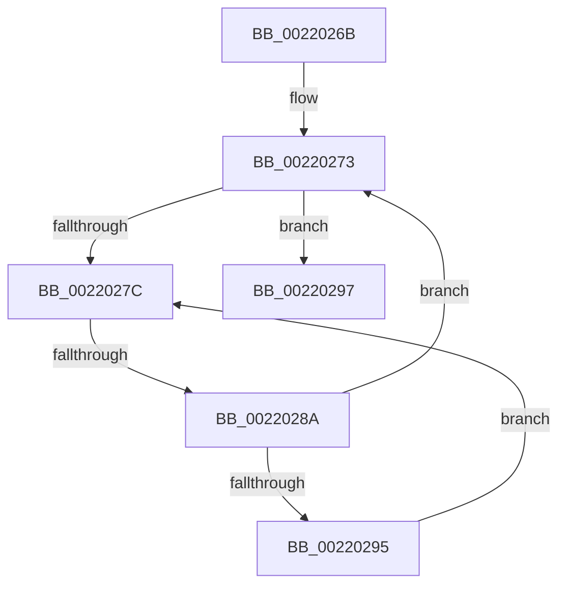

# sub_0022026B

- RVA: `0x0022026B`–`0x002202B6` (길이 `75` bytes)
- VA: `0x000000014022026B`
- 실행 섹션: `.text`
- PDB 이름 있음: `아니요`; PDB Function 태그: `아니요`
- unwind 정보 RVA: `0x0005F324`
- 디코드: `19`개 명령, `75/75` bytes 표시
- 미해석 바이트: `0` (있으면 어셈블리에 `.byte`로 보존)

> 이 문서는 커널 이미지의 기계어와 PDB 기호를 분석해 생성했습니다. 4번과 5번은 함수 원형과 자료형을 바이너리 사용 방식에서 추정한 C 해석이며 원본 소스 복구 결과는 아닙니다.

## 1. Dependencies

- 직접 호출 지점: **0**; 고유 호출 대상: **0**
- 직접 호출자로 확인된 함수: **0**
- RIP 상대 이미지 참조: **1**

### Outgoing calls
- 직접 디코드된 call 명령이 없습니다.

### Direct callers
- 이 함수 시작 RVA로 연결되는 직접 call은 확인되지 않았습니다. 간접 호출은 완전히 역산할 수 없습니다.

### Static image references
- `0x0022027E` → RVA `0x00FC52AC` (`ALMOSTRO`; reference)

## 2. Other-region calls and transfers

- 다른 실행 섹션으로 향하는 call: **0**
- call이 아닌 외부 분기/꼬리 이동: **2**
  - `0x00220284` → [sub_002203C4](Unknown_function_002203C4.md) (`tail-transfer`)
  - `0x002202B4` → [sub_002202B6 + 0x19](Unknown_function_002202B6.md) (`tail-transfer`)

## 3. Assembly (complete function range)

```asm
0022026B  48 89 6C 24 50                  mov qword ptr [rsp + 0x50], rbp
00220270  41 8B EE                        mov ebp, r14d
00220273  F0 48 0F BA 6F 40 00            lock bts qword ptr [rdi + 0x40], 0
0022027A  73 1B                           jae 0x140220297
0022027C  FF C5                           inc ebp
0022027E  85 2D 28 50 DA 00               test dword ptr [rip + 0xda5028], ebp
00220284  0F 84 3A 01 00 00               je 0x1402203c4
0022028A  F3 90                           pause
0022028C  48 8B 47 40                     mov rax, qword ptr [rdi + 0x40]
00220290  48 85 C0                        test rax, rax
00220293  74 DE                           je 0x140220273
00220295  EB E5                           jmp 0x14022027c
00220297  4C 0F BE 8F 1B 03 00 00         movsx r9, byte ptr [rdi + 0x31b]
0022029F  48 8B 6C 24 50                  mov rbp, qword ptr [rsp + 0x50]
002202A4  4D 8B C1                        mov r8, r9
002202A7  49 8D 0C 39                     lea rcx, [r9 + rdi]
002202AB  0F B6 81 38 03 00 00            movzx eax, byte ptr [rcx + 0x338]
002202B2  84 C0                           test al, al
002202B4  75 19                           jne 0x1402202cf
```

## 4. C-style interpretation (structured pseudocode)

```c
__int64 __fastcall sub_0022026B(__int64 a1, __int64 a2, __int64 a3, __int64 a4, __int64 a5, __int64 a6, __int64 a7, __int64 a8, __int64 a9, __int64 a10)
{
    __int64 v_rbp;
    unsigned __int64 v_stack_p50;

    v_stack_p50 = v_rbp;
loc_00220273:
    if (condition_is_above_or_equal) goto loc_00220297;
loc_0022027C:
    v_rbp = (unsigned int)(((unsigned int)((unsigned int)(v_r14))) + 1);
    if (*(unsigned __int64 *)(v_rdi + 64) == 0) goto loc_00220273;
    goto loc_0022027C;
loc_00220297:
}
```

## 5. (Beta) C Style

```c
int64_t sub_0022026B(int64_t Arg1, int64_t Arg2, int64_t Arg3, int64_t Arg4, uint64_t Arg5, uint64_t Arg6, uint64_t Arg7, uint64_t Arg8, uint64_t Arg9, int64_t Arg10)
{
    int64_t local_rbp;
    uint64_t v_stack_p50;

    v_stack_p50 = local_rbp;
loc_00220273:
    if (condition_is_above_or_equal) goto loc_00220297;
loc_0022027C:
    local_rbp = (uint32_t)(((uint32_t)((uint32_t)(local_r14))) + 1);
    if (*(uint64_t *)(local_rdi + 0x40) == 0) goto loc_00220273;
    goto loc_0022027C;
loc_00220297:
}
```

## 6. Execution-region graph

[열기: 2D/3D 그래프와 함수 탐색 컨트롤 패널](../../../control-panel.html?section=text&rva=0x0022026B&view=graph)

- 2D 그래프는 위에서 아래로 흐르고, 3D 그래프는 빈 공간을 드래그해 회전합니다. Shift+드래그는 이동, 휠은 확대·축소, 함수 노드 선택은 대상 보고서 이동입니다.

### Static fallback


