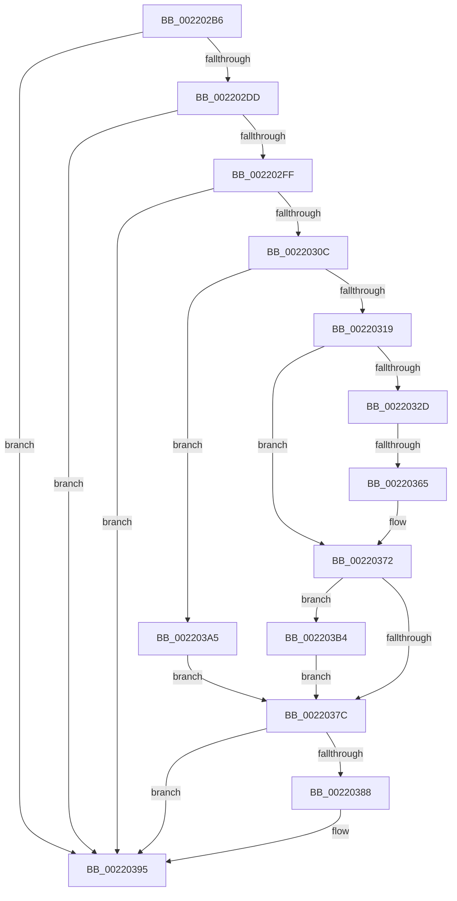

# sub_002202B6

- RVA: `0x002202B6`–`0x002203C4` (길이 `270` bytes)
- VA: `0x00000001402202B6`
- 실행 섹션: `.text`
- PDB 이름 있음: `아니요`; PDB Function 태그: `아니요`
- unwind 정보 RVA: `0x0005F338`
- 디코드: `68`개 명령, `270/270` bytes 표시
- 미해석 바이트: `0` (있으면 어셈블리에 `.byte`로 보존)

> 이 문서는 커널 이미지의 기계어와 PDB 기호를 분석해 생성했습니다. 4번과 5번은 함수 원형과 자료형을 바이너리 사용 방식에서 추정한 C 해석이며 원본 소스 복구 결과는 아닙니다.

## 1. Dependencies

- 직접 호출 지점: **4**; 고유 호출 대상: **4**
- 직접 호출자로 확인된 함수: **0**
- RIP 상대 이미지 참조: **0**

### Outgoing calls
- `0x002202C9` → [KeBugCheckEx](../4F/KeBugCheckEx_function_004FD660.md) (function, `0x004FD660`)
- `0x0022030C` → [Feature_StackingDecayBoosts__private_IsEnabledNoReportingNoInline](../4E/Feature_StackingDecayBoosts__private_IsEnabledNoReportingNoInline_function_004EF7C0.md) (function, `0x004EF7C0`)
- `0x00220390` → [KiSetPriorityThread](KiSetPriorityThread_function_00220E78.md) (function, `0x00220E78`)
- `0x002203AA` → [KiComputeThreadPriorityNonStacking](../5C/KiComputeThreadPriorityNonStacking_function_005CA81C.md) (function, `0x005CA81C`)

### Direct callers
- 이 함수 시작 RVA로 연결되는 직접 call은 확인되지 않았습니다. 간접 호출은 완전히 역산할 수 없습니다.

### Static image references
- 디코드된 RIP-relative 메모리 참조가 없습니다.

## 2. Other-region calls and transfers

- 다른 실행 섹션으로 향하는 call: **0**
- call이 아닌 외부 분기/꼬리 이동: **2**
  - `0x0022035F` → [sub_002203EB + 0x83](Unknown_function_002203EB.md) (`tail-transfer`)
  - `0x002203A0` → [KiExitThreadWait + 0x24](KiExitThreadWait_function_00220200.md) (`tail-transfer`)

## 3. Assembly (complete function range)

```asm
002202B6  41 B9 02 00 00 00               mov r9d, 2
002202BC  4C 89 74 24 20                  mov qword ptr [rsp + 0x20], r14
002202C1  48 8B D7                        mov rdx, rdi
002202C4  B9 57 01 00 00                  mov ecx, 0x157
002202C9  E8 92 D3 2D 00                  call 0x1404fd660
002202CE  CC                              int3
002202CF  2C 01                           sub al, 1
002202D1  88 81 38 03 00 00               mov byte ptr [rcx + 0x338], al
002202D7  0F 85 B8 00 00 00               jne 0x140220395
002202DD  8B 97 58 03 00 00               mov edx, dword ptr [rdi + 0x358]
002202E3  41 8B C9                        mov ecx, r9d
002202E6  44 0F BB CA                     btc edx, r9d
002202EA  B8 01 00 00 00                  mov eax, 1
002202EF  D3 E0                           shl eax, cl
002202F1  89 97 58 03 00 00               mov dword ptr [rdi + 0x358], edx
002202F7  3B D0                           cmp edx, eax
002202F9  0F 83 96 00 00 00               jae 0x140220395
002202FF  80 BF C3 00 00 00 1F            cmp byte ptr [rdi + 0xc3], 0x1f
00220306  0F 8F 89 00 00 00               jg 0x140220395
0022030C  E8 AF F4 2C 00                  call 0x1404ef7c0
00220311  85 C0                           test eax, eax
00220313  0F 84 8C 00 00 00               je 0x1402203a5
00220319  44 0F BE 87 33 02 00 00         movsx r8d, byte ptr [rdi + 0x233]
00220321  45 8B D0                        mov r10d, r8d
00220324  45 8B C8                        mov r9d, r8d
00220327  41 83 F8 10                     cmp r8d, 0x10
0022032B  7D 45                           jge 0x140220372
0022032D  0F B6 8F 66 03 00 00            movzx ecx, byte ptr [rdi + 0x366]
00220334  0F B7 97 06 02 00 00            movzx edx, word ptr [rdi + 0x206]
0022033B  8B C2                           mov eax, edx
0022033D  83 E0 0F                        and eax, 0xf
00220340  41 03 C0                        add eax, r8d
00220343  41 3B C1                        cmp eax, r9d
00220346  44 8B C0                        mov r8d, eax
00220349  41 8B C6                        mov eax, r14d
0022034C  45 0F 4E C1                     cmovle r8d, r9d
00220350  84 C9                           test cl, cl
00220352  0F 4F C1                        cmovg eax, ecx
00220355  0F BE C0                        movsx eax, al
00220358  44 03 C0                        add r8d, eax
0022035B  41 83 F8 10                     cmp r8d, 0x10
0022035F  0F 8D 09 01 00 00               jge 0x14022046e
00220365  C1 EA 04                        shr edx, 4
00220368  0F B6 C2                        movzx eax, dl
0022036B  41 3B C0                        cmp eax, r8d
0022036E  44 0F 4F C0                     cmovg r8d, eax
00220372  8B 87 58 03 00 00               mov eax, dword ptr [rdi + 0x358]
00220378  85 C0                           test eax, eax
0022037A  75 38                           jne 0x1402203b4
0022037C  0F BE 87 C3 00 00 00            movsx eax, byte ptr [rdi + 0xc3]
00220383  44 3B C0                        cmp r8d, eax
00220386  7D 0D                           jge 0x140220395
00220388  48 8D 54 24 68                  lea rdx, [rsp + 0x68]
0022038D  48 8B CF                        mov rcx, rdi
00220390  E8 E3 0A 00 00                  call 0x140220e78
00220395  C6 87 1B 03 00 00 20            mov byte ptr [rdi + 0x31b], 0x20
0022039C  4C 89 77 40                     mov qword ptr [rdi + 0x40], r14
002203A0  E9 7F FE FF FF                  jmp 0x140220224
002203A5  33 D2                           xor edx, edx
002203A7  48 8B CF                        mov rcx, rdi
002203AA  E8 6D A4 3A 00                  call 0x1405ca81c
002203AF  44 8B C0                        mov r8d, eax
002203B2  EB C8                           jmp 0x14022037c
002203B4  0F BD C0                        bsr eax, eax
002203B7  44 3B C0                        cmp r8d, eax
002203BA  89 44 24 60                     mov dword ptr [rsp + 0x60], eax
002203BE  44 0F 4C C0                     cmovl r8d, eax
002203C2  EB B8                           jmp 0x14022037c
```

## 4. C-style interpretation (structured pseudocode)

```c
__int64 __fastcall sub_002202B6(__int64 a1, __int64 a2, __int64 a3, __int64 a4, __int64 a5, __int64 a6, __int64 a7, __int64 a8, __int64 a9, __int64 a10, __int64 a11, __int64 a12, __int64 a13)
{
    __int64 result;
    unsigned __int64 v_stack_p20;
    unsigned int v_stack_p60;

    v_stack_p20 = v_r14;
    result = KeBugCheckEx(343, v_rdi, a3, 2);
    result = (unsigned __int8)((result) - (1));
    *(unsigned __int8 *)(343 + 824) = (unsigned __int8)(result);
    if (condition_is_not_equal) goto loc_00220395;
    result = (unsigned int)((1) << (2));
    *(unsigned int *)(v_rdi + 856) = (unsigned int)((unsigned int)(*(unsigned int *)(v_rdi + 856)));
    if (((unsigned int)((unsigned int)(*(unsigned int *)(v_rdi + 856)))) >= ((unsigned int)(result))) goto loc_00220395;
    if ((*(unsigned __int8 *)(v_rdi + 195)) > 31) goto loc_00220395;
    result = Feature_StackingDecayBoosts__private_IsEnabledNoReportingNoInline(2, (unsigned int)(*(unsigned int *)(v_rdi + 856)), a3, 2);
    if ((unsigned int)(result) == 0) goto loc_002203A5;
    if (((unsigned int)((__int8)(*(unsigned __int8 *)(v_rdi + 563)))) >= 16) goto loc_00220372;
    result = (unsigned int)(((unsigned int)((unsigned int)(*(unsigned __int16 *)(v_rdi + 518)))) & (15));
    result = (unsigned int)((result) + ((unsigned int)((__int8)(*(unsigned __int8 *)(v_rdi + 563)))));
    a3 = (unsigned int)((unsigned int)(result));
    if (((unsigned int)(result)) <= ((unsigned int)((unsigned int)((unsigned int)((__int8)(*(unsigned __int8 *)(v_rdi + 563))))))) { a3 = (unsigned int)((unsigned int)((unsigned int)((__int8)(*(unsigned __int8 *)(v_rdi + 563))))); }
    result = (unsigned int)((unsigned int)(v_r14));
    if (condition_is_greater) { result = (unsigned int)(*(unsigned __int8 *)(v_rdi + 870)); }
    a3 = (unsigned int)((a3) + ((unsigned int)((__int8)((unsigned __int8)(result)))));
    a2 = (unsigned int)((*(unsigned __int16 *)(v_rdi + 518)) >> (4));
    if (((unsigned int)((unsigned __int8)(a2))) > ((unsigned int)(a3))) { a3 = (unsigned int)((unsigned __int8)(a2)); }
loc_00220372:
    if ((unsigned int)((unsigned int)(*(unsigned int *)(v_rdi + 856))) != 0) goto loc_002203B4;
loc_0022037C:
    result = (__int8)(*(unsigned __int8 *)(v_rdi + 195));
    if (((unsigned int)(a3)) < ((unsigned int)((__int8)(*(unsigned __int8 *)(v_rdi + 195))))) {
        a2 = a13;
        a1 = v_rdi;
        result = KiSetPriorityThread(a1, a2, a3, (unsigned int)((unsigned int)((__int8)(*(unsigned __int8 *)(v_rdi + 563)))));
    }
    *(unsigned __int8 *)(v_rdi + 795) = 32;
    *(unsigned __int64 *)(v_rdi + 64) = v_r14;
loc_002203A5:
    a2 = 0;
    result = KiComputeThreadPriorityNonStacking(v_rdi, a2, a3, (unsigned int)((unsigned int)((__int8)(*(unsigned __int8 *)(v_rdi + 563)))));
    goto loc_0022037C;
loc_002203B4:
    v_stack_p60 = (unsigned int)(result);
    a3 = (unsigned int)((unsigned int)(result));
    if (((unsigned int)((unsigned int)((unsigned int)(result)))) < ((unsigned int)(result))) { a3 = (unsigned int)(result); }
    goto loc_0022037C;
}
```

## 5. (Beta) C Style

```c
int64_t sub_002202B6(int64_t Arg1, int64_t Arg2, int64_t Arg3, int64_t Arg4, uint64_t Arg5, uint64_t Arg6, uint64_t Arg7, uint64_t Arg8, uint64_t Arg9, uint64_t Arg10, uint64_t Arg11, uint64_t Arg12, int64_t Arg13)
{
    int64_t result;
    uint64_t v_stack_p20;
    uint32_t v_stack_p60;

    v_stack_p20 = local_r14;
    result = KeBugCheckEx(343, local_rdi, Arg3, 2);
    result = (uint8_t)((result) - (1));
    *(uint8_t *)(343 + 0x338) = (uint8_t)(result);
    if (condition_is_not_equal) goto loc_00220395;
    result = (uint32_t)((1) << (2));
    *(uint32_t *)(local_rdi + 0x358) = (uint32_t)((uint32_t)(*(uint32_t *)(local_rdi + 0x358)));
    if (((uint32_t)((uint32_t)(*(uint32_t *)(local_rdi + 0x358)))) >= ((uint32_t)(result))) goto loc_00220395;
    if ((*(uint8_t *)(local_rdi + 0xC3)) > 31) goto loc_00220395;
    result = Feature_StackingDecayBoosts__private_IsEnabledNoReportingNoInline(2, (uint32_t)(*(uint32_t *)(local_rdi + 0x358)), Arg3, 2);
    if ((uint32_t)(result) == 0) goto loc_002203A5;
    if (((uint32_t)((int8_t)(*(uint8_t *)(local_rdi + 0x233)))) >= 16) goto loc_00220372;
    result = (uint32_t)(((uint32_t)((uint32_t)(*(uint16_t *)(local_rdi + 0x206)))) & (15));
    result = (uint32_t)((result) + ((uint32_t)((int8_t)(*(uint8_t *)(local_rdi + 0x233)))));
    Arg3 = (uint32_t)((uint32_t)(result));
    if (((uint32_t)(result)) <= ((uint32_t)((uint32_t)((uint32_t)((int8_t)(*(uint8_t *)(local_rdi + 0x233))))))) { Arg3 = (uint32_t)((uint32_t)((uint32_t)((int8_t)(*(uint8_t *)(local_rdi + 0x233))))); }
    result = (uint32_t)((uint32_t)(local_r14));
    if (condition_is_greater) { result = (uint32_t)(*(uint8_t *)(local_rdi + 0x366)); }
    Arg3 = (uint32_t)((Arg3) + ((uint32_t)((int8_t)((uint8_t)(result)))));
    Arg2 = (uint32_t)((*(uint16_t *)(local_rdi + 0x206)) >> (4));
    if (((uint32_t)((uint8_t)(Arg2))) > ((uint32_t)(Arg3))) { Arg3 = (uint32_t)((uint8_t)(Arg2)); }
loc_00220372:
    if ((uint32_t)((uint32_t)(*(uint32_t *)(local_rdi + 0x358))) != 0) goto loc_002203B4;
loc_0022037C:
    result = (int8_t)(*(uint8_t *)(local_rdi + 0xC3));
    if (((uint32_t)(Arg3)) < ((uint32_t)((int8_t)(*(uint8_t *)(local_rdi + 0xC3))))) {
        Arg2 = Arg13;
        Arg1 = local_rdi;
        result = KiSetPriorityThread(Arg1, Arg2, Arg3, (uint32_t)((uint32_t)((int8_t)(*(uint8_t *)(local_rdi + 0x233)))));
    }
    *(uint8_t *)(local_rdi + 0x31B) = 32;
    *(uint64_t *)(local_rdi + 0x40) = local_r14;
loc_002203A5:
    Arg2 = 0;
    result = KiComputeThreadPriorityNonStacking(local_rdi, Arg2, Arg3, (uint32_t)((uint32_t)((int8_t)(*(uint8_t *)(local_rdi + 0x233)))));
    goto loc_0022037C;
loc_002203B4:
    v_stack_p60 = (uint32_t)(result);
    Arg3 = (uint32_t)((uint32_t)(result));
    if (((uint32_t)((uint32_t)((uint32_t)(result)))) < ((uint32_t)(result))) { Arg3 = (uint32_t)(result); }
    goto loc_0022037C;
}
```

## 6. Execution-region graph

[열기: 2D/3D 그래프와 함수 탐색 컨트롤 패널](../../../control-panel.html?section=text&rva=0x002202B6&view=graph)

- 2D 그래프는 위에서 아래로 흐르고, 3D 그래프는 빈 공간을 드래그해 회전합니다. Shift+드래그는 이동, 휠은 확대·축소, 함수 노드 선택은 대상 보고서 이동입니다.

### Static fallback


