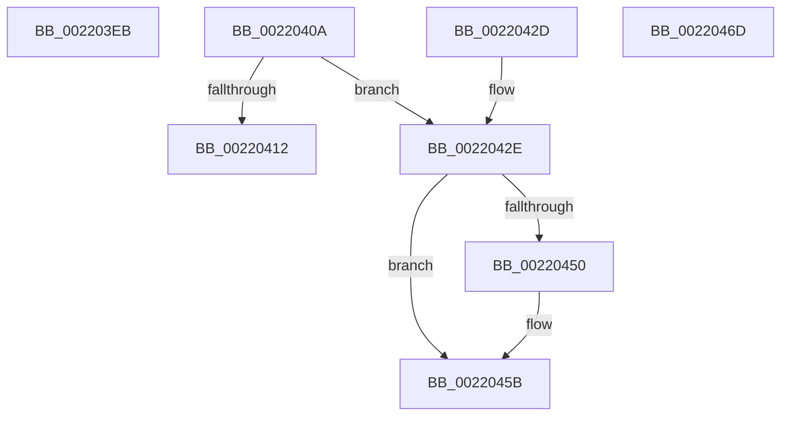

# sub_002203EB

- RVA: `0x002203EB`–`0x00220479` (길이 `142` bytes)
- VA: `0x00000001402203EB`
- 실행 섹션: `.text`
- PDB 이름 있음: `아니요`; PDB Function 태그: `아니요`
- unwind 정보 RVA: `0x0005F35C`
- 디코드: `46`개 명령, `142/142` bytes 표시
- 미해석 바이트: `0` (있으면 어셈블리에 `.byte`로 보존)

> 이 문서는 커널 이미지의 기계어와 PDB 기호를 분석해 생성했습니다. 4번과 5번은 함수 원형과 자료형을 바이너리 사용 방식에서 추정한 C 해석이며 원본 소스 복구 결과는 아닙니다.

## 1. Dependencies

- 직접 호출 지점: **5**; 고유 호출 대상: **4**
- 직접 호출자로 확인된 함수: **0**
- RIP 상대 이미지 참조: **1**

### Outgoing calls
- `0x002203F7` → [KiProcessDeferredReadyList](../25/KiProcessDeferredReadyList_function_00250800.md) (function, `0x00250800`)
- `0x0022041A` → [KiExitThreadWaitReschedule](../35/KiExitThreadWaitReschedule_function_00352EC8.md) (function, `0x00352EC8`)
- `0x00220436` → [KiProcessDeferredReadyList](../25/KiProcessDeferredReadyList_function_00250800.md) (function, `0x00250800`)
- `0x00220442` → [KiDeliverApc](../25/KiDeliverApc_function_00250F20.md) (function, `0x00250F20`)
- `0x00220456` → [KiLowerIrqlProcessIrqlFlags](../4F/KiLowerIrqlProcessIrqlFlags_function_004F5698.md) (function, `0x004F5698`)

### Direct callers
- 이 함수 시작 RVA로 연결되는 직접 call은 확인되지 않았습니다. 간접 호출은 완전히 역산할 수 없습니다.

### Static image references
- `0x00220447` → RVA `0x00FC6D20` (`ALMOSTRO`; read)

## 2. Other-region calls and transfers

- 다른 실행 섹션으로 향하는 call: **0**
- call이 아닌 외부 분기/꼬리 이동: **1**
  - `0x00220474` → [sub_002202B6 + 0xAF](Unknown_function_002202B6.md) (`tail-transfer`)

## 3. Assembly (complete function range)

```asm
002203EB  44 0F B6 C7                     movzx r8d, dil
002203EF  48 8D 54 24 68                  lea rdx, [rsp + 0x68]
002203F4  48 8B CE                        mov rcx, rsi
002203F7  E8 04 04 03 00                  call 0x140250800
002203FC  48 8B 5C 24 58                  mov rbx, qword ptr [rsp + 0x58]
00220401  48 83 C4 30                     add rsp, 0x30
00220405  41 5E                           pop r14
00220407  5F                              pop rdi
00220408  5E                              pop rsi
00220409  C3                              ret
0022040A  CC                              int3
0022040B  48 8B CE                        mov rcx, rsi
0022040E  A8 18                           test al, 0x18
00220410  74 1C                           je 0x14022042e
00220412  4C 8D 44 24 68                  lea r8, [rsp + 0x68]
00220417  48 8B D7                        mov rdx, rdi
0022041A  E8 A9 2A 13 00                  call 0x140352ec8
0022041F  48 8B 5C 24 58                  mov rbx, qword ptr [rsp + 0x58]
00220424  48 83 C4 30                     add rsp, 0x30
00220428  41 5E                           pop r14
0022042A  5F                              pop rdi
0022042B  5E                              pop rsi
0022042C  C3                              ret
0022042D  CC                              int3
0022042E  41 B0 01                        mov r8b, 1
00220431  48 8D 54 24 68                  lea rdx, [rsp + 0x68]
00220436  E8 C5 03 03 00                  call 0x140250800
0022043B  45 33 C0                        xor r8d, r8d
0022043E  33 D2                           xor edx, edx
00220440  33 C9                           xor ecx, ecx
00220442  E8 D9 0A 03 00                  call 0x140250f20
00220447  44 39 35 D2 68 DA 00            cmp dword ptr [rip + 0xda68d2], r14d
0022044E  74 0B                           je 0x14022045b
00220450  44 0F 20 C1                     mov rcx, cr8
00220454  33 D2                           xor edx, edx
00220456  E8 3D 52 2D 00                  call 0x1404f5698
0022045B  45 0F 22 C6                     mov cr8, r14
0022045F  48 8B 5C 24 58                  mov rbx, qword ptr [rsp + 0x58]
00220464  48 83 C4 30                     add rsp, 0x30
00220468  41 5E                           pop r14
0022046A  5F                              pop rdi
0022046B  5E                              pop rsi
0022046C  C3                              ret
0022046D  CC                              int3
0022046E  41 B8 0F 00 00 00               mov r8d, 0xf
00220474  E9 EC FE FF FF                  jmp 0x140220365
```

## 4. C-style interpretation (structured pseudocode)

```c
__int64 __fastcall sub_002203EB(__int64 a1, __int64 a2, __int64 a3, __int64 a4, __int64 a5, __int64 a6, __int64 a7, __int64 a8, __int64 a9, __int64 a10, __int64 a11, __int64 a12, __int64 a13)
{
    __int64 result;
    __int64 v_rsp;
    unsigned __int64 v_stack_pA0;
    unsigned __int64 v_stack_pB0;
    unsigned __int64 v_stack_pE8;
    unsigned __int64 v_stack_pF8;

    result = KiProcessDeferredReadyList(v_rsi, a13, (unsigned __int8)(v_rdi), a4);
    v_rsp = (v_rsp) + (48);
    return result;
}
```

## 5. (Beta) C Style

```c
int64_t sub_002203EB(int64_t Arg1, int64_t Arg2, int64_t Arg3, int64_t Arg4, uint64_t Arg5, uint64_t Arg6, uint64_t Arg7, uint64_t Arg8, uint64_t Arg9, uint64_t Arg10, int64_t Arg11, uint64_t Arg12, int64_t Arg13)
{
    int64_t result;
    int64_t local_rsp;
    uint64_t v_stack_pA0;
    uint64_t v_stack_pB0;
    uint64_t v_stack_pE8;
    uint64_t v_stack_pF8;

    result = KiProcessDeferredReadyList(local_rsi, Arg13, (uint8_t)(local_rdi), Arg4);
    local_rsp = (local_rsp) + (48);
    return result;
}
```

## 6. Execution-region graph

[열기: 2D/3D 그래프와 함수 탐색 컨트롤 패널](../../../control-panel.html?section=text&rva=0x002203EB&view=graph)

- 2D 그래프는 위에서 아래로 흐르고, 3D 그래프는 빈 공간을 드래그해 회전합니다. Shift+드래그는 이동, 휠은 확대·축소, 함수 노드 선택은 대상 보고서 이동입니다.

### Static fallback


