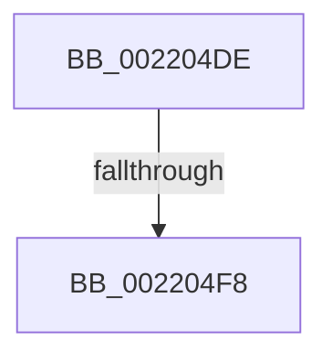

# sub_002204DE

- RVA: `0x002204DE`–`0x00220520` (길이 `66` bytes)
- VA: `0x00000001402204DE`
- 실행 섹션: `.text`
- PDB 이름 있음: `아니요`; PDB Function 태그: `아니요`
- unwind 정보 RVA: `0x0005F3A0`
- 디코드: `14`개 명령, `66/66` bytes 표시
- 미해석 바이트: `0` (있으면 어셈블리에 `.byte`로 보존)

> 이 문서는 커널 이미지의 기계어와 PDB 기호를 분석해 생성했습니다. 4번과 5번은 함수 원형과 자료형을 바이너리 사용 방식에서 추정한 C 해석이며 원본 소스 복구 결과는 아닙니다.

## 1. Dependencies

- 직접 호출 지점: **1**; 고유 호출 대상: **1**
- 직접 호출자로 확인된 함수: **0**
- RIP 상대 이미지 참조: **0**

### Outgoing calls
- `0x0022050B` → [KeBugCheckEx](../4F/KeBugCheckEx_function_004FD660.md) (function, `0x004FD660`)

### Direct callers
- 이 함수 시작 RVA로 연결되는 직접 call은 확인되지 않았습니다. 간접 호출은 완전히 역산할 수 없습니다.

### Static image references
- 디코드된 RIP-relative 메모리 참조가 없습니다.

## 2. Other-region calls and transfers

- 다른 실행 섹션으로 향하는 call: **0**
- call이 아닌 외부 분기/꼬리 이동: **1**
  - `0x002204F6` → [sub_0022053D](Unknown_function_0022053D.md) (`tail-transfer`)

## 3. Assembly (complete function range)

```asm
002204DE  4C 0F BE 8F 1B 03 00 00         movsx r9, byte ptr [rdi + 0x31b]
002204E6  4D 8B C1                        mov r8, r9
002204E9  49 8D 0C 39                     lea rcx, [r9 + rdi]
002204ED  0F B6 81 38 03 00 00            movzx eax, byte ptr [rcx + 0x338]
002204F4  84 C0                           test al, al
002204F6  75 45                           jne 0x14022053d
002204F8  41 B9 02 00 00 00               mov r9d, 2
002204FE  4C 89 7C 24 20                  mov qword ptr [rsp + 0x20], r15
00220503  48 8B D7                        mov rdx, rdi
00220506  B9 57 01 00 00                  mov ecx, 0x157
0022050B  E8 50 D1 2D 00                  call 0x1404fd660
00220510  CC                              int3
00220511  0F 1F 40 00                     nop dword ptr [rax]
00220515  66 66 66 0F 1F 84 00 00 00 00 00  nop word ptr [rax + rax]
```

## 4. C-style interpretation (structured pseudocode)

```c
__int64 __fastcall sub_002204DE(void)
{
    __int64 result;
    unsigned __int64 v_stack_p20;

    v_stack_p20 = v_r15;
    result = KeBugCheckEx(343, v_rdi, (__int8)(*(unsigned __int8 *)(v_rdi + 795)), 2);
    return result;
}
```

## 5. (Beta) C Style

```c
void sub_002204DE(void)
{
    int64_t result;
    uint64_t v_stack_p20;

    v_stack_p20 = local_r15;
    result = KeBugCheckEx(343, local_rdi, (int8_t)(*(uint8_t *)(local_rdi + 0x31B)), 2);
    return result;
}
```

## 6. Execution-region graph

[열기: 2D/3D 그래프와 함수 탐색 컨트롤 패널](../../../control-panel.html?section=text&rva=0x002204DE&view=graph)

- 2D 그래프는 위에서 아래로 흐르고, 3D 그래프는 빈 공간을 드래그해 회전합니다. Shift+드래그는 이동, 휠은 확대·축소, 함수 노드 선택은 대상 보고서 이동입니다.

### Static fallback


