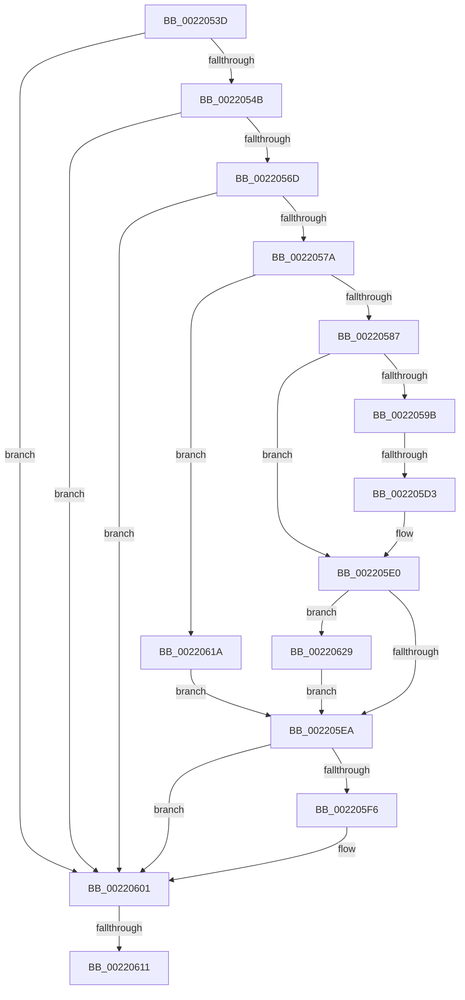

# sub_0022053D

- RVA: `0x0022053D`–`0x00220639` (길이 `252` bytes)
- VA: `0x000000014022053D`
- 실행 섹션: `.text`
- PDB 이름 있음: `아니요`; PDB Function 태그: `아니요`
- unwind 정보 RVA: `0x0005F3C4`
- 디코드: `64`개 명령, `252/252` bytes 표시
- 미해석 바이트: `0` (있으면 어셈블리에 `.byte`로 보존)

> 이 문서는 커널 이미지의 기계어와 PDB 기호를 분석해 생성했습니다. 4번과 5번은 함수 원형과 자료형을 바이너리 사용 방식에서 추정한 C 해석이며 원본 소스 복구 결과는 아닙니다.

## 1. Dependencies

- 직접 호출 지점: **3**; 고유 호출 대상: **3**
- 직접 호출자로 확인된 함수: **0**
- RIP 상대 이미지 참조: **0**

### Outgoing calls
- `0x0022057A` → [Feature_StackingDecayBoosts__private_IsEnabledNoReportingNoInline](../4E/Feature_StackingDecayBoosts__private_IsEnabledNoReportingNoInline_function_004EF7C0.md) (function, `0x004EF7C0`)
- `0x002205FC` → [KiSetPriorityThread](KiSetPriorityThread_function_00220E78.md) (function, `0x00220E78`)
- `0x0022061F` → [KiComputeThreadPriorityNonStacking](../5C/KiComputeThreadPriorityNonStacking_function_005CA81C.md) (function, `0x005CA81C`)

### Direct callers
- 이 함수 시작 RVA로 연결되는 직접 call은 확인되지 않았습니다. 간접 호출은 완전히 역산할 수 없습니다.

### Static image references
- 디코드된 RIP-relative 메모리 참조가 없습니다.

## 2. Other-region calls and transfers

- 다른 실행 섹션으로 향하는 call: **0**
- call이 아닌 외부 분기/꼬리 이동: **3**
  - `0x002205CD` → [sub_00220661](Unknown_function_00220661.md) (`tail-transfer`)
  - `0x0022060B` → [KiPerformWaitDeferredWork + 0x23](KiPerformWaitDeferredWork_function_00220480.md) (`tail-transfer`)
  - `0x00220615` → [KiPerformWaitDeferredWork + 0x23](KiPerformWaitDeferredWork_function_00220480.md) (`tail-transfer`)

## 3. Assembly (complete function range)

```asm
0022053D  2C 01                           sub al, 1
0022053F  88 81 38 03 00 00               mov byte ptr [rcx + 0x338], al
00220545  0F 85 B6 00 00 00               jne 0x140220601
0022054B  8B 97 58 03 00 00               mov edx, dword ptr [rdi + 0x358]
00220551  41 8B C9                        mov ecx, r9d
00220554  44 0F BB CA                     btc edx, r9d
00220558  B8 01 00 00 00                  mov eax, 1
0022055D  D3 E0                           shl eax, cl
0022055F  89 97 58 03 00 00               mov dword ptr [rdi + 0x358], edx
00220565  3B D0                           cmp edx, eax
00220567  0F 83 94 00 00 00               jae 0x140220601
0022056D  80 BF C3 00 00 00 1F            cmp byte ptr [rdi + 0xc3], 0x1f
00220574  0F 8F 87 00 00 00               jg 0x140220601
0022057A  E8 41 F2 2C 00                  call 0x1404ef7c0
0022057F  85 C0                           test eax, eax
00220581  0F 84 93 00 00 00               je 0x14022061a
00220587  44 0F BE 87 33 02 00 00         movsx r8d, byte ptr [rdi + 0x233]
0022058F  45 8B D0                        mov r10d, r8d
00220592  45 8B C8                        mov r9d, r8d
00220595  41 83 F8 10                     cmp r8d, 0x10
00220599  7D 45                           jge 0x1402205e0
0022059B  0F B6 8F 66 03 00 00            movzx ecx, byte ptr [rdi + 0x366]
002205A2  0F B7 97 06 02 00 00            movzx edx, word ptr [rdi + 0x206]
002205A9  8B C2                           mov eax, edx
002205AB  83 E0 0F                        and eax, 0xf
002205AE  41 03 C0                        add eax, r8d
002205B1  41 3B C1                        cmp eax, r9d
002205B4  44 8B C0                        mov r8d, eax
002205B7  41 8B C7                        mov eax, r15d
002205BA  45 0F 4E C1                     cmovle r8d, r9d
002205BE  84 C9                           test cl, cl
002205C0  0F 4F C1                        cmovg eax, ecx
002205C3  0F BE C0                        movsx eax, al
002205C6  44 03 C0                        add r8d, eax
002205C9  41 83 F8 10                     cmp r8d, 0x10
002205CD  0F 8D 8E 00 00 00               jge 0x140220661
002205D3  C1 EA 04                        shr edx, 4
002205D6  0F B6 C2                        movzx eax, dl
002205D9  41 3B C0                        cmp eax, r8d
002205DC  44 0F 4F C0                     cmovg r8d, eax
002205E0  8B 87 58 03 00 00               mov eax, dword ptr [rdi + 0x358]
002205E6  85 C0                           test eax, eax
002205E8  75 3F                           jne 0x140220629
002205EA  0F BE 87 C3 00 00 00            movsx eax, byte ptr [rdi + 0xc3]
002205F1  44 3B C0                        cmp r8d, eax
002205F4  7D 0B                           jge 0x140220601
002205F6  48 8B D5                        mov rdx, rbp
002205F9  48 8B CF                        mov rcx, rdi
002205FC  E8 77 08 00 00                  call 0x140220e78
00220601  C6 87 1B 03 00 00 20            mov byte ptr [rdi + 0x31b], 0x20
00220608  40 84 F6                        test sil, sil
0022060B  0F 85 92 FE FF FF               jne 0x1402204a3
00220611  4C 89 7F 40                     mov qword ptr [rdi + 0x40], r15
00220615  E9 89 FE FF FF                  jmp 0x1402204a3
0022061A  33 D2                           xor edx, edx
0022061C  48 8B CF                        mov rcx, rdi
0022061F  E8 F8 A1 3A 00                  call 0x1405ca81c
00220624  44 8B C0                        mov r8d, eax
00220627  EB C1                           jmp 0x1402205ea
00220629  0F BD C0                        bsr eax, eax
0022062C  44 3B C0                        cmp r8d, eax
0022062F  89 44 24 58                     mov dword ptr [rsp + 0x58], eax
00220633  44 0F 4C C0                     cmovl r8d, eax
00220637  EB B1                           jmp 0x1402205ea
```

## 4. C-style interpretation (structured pseudocode)

```c
__int64 __fastcall sub_0022053D(__int64 a1, __int64 a2, __int64 a3, int a4)
{
    __int64 result;
    unsigned int v_stack_p58;

    result = (unsigned __int8)((result) - (1));
    *(unsigned __int8 *)(a1 + 824) = (unsigned __int8)(result);
    if (condition_is_not_equal) goto loc_00220601;
    result = (unsigned int)((1) << ((unsigned __int8)((unsigned int)(a4))));
    *(unsigned int *)(v_rdi + 856) = (unsigned int)((unsigned int)(*(unsigned int *)(v_rdi + 856)));
    if (((unsigned int)((unsigned int)(*(unsigned int *)(v_rdi + 856)))) >= ((unsigned int)(result))) goto loc_00220601;
    if ((*(unsigned __int8 *)(v_rdi + 195)) > 31) goto loc_00220601;
    result = Feature_StackingDecayBoosts__private_IsEnabledNoReportingNoInline((unsigned int)(a4), (unsigned int)(*(unsigned int *)(v_rdi + 856)), a3, a4);
    if ((unsigned int)(result) == 0) goto loc_0022061A;
    if (((unsigned int)((__int8)(*(unsigned __int8 *)(v_rdi + 563)))) >= 16) goto loc_002205E0;
    result = (unsigned int)(((unsigned int)((unsigned int)(*(unsigned __int16 *)(v_rdi + 518)))) & (15));
    result = (unsigned int)((result) + ((unsigned int)((__int8)(*(unsigned __int8 *)(v_rdi + 563)))));
    a3 = (unsigned int)((unsigned int)(result));
    if (((unsigned int)(result)) <= ((unsigned int)((unsigned int)((unsigned int)((__int8)(*(unsigned __int8 *)(v_rdi + 563))))))) { a3 = (unsigned int)((unsigned int)((unsigned int)((__int8)(*(unsigned __int8 *)(v_rdi + 563))))); }
    result = (unsigned int)((unsigned int)(v_r15));
    if (condition_is_greater) { result = (unsigned int)(*(unsigned __int8 *)(v_rdi + 870)); }
    a3 = (unsigned int)((a3) + ((unsigned int)((__int8)((unsigned __int8)(result)))));
    a2 = (unsigned int)((*(unsigned __int16 *)(v_rdi + 518)) >> (4));
    if (((unsigned int)((unsigned __int8)(a2))) > ((unsigned int)(a3))) { a3 = (unsigned int)((unsigned __int8)(a2)); }
loc_002205E0:
    if ((unsigned int)((unsigned int)(*(unsigned int *)(v_rdi + 856))) != 0) goto loc_00220629;
loc_002205EA:
    result = (__int8)(*(unsigned __int8 *)(v_rdi + 195));
    if (((unsigned int)(a3)) < ((unsigned int)((__int8)(*(unsigned __int8 *)(v_rdi + 195))))) {
        a2 = v_rbp;
        a1 = v_rdi;
        result = KiSetPriorityThread(a1, a2, a3, (unsigned int)((unsigned int)((__int8)(*(unsigned __int8 *)(v_rdi + 563)))));
    }
    *(unsigned __int8 *)(v_rdi + 795) = 32;
    *(unsigned __int64 *)(v_rdi + 64) = v_r15;
loc_0022061A:
    a2 = 0;
    result = KiComputeThreadPriorityNonStacking(v_rdi, a2, a3, (unsigned int)((unsigned int)((__int8)(*(unsigned __int8 *)(v_rdi + 563)))));
    goto loc_002205EA;
loc_00220629:
    v_stack_p58 = (unsigned int)(result);
    a3 = (unsigned int)((unsigned int)(result));
    if (((unsigned int)((unsigned int)((unsigned int)(result)))) < ((unsigned int)(result))) { a3 = (unsigned int)(result); }
    goto loc_002205EA;
}
```

## 5. (Beta) C Style

```c
int64_t sub_0022053D(void *Arg1, int64_t Arg2, int64_t Arg3, int32_t Arg4)
{
    uint8_t *arg1 = (uint8_t *)Arg1;

    int64_t result;
    uint32_t v_stack_p58;

    result = (uint8_t)((result) - (1));
    *(uint8_t *)(arg1 + 0x338) = (uint8_t)(result);
    if (condition_is_not_equal) goto loc_00220601;
    result = (uint32_t)((1) << ((uint8_t)((uint32_t)(Arg4))));
    *(uint32_t *)(local_rdi + 0x358) = (uint32_t)((uint32_t)(*(uint32_t *)(local_rdi + 0x358)));
    if (((uint32_t)((uint32_t)(*(uint32_t *)(local_rdi + 0x358)))) >= ((uint32_t)(result))) goto loc_00220601;
    if ((*(uint8_t *)(local_rdi + 0xC3)) > 31) goto loc_00220601;
    result = Feature_StackingDecayBoosts__private_IsEnabledNoReportingNoInline((uint32_t)(Arg4), (uint32_t)(*(uint32_t *)(local_rdi + 0x358)), Arg3, Arg4);
    if ((uint32_t)(result) == 0) goto loc_0022061A;
    if (((uint32_t)((int8_t)(*(uint8_t *)(local_rdi + 0x233)))) >= 16) goto loc_002205E0;
    result = (uint32_t)(((uint32_t)((uint32_t)(*(uint16_t *)(local_rdi + 0x206)))) & (15));
    result = (uint32_t)((result) + ((uint32_t)((int8_t)(*(uint8_t *)(local_rdi + 0x233)))));
    Arg3 = (uint32_t)((uint32_t)(result));
    if (((uint32_t)(result)) <= ((uint32_t)((uint32_t)((uint32_t)((int8_t)(*(uint8_t *)(local_rdi + 0x233))))))) { Arg3 = (uint32_t)((uint32_t)((uint32_t)((int8_t)(*(uint8_t *)(local_rdi + 0x233))))); }
    result = (uint32_t)((uint32_t)(local_r15));
    if (condition_is_greater) { result = (uint32_t)(*(uint8_t *)(local_rdi + 0x366)); }
    Arg3 = (uint32_t)((Arg3) + ((uint32_t)((int8_t)((uint8_t)(result)))));
    Arg2 = (uint32_t)((*(uint16_t *)(local_rdi + 0x206)) >> (4));
    if (((uint32_t)((uint8_t)(Arg2))) > ((uint32_t)(Arg3))) { Arg3 = (uint32_t)((uint8_t)(Arg2)); }
loc_002205E0:
    if ((uint32_t)((uint32_t)(*(uint32_t *)(local_rdi + 0x358))) != 0) goto loc_00220629;
loc_002205EA:
    result = (int8_t)(*(uint8_t *)(local_rdi + 0xC3));
    if (((uint32_t)(Arg3)) < ((uint32_t)((int8_t)(*(uint8_t *)(local_rdi + 0xC3))))) {
        Arg2 = local_rbp;
        Arg1 = local_rdi;
        result = KiSetPriorityThread(Arg1, Arg2, Arg3, (uint32_t)((uint32_t)((int8_t)(*(uint8_t *)(local_rdi + 0x233)))));
    }
    *(uint8_t *)(local_rdi + 0x31B) = 32;
    *(uint64_t *)(local_rdi + 0x40) = local_r15;
loc_0022061A:
    Arg2 = 0;
    result = KiComputeThreadPriorityNonStacking(local_rdi, Arg2, Arg3, (uint32_t)((uint32_t)((int8_t)(*(uint8_t *)(local_rdi + 0x233)))));
    goto loc_002205EA;
loc_00220629:
    v_stack_p58 = (uint32_t)(result);
    Arg3 = (uint32_t)((uint32_t)(result));
    if (((uint32_t)((uint32_t)((uint32_t)(result)))) < ((uint32_t)(result))) { Arg3 = (uint32_t)(result); }
    goto loc_002205EA;
}
```

### 관측된 메모리 오프셋

구조체 형식이 확인되지 않은 접근은 인자 기준의 오프셋으로만 기록했습니다.

| 기준 인자 | 오프셋 표현 | 폭 (bit) | 접근 |
|---|---:|---:|---|
| `Arg1` | `+ 0x338` | `8` | `W` |

## 6. Execution-region graph

[열기: 2D/3D 그래프와 함수 탐색 컨트롤 패널](../../../control-panel.html?section=text&rva=0x0022053D&view=graph)

- 2D 그래프는 위에서 아래로 흐르고, 3D 그래프는 빈 공간을 드래그해 회전합니다. Shift+드래그는 이동, 휠은 확대·축소, 함수 노드 선택은 대상 보고서 이동입니다.

### Static fallback


