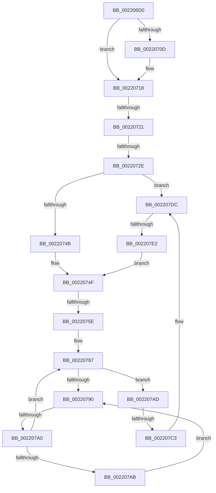

# sub_002206D0

- RVA: `0x002206D0`–`0x002207EF` (길이 `287` bytes)
- VA: `0x00000001402206D0`
- 실행 섹션: `.text`
- PDB 이름 있음: `아니요`; PDB Function 태그: `아니요`
- unwind 정보 RVA: `0x0005F40C`
- 디코드: `67`개 명령, `287/287` bytes 표시
- 미해석 바이트: `0` (있으면 어셈블리에 `.byte`로 보존)

> 이 문서는 커널 이미지의 기계어와 PDB 기호를 분석해 생성했습니다. 4번과 5번은 함수 원형과 자료형을 바이너리 사용 방식에서 추정한 C 해석이며 원본 소스 복구 결과는 아닙니다.

## 1. Dependencies

- 직접 호출 지점: **2**; 고유 호출 대상: **2**
- 직접 호출자로 확인된 함수: **0**
- RIP 상대 이미지 참조: **1**

### Outgoing calls
- `0x002207D6` → [KeBugCheckEx](../4F/KeBugCheckEx_function_004FD660.md) (function, `0x004FD660`)
- `0x002207E5` → [KiAbOwnerComputeCpuPriorityKey](../21/KiAbOwnerComputeCpuPriorityKey_function_0021F090.md) (function, `0x0021F090`)

### Direct callers
- 이 함수 시작 RVA로 연결되는 직접 call은 확인되지 않았습니다. 간접 호출은 완전히 역산할 수 없습니다.

### Static image references
- `0x00220793` → RVA `0x00FC52AC` (`ALMOSTRO`; reference)

## 2. Other-region calls and transfers

- 다른 실행 섹션으로 향하는 call: **0**
- call이 아닌 외부 분기/꼬리 이동: **6**
  - `0x0022071B` → [sub_002208AD + 0x28](Unknown_function_002208AD.md) (`tail-transfer`)
  - `0x00220728` → [sub_002209D5 + 0x1B5](Unknown_function_002209D5.md) (`tail-transfer`)
  - `0x00220758` → [sub_002208AD + 0x54](Unknown_function_002208AD.md) (`tail-transfer`)
  - `0x0022079A` → [sub_002208AD](Unknown_function_002208AD.md) (`tail-transfer`)
  - `0x002207BD` → [sub_002208AD + 0x5C](Unknown_function_002208AD.md) (`tail-transfer`)
  - `0x002207E0` → [sub_00220854](Unknown_function_00220854.md) (`tail-transfer`)

## 3. Assembly (complete function range)

```asm
002206D0  4C 89 64 24 68                  mov qword ptr [rsp + 0x68], r12
002206D5  48 6B C8 58                     imul rcx, rax, 0x58
002206D9  48 2B D9                        sub rbx, rcx
002206DC  48 8B 5B F0                     mov rbx, qword ptr [rbx - 0x10]
002206E0  0F B6 83 C3 00 00 00            movzx eax, byte ptr [rbx + 0xc3]
002206E7  8B AB A0 05 00 00               mov ebp, dword ptr [rbx + 0x5a0]
002206ED  88 84 24 B0 00 00 00            mov byte ptr [rsp + 0xb0], al
002206F4  48 8B 83 20 02 00 00            mov rax, qword ptr [rbx + 0x220]
002206FB  C1 ED 09                        shr ebp, 9
002206FE  83 E5 07                        and ebp, 7
00220701  48 8B 80 A0 02 00 00            mov rax, qword ptr [rax + 0x2a0]
00220708  48 85 C0                        test rax, rax
0022070B  74 0B                           je 0x140220718
0022070D  8B 80 3C 04 00 00               mov eax, dword ptr [rax + 0x43c]
00220713  3B E8                           cmp ebp, eax
00220715  0F 4D E8                        cmovge ebp, eax
00220718  83 FD 02                        cmp ebp, 2
0022071B  0F 8C B4 01 00 00               jl 0x1402208d5
00220721  83 BB E8 05 00 00 00            cmp dword ptr [rbx + 0x5e8], 0
00220728  0F 85 5C 04 00 00               jne 0x140220b8a
0022072E  C6 84 24 B8 00 00 00 01         mov byte ptr [rsp + 0xb8], 1
00220736  F6 46 0B 01                     test byte ptr [rsi + 0xb], 1
0022073A  44 8B FF                        mov r15d, edi
0022073D  89 7C 24 50                     mov dword ptr [rsp + 0x50], edi
00220741  89 7C 24 54                     mov dword ptr [rsp + 0x54], edi
00220745  0F 85 91 00 00 00               jne 0x1402207dc
0022074B  0F B6 46 28                     movzx eax, byte ptr [rsi + 0x28]
0022074F  4C 0F BE 64 24 58               movsx r12, byte ptr [rsp + 0x58]
00220755  41 3A C4                        cmp al, r12b
00220758  0F 8D A3 01 00 00               jge 0x140220901
0022075E  8B 56 50                        mov edx, dword ptr [rsi + 0x50]
00220761  41 8D 4C 24 FF                  lea ecx, [r12 - 1]
00220766  B8 01 00 00 00                  mov eax, 1
0022076B  44 88 64 24 50                  mov byte ptr [rsp + 0x50], r12b
00220770  D3 E0                           shl eax, cl
00220772  44 8B F7                        mov r14d, edi
00220775  0B C2                           or eax, edx
00220777  81 E2 00 00 00 C0               and edx, 0xc0000000
0022077D  25 FF FF FF 3F                  and eax, 0x3fffffff
00220782  33 C2                           xor eax, edx
00220784  89 46 50                        mov dword ptr [rsi + 0x50], eax
00220787  F0 48 0F BA 6B 40 00            lock bts qword ptr [rbx + 0x40], 0
0022078E  73 1D                           jae 0x1402207ad
00220790  41 FF C6                        inc r14d
00220793  44 85 35 12 4B DA 00            test dword ptr [rip + 0xda4b12], r14d
0022079A  0F 84 0D 01 00 00               je 0x1402208ad
002207A0  F3 90                           pause
002207A2  48 8B 43 40                     mov rax, qword ptr [rbx + 0x40]
002207A6  48 85 C0                        test rax, rax
002207A9  74 DC                           je 0x140220787
002207AB  EB E3                           jmp 0x140220790
002207AD  4A 8D 0C 23                     lea rcx, [rbx + r12]
002207B1  4D 8B C4                        mov r8, r12
002207B4  0F B6 81 38 03 00 00            movzx eax, byte ptr [rcx + 0x338]
002207BB  3C FF                           cmp al, 0xff
002207BD  0F 85 46 01 00 00               jne 0x140220909
002207C3  41 B9 01 00 00 00               mov r9d, 1
002207C9  48 89 7C 24 20                  mov qword ptr [rsp + 0x20], rdi
002207CE  48 8B D3                        mov rdx, rbx
002207D1  B9 57 01 00 00                  mov ecx, 0x157
002207D6  E8 85 CE 2D 00                  call 0x1404fd660
002207DB  CC                              int3
002207DC  80 7E 09 00                     cmp byte ptr [rsi + 9], 0
002207E0  75 72                           jne 0x140220854
002207E2  48 8B CE                        mov rcx, rsi
002207E5  E8 A6 E8 FF FF                  call 0x14021f090
002207EA  E9 60 FF FF FF                  jmp 0x14022074f
```

## 4. C-style interpretation (structured pseudocode)

```c
__int64 __fastcall sub_002206D0(__int64 a1, __int64 a2, __int64 a3, __int64 a4, __int64 a5, __int64 a6, __int64 a7, __int64 a8, __int64 a9, __int64 a10, unsigned __int8 a11)
{
    __int64 result;
    __int64 v_r14;
    __int64 v_rbp;
    __int64 v_rbx;
    unsigned __int64 v_stack_p20;
    unsigned int v_stack_p50;
    unsigned int v_stack_p54;
    unsigned __int64 v_stack_p68;
    unsigned __int8 v_stack_pB0;
    unsigned __int8 v_stack_pB8;

    v_stack_p68 = v_r12;
    a1 = (a1) * (result);
    v_rbx = (v_rbx) - (a1);
    v_stack_pB0 = (unsigned __int8)(*(unsigned __int8 *)(*(unsigned __int64 *)(v_rbx - 16) + 195));
    v_rbp = (unsigned int)(((unsigned int)(*(unsigned int *)(*(unsigned __int64 *)(v_rbx - 16) + 1440))) >> (9));
    v_rbp = (unsigned int)((v_rbp) & (7));
    result = *(unsigned __int64 *)(*(unsigned __int64 *)(*(unsigned __int64 *)(v_rbx - 16) + 544) + 672);
    if (*(unsigned __int64 *)(*(unsigned __int64 *)(*(unsigned __int64 *)(v_rbx - 16) + 544) + 672) != 0) {
        result = *(unsigned int *)(*(unsigned __int64 *)(*(unsigned __int64 *)(*(unsigned __int64 *)(v_rbx - 16) + 544) + 672) + 1084);
        if (((unsigned int)(v_rbp)) >= ((unsigned int)(result))) { v_rbp = (unsigned int)(result); }
    }
    v_stack_pB8 = 1;
    v_stack_p50 = (unsigned int)(v_rdi);
    v_stack_p54 = (unsigned int)(v_rdi);
    if (((*(unsigned __int8 *)(v_rsi + 11)) & (1)) != 0) goto loc_002207DC;
loc_0022074F:
    v_stack_p50 = (unsigned __int8)((__int8)(a11));
    result = (unsigned int)((1) << ((unsigned __int8)((__int8)(a11) - 1)));
    result = (unsigned int)((result) | ((unsigned int)((unsigned int)(*(unsigned int *)(v_rsi + 80)))));
    a2 = (unsigned int)(((unsigned int)(*(unsigned int *)(v_rsi + 80))) & (0xC0000000ULL));
    result = (unsigned int)((result) & (0x3FFFFFFFULL));
    result = (unsigned int)((result) ^ ((unsigned int)(a2)));
    *(unsigned int *)(v_rsi + 80) = (unsigned int)(result);
loc_00220787:
    if (condition_is_above_or_equal) goto loc_002207AD;
loc_00220790:
    v_r14 = (unsigned int)(((unsigned int)((unsigned int)(v_rdi))) + 1);
    if (*(unsigned __int64 *)(*(unsigned __int64 *)(v_rbx - 16) + 64) == 0) goto loc_00220787;
    goto loc_00220790;
loc_002207AD:
    v_stack_p20 = v_rdi;
    result = KeBugCheckEx(343, *(unsigned __int64 *)(v_rbx - 16), (__int8)(a11), 1);
loc_002207DC:
    result = KiAbOwnerComputeCpuPriorityKey(v_rsi, *(unsigned __int64 *)(v_rbx - 16), (__int8)(a11), 1);
    goto loc_0022074F;
}
```

## 5. (Beta) C Style

```c
int64_t sub_002206D0(int64_t Arg1, int64_t Arg2, int64_t Arg3, int64_t Arg4, uint64_t Arg5, uint64_t Arg6, uint64_t Arg7, uint64_t Arg8, uint64_t Arg9, uint64_t Arg10, void *Arg11)
{
    uint8_t *arg11 = (uint8_t *)Arg11;

    int64_t result;
    int64_t local_r14;
    int64_t local_rbp;
    int64_t local_rbx;
    uint64_t v_stack_p20;
    uint32_t v_stack_p50;
    uint32_t v_stack_p54;
    uint64_t v_stack_p68;
    uint8_t v_stack_pB0;
    uint8_t v_stack_pB8;

    v_stack_p68 = local_r12;
    Arg1 = (Arg1) * (result);
    local_rbx = (local_rbx) - (Arg1);
    v_stack_pB0 = (uint8_t)(*(uint8_t *)(*(uint64_t *)(local_rbx - 0x10) + 0xC3));
    local_rbp = (uint32_t)(((uint32_t)(*(uint32_t *)(*(uint64_t *)(local_rbx - 0x10) + 0x5A0))) >> (9));
    local_rbp = (uint32_t)((local_rbp) & (7));
    result = *(uint64_t *)(*(uint64_t *)(*(uint64_t *)(local_rbx - 0x10) + 0x220) + 0x2A0);
    if (*(uint64_t *)(*(uint64_t *)(*(uint64_t *)(local_rbx - 0x10) + 0x220) + 0x2A0) != 0) {
        result = *(uint32_t *)(*(uint64_t *)(*(uint64_t *)(*(uint64_t *)(local_rbx - 0x10) + 0x220) + 0x2A0) + 0x43C);
        if (((uint32_t)(local_rbp)) >= ((uint32_t)(result))) { local_rbp = (uint32_t)(result); }
    }
    v_stack_pB8 = 1;
    v_stack_p50 = (uint32_t)(local_rdi);
    v_stack_p54 = (uint32_t)(local_rdi);
    if (((*(uint8_t *)(local_rsi + 0xB)) & (1)) != 0) goto loc_002207DC;
loc_0022074F:
    v_stack_p50 = (uint8_t)((int8_t)(Arg11));
    result = (uint32_t)((1) << ((uint8_t)((int8_t)(Arg11) - 1)));
    result = (uint32_t)((result) | ((uint32_t)((uint32_t)(*(uint32_t *)(local_rsi + 0x50)))));
    Arg2 = (uint32_t)(((uint32_t)(*(uint32_t *)(local_rsi + 0x50))) & (0xC0000000ULL));
    result = (uint32_t)((result) & (0x3FFFFFFFULL));
    result = (uint32_t)((result) ^ ((uint32_t)(Arg2)));
    *(uint32_t *)(local_rsi + 0x50) = (uint32_t)(result);
loc_00220787:
    if (condition_is_above_or_equal) goto loc_002207AD;
loc_00220790:
    local_r14 = (uint32_t)(((uint32_t)((uint32_t)(local_rdi))) + 1);
    if (*(uint64_t *)(*(uint64_t *)(local_rbx - 0x10) + 0x40) == 0) goto loc_00220787;
    goto loc_00220790;
loc_002207AD:
    v_stack_p20 = local_rdi;
    result = KeBugCheckEx(343, *(uint64_t *)(local_rbx - 0x10), (int8_t)(Arg11), 1);
loc_002207DC:
    result = KiAbOwnerComputeCpuPriorityKey(local_rsi, *(uint64_t *)(local_rbx - 0x10), (int8_t)(Arg11), 1);
    goto loc_0022074F;
}
```

### 관측된 메모리 오프셋

구조체 형식이 확인되지 않은 접근은 인자 기준의 오프셋으로만 기록했습니다.

| 기준 인자 | 오프셋 표현 | 폭 (bit) | 접근 |
|---|---:|---:|---|
| `Arg11` | `- 0x1` | `32` | `R` |

## 6. Execution-region graph

[열기: 2D/3D 그래프와 함수 탐색 컨트롤 패널](../../../control-panel.html?section=text&rva=0x002206D0&view=graph)

- 2D 그래프는 위에서 아래로 흐르고, 3D 그래프는 빈 공간을 드래그해 회전합니다. Shift+드래그는 이동, 휠은 확대·축소, 함수 노드 선택은 대상 보고서 이동입니다.

### Static fallback


